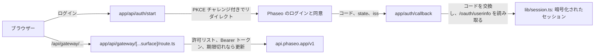

ユーザーが Phaseo でログインし、自分のクレジットをあなたのアプリで使えるようにします。PKCE を使う OAuth 2.1 でサーバーがアクセストークンを受け取り、サーバー側のプロキシ 1 つがすべての Gateway 呼び出しにそのトークンを付けます。完成すると、ログイン、更新されるセッションベースのトークン、モデル検出、`/responses` を使うチャットフロー、他のエンドポイント用のテスターを備えたローカルアプリができます。

このサンプルは Phaseo の OAuth エンドポイントを自動で検出し、戻ってきたときに `state` と `iss` を確認し、トークンを安全に更新し、ユーザーがログアウトするとキーを取り消します。

同じアプリをコーディングエージェントにゼロから作らせるには、次のプロンプトを貼り付けます。

<Prompt
  description="OAuth と Phaseo 統合プロキシを備えた**ログイン機能付き Next.js ワークベンチ**を構築します。"
  icon="shield-user"
  actions={["copy", "cursor"]}
>
{`You are building a signed-in Next.js app on top of Phaseo Gateway.

Create a workbench-style app with:
- OAuth 2.1 + PKCE sign-in against https://api.phaseo.app/oauth/authorize and https://api.phaseo.app/oauth/token (discover them from https://api.phaseo.app/.well-known/oauth-authorization-server), requesting the gateway:access scope
- session-backed token storage in an encrypted, httpOnly cookie
- one unified gateway proxy route on the server that calls https://api.phaseo.app/v1
- model discovery
- one chat flow using the Responses API, sending the whole conversation in input on every turn
- one generic endpoint tester for additional Phaseo endpoints

Requirements:
- Keep gateway credentials and access tokens server-side.
- Use a proxy allowlist of exact paths for safety.
- Support token refresh. Store the new refresh token from every refresh and drop the old one.
- Sign out by sending the refresh token to https://api.phaseo.app/oauth/revoke.
- Keep the workbench understandable rather than over-engineered.
- Add a short README with setup, env vars, and run steps.

Verification:
- run the app if possible
- verify sign-in flow as far as local setup allows
- verify at least one proxied gateway request path
- report exactly what you verified and what remains dependent on external OAuth configuration.`}
</Prompt>

## サンプルの構成



サンプルは [examples/oauth-client-nextjs](https://github.com/phaseoteam/Phaseo/tree/main/examples/oauth-client-nextjs) にあります。

| ファイル | 役割 |
| --- | --- |
| `app/page.tsx` | ログインの入口ページ。ログインのエラーを表示します |
| `app/api/auth/start/route.ts` | 認可 URL を組み立て、PKCE の verifier と state を保存します |
| `app/auth/callback/route.ts` | `state` と `iss` を確認し、コードを交換して、`/oauth/userinfo` を読み取ります |
| `app/api/auth/signout/route.ts` | リフレッシュトークンを取り消してから、セッションを消去します |
| `app/dashboard/page.tsx` | 保護されたシェル |
| `app/dashboard/GatewayWorkbench.tsx` | Gateway の状態を表示し、モデル ID を一覧表示し、`POST /responses` でチャットを実行し、他のエンドポイントをテストします |
| `app/api/gateway/[...surface]/route.ts` | キャッチオールのプロキシ。許可リストを確認し、Bearer トークンを付け、期限切れなら更新し、本文とステータスを転送します |
| `lib/oauth.ts` | ディスカバリー、PKCE、コードの交換、トークンの更新と取り消し、userinfo |
| `lib/session.ts` | 暗号化されたセッションの保存 |

ログインと Gateway 呼び出しを分けておくと、ログインの問題がモデルの問題に見えることはなく、すべてのエンドポイントがトークンを扱う 1 か所を共有できます。

<span id="run-it"></span>
## 実行する

Node.js、リダイレクト URI に `http://localhost:3000/auth/callback`（または独自のコールバック）を登録した OAuth アプリ、長いランダムなセッションシークレットが必要です。OAuth アプリは **設定 → OAuth アプリ** または [OAuth クライアント API](../api-reference/endpoint/oauth-clients-create) で作成します。

<Steps>
<Step title="インストールする">

```bash
cd examples/oauth-client-nextjs
npm install
```

</Step>
<Step title=".env.local を作成する">

```bash
cp .env.example .env.local
```

値を入力します。

| 変数 | 必須 | 値 |
| --- | --- | --- |
| `PHASEO_OAUTH_CLIENT_ID` | はい | OAuth アプリのクライアント ID |
| `PHASEO_OAUTH_CLIENT_SECRET` | コンフィデンシャルなアプリ | OAuth アプリのクライアントシークレット。公開アプリでは空のままにします。 |
| `PHASEO_OAUTH_REDIRECT_URI` | はい | `http://localhost:3000/auth/callback`。登録した値と完全に一致させます |
| `SESSION_SECRET` | はい | 32 文字以上のランダムな文字列 |
| `PHASEO_API_URL` | いいえ | 既定値は `https://api.phaseo.app` です |

サンプルはこれらをすべてサーバー側でのみ読み取ります。クライアントシークレットやセッションシークレットを `NEXT_PUBLIC_` 変数に入れないでください。

サンプルは、認可、トークン、取り消し、userinfo の各エンドポイントを `https://api.phaseo.app/.well-known/oauth-authorization-server` から見つけ、`openid email profile gateway:access` を要求します。`gateway:access` があると、トークンで Gateway を呼び出せます。

</Step>
<Step title="開発サーバーを起動する">

```bash
npm run dev
```

`http://localhost:3000` を開いてログインし、ダッシュボードを開きます。

</Step>
</Steps>

## 動作を確認する

- ログインするとコールバック URL に戻り、セッションが作成されます。
- ダッシュボードが `/api/gateway/models` を通じてモデルを一覧表示します。
- `/api/gateway/responses` を通したチャットのターンで回答が返り、ブラウザーのリクエストにはアクセストークンが含まれません。
- プロキシの許可リストにないパスは拒否されます。

## トークンの有効期間

トークンエンドポイントは 2 つのトークンを返します。

| トークン | 有効期間 | 用途 |
| --- | --- | --- |
| `access_token` | 7 日（`expires_in`） | Gateway リクエストで `Authorization: Bearer` として送ります。ユーザーが選んだワークスペースのクレジットを消費します。 |
| `refresh_token` | 最後に使ってから 90 日 | `grant_type=refresh_token` とともに送ると、新しいトークンの組を取得できます。 |

- **更新のたびにローテーションする。** 更新するたびに、新しいアクセストークンと新しいリフレッシュトークンが返ります。両方を保存し、古いものは破棄してください。古いアクセストークンはすぐに使えなくなり、古いリフレッシュトークンは再利用できません。
- **期限切れ後に更新する。** リフレッシュトークンが期限切れでなければ、アクセストークンの期限が切れた後でも更新できます。
- **リフレッシュトークンを再利用しない。** 同じリフレッシュトークンを 2 回使うと、そのログインは終了します。Phaseo はそれを漏えいしたトークンとして扱い、そのログインのアクセストークンとすべてのリフレッシュトークンを取り消すため、ユーザーは再ログインが必要になります。
- **スコープは減るだけ。** 更新でスコープが追加されることはありません。ユーザーが承認したスコープから、その後に外したものを除いたスコープが維持されます。
- **更新に失敗する場合。** ユーザーがアプリを取り消した、キーを取り消すか無効にした、キーに必要なスコープ（`gateway:access` など）を外した、またはワークスペースを離れた時点で、更新は失敗します。`gateway:access` を外すとキーも取り消されるため、そのアクセストークンはすぐに使えなくなります。スコープを再度付与しても、リフレッシュトークンは戻りません。ユーザーにもう一度ログインしてもらってください。
- **再ログインでキーが更新される。** `resource=https://api.phaseo.app/v1` を送るかどうかにかかわらず、キーを追加するのではなく同じキーを更新します。新しいアクセストークンとリフレッシュトークンが発行されて以前のものは使えなくなり、キーは今月の支出額を引き継ぎます。月間の支出上限は、ユーザーが今回承認した値になります。以前のログインのリフレッシュトークンは単に拒否され、それをトークンエンドポイントや取り消しエンドポイントに送っても新しいログインは終了しません。
- **一時停止中のキーはログインを妨げる。** そのユーザーとワークスペースに対するアプリのキーのいずれかが一時停止中の場合、リソースに関係なく、誰かが **設定 → APIキー** でキーを再び有効にするまで、トークンエンドポイントは `invalid_grant` を返します。更新が機能するのはキーが取り消されていない間だけです。ログアウトなどで取り消された後にログインすると新しいキーが発行され、上限と支出額は最初からになります。
- **ログアウトには取り消しを使う。** リフレッシュトークンを `https://api.phaseo.app/oauth/revoke` に送ります。これにより、キーと、そのログインのすべてのリフレッシュトークンが取り消されます。直前の更新で発行されたものも含まれます。

## 支出上限

同意画面で、ユーザーはアプリの月間支出上限を設定します。既定は $20.00 で、別の金額や上限なしも選べます。キーが暦月内にその額を使い切ると、翌月になるか、ユーザーが **設定 → APIキー** で上限を引き上げるまで、Gateway リクエストは `key_limit_exceeded` とともに `429` を返します。

どのスコープを持っていても、アプリが API を通じてこの上限を解除したり回避したりすることはできません。アプリにできるのは API キーの名前変更と削除だけです。キーの作成やローテーション、キーの上限・ステータス・有効期限の変更、管理キーや信頼済みワークロードの作成、メンバーの追加、予算・ガードレール・レート制限・支出ルールの変更、ワークスペースのルーティング用価格上限や BYOK からクレジットへのフォールバックの変更はできません。

## 公開する前に

- **許可リストを絞り込む。** `lib/gateway.ts` は、ワークベンチが呼び出すパスに加えて、`videos/` と `music/generate/` 以下のジョブステータスを許可しています。製品が呼び出すパスだけを残してください。
- **更新をインスタンス間で共有する。** `lib/oauth.ts` は、並行するリクエスト間で 1 回の更新をメモリー内で共有します。サーバーインスタンスを複数実行する場合は、これを共有ストレージに移してください。そうしないと、2 つのインスタンスが同じトークンで更新し、ログインが終了することがあります。
- **会話全体を送る。** Gateway はレスポンスを保存せず、`previous_response_id` を拒否します。以前のターンは `input` に含めて再送してください。
- **テスターを置き換える。** ワークベンチは社内 QA 用に残し、エンドユーザー向けには目的に合わせたフローを作ってください。

ログインなしで API キーを使うアプリには、[Next.js ウェブチャットアプリ](./build-a-nextjs-web-chat-app)から始めてください。
