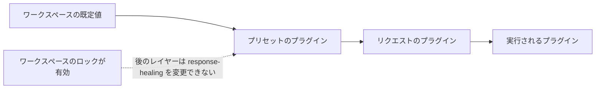

[応答の修復](./response-healing-for-structured-json)を、リクエストごとではなく、ワークスペース全体または 1 つのプリセットで一度だけ有効にします。完成すると、構造化出力を使うすべての呼び出し元に同じ修復ポリシーが適用され、プリセットやリクエストが無効にできないようにロックすることもできます。

これはダッシュボードでの手順です。最後のリクエスト例は本番環境で使えます。

## レイヤーの組み合わせ方

Phaseo は、各リクエストのプラグイン一覧を 3 つのレイヤーから組み立てます。同じプラグインについては、前のレイヤーがロックされていない限り、後のレイヤーが前のレイヤーの設定を置き換えます。



| レイヤー | 設定場所 | 上書きする対象 |
| --- | --- | --- |
| ワークスペース | **設定 → ルーティング → 応答の修復** | なし |
| プリセット | **設定 → プリセット →（プリセット）→ 応答の修復** | ワークスペース（ロックされていない場合） |
| リクエスト | 本文の `plugins` | プリセットとワークスペース（ワークスペースがロックされていない場合） |

## 設定する

<Steps>
<Step title="ワークスペースの既定値を有効にする">

**設定 → ルーティング → 応答の修復** で **デフォルトで有効にする** をオンにし、**修復モード** を選びます。`safe` は範囲を限定した構文の修復、`strict` はもともと有効な JSON の取り出しだけを行います。ワークスペース内のすべての API キーが共有する広い既定値に使います。

</Step>
<Step title="譲れない場合はロックする">

**ワークスペースポリシーをロック** をオンにします。これにより、プリセットやリクエストは修復を無効にすることも、モードを変更することもできなくなります。ログには、適用されたかスキップされたかが引き続き表示されます。

</Step>
<Step title="1 つのワークフロー用にプリセットの既定値を設定する">

ある種類のリクエストに構造化出力の形式と修復の両方を持たせたい場合は、プリセットエディターで **応答の修復** をオンにしてモードを選びます。そのプリセットの呼び出し元は、入力だけを送ればよくなります。

</Step>
</Steps>

## 1 件のリクエストで上書きする

ワークスペースがロックされていない場合、リクエスト自体でプラグインを設定できます。`"enabled": false` を指定すると、そのリクエストでは無効になります。

```json
{
  "model": "openai/gpt-6-astra",
  "input": "Return the summary as JSON.",
  "text": {
    "format": {
      "type": "json_schema",
      "name": "answer",
      "schema": {
        "type": "object",
        "properties": { "summary": { "type": "string" } },
        "required": ["summary"],
        "additionalProperties": false
      }
    }
  },
  "plugins": [{ "id": "response-healing", "enabled": true, "mode": "strict" }],
  "meta": true
}
```

## 実行されたポリシーを確認する

**設定 → 使用量 → ログ** でリクエストを開くか、`meta: true` を送った場合は `meta.plugin_executions` を読みます。ステータス（`applied`、`skipped`、`failed`）、実際に実行されたモード、修復した候補がスキーマに一致しなかった場合の `validation_errors` が表示されます。

2 つのサービスの動作が異なる場合は、モデルの問題として扱う前に、ワークスペースの設定とそのロック、プリセットのプラグイン、各リクエストの `plugins` を比較してください。
