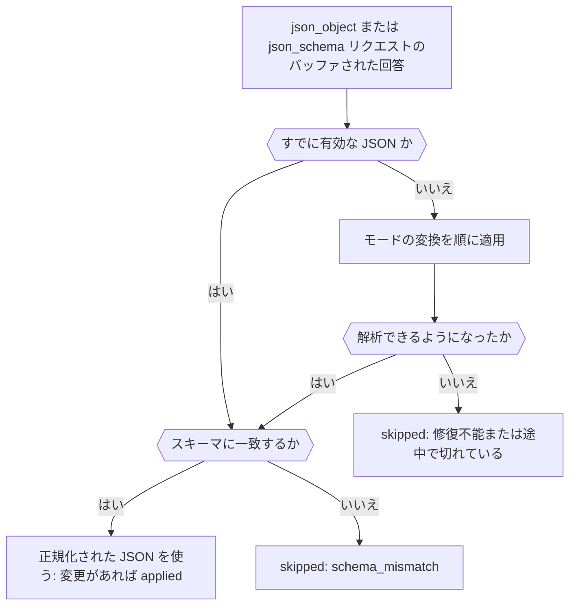

構造化出力のリクエストに `response-healing` プラグインを追加すると、Markdown のコードフェンスに囲まれた JSON や末尾にカンマが付いた JSON など、ほぼ有効な JSON を、パーサーに届く前に Phaseo が修復します。完成すると、JSON Schema を要求し、必要に応じて回答を修復し、修復したかどうかをレスポンスで知らせるリクエストが 1 つできます。

このリクエストは本番環境で使えます。修復は構文だけを直すため、[結果を検証する](../guides/structured-outputs#validate-the-result)のように、コード側での結果の検証は引き続き必要です。



## 修復付きのリクエストを送る

<CodeGroup>
```bash cURL
curl https://api.phaseo.app/v1/responses \
  -H "Authorization: Bearer $PHASEO_API_KEY" \
  -H "Content-Type: application/json" \
  -d '{
    "model": "openai/gpt-6-astra",
    "input": "Summarize this release in one sentence: dark mode and faster search.",
    "text": {
      "format": {
        "type": "json_schema",
        "name": "answer",
        "strict": true,
        "schema": {
          "type": "object",
          "properties": { "summary": { "type": "string" } },
          "required": ["summary"],
          "additionalProperties": false
        }
      }
    },
    "plugins": [{ "id": "response-healing", "mode": "safe" }],
    "meta": true
  }'
```

```typescript TypeScript
import Phaseo from "@phaseo/sdk";

const client = new Phaseo({ apiKey: process.env.PHASEO_API_KEY! });

const response = await client.generateResponse({
  model: "openai/gpt-6-astra",
  input: "Summarize this release in one sentence: dark mode and faster search.",
  text: {
    format: {
      type: "json_schema",
      name: "answer",
      strict: true,
      schema: {
        type: "object",
        properties: { summary: { type: "string" } },
        required: ["summary"],
        additionalProperties: false,
      },
    },
  },
  plugins: [{ id: "response-healing", mode: "safe" }],
  meta: true,
});

console.log(response.meta?.plugin_executions);
```

```python Python
import os

from phaseo import Phaseo

client = Phaseo(api_key=os.environ["PHASEO_API_KEY"])

response = client.generate_response(
    {
        "model": "openai/gpt-6-astra",
        "input": "Summarize this release in one sentence: dark mode and faster search.",
        "text": {
            "format": {
                "type": "json_schema",
                "name": "answer",
                "strict": True,
                "schema": {
                    "type": "object",
                    "properties": {"summary": {"type": "string"}},
                    "required": ["summary"],
                    "additionalProperties": False,
                },
            }
        },
        "plugins": [{"id": "response-healing", "mode": "safe"}],
        "meta": True,
    }
)

print(response["meta"].get("plugin_executions"))
```
</CodeGroup>

Chat Completions では、同じスキーマを `text.format` ではなく `response_format` で送ります。修復はリクエストが `json_object` または `json_schema` を要求している場合にだけ実行され、ストリームでは実行されません。ストリーミングのリクエストは `streaming_unsupported` でスキップされます。

## 実行されたことを確認する

`meta: true` を指定すると、プラグインが実行された場合に `meta.plugin_executions` に一覧表示されます。

```json
{
  "id": "response-healing",
  "stage": "response.post_provider",
  "status": "applied",
  "changed": true,
  "metadata": {
    "attempted": true,
    "healed": true,
    "mode": "safe",
    "transforms_applied": ["strip_markdown_fence"]
  }
}
```

| `status` | 意味 |
| --- | --- |
| `applied` | 回答が有効な JSON に書き換えられました。 |
| `skipped` | 回答はそのまま残されました。`attempted: false` の場合、リクエストは対象外でした。それ以外の場合は、JSON がすでに有効だったか、修復できませんでした。理由は `metadata.failure_reason` に示されます。`streaming_unsupported`、`not_json`（構造化出力が要求されていない、またはテキストがない）、`unrepairable`、`truncated`（回答がトークン上限で止まった）、または `validation_errors` 付きの `schema_mismatch` です。 |
| `failed` | プラグイン自体がエラーになりました（`reason: plugin_error`）。回答は変更されていません。 |

同じ記録は **設定 → 使用量 → ログ** のリクエストにも表示されます。プラグインがまったく表示されない場合は、リクエスト、そのプリセット、またはワークスペースで実際に有効になっているかを確認してください。設定場所は[プラグインの既定値を設定する](./plugin-defaults-and-response-healing)で説明しています。

## モードを選ぶ

| モード | 変換（適用順） |
| --- | --- |
| `safe`（既定） | Markdown のコードフェンスを取り除き、最も外側の `{…}` または `[…]` までに切り詰め、末尾のカンマを削除し、引用符のないキーを引用符で囲み、足りない閉じかっこを追加します（回答がトークン上限に達した場合は追加しません） |
| `strict` | Markdown のコードフェンスを取り除き、最も外側の `{…}` または `[…]` までに切り詰めるだけです。そのため、囲みの内側ですでに有効だった JSON だけを受け付けます |

JSON Schema がある場合、修復した結果は回答を置き換える前に次の点が確認されます。必須キー、型、`enum` と `const`、配列の範囲と `uniqueItems`、文字列の長さ、`pattern` と `email`・`uri`・`uuid`・`date-time` の形式、数値の範囲と `multipleOf`、プロパティ数、`additionalProperties: false` です。

## 役に立たない場合を知る

修復は、足りないフィールドを作り出したり、値を推測したり、文章をデータに変換したりすることはありません。使う前に、次の失敗を見分けてください。

| 失敗 | 対処 |
| --- | --- |
| 構造的には正しい形に近い JSON | 応答の修復 |
| フィールドが誤っている有効な JSON | スキーマとプロンプトを厳しくする |
| JSON ではなく文章 | プロンプトでの指示だけでなく `json_schema` を要求する |
| トークン上限で途切れた | `max_output_tokens` を引き上げる |

修復は、必須キーが明示された 1 つのオブジェクト、低い temperature、JSON 以外のテキストを要求しない場合に最も効果を発揮します。まず 1 つのプリセットで有効にし、ログで `plugin_executions` を確認して、修復されたペイロードがスキーマに一致するようになったら適用範囲を広げてください。
