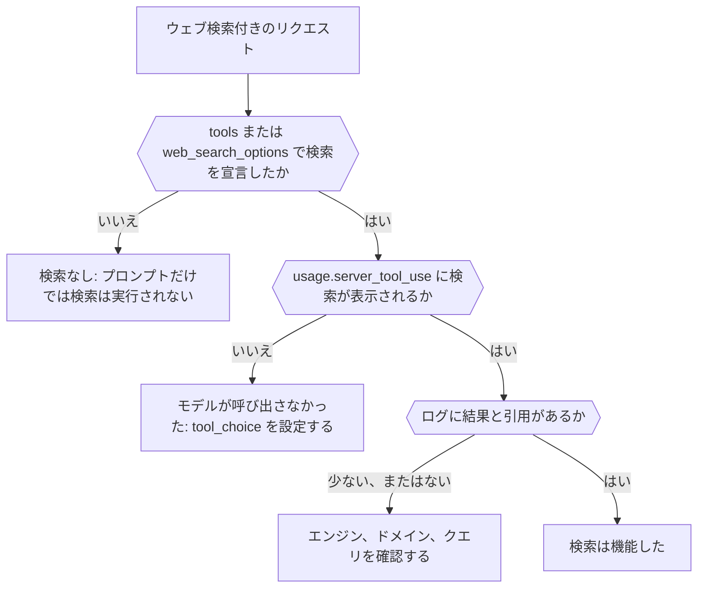

レスポンスとリクエストのログから、ウェブ検索が実際に実行されたか、どのエンジンが実行したか、何が返されたかを調べます。完成すると、実行されなかった検索と、実行されたものの結果が少なかった検索を見分けられるようになります。



## リクエストで検索を宣言する

プロンプトで「最新のニュース」を求めても、検索は実行されません。明示的に追加してください。

```json
{
  "model": "openai/gpt-6-astra",
  "input": "What changed in the Phaseo changelog this week?",
  "tools": [{ "type": "phaseo:web_search", "parameters": { "max_results": 5 } }],
  "tool_choice": "phaseo:web_search"
}
```

`phaseo:web_search` は Chat Completions、Responses、Messages で使えます。`web_search_options` はエンドポイントが対応している場合に使えます。`tool_choice` は呼び出しを強制します。これがないと、モデルは記憶から答えることがあります。すべてのパラメーターは[ウェブ検索ガイド](../guides/server-tools/web-search)に一覧があります。

## 実行されたことを確認する

| 確認する箇所 | 表示される内容 |
| --- | --- |
| レスポンスの `usage.server_tool_use.web_search_requests` | 実行されたマネージド検索の回数 |
| **設定 → 使用量 → ログ** のリクエストの **ウェブ検索の可観測性** | マネージド検索、ネイティブ検索、結果の件数、引用の件数と、抽出された結果と引用の記録 |
| 同じリクエストの **ルーティングの可観測性** | 検討されたプロバイダーと、リクエストに対応していないために除外されたプロバイダー |

## 失敗のケースを見分ける

| 見えている状況 | 原因 | 対処 |
| --- | --- | --- |
| 検索のカウンターがまったくない | 検索が宣言されていない、またはモデルが呼び出さないことを選んだ | ツールを追加し、`tool_choice` を設定する |
| ツールがモデルに `search_not_configured` を返す | 選んだマネージドエンジンが有効になっていない | 既定のエンジンか別のエンジンを使う |
| ツールが `unsupported_search_engine` を返す | モデルが呼び出しの中で `engine: "native"` を要求した | `native` はツールの定義でだけ設定する |
| `400 not_supported`、理由 `regional_hosted_tool_not_supported` | サーバーツールを拒否する `eu.api.phaseo.app` または `us.api.phaseo.app` に送った | `api.phaseo.app` を使う |
| 検索は実行されたが引用が少ない | クエリや情報源が弱かった | `max_results`、`allowed_domains`、`engine` を調整する |

`engine: "native"` を指定すると、リクエストは自分でウェブ検索を実行するプロバイダーにだけ送られます。そのようなプロバイダーがモデルを提供していない場合、Phaseo は代わりに既定のエンジンを実行してマネージド検索として課金するため、ネイティブのリクエストでもマネージドのカウンターが表示されることがあります。

## リクエストを比較する

実行ごとに結果が異なる場合は、モデル ID、選ばれたプロバイダー、検索のパラメーター、結果と引用の件数を比較します。件数はプロバイダー間で正規化されているため、生のペイロードを読まなくても検索品質の違いが分かります。根拠付きのワークフロー全体については [TypeScript でマネージドウェブ検索](./sdk-typescript-managed-search)を、既知の URL には代わりに[ウェブ取得](./tool-grounding-with-web-fetch)を参照してください。
