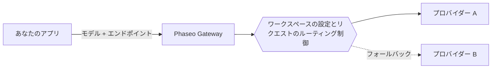

モデル ID を Phaseo のエンドポイントに送ると、Phaseo はそのモデルをホストするプロバイダーにリクエストをルーティングします。モデルとエンドポイントはアプリケーションが選び、どのプロバイダーが処理できるかはワークスペースの設定とリクエストのルーティング制御が決めます。

## モデルとプロバイダー

モデルは出力を生成するシステムです。プロバイダーはモデルをホストし、その提供状況、対応するパラメーター、価格、性能を決めます。1 つのモデルに複数のプロバイダーの提供がある場合もあります。

公開カタログには、まだ Gateway で利用できないモデルも掲載されています。リクエストで ID を使う前に、[モデルの提供状況](../exploring/models.mdx)を確認してください。

## リクエストとルーティング

[Responses、Chat Completions、Messages](../api-reference/introduction.mdx) のうち、アプリケーションのプロトコルに合うものを使います。エンドポイントが共通でも、すべてのモデルがすべてのパラメーターに対応しているわけではありません。プロバイダーの機能は依然として異なります。

[ルーティング制御](../guides/routing-and-fallbacks.mdx)は、どのプロバイダーがリクエストを処理できるか、そしてどう順位付けされるかを制限します。フォールバックはこれらの制限の範囲内で行われ、利用可能な容量に左右されるため、成功を保証するものではありません。

## 課金とアクセス

マネージドのリクエストには Phaseo ワークスペースの残高が使われ、`:free` モデルはクレジットを入金しなくても動作します。独自のプロバイダー認証情報（BYOK）を使う場合は、プロバイダーの課金とアカウントの上限が適用されます。展開する前に[価格と課金](../pricing/tiers.mdx)を確認してください。

[動画とバッチのジョブ](../guides/async-video-and-batch.mdx)は、処理が終わる前にジョブを返します。これらのプレビューアクセスはワークスペースごとに管理されます。ステータスをポーリングするか Webhook を受け取り、その後で結果をダウンロードします。

## 次のステップ

[クイックスタート](../quickstart.mdx)で最初のリクエストを送り、キーをバックエンドに置いたまま、アプリケーションに [Gateway を連携](./integrating-with-the-gateway.mdx)します。問題が起きたときの調べ方は[信頼性とステータス](./reliability-and-status.mdx)で、リクエストごとの使用量、レイテンシ、コスト、エラーは[リクエストのログ](../guides/integrations/observability.mdx)で確認できます。
