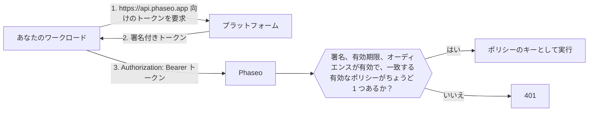

<Note>
信頼済みワークロードはベータ版で、ワークスペースへ段階的に提供しています。ダッシュボードに **設定 → APIキー → 信頼済みワークロード** が表示されない場合、そのワークスペースではまだ利用できません。
</Note>

Phaseo の API キーの代わりに、プラットフォームが発行する短期間有効な OIDC トークンをベアラートークンとして送ると、プロジェクト設定や CI のシークレットに長期間有効な認証情報を置く必要がなくなります。プラットフォームは、デプロイ、ジョブ、ワークロードごとに、それが誰かを示す署名付きトークンを発行します。たとえば「`website` プロジェクトの本番デプロイ」や「GitLab プロジェクト `4815162` のジョブ」といった内容で、トークンは数時間以内に失効します。どのワークロードを信頼するかは、Phaseo に設定します。

Phaseo は、Vercel、GitHub Actions、GitLab、Google Cloud、Buildkite、CircleCI、AWS のトークンに加え、Kubernetes クラスター、Bitbucket Pipelines、セルフマネージドの GitLab など、自分で運用する OIDC 発行元のトークンを信頼します。ローカルスクリプトやモバイルアプリなど、それ以外の環境では引き続き API キーを使ってください。

## 仕組み



ワークスペースのオーナーまたは管理者が **信頼ポリシー** を作成します。ポリシーには、プラットフォーム、信頼するオーナー（GitHub のオーナー、GitLab のプロジェクト、AWS のロールなど）、そしてプロジェクト、リポジトリ、ブランチ、環境などの任意の条件を指定します。一致したリクエストはそのポリシーのキーとして実行され、API キーで送ったリクエストと同じレート制限、予算、ログ、課金が適用されます。

トークンはオーディエンス `https://api.phaseo.app` 向けに発行されている必要があり、Phaseo はそれ以外のオーディエンスを拒否します。多くのプラットフォームは既定で、ワークロードが呼び出すすべてのサービスで共通のオーディエンスを使います。それを受け付けると、別のサービスに送ったトークンが Phaseo に対して再利用されるおそれがあります。

## 信頼ポリシーを作成する

<Steps>
<Step title="信頼済みワークロードを開く">
**設定 → APIキー → 信頼済みワークロード** を開き、**新しいポリシー** を選択します。ポリシーを管理できるのは、ワークスペースのオーナーと管理者だけです。
</Step>
<Step title="プラットフォームを選んで ID を入力する">
各プラットフォームでは、名前の変更や他人による取得ができない ID 1 つにポリシーを固定します。名前は持ち主が変わることがあるため、Phaseo は名前だけを信頼することはありません。

<Tabs>
<Tab title="Vercel">
- **チームのスラッグ**: `vercel.com/<team-slug>` に含まれるチームのスラッグです。プロジェクトが Vercel のグローバル発行元モード（発行元が `https://oidc.vercel.com/<team-slug>` ではなく `https://oidc.vercel.com`）を使っている場合は空欄にします。
- **チーム ID**: `team_` で始まります。Vercel のチーム設定で確認できます。
- **プロジェクト ID**（推奨）: `prj_` で始まります。Vercel のプロジェクト設定で確認できます。指定しないと、チーム内のすべてのプロジェクトが信頼されます。
- **環境**: production、preview、development のいずれかです。どれも選択しない場合、すべての環境を受け付けます。
</Tab>
<Tab title="GitHub Actions">
- **オーナー ID**: リポジトリを所有するユーザーまたは組織の数値 ID です。
- **リポジトリ ID**（推奨）: リポジトリの数値 ID です。指定しないと、オーナーのすべてのリポジトリが信頼されます。
- **ブランチまたはタグ** と **環境**（任意）: たとえば `refs/heads/main` や `production` です。

両方の ID は GitHub CLI で取得できます。

```bash
gh api repos/OWNER/REPO --jq '.id, .owner.id'
```
</Tab>
<Tab title="GitLab">
GitLab.com 上のプロジェクト向けです。セルフマネージドの GitLab では **カスタム OIDC 発行元** を使ってください。

- **プロジェクト ID**: プロジェクトの概要ページにある数値 ID です。プロジェクトの名前を変えたり別のグループに移動したりしても変わらないため、Phaseo はグループではなくこの ID に固定します。
- **ブランチまたはタグ**（任意）: `main` などのブランチ名またはタグ名です。
- **環境**（任意）: `production` などのジョブの環境です。

両方の条件を空欄にすると、プロジェクト内のすべてのジョブを受け付けます。
</Tab>
<Tab title="Google Cloud">
Cloud Run、Compute Engine、GKE、Cloud Run functions、App Engine、Cloud Build のメタデータサーバーから取得するトークン向けです。

- **サービス アカウントの一意の ID**: Google Cloud コンソールのサービスアカウント詳細ページにある数値の一意の ID です。すべての Google アカウントが同じ発行元を共有するため、この ID でワークロードを区別します。代わりにメールアドレスを使わないでください。サービスアカウントが削除されると、誰かが同じメールアドレスで新しいアカウントを作成できます。
- **サービス アカウントのメールアドレス**（任意）: 追加のチェックです。ワークロードが `format=full` でトークンを要求した場合にのみ、トークンにメールアドレスが含まれます。
</Tab>
<Tab title="Buildkite">
- **組織 ID**: 組織の UUID です。すべての Buildkite トークンの `organization_id` クレームに含まれるため、自分のパイプラインが要求したトークンから読み取れます。組織のスラッグと違い、変わることはありません。
- **パイプライン スラッグ**（任意）: 指定しないと、組織内のすべてのパイプラインが信頼されます。
</Tab>
<Tab title="CircleCI">
- **組織 ID**: **Organization Settings → Overview** で確認できます。CircleCI の組織ごとに固有の発行元 `https://oidc.circleci.com/org/<organisation ID>` があり、Phaseo はこの ID から発行元を組み立てます。
- **プロジェクト ID**（任意）: **Project Settings → Overview** で確認できます。指定しないと、組織内のすべてのプロジェクトが信頼されます。
</Tab>
<Tab title="AWS">
IAM のアウトバウンド ID フェデレーションで発行されるトークン向けです。この機能は、外部サービス向けの署名付きトークンを IAM ロールに発行します。

- **発行元 URL**: AWS アカウントごとに固有の発行元があり、末尾は `.tokens.sts.global.api.aws` です。`aws iam get-outbound-web-identity-federation-info` を実行し、`IssuerIdentifier` をコピーしてください。失敗する場合は、先に `aws iam enable-outbound-web-identity-federation` で機能を有効にします。
- **IAM ロール ARN**: `arn:aws:iam::123456789012:role/evals` のような、このロールのトークンのみを受け付けます。発行元ですでにアカウントが特定されるため、ロール ARN でワークロードを特定します。
</Tab>
<Tab title="カスタム OIDC 発行元">
次の条件をすべて満たす、その他の OIDC 発行元に使います。

- 発行元 URL が公開の `https://` URL で、ポート、クエリ、フラグメントを含まず、上記のプラットフォームに属するホスト上にないこと。
- `<issuer>/.well-known/openid-configuration` でディスカバリードキュメントを提供していること。
- 署名鍵（`jwks_uri`）が発行元と同じホストにあること。
- RS256、ES256、ES384 のいずれかでトークンに署名し、オーディエンス `https://api.phaseo.app` 向けにトークンを発行できること。

次を入力します。

- **発行元 URL**: トークンの `iss` クレームに表示されるとおり、末尾のスラッシュも含めて正確にコピーします。
- **オーナー クレーム** と **オーナーの値**: すべてのトークンが持つ必要のあるクレームと、そのクレームが持つべき正確な値です。名前の変更や再登録ができる名前ではなく、数値 ID など、他の誰にも再利用できないクレームを選んでください。
- **追加クレーム** と **必要な値**（任意）: トークンが一致する必要のある、もう 1 つのクレームです。

条件はトップレベルのクレームにのみ一致します。Kubernetes の `kubernetes.io` オブジェクトのような入れ子のクレームは使えません。

**Kubernetes（EKS、GKE、AKS）**: クラスターごとに固有の発行元があります。EKS では `aws eks describe-cluster --name <cluster> --query cluster.identity.oidc.issuer` を実行します。AKS では OIDC 発行元を有効にして `az aks show -n <cluster> -g <resource-group> --query oidcIssuerProfile.issuerUrl` を実行します。GKE の発行元は `https://container.googleapis.com/v1/projects/<project>/locations/<location>/clusters/<cluster>` です。オーナー クレームには `sub` を使い、値は `system:serviceaccount:<namespace>:<service-account>` にします。

ディスカバリーエンドポイントが公開されていないセルフマネージドの Kubernetes クラスターは使えません。Phaseo は認証情報なしでインターネットからディスカバリードキュメントと鍵を取得する必要がありますが、ほとんどのクラスターは既定でそれを許可していません。

**Bitbucket Pipelines**: 発行元は `https://api.bitbucket.org/2.0/workspaces/<workspace>/pipelines-config/identity/oidc` です。オーナー クレームには `workspaceUuid` を使い、値は `{a1b2c3d4-...}` のように波かっこを含めて指定します。ステップで Phaseo のオーディエンスを要求してください。

```yaml
- step:
    oidc:
      audiences:
        - https://api.phaseo.app
```

**セルフマネージドの GitLab**: 発行元は `https://gitlab.example.com` のような GitLab の URL です。オーナー クレームには `project_id` を使い、値はプロジェクトの数値 ID にします。インスタンスはインターネットから到達可能である必要があります。
</Tab>
</Tabs>
</Step>
<Step title="受け付ける最長トークンを設定する">
**受け付ける最長トークン（時間）** に、受け付ける最長の有効期間を設定します。これより長く有効になるよう発行されたトークンは拒否されます。最大値かつ既定値は 12 時間で、Vercel の development 環境のトークンもカバーします。
</Step>
</Steps>

ポリシーは約 1 分以内に有効になります。ポリシーを無効にするか削除すると、同じくらいの時間でそのトークンは使えなくなります。

## Terraform または API でポリシーを管理する

`keys:read`、`keys:write`、`keys:delete` の機能を持つ[管理キー](./management-api-keys.mdx)を使うと、ポリシーをコードとして管理できます。これらのルートを使えるのは、信頼済みワークロードが有効なワークスペースだけです。

Terraform では `phaseo_trusted_workload` リソースを使います。

```hcl
resource "phaseo_trusted_workload" "deploy" {
  name     = "GitHub deploy (main)"
  platform = "github_actions"
  owner_id = "123456"

  claim_conditions = {
    repository_id = ["987654321"]
    ref           = ["refs/heads/main"]
  }
}
```

`owner_id` はプラットフォームのオーナー クレームの値です。プラットフォームが必要とする場合は `issuer` を設定します。

| `platform` | `issuer` | オーナー クレーム |
| --- | --- | --- |
| `vercel` | 必須: `https://oidc.vercel.com/<team-slug>`、グローバル発行元モードでは `https://oidc.vercel.com` | `owner_id`（チーム ID） |
| `github_actions` | 既定値は `https://token.actions.githubusercontent.com` | `repository_owner_id` |
| `gitlab` | 既定値は `https://gitlab.com` | `project_id` |
| `google_cloud` | 既定値は `https://accounts.google.com` | `sub`（サービスアカウントの一意の ID） |
| `buildkite` | 既定値は `https://agent.buildkite.com` | `organization_id` |
| `circleci` | 必須: `https://oidc.circleci.com/org/<organisation ID>` | `oidc.circleci.com/org-id` |
| `aws` | 必須: アカウントの発行元 | `sub`（IAM ロール ARN） |
| `custom` | 必須: 発行元 URL | `owner_claim` に設定したクレーム |

カスタム発行元では、`owner_claim` も設定します。

```hcl
resource "phaseo_trusted_workload" "cluster" {
  name        = "Production cluster"
  platform    = "custom"
  issuer      = "https://oidc.eks.us-east-1.amazonaws.com/id/EXAMPLED539D4633E53DE1B71EXAMPLE"
  owner_claim = "sub"
  owner_id    = "system:serviceaccount:prod:api"
}
```

その他のフィールド:

| フィールド | 値 |
| --- | --- |
| `claim_conditions` | クレーム名と許可する値の対応です。各クレームは、その値のいずれかに一致する必要があります。オーナー クレーム以外に最大 15 個のクレーム、クレームごとに 20 個の値を指定できます。`iss`、`aud`、`exp`、`iat`、`nbf`、`jti` とオーナー クレームは使えません。 |
| `max_token_lifetime_seconds` | 受け付けるトークンの最長有効期間で、`60` から `43200`（12 時間）です。既定値は `43200` です。 |
| `enabled`（Terraform）または `status`（API: `active` または `disabled`） | 一致するトークンを受け付けるかどうか。 |

プラットフォーム、発行元、オーナー クレーム、オーナーを変更すると、ポリシーは置き換えられます。ポリシーにはシークレットがないため、Terraform の state に機密情報は保存されません。

API では、同じフィールドを `/v1/workload-identity/policies` に送ります。API ではプラットフォームを `provider` と呼びます。

```bash
curl https://api.phaseo.app/v1/workload-identity/policies \
  -H "Authorization: Bearer $PHASEO_MANAGEMENT_KEY" \
  -H "Content-Type: application/json" \
  -d '{"name":"GitHub deploy (main)","provider":"github_actions","owner_id":"123456","claim_conditions":{"repository_id":["987654321"],"ref":["refs/heads/main"]}}'
```

カスタム発行元の場合:

```bash
curl https://api.phaseo.app/v1/workload-identity/policies \
  -H "Authorization: Bearer $PHASEO_MANAGEMENT_KEY" \
  -H "Content-Type: application/json" \
  -d '{"name":"Production cluster","provider":"custom","issuer":"https://oidc.eks.us-east-1.amazonaws.com/id/EXAMPLED539D4633E53DE1B71EXAMPLE","owner_claim":"sub","owner_id":"system:serviceaccount:prod:api"}'
```

すべてのフィールドとレスポンスは [API リファレンス](../api-reference/endpoint/trusted-workloads-create.mdx)に記載されています。

## トークンで Phaseo を呼び出す

Phaseo のすべての SDK は、API キーの代わりに関数を受け付け、各リクエストとリトライの前にその関数を呼び出します。そのため、どのリクエストも現在有効なトークンを使います。C++ 以外の各 SDK には、GitHub Actions と Vercel 用のヘルパーが含まれています。ヘルパーは `https://api.phaseo.app` 向けに発行されたトークンを取得し、有効期限の 1 分前まで再利用します。

| SDK | GitHub Actions | Vercel |
| --- | --- | --- |
| TypeScript | `githubActionsToken()` | `vercelToken()` |
| Python | `github_actions_token()` | `vercel_token()` |
| Go | `phaseo.GitHubActionsToken()` | `phaseo.VercelToken()` |
| Java | `WorkloadTokens.gitHubActions()` | `WorkloadTokens.vercel()` |
| C# | `WorkloadTokens.GitHubActions()` | `WorkloadTokens.Vercel()` |
| PHP | `WorkloadTokens::githubActions()` | `WorkloadTokens::vercel()` |
| Ruby | `PhaseoSdk::WorkloadTokens.github_actions` | `PhaseoSdk::WorkloadTokens.vercel` |
| Rust | `phaseo::auth::github_actions_token()` | `phaseo::auth::vercel_token()` |
| C++ | 独自の関数を `set_api_key_provider` に渡します | 独自の関数を `set_api_key_provider` に渡します |

ヘルパーを使うには、各 SDK の次のリリースが必要です。Vercel では、ヘルパーは `VERCEL_OIDC_TOKEN_FILE` または `VERCEL_OIDC_TOKEN` からデプロイのトークンを取得して交換します。Vercel Functions では、トークンはリクエストごとに `x-vercel-oidc-token` ヘッダーで届くため、それをトークンのソースとしてヘルパーに渡してください。

その他のプラットフォームでは、GitLab ジョブの変数を読む関数や Google Cloud のメタデータサーバーを呼び出す関数など、トークンを返す独自の関数を渡します。

```ts
import Phaseo from "@phaseo/sdk";

const client = new Phaseo({
	apiKey: async () => {
		const response = await fetch(
			"http://metadata.google.internal/computeMetadata/v1/instance/service-accounts/default/identity?audience=https://api.phaseo.app",
			{ headers: { "Metadata-Flavor": "Google" } },
		);
		return response.text();
	},
});
```

<Tabs>
<Tab title="Vercel">
`@vercel/oidc` 4.x のサーバー用エントリーにある `getVercelOidcToken` を使います。`audience` を渡すと、デプロイのトークンが Phaseo 向けに発行されたトークンと交換されます。

[TypeScript SDK](../sdk-reference/client/overview.mdx) では、`apiKey` の関数として渡します。

```ts
import Phaseo from "@phaseo/sdk";
import { getVercelOidcToken } from "@vercel/oidc";

const client = new Phaseo({
	apiKey: () => getVercelOidcToken({ audience: "https://api.phaseo.app" }),
});

const response = await client.responses.create({
	model: "openai/gpt-6-astra",
	input: "Hello from a trusted workload",
});
```

`apiKey` に関数を渡すには、3.0.0 より新しい `@phaseo/sdk` が必要です。

任意の HTTP クライアントでは、リクエストごとにトークンを要求し、ベアラートークンとして送ります。

```ts
import { getVercelOidcToken } from "@vercel/oidc";

const token = await getVercelOidcToken({ audience: "https://api.phaseo.app" });

const response = await fetch("https://api.phaseo.app/v1/chat/completions", {
	method: "POST",
	headers: {
		Authorization: `Bearer ${token}`,
		"Content-Type": "application/json",
	},
	body: JSON.stringify({
		model: "openai/gpt-6-astra",
		messages: [{ role: "user", content: "Hello from a trusted workload" }],
	}),
});
```

トークンをモジュールレベルの変数に保存しないでください。Vercel はリクエストの間にトークンを変更することがあります。
</Tab>
<Tab title="GitHub Actions">
トークンを要求するには、ジョブに `id-token: write` 権限が必要です。

```yaml
permissions:
  id-token: write
  contents: read

jobs:
  evals:
    runs-on: ubuntu-latest
    steps:
      - uses: actions/github-script@v7
        with:
          script: |
            const token = await core.getIDToken("https://api.phaseo.app");
            const response = await fetch("https://api.phaseo.app/v1/chat/completions", {
              method: "POST",
              headers: {
                Authorization: `Bearer ${token}`,
                "Content-Type": "application/json",
              },
              body: JSON.stringify({
                model: "openai/gpt-6-astra",
                messages: [{ role: "user", content: "Hello from GitHub Actions" }],
              }),
            });
            core.info(String(response.status));
```

シェルのステップからは、`curl` でトークンを要求します。

```bash
TOKEN=$(curl -sS -H "Authorization: bearer $ACTIONS_ID_TOKEN_REQUEST_TOKEN" \
  "$ACTIONS_ID_TOKEN_REQUEST_URL&audience=https://api.phaseo.app" | jq -r .value)

curl https://api.phaseo.app/v1/chat/completions \
  -H "Authorization: Bearer $TOKEN" \
  -H "Content-Type: application/json" \
  -d '{"model":"openai/gpt-6-astra","messages":[{"role":"user","content":"Hello"}]}'
```

GitHub Actions のトークンは有効期間が短いため、長時間のジョブでは新しいトークンを要求してください。
</Tab>
<Tab title="GitLab">
`.gitlab-ci.yml` のジョブに `id_tokens` エントリーを追加します。GitLab は、指定した名前の変数にトークンを格納します。

```yaml
evals:
  id_tokens:
    PHASEO_TOKEN:
      aud: https://api.phaseo.app
  script:
    - >
      curl https://api.phaseo.app/v1/chat/completions
      -H "Authorization: Bearer $PHASEO_TOKEN"
      -H "Content-Type: application/json"
      -d '{"model":"openai/gpt-6-astra","messages":[{"role":"user","content":"Hello from GitLab"}]}'
```

トークンはジョブのタイムアウトと同じ期間有効です。
</Tab>
<Tab title="Google Cloud">
メタデータサーバーからトークンを要求します。Cloud Run、Compute Engine、GKE、Cloud Run functions、App Engine、Cloud Build で動作します。

```bash
TOKEN=$(curl -sS -H "Metadata-Flavor: Google" \
  "http://metadata.google.internal/computeMetadata/v1/instance/service-accounts/default/identity?audience=https://api.phaseo.app")

curl https://api.phaseo.app/v1/chat/completions \
  -H "Authorization: Bearer $TOKEN" \
  -H "Content-Type: application/json" \
  -d '{"model":"openai/gpt-6-astra","messages":[{"role":"user","content":"Hello from Google Cloud"}]}'
```

ポリシーでサービスアカウントのメールアドレスを確認する場合は、URL に `&format=full` を追加します。トークンの有効期間は 1 時間です。
</Tab>
<Tab title="Buildkite">
ステップのコマンドで、エージェントを使ってトークンを要求します。

```bash
TOKEN=$(buildkite-agent oidc request-token --audience https://api.phaseo.app)

curl https://api.phaseo.app/v1/chat/completions \
  -H "Authorization: Bearer $TOKEN" \
  -H "Content-Type: application/json" \
  -d '{"model":"openai/gpt-6-astra","messages":[{"role":"user","content":"Hello from Buildkite"}]}'
```

トークンの有効期間は既定で 5 分です。長いステップでは、新しいトークンを要求するか、`--lifetime` を秒単位で指定します。
</Tab>
<Tab title="CircleCI">
ジョブのステップで、CircleCI CLI を使ってトークンを要求します。

```bash
TOKEN=$(circleci run oidc get --claims '{"aud":"https://api.phaseo.app"}')

curl https://api.phaseo.app/v1/chat/completions \
  -H "Authorization: Bearer $TOKEN" \
  -H "Content-Type: application/json" \
  -d '{"model":"openai/gpt-6-astra","messages":[{"role":"user","content":"Hello from CircleCI"}]}'
```

トークンの有効期間は 1 時間です。
</Tab>
<Tab title="AWS">
AWS アカウントごとに一度アウトバウンド ID フェデレーションを有効にし、その後 IAM ロールとしてトークンを要求します。ロールには `sts:GetWebIdentityToken` の権限が必要です。

```bash
# アカウントごとに一度
aws iam enable-outbound-web-identity-federation

# ワークロード内で
TOKEN=$(aws sts get-web-identity-token --audience https://api.phaseo.app \
  --signing-algorithm ES384 --query WebIdentityToken --output text)

curl https://api.phaseo.app/v1/chat/completions \
  -H "Authorization: Bearer $TOKEN" \
  -H "Content-Type: application/json" \
  -d '{"model":"openai/gpt-6-astra","messages":[{"role":"user","content":"Hello from AWS"}]}'
```

Phaseo は `ES384` と `RS256` を受け付けます。トークンの有効期間は既定で 5 分です。`--duration-seconds` を指定すると最大 1 時間にできます。
</Tab>
<Tab title="カスタム OIDC 発行元">
Kubernetes では、Phaseo のオーディエンス向けに発行された projected サービスアカウントトークンをマウントします。

```yaml
spec:
  serviceAccountName: api
  containers:
    - name: app
      volumeMounts:
        - name: phaseo-token
          mountPath: /var/run/secrets/phaseo
  volumes:
    - name: phaseo-token
      projected:
        sources:
          - serviceAccountToken:
              audience: https://api.phaseo.app
              expirationSeconds: 3600
              path: token
```

各リクエストの前に `/var/run/secrets/phaseo/token` を読み、その内容をベアラートークンとして送ります。Kubernetes はトークンの有効期限が切れる前にファイルを更新するため、値をメモリに保持しないでください。

Bitbucket Pipelines では、`oidc` のオーディエンスを設定したステップが `BITBUCKET_STEP_OIDC_TOKEN` でトークンを受け取ります。
</Tab>
</Tabs>

## 動作と制限

- **キーと同じ制御。** リクエストはポリシーのキーとして実行されるため、キーのレート制限、予算、部門の紐付け、IP 許可リスト、ログ設定、課金が通常どおり適用されます。
- **モデル呼び出しのみ。** ワークロードトークンは、Gateway API キーが使える場所で使えます。管理 API はこれを拒否します。
- **一致するポリシーは 1 つ。** 複数の有効なポリシーに一致するトークンは拒否されます。ポリシーが異なるワークスペースにある場合は、`x-phaseo-workspace` ヘッダーでワークスペース ID を送って 1 つを選びます。同じワークスペースにある場合は、1 つだけが一致するように条件を絞り込みます。
- **トークンの有効期間。** ポリシーの **受け付ける最長トークン** より長く有効になるよう発行されたトークンは拒否され、Phaseo は 12 時間を超えて発行されたトークンを一切受け付けません。Buildkite と AWS のトークンは既定で 5 分、Google Cloud と CircleCI のトークンは 1 時間有効です。GitLab のトークンはジョブのタイムアウトと同じ期間有効なため、タイムアウトが 12 時間を超えるジョブには Phaseo が拒否するトークンが発行されます。AKS は最大 24 時間有効なトークンを発行できるため、より短い `expirationSeconds` を設定してください。
- **Azure はまだサポートされていません。** Azure のマネージド ID は、Phaseo のオーディエンス向けのトークンを要求できません。AKS 上の Pod は、カスタム発行元を通じて Kubernetes のサービスアカウントトークンを引き続き使えます。
- **API キーには影響しません。** 信頼済みワークロードは 2 つ目の認証方法を追加するもので、API キーを変更したり無効にしたりすることはありません。

## 拒否されたトークンを修正する

拒否されたトークンは、エラーコード `unauthorised` と次のいずれかの `reason` 値を伴う `401` を返します。

| `reason` | 意味 | 対処 |
| --- | --- | --- |
| `workload_token_wrong_audience` | トークンが `https://api.phaseo.app` 向けに発行されていません。 | そのオーディエンスでトークンを要求してください。 |
| `workload_token_malformed` | トークンが正しい形式の OIDC トークンではありません（鍵 ID、発行元、有効な時刻のクレームがありません）。 | プラットフォームが発行したとおりに、トークンを変更せずに送ってください。 |
| `workload_issuer_not_trusted` | このトークンの発行元を使う有効なポリシーがありません。 | ポリシーが有効であること、そしてその発行元がトークンの `iss` クレームと正確に一致していることを確認してください。Vercel のチームスラッグや発行元モード、カスタム発行元の末尾のスラッシュも含みます。 |
| `workload_identity_no_matching_policy` | トークンは有効ですが、一致する有効なポリシーがありません。 | オーナー ID、プロジェクト、リポジトリ、パイプライン、ブランチ、タグ、環境の条件を確認し、トークンの有効期間がポリシーの **受け付ける最長トークン** を超えていないことを確認してください。 |
| `workload_identity_ambiguous` | このトークンに一致する有効なポリシーが複数あります。 | ワークスペースをまたぐ場合は `x-phaseo-workspace: <workspace id>` を送ってください。1 つのワークスペース内の場合は、ポリシーの条件を絞り込んでください。 |
| `workload_identity_not_enabled` | このワークスペースではまだ信頼済みワークロードを利用できません。 | 当面は API キーを使ってください。 |
| `workload_token_expired` | トークンの有効期限が切れています。 | リクエストまたはジョブのステップごとに新しいトークンを要求してください。 |
| `workload_token_not_yet_valid` | トークンの `nbf` 時刻が 1 分以上先です。 | トークンを発行するマシンの時計を確認してください。 |
| `workload_token_lifetime_too_long` | トークンが、Phaseo が受け付ける上限の 12 時間を超えて有効になるよう発行されています。 | Kubernetes ではより短い `expirationSeconds`、GitLab ではより短いジョブのタイムアウトなど、有効期間の短いトークンを要求してください。 |
| `workload_token_too_many_claims` | カスタム発行元のトークンに、トップレベルのクレーム値が 100 個を超えて含まれています。 | 送るクレームを減らすように発行元を設定するか、余分な値を入れ子のオブジェクトに移してください。 |
| `workload_token_unsupported_alg` | トークンが RS256、ES256、ES384 のいずれでも署名されていません。 | これらのいずれかを使うように発行元を設定してください。 |
| `workload_token_invalid_signature` | トークンの署名がプラットフォームの鍵と一致しません。 | プラットフォームが発行したとおりに、トークンを変更せずに送ってください。 |
| `workload_token_key_not_found` | 発行元が公開している鍵に、トークンに署名した鍵が含まれていません。 | 少し待ってからリトライしてください。カスタム発行元の場合は、`jwks_uri` が現在の署名鍵を提供していることを確認してください。 |
| `key_ip_not_allowed` | ポリシーのキーに IP 許可リストがあり、呼び出し元が含まれていません。 | ワークロードの IP アドレスをキーの許可リストに追加してください。 |
| `workload_jwks_unavailable` | Phaseo がプラットフォームの署名鍵を取得できませんでした。 | 少し待ってからリトライしてください。カスタム発行元の場合は、`<issuer>/.well-known/openid-configuration` が認証情報なしで公開インターネットから読み込めること、そして `jwks_uri` が同じホストにあることを確認してください。 |
