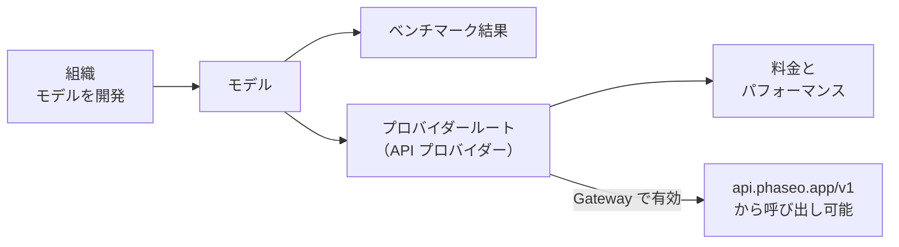

[phaseo.app](https://phaseo.app/models) で任意のモデルを調べると、開発元、提供しているプロバイダー、料金、スコアを確認できます。有効なルートがあるモデルは、そのまま Gateway を通じて呼び出せます。

## カタログに含まれるもの

| レコード | 内容 | 確認する場所 |
| --- | --- | --- |
| [組織](./organisations.mdx) | モデルを開発・公開する企業や研究ラボ。 | [組織](https://phaseo.app/organisations) |
| [モデル](./models.mdx) | リリースされた各モデル。関連するモデルはファミリーにまとめられています。 | [モデル](https://phaseo.app/models) |
| [ベンチマーク](./benchmarks.mdx) | 評価と、それに対するモデルのスコア。 | [ベンチマーク](https://phaseo.app/benchmarks) |
| [API プロバイダー](./api-providers.mdx) | API を通じてモデルを提供するプラットフォーム。 | [API プロバイダー](https://phaseo.app/api-providers) |
| [料金とパフォーマンス](./pricing-performance.mdx) | 各プロバイダーのトークン、画像、秒、リクエストあたりの料金と、測定された Gateway の速度。 | モデルページ、[比較](https://phaseo.app/compare) |
| [サブスクリプションプラン](./subscription-plans.mdx) | Phaseo のプランと、プロバイダーが販売するサブスクリプション。 | [サブスクリプションプラン](https://phaseo.app/subscription-plans) |

カタログにレコードがあっても、そのモデルを呼び出せるとは限りません。ルートがあるのは **Gateway で有効** と表示されたモデルだけで、`GET /v1/models` はそれらのみを返します。

## データの読み方

- **料金** は USD で、テキストは 100 万トークンあたり、メディアはプロバイダー独自の単位（画像あたり、秒あたり、リクエストあたり）で表示されます。
- **日付** は UTC の日付で、英語では `01 Jan 2026` の形式で表示されます。
- **ベンチマークスコア** は、ベンチマーク独自のスケールと方向を保ちます。Phaseo はそれらを 1 つの共通スコアに換算しません。[ベンチマーク](./benchmarks.mdx)を参照してください。
- **ファミリー** は、1 つのモデルラインのサイズやバージョンなど、関連するモデルをまとめたものです。

## データを最新に保つ仕組み

プロバイダーの同期ジョブが新しい料金を提案し、管理者がレビューしてから公開します。ベンチマークの取り込みとモデルのライフサイクルのジョブは、定期的にデータベースを更新します。誰でも GitHub の issue で修正や欠けているレコードを報告でき、メンテナーが根拠を確認して承認した変更を反映します。[コントリビューション](../contributing/overview.mdx)を参照してください。

## 質問の例

| 目的 | 答えを見つける場所 |
| --- | --- |
| 2 つのモデルをベンチマークで比較する | [比較](https://phaseo.app/compare)、またはベンチマークのページ |
| タスクに最も安いモデルを探す | 料金で並べ替えた[モデル](https://phaseo.app/models)一覧、次に[料金計算ツール](https://phaseo.app/tools/pricing-calculator) |
| ベンチマークの推移を見る | ベンチマークの **推移** グラフ |
| ある機能をサポートするプロバイダーを探す | モデルページの **プロバイダー** セクション、または `GET /v1/models/{author}/{slug}/endpoints` |
| コントリビュートできるレコードを探す | ベンチマークやメタデータが欠けているモデルページ。[コントリビューション](../contributing/overview.mdx)を参照してください |
