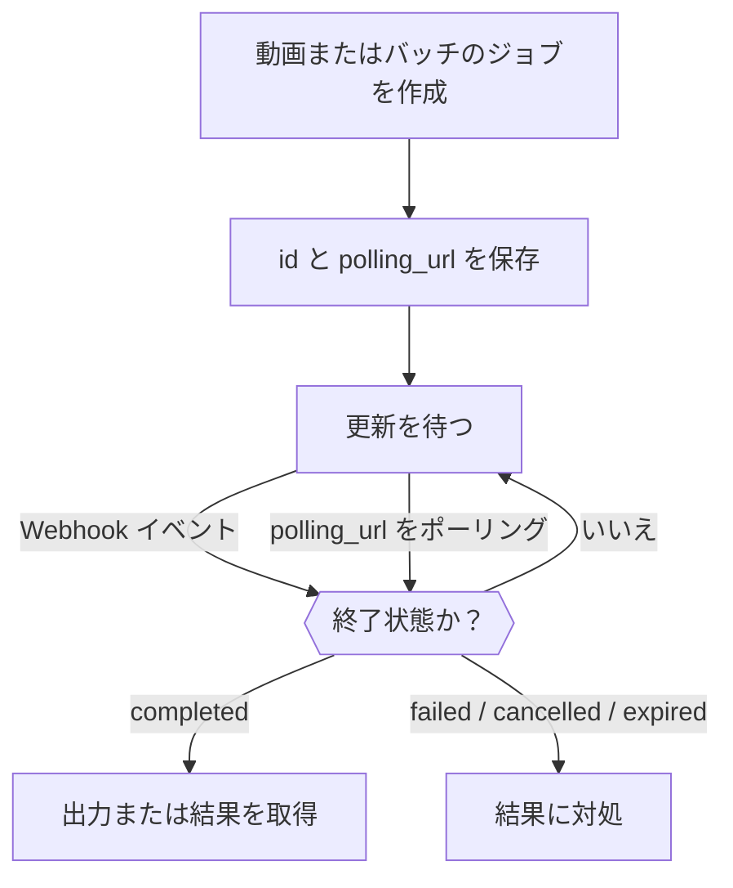

<Note>
Video API と Batch API は、選ばれたワークスペース向けの招待制ベータプレビューです。利用できるかどうかは **設定 → 機能プレビュー** で確認してください。アクセスはワークスペース単位で管理され、個人の Web 設定を有効にしても API アクセスは付与されません。通常のモデル使用料金がかかります。
</Note>

動画やバッチを作成すると、処理が終わる前にジョブが返されます。その `id` と `polling_url` を保存し、Webhook を待つか、ジョブが終了状態（`completed`、`failed`、`cancelled`、`expired`）になるまでポーリングします。作成レスポンスが成功しても、ジョブが受け付けられたことを意味するだけです。



Webhook を使う場合も、ポーリングの経路は残しておいてください。ベータ期間中は、小さなリクエストと API キーの支出上限から始めてください。参照入力、キャンセル、出力の保持期間はプロバイダーとモデルによって異なります。完了した出力は、期限切れになる前に自分でコピーを保存してください。

<span id="receive-updates"></span>
## 更新を受信する

どちらの種類のジョブでも、作成時に自分のワークスペースの Webhook エンドポイントを指定します。

```json
{
  "webhook": {
    "endpoint_id": "YOUR_ENDPOINT_ID",
    "events": ["job.status_changed", "job.completed", "job.failed", "job.cancelled", "job.expired"]
  }
}
```

Phaseo がプロバイダーのステータスを照合して通知を送るため、Anthropic のメッセージバッチのようにポーリングにしか対応していないプロバイダーでも Webhook が発生します。Webhook の配信が失敗しても、ジョブが失敗したことにはなりません。

`batch.completed` や `video.failed` のような名前空間付きのイベントタイプを使うと、Batch と Video のイベントを別々に購読できます。汎用の `job.*` イベントタイプも引き続き使え、両方のジョブタイプの該当するフェーズを購読します。

### 配信を検証して確認応答する

エンドポイントのシークレットで `x-phaseo-signature` を検証します。これは、`x-phaseo-timestamp`、ピリオド 1 文字、**変更していないリクエスト本文** を連結したものの HMAC-SHA256 を 16 進数で表したものです。タイムスタンプが新しいことを確認し、`x-phaseo-event-id` で重複を排除し、受け付けた配信には 2xx レスポンスで確認応答します。配信はリトライされたり順不同で届いたりすることがあるため、矛盾する状態変更を適用する前にジョブを取得してください。

| 試行 | タイミング |
| --- | --- |
| 1 | イベントの発生直後 |
| 2 | 失敗した試行の約 1 分後 |
| 3 | その約 5 分後 |
| 4 | その約 15 分後。失敗すると、配信は恒久的な失敗として記録されます |

2xx レスポンスで配信は終了します。リトライはバックグラウンドの定期処理が送るため、予定より遅れて届くことがあります。各試行には、試行番号、時刻、HTTP ステータス、エラー、次のリトライ時刻が記録されます。それでも重複排除は行ってください。確認応答が失われたりワーカーが中断されたりすると、配信の成否が不確かになることがあります。

エンドポイントを保存した後、設定の **テストイベントを送信** を使うと、署名付きの `webhook.test` ペイロードが配信されます。テスト配信は 1 回だけ試行され、リトライされず、ジョブの配信履歴にも追加されません。

## ジョブとリクエストのログを見る

**設定 → 利用状況 → ログ** で、推論リクエストの詳細は **リクエスト**、動画のライフサイクルは **動画**、バッチジョブと行ごとの結果は **バッチ** で確認します。動画とバッチの詳細画面には、請求ステータス、プロバイダーへの試行、Webhook の試行が表示されます。Webhook の配信が失敗していても、ジョブ自体は正常に完了していることがあります。

動画の送信では、プロバイダーに連絡する前にクレジットを予約します。タスク ID のないタイムアウトでは、照合のために予約が保持されます。これは生成が失敗した証拠ではありません。有料の動画またはバッチの予約が、処理の成功後に予期せず料金ゼロと算定された場合、調査のため請求は `unexpected_zero_cost` で保留されたままになります。作成レスポンスだけがゼロコストであるのは、非同期生成では通常のことです。

## 動画のコストを見積もる

動画の料金はプロバイダーとモデルによって異なります。秒あたりの料金には課金対象の長さを掛ける必要があり、クリップあたりの料金は指定された長さと解像度にのみ適用されます。複数の出力や課金対象の参照入力があると、合計が増えることがあります。

LTX のテキスト／画像からの生成は出力の秒数で課金され、音声から動画への生成は入力音声の秒数で課金されます。BytePlus Seedance は動画トークンを使い、参照動画がある場合は異なる料金になります。MiniMax Hailuo V1 は固定長のクリップ料金を使い、H3 は秒数を使い、参照入力に課金することがあります。表示上の料金をリクエスト全体のコストと解釈するのではなく、選択したプロバイダーの料金の構成要素を確認してください。

予約は送信前に確保される見積もりです。最終的な請求はジョブの課金対象の使用量に基づき、使われなかった予約クレジットは照合後に解放されます。プロバイダーがサポートする解像度やオプションが、ベータで利用できるとは限りません。

## 長さ、フレーム、参照を設定する

出力の長さには `seconds` または `duration` を使います。両方を指定する場合は値が一致している必要があります。`resolution` と `aspect_ratio` を組み合わせるか、`1280x720` のようなピクセル単位の `size` を使います。

最初と最後のフレームを明示するには `frame_images` を使います。

```json
{
  "frame_images": [
    {
      "type": "image_url",
      "frame_type": "first_frame",
      "image_url": { "url": "https://example.com/start.png" }
    }
  ],
  "input_references": [
    {
      "type": "image_url",
      "role": "reference",
      "image_url": { "url": "https://example.com/character.png" }
    }
  ]
}
```

参照 URL には HTTPS を使う必要があります。参照専用の画像には `role: "reference"` を明示してください。`frame_images` のない従来のリクエストでは、ラベルのない最初の画像が最初のフレームとして解釈されます。`frame_images` を、`input_references` 内の最初／最後のフレームのロールや `input_reference` と組み合わせないでください。

動画と音声の参照には、`type: "video_url"` または `"audio_url"` と `media_url: { "url": "https://..." }` を使います。サポートされる組み合わせはモデルとプロバイダーによって異なります。参照の長さが料金に影響する場合は、`input_video_duration` と `input_audio_duration` を秒単位で指定してください。

## プロバイダー固有の動画オプションを渡す

モデル、長さ、解像度、音声生成、入力メディア、出力数は正規のフィールドで指定します。プロバイダー固有の拡張は、正規のプロバイダー ID の下に渡します。

```json
{
  "provider_options": {
    "atlascloud": { "watermark": false, "output_format": "mp4" },
    "byteplus": { "camera_fixed": true }
  }
}
```

転送されるのは選択されたプロバイダーのオプションだけです。オプションでプロバイダーが選ばれることはないため、プロバイダーの選択には `provider` のルーティング設定を使ってください。`provider_options` を従来の `provider_params` と組み合わせないでください。入れ子のオプションで、Gateway が管理する請求やコールバックのフィールドを上書きすることはできません。

| プロバイダー | ネイティブ拡張の例 | 参考資料 |
| --- | --- | --- |
| AtlasCloud Seedance 2.5 | `watermark`、`output_format`、`return_last_frame`、`omni_reference_task_type` | [Model API](https://www.atlascloud.ai/models/bytedance/seedance-2.5/reference-to-video) |
| Novita Seedance 1.5 | `watermark`、`camera_fixed`、`fps`（24）、`service_tier`（`default`） | [Unified video API](https://docs.novita.ai/api-reference/reference-unified-video-generation) |
| BytePlus Seedance | `camera_fixed` | 使用前に、選択したモデルのプロバイダー契約を確認してください。 |
| MiniMax V1 | `fast_pretreatment`。プロンプトの最適化には正規の `enhance_prompt` を使います | [Video API](https://platform.minimax.io/docs/api-reference/video-generation-t2v) |

AtlasCloud Seedance は、ネイティブの `resolution`、`ratio`、`last_image` フィールドを使います。参照から動画を生成するバリアントは、順序付きの画像、動画、音声の参照を受け取ります。長さを自動で決める編集（`duration: -1`）は、Gateway の固定長の予約方式ではサポートされていません。モデルをルーティングするには、プロバイダーのモデルの提供状況と料金が設定されている必要があります。プロバイダーオプションによって、利用できないモデルが有効になることはありません。

MiniMax H3 は V2 を使い、`768P` または `2K` で 4〜15 秒（整数秒）に対応します。H3 Max は `480P` または `768P` で 5〜15 秒（整数秒）に対応し、テキストまたはフレーム画像を使えます。H3 は参照画像、動画、音声をサポートしますが、参照を最初／最後のフレームと混在させることはできません。どちらのモデルもリクエストごとに 1 本の動画を生成し、V1 のプロンプト最適化オプションはサポートしません。正規の `aspect_ratio` を使ってください。フレーム入力は独自の比率を決めます。参照動画の予約はプロバイダーの入力上限である 15 秒をカバーし、実際の使用量は完了時に精算されます。[MiniMax V2 の仕様](https://platform.minimax.io/docs/api-reference/video-generation-v2-create)を参照してください。

## 各バッチプロバイダーがサポートする内容を確認する

バッチリクエストも `provider_options` を受け付けます。OpenAI は `output_expires_after`、Mistral は `metadata` をサポートします。正規のプロバイダー ID を使い、これらのフィールドをトップレベルに重複して指定しないでください。たとえば、`provider_options: { "openai": { "output_expires_after": { "anchor": "created_at", "seconds": 86400 } } }` は OpenAI の出力保持期間を設定します。行の入力、モデル、エンドポイント、Webhook の送信先は、オプションで上書きできません。

Mistral にはすでにネイティブのバッチアダプターがあります。Anthropic のメッセージバッチはポーリングで処理され、他のプロバイダーはポーリングとネイティブの完了通知を組み合わせることがあります。利用できるかどうかは、プロバイダーがサポートするエンドポイントとデプロイのバッチ許可リストによって決まります。ファイルやインラインのリクエストを送信する前に、バッチの機能レスポンスを確認してください。

Vertex Gemini のバッチは、`/v1/generateContent` を使うインラインの `requests`、または `model` と `prompts` を受け付けます。Vertex を使うには `provider: "google-vertex"` を選択します。成功した行は Batch 料金で課金されます。このアダプターにはマネージドの認証情報が必要で、BYOK、アップロードしたファイル、埋め込み、`google-vertex-eu` のバッチは利用できません。入力は 20 MB、10,000 リクエストまでです。保存された入力と出力は 30 日後に期限切れになります。

Vertex の結果では、送信した各行を `custom_id` で識別し、成功した生成は `response.body` に、リクエストごとのエラーは `error` に入ります。出力の順序は入力の順序と異なることがあります。プロバイダーでの結果が不確かな送信は、クレジットの保留を維持したまま手動レビューの対象になります。結果が確認されるまで、代わりのバッチを作成しないでください。

バッチの完了には、失敗した行が含まれることがあります。すべての行が成功したと決めつけず、カスタム ID を使って各結果を確認してください。結果と請求の照合が終わるまで、元の入力とジョブ ID を保管してください。結果が不確かな送信は、プロバイダーが元のリクエストを受け付けている可能性があるため、再送信する前に調査する必要があります。

### バッチ結果をダウンロードする

サポートされているバッチが終了状態になると、その `results_url` は認証付きの Phaseo のダウンロードを指します。バッチを所有するワークスペースの通常の Phaseo API キーを使ってください。

```bash
curl --fail "https://api.phaseo.app/v1/batches/$BATCH_ID/results" \
  -H "Authorization: Bearer $PHASEO_API_KEY" \
  --output results.jsonl
```

レスポンスは、サポートされているすべてのバッチプロバイダーで、同じエンドポイントから JSONL をストリーミングします。Phaseo は、別々の成功ファイルとエラーファイルを結合し、インラインの結果配列を JSONL に変換し、結果のページネーションをたどります。生成されたコンテンツとリクエストごとのエラーは保持されます。行のフィールドはプロバイダーのネイティブ形式のままです。OpenAI 互換と Anthropic の行には `custom_id`、Gemini にはリクエストのメタデータ、xAI には `batch_request_id` を使います。Anthropic の成功した行では、生成されたメッセージが `result.message` に入ります。

ダウンロードは、OpenAI、Anthropic、Google AI Studio、Mistral、Together、Groq、Alibaba Cloud、Moonshot、Parasail、OVHcloud、xAI のアダプターに対応しています。プロバイダーを利用できるかどうかは、引き続きプレビューアクセスと送信の許可リストによって決まります。ダウンロードに対応していても、追加のルートが有効になるわけではありません。既存の `output_file_id`、`error_file_id`、ファイル内容のエンドポイントも引き続き利用できます。バッチのリクエスト行エンドポイントには、追跡と請求のメタデータが含まれ、生成されたメッセージ本文は含まれません。

結果をダウンロードしても、別のバッチが送信されたり推論の料金が追加されたりすることはありません。プロバイダーの認証情報は必要ありません。Webhook はジョブの更新を通知するもので、結果は別途ダウンロードしてください。終了したジョブでも、結果が一部だけだったり、出力がまったくなかったりすることがあります。エンドポイントは処理中には `409`、出力がない場合は `404` を返します。プロバイダーの保持期間が終わる前に結果を保存してください。ダウンロードが中断された場合は、途中のファイルを破棄し、バッチの送信ではなくダウンロードをやり直してください。インラインの JSON 結果は行ごとに 8 MiB の安全上限付きでストリーミングされ、ネイティブの JSONL ファイルはその行の上限なしでストリーミングされます。

大きな出力では、TypeScript の `client.batches.streamResults(batchId, { signal })` が、バッファリングせずに `ReadableStream<Uint8Array>` を返します。出力先にパイプし、途中で止めるにはストリームをキャンセルするかシグナルを中止します。ダウンロード全体の固定タイムアウトはありません。Python の `client.batches.stream_results(batch_id)` は、設定された HTTP タイムアウトでバイトのチャンクを返します。途中で止める場合はイテレーターを閉じてください。生成された `retrieveBatchResults` 操作は JSONL のテキスト全体を返すため、小さな出力に最適です。

### バッチダウンロードの制限

バッチ結果のダウンロードは、バッチごと、ワークスペースごとに、直近 30 分間で 10 回まで試行できます。この回数は API キーと、`/batches` および `/batch` のエイリアスの間で共有されます。ダウンロードの受け付けまで到達した試行は、上流のダウンロードが失敗またはキャンセルされてもカウントされます。所有権や準備状況による失敗はカウントされません。`429` レスポンスには秒単位の `Retry-After` が含まれます。制限機能が利用できない場合、ダウンロードは `Retry-After: 30` 付きの `503` を返します。
