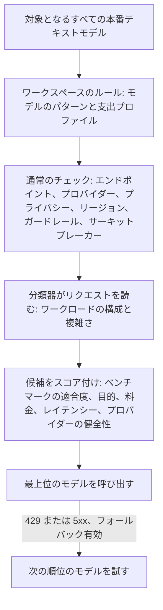

`"model": "phaseo/auto"` を送ると、Phaseo はワークロード、ワークスペースの目的、料金の上限に基づいて、リクエストごとにモデルを選びます。自動ルーティングは、選ばれたワークスペースで利用できるアルファ版です。

```json
{
  "model": "phaseo/auto",
  "input": "Review this TypeScript function for correctness."
}
```

レスポンスの `model` フィールドに、回答したモデルが表示されます。

## モデルの選び方



1. **候補。** Phaseo は、標準料金がわかっているすべての本番テキストモデルから始め、モデルのパターンと支出プロファイルに一致するものだけを残します。
2. **チェック。** 各候補は、モデルを固定したリクエストと同じエンドポイント、ワークスペースのモデル、プロバイダー、プライバシー、ガードレール、サーキットブレーカーのチェックを通過する必要があります。
3. **分類器。** 固定された低コストのモデルがリクエストを読み、ワークロードの構成（コード、推論、ツール使用など）、複雑さのスコア、信頼度を返します。分類器自身がモデルを選ぶことはありません。リクエスト内のツールと構造化出力は、信頼できる事実として分類器に渡されます。
4. **スコア付け。** 複雑さによって、許容できる回答を返せる可能性が高い最も能力の低いモデルに余裕を加えた水準が決まります。その後 Phaseo は、自己申告ではないカタログのベンチマークを、目的と、各候補の現在の料金、レイテンシー、健全性、信頼性と組み合わせます。データが欠けている場合は中立として扱われ、候補リストが広がることはありません。

リクエストでワークスペースの目的、支出プロファイル、パターンを変えることはできません。モデルを固定したリクエストは、自動ルーティングを完全にスキップします。

## 設定する

<Steps>
<Step title="自動ルーティングを開く">

**ダッシュボード -> 設定 -> ルーティング -> 自動ルーティング** を開きます。

</Step>
<Step title="目的を選ぶ">

| 目的 | 最も重視する点 |
| --- | --- |
| `balanced` | 品質、料金、レイテンシー、信頼性の実用的なバランス。 |
| `quality` | ワークロードに関連するベンチマーク結果。 |
| `cost` | 入力と出力のトークン料金の低さ。 |
| `latency` | 最近のプロバイダーのレイテンシーの低さ。 |

</Step>
<Step title="支出プロファイルを選ぶ">

各プロファイルは、標準ティアのテキスト料金（100 万トークンあたりの USD）に対する厳格な上限です。上限を超えるモデルは一切検討されません。

| 支出プロファイル | 入力の上限 | 出力の上限 |
| --- | ---: | ---: |
| 低コスト | $0.10 | $0.50 |
| 標準 | $0.30 | $1.50 |
| プレミアム | $1 | $5 |
| 価格制限なし | なし | なし |

**カスタム上限** では、両方の上限を自分で設定します。

</Step>
<Step title="モデルを絞り込む（任意）">

`anthropic/*`、`openai/gpt-5.*` などのパターンや、正確なモデル ID を追加します。

</Step>
<Step title="フォールバックを許可して保存する">

フォールバックを有効にすると、`429`、`500`、`502`、`503`、`504` の後に、Phaseo は次の順位のモデルを試します。各フォールバックでも、すべてのチェックをもう一度通過します。クライアントエラーではモデルは切り替わりません。

</Step>
</Steps>

CLI では `phaseo routing auto update --objective <o> --spend-profile <p> --allowed-patterns <list> --allow-fallbacks` で設定し、`phaseo routing auto get` で読み戻します。API は `PATCH /v1/routing/auto` です。

<Warning>
  支出プロファイルとパターンは、どのモデルが対象になるかを決めるものです。品質を保証するものではないため、結果として選ばれるモデルの構成を自分のワークロードで確認してください。
</Warning>

## 分類器へのリクエスト

各 `phaseo/auto` リクエストは、同じワークスペースと請求 ID のもとで、分類器モデルへの別の子リクエストを作成します。このリクエストは `purpose=auto_routing_classifier` と親リクエストの ID 付きでリクエストログに個別に表示され、個別に課金されます。

分類器が失敗した場合、タイムアウトした場合、または無効なデータを返した場合、Phaseo は代わりにローカルのルールベースの分類器（コード、推論、ツール使用、構造化出力、翻訳、要約、一般）を使うため、メインのリクエストは引き続き実行されます。

## プライバシーとリージョンの制限

リクエストに対するデータの制限は、自動ルーティングにも適用されます。

- `provider.require_zero_data_retention: true` を指定した場合、またはデータ保持ゼロのプロバイダーのみを許可するワークスペースやキーのガードレールがある場合、そのようなプロバイダーを持つモデルだけが候補になります。
- 必須のリージョンは、各候補のプロバイダーに対して確認されます。
- 分類器へのリクエストにも同じ制限と、`only` および `ignore` のプロバイダーリストが適用されます。分類器のモデルがそれを満たせない場合、Phaseo はローカルの分類器を使います。

データ所在地の要件だけでモデルが 1 つも残らない場合、リクエストはモデルを固定した場合と同じく、`unmet_requirements` 付きの `403 model_region_unavailable` で失敗します。他の理由でも除外されたモデルがある場合は、`400 unsupported_model_or_endpoint` で失敗します。

## 判断の内容を確認する

リクエストの詳細には、ワークロード、目的、選ばれたモデル、フォールバックの順序、各候補のスコアと要素ごとのスコア、ベンチマーク ID、除外理由、アルゴリズムのバージョンが表示されます。トレースにはプロンプトやレスポンスの内容は含まれません。

## 他のルーティングと組み合わせる

- **動的ルート。** 適用された[動的ルート](./routing-and-fallbacks#attach-routing-rules-to-api-keys)が選んだ固定モデルが優先されます。この上書きは記録され、そのリクエストでは自動ルーティングのフォールバックは無効になります。
- **リクエストのフォールバック。** `phaseo/auto` は独自の順位付きフォールバックを管理するため、[`models` リスト](./routing-and-fallbacks#request-level-model-fallbacks)と組み合わせたり、その中に含めたりすることはできません。
