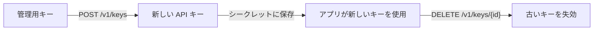

[管理用キー](../../developers/management-api-keys.mdx)で代わりのキーを作成し、アプリをそのキーに切り替えてから古いキーを削除すると、ダウンタイムなしで Phaseo の API キーをローテーションできます。このページでは、そのローテーションに Infisical の接続が使う値を説明します。

<Warning>
Phaseo は、Infisical の App Connection でまだ選択できません。コネクター、テスト、画面の項目が Infisical に取り込まれる必要があります。それまでは、独自のローテーションジョブから以下のリクエストを使ってください。
</Warning>

## ローテーションの仕組み



Phaseo が API キーの値を表示するのは、作成時の 1 回だけです。古いキーを削除するまでは新旧どちらのキーも機能するため、シークレットの更新中にアプリを切り替えられます。

## スコープを絞った管理用キーを作成する

**設定 → 管理用キー**で、次の権限を持つキーを作成します。

| 権限 | 用途 |
| --- | --- |
| `keys:read` | 接続を確認し、管理対象のキーを一覧表示します。 |
| `keys:write` | 代わりのキーを作成します。 |
| `keys:delete` | 古いキーを失効させます。 |

`phaseo_v1_mk_...` の値を Infisical に保存します。管理用キーはアカウントを管理するためのもので、推論には使えません。

## 接続の詳細

| 項目 | 値 |
| --- | --- |
| Base URL | `https://api.phaseo.app/v1` |
| 認証 | `Authorization: Bearer <PHASEO_MANAGEMENT_KEY>` |
| 接続の確認 | `GET /keys` |
| API キーの一覧 | `GET /keys` |
| API キーの作成 | [`POST /keys`](../../api-reference/endpoint/keys-create.mdx) |
| API キーの失効 | [`DELETE /keys/{id}`](../../api-reference/endpoint/keys-delete.mdx) |

## 代わりのキーを作成する

```bash
curl https://api.phaseo.app/v1/keys \
  -H "Authorization: Bearer $PHASEO_MANAGEMENT_KEY" \
  -H "Content-Type: application/json" \
  -d '{
    "name": "infisical-production",
    "limit": 100,
    "limit_reset": "monthly",
    "include_byok_in_limit": false
  }'
```

レスポンスには、新しいキーが 1 回だけ `data.key` に、その ID が `data.id` に含まれます。

| 項目 | 値 |
| --- | --- |
| `limit` | 米ドル建ての利用上限。 |
| `limit_reset` | `daily`、`weekly`、または `monthly`。 |
| `include_byok_in_limit` | 互換性のためにのみ受け付けます。BYOK の利用はこの上限に含まれません。 |

## 古いキーを失効させる

```bash
curl -X DELETE https://api.phaseo.app/v1/keys/$PREVIOUS_KEY_ID \
  -H "Authorization: Bearer $PHASEO_MANAGEMENT_KEY"
```

削除はべき等です。すでに削除されたキーを削除すると `{"deleted": true}` とともに `200` が返るため、ローテーションを再試行しても安全です。
