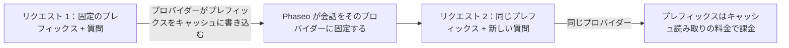

リクエスト間でプロンプトの先頭を同じにしておくと、プロバイダーはそれを再処理せずにキャッシュから読み込みます。そのトークンはキャッシュ読み取りの料金で課金され、最初のトークンも早く届きます。ほとんどのプロバイダーは繰り返されるプレフィックスを自動でキャッシュします。Claude は `cache_control` で指定した部分だけをキャッシュします。



プロンプトキャッシュを使っても、推論はリクエストごとに実行されます。同じリクエストに以前の回答を返すものではありません。

## プロンプトをキャッシュする

変わらない部分の最後のブロックに印を付けます。そのブロックまでのすべて（そのブロックを含む）がキャッシュされます。

<CodeGroup>
```bash Chat Completions
curl https://api.phaseo.app/v1/chat/completions \
  -H "Authorization: Bearer $PHASEO_API_KEY" \
  -H "Content-Type: application/json" \
  -d '{
    "model": "anthropic/claude-sonnet-5.5",
    "messages": [
      {
        "role": "system",
        "content": [
          {
            "type": "text",
            "text": "You are a support assistant. Follow the company policy exactly.",
            "cache_control": { "type": "ephemeral", "ttl": "1h" }
          }
        ]
      },
      { "role": "user", "content": "Summarise the latest ticket." }
    ]
  }'
```

```bash Responses
curl https://api.phaseo.app/v1/responses \
  -H "Authorization: Bearer $PHASEO_API_KEY" \
  -H "Content-Type: application/json" \
  -d '{
    "model": "anthropic/claude-sonnet-5.5",
    "input": [
      {
        "role": "user",
        "content": [
          {
            "type": "input_text",
            "text": "Reference document: Refunds are available for 30 days when...",
            "cache_control": { "type": "ephemeral", "ttl": "5m" }
          },
          {
            "type": "input_text",
            "text": "Answer this customer: Can I return an item after 20 days?"
          }
        ]
      }
    ]
  }'
```

```bash Anthropic Messages
curl https://api.phaseo.app/v1/messages \
  -H "Authorization: Bearer $PHASEO_API_KEY" \
  -H "Content-Type: application/json" \
  -d '{
    "model": "anthropic/claude-sonnet-5.5",
    "max_tokens": 512,
    "system": [
      {
        "type": "text",
        "text": "You are a careful support assistant. Use the policy below.",
        "cache_control": { "type": "ephemeral", "ttl": "1h" }
      }
    ],
    "messages": [
      {
        "role": "user",
        "content": [
          {
            "type": "text",
            "text": "Policy: refunds are available for 30 days when...",
            "cache_control": { "type": "ephemeral", "ttl": "5m" }
          },
          { "type": "text", "text": "Can this customer return an item after 20 days?" }
        ]
      }
    ],
    "tools": [
      {
        "name": "lookup_order",
        "description": "Look up order status.",
        "input_schema": {
          "type": "object",
          "properties": { "order_id": { "type": "string" } },
          "required": ["order_id"]
        },
        "cache_control": { "type": "ephemeral", "ttl": "5m" }
      }
    ]
  }'
```
</CodeGroup>

次に、うまく動いたかを確認します。

1. リクエストを一度送り、キャッシュを書き込みます。
2. 同じキャッシュ対象の内容で、もう一度送ります。
3. レスポンスの使用量にある `cached_tokens` と `cache_write_tokens`（[使用量と料金のフィールド](#usage-and-pricing-fields)を参照）と、リクエスト詳細のキャッシュメーターを確認します。
4. 最初の 1 回だけでなく、複数回の呼び出しでレイテンシとコストを比較します。

リクエスト間で変わらない内容をキャッシュします。長いシステム指示、再利用するドキュメント、few-shot の例、ツール定義、次のターンでもう一度送る大きなツール結果などです。リクエストごとに変わる内容、短い一回限りの入力、ポリシー上プロバイダーに保存させてはいけないデータには印を付けないでください。

<Note>
Phaseo は各プロバイダーに、そのプロバイダーが文書化しているキャッシュ制御だけを送り、それ以外は取り除きます。キャッシュ制御によってプロバイダーがルーティングから除外されることはありません。各モデルページにキャッシュの読み取りと書き込みの料金が掲載されています。
</Note>

## 自動でキャッシュするプロバイダー

| プロバイダー | キャッシュ | Phaseo が送る内容 |
| --- | --- | --- |
| [OpenAI](https://developers.openai.com/api/docs/guides/prompt-caching)、[Azure OpenAI](https://learn.microsoft.com/en-us/azure/foundry/openai/how-to/prompt-caching) | 1,024 トークン以上のプロンプトで自動 | `prompt_cache_key`。GPT-5.6 以降ではブレークポイントと `prompt_cache_options`、それより前のモデルでは `prompt_cache_retention` |
| Anthropic、Claude on AWS、Amazon Bedrock、Google Vertex AI 上の [Anthropic Claude](https://platform.claude.com/docs/en/build-with-claude/prompt-caching) | オプトイン | `cache_control` ブレークポイント。リクエストあたり最大 4 個 |
| Google AI Studio と [Vertex AI](https://docs.cloud.google.com/vertex-ai/generative-ai/docs/context-cache/context-cache-overview) 上の [Google Gemini](https://ai.google.dev/gemini-api/docs/caching) | Gemini 2.5 以降で自動 | 自分で作成した明示的なキャッシュ用の `cached_content` |
| [xAI](https://docs.x.ai/developers/advanced-api-usage/prompt-caching/maximizing-cache-hits) | 自動 | `prompt_cache_key` と `x-grok-conv-id` ヘッダー |
| [DeepSeek](https://api-docs.deepseek.com/guides/kv_cache) | 自動 | 追加の送信なし |
| [Moonshot AI](https://platform.kimi.ai/docs/guide/context-caching) | 自動で TTL は 5 分。Kimi K3 では 1 時間の TTL をオプトインで利用可能 | `prompt_cache_key` と `prompt_cache_options` |
| [Groq](https://console.groq.com/docs/prompt-caching) | Groq が掲載しているモデルで自動 | 追加の送信なし |
| [Fireworks](https://docs.fireworks.ai/guides/prompt-caching) | 自動 | `prompt_cache_key`、`x-session-affinity` ヘッダー、`user` |
| [Cerebras](https://inference-docs.cerebras.ai/capabilities/prompt-caching) | 自動 | `prompt_cache_key` |
| [Cloudflare Workers AI](https://developers.cloudflare.com/workers-ai/features/prompt-caching) | 一部のモデルで自動 | `x-session-affinity` ヘッダー |
| [Together AI](https://docs.together.ai/docs/inference/chat/prompt-caching)、[Mistral](https://docs.mistral.ai/studio-api/conversations/advanced/prompt-caching) | 自動。`prompt_cache_key` でヒット率が上がる | `prompt_cache_key` |
| [Alibaba Model Studio](https://www.alibabacloud.com/help/en/model-studio/context-cache) | 自動（暗黙的）。明示的なキャッシュはオプトイン | ブロックの `cache_control` |
| [Venice](https://docs.venice.ai/overview/guides/prompt-caching) | 自動。Venice が Claude のブレークポイントを自ら追加 | ブロックの `cache_control` |
| [DeepInfra](https://docs.deepinfra.com/chat/prompt-cache-retention) | 自動。保持期間はオプトイン | `prompt_cache_key`、`prompt_cache_breakpoint`、`prompt_cache_options` |
| [Inference.net](https://inference.net/models/claude-opus-5/) | 自動。Claude と Gemini 2.5 のモデルでは明示的なキャッシュ | Claude と Gemini 2.5 のモデルでは `ttl` なしのブロックの `cache_control` |
| [Baseten](https://docs.baseten.co/inference/model-apis/pricing-and-limits) | 自動 | `prompt_cache_key` と `x-session-affinity` ヘッダー |
| [Morph](https://docs.morphllm.com/sdk/components/caching) | 自動 | `prompt_cache_key` と `x-session-id` ヘッダー |

その他の OpenAI 互換プロバイダーには、API が受け付ける場合に `prompt_cache_key` が送られ、それ以外のキャッシュ制御は送られません。Phaseo はキーそのものではなく、常にワークスペースとキーのハッシュを送ります。[プロバイダーアフィニティ](#provider-affinity)を参照してください。

<span id="cache-controls"></span>
## キャッシュ制御

### Claude のブレークポイントを Phaseo に配置させる

Chat Completions、Responses、Anthropic Messages でトップレベルに `cache_control` を指定すると、Claude のルートでキャッシュが有効になり、Phaseo がブレークポイントを配置します。他のプロバイダーはこれを無視します。

```json
{
  "cache_control": { "type": "ephemeral", "ttl": "5m" }
}
```

短期間だけ共有するコンテキストには `ttl: "5m"`（既定）を、モデルが長期間のキャッシュエントリに対応している場合は `ttl: "1h"` を使います。トップレベルの `cache_control` は会話を 1 つのプロバイダーに留める効果もあります。[プロバイダーアフィニティ](#provider-affinity)を参照してください。

`provider_options.anthropic.cache_control` は同じ設定で、`scope` も指定できます。リクエストが両方を送った場合は、`provider_options` の値が優先されます。

```json
{
  "provider_options": {
    "anthropic": {
      "cache_control": { "type": "ephemeral", "ttl": "5m", "scope": "agent" }
    }
  }
}
```

| `scope` | Phaseo がブレークポイントを配置する場所 |
| --- | --- |
| `all_text`（既定） | システムテキストと、テキストまたは画像を含む直近 3 件のユーザーメッセージ。 |
| `last_user_message` | 最新のユーザーメッセージのみ。 |
| `agent` | ツールループ用。最後のツール定義、システムテキスト、最後のメッセージ（ツール結果を含む）、前のステップのメッセージ。`conversation` はエイリアスです。 |
| `none` | どこにも配置しません。 |

複数ステップのツールループには `agent` を使います。`all_text` と `last_user_message` はツール結果だけを含むメッセージに印を付けないため、キャッシュされるプレフィックスが伸びなくなります。認識できない `scope` の値は `agent` として扱われます。

ブロックに自分で設定したブレークポイントは既定のポリシーより優先され、Anthropic のリクエストあたり 4 個という上限に数えられます。既定のポリシーは 4 個に達すると印の追加をやめます。自分のブロックに 4 個を超える印がある場合、Phaseo は最初の 1 個と最新の 3 個を残して他を取り除くため、リクエストは拒否されません。

### ブロックにキャッシュのブレークポイントを置く

コンテンツブロックにキャッシュの印を付けると、そのブロックまでのすべて（そのブロックを含む）がキャッシュされます。Phaseo は 2 つの書き方を受け付けます。

- `cache_control`: `{"type": "ephemeral"}`。任意で `5m` または `1h` の `ttl` を指定します。
- `prompt_cache_breakpoint`: OpenAI の `{"mode": "explicit"}`。任意で `30m` または `12h` の `ttl` を指定します（[OpenAI の 12 時間キャッシュ](#12-hour-cache-on-openai)を参照）。1 つのブロックに両方がある場合は、`prompt_cache_breakpoint` が優先されます。

Chat Completions と Responses では、テキストと画像のパート、関数ツールの定義、内容がテキストパートの配列であるツール結果に印を付けられます。Anthropic Messages は、Anthropic が受け付けるすべての場所で `cache_control` を受け付けます。`system` のテキストブロック、メッセージのテキストと画像のブロック、ツール結果のブロック、ツール定義です。1 つのリクエストに複数の TTL がある場合、Anthropic では `1h` のブレークポイントを `5m` のものより前に置く必要があります。

各プロバイダーには、それぞれの形式で印が送られます。

| プロバイダー | ブロックの `cache_control` | `prompt_cache_breakpoint` |
| --- | --- | --- |
| Anthropic、Claude on AWS、Amazon Bedrock、Google Vertex AI 上の Claude | 指定した `ttl` 付きの `{"type": "ephemeral"}` として送信 | `cache_control: {"type": "ephemeral"}` として送信 |
| OpenAI、GPT-5.6 以降 | `prompt_cache_breakpoint: {"mode": "explicit"}` として送信。`ttl` は削除 | `ttl` 付きで送信 |
| Azure OpenAI、GPT-5.6 以降 | `prompt_cache_breakpoint: {"mode": "explicit"}` として送信。`ttl` は削除 | `ttl` なしで送信 |
| OpenAI と Azure OpenAI、それより前のモデル | 削除 | 削除 |
| DeepInfra | 削除 | `ttl` なしで送信 |
| Alibaba Model Studio と Venice | 送信 | 削除 |
| Inference.net、Claude と Gemini 2.5 のモデル | `ttl` なしで送信 | 削除 |
| その他のプロバイダー | 削除 | 削除 |

ツール定義の印が届くのは、Claude のルート、Alibaba Model Studio、Venice、Inference.net の Claude と Gemini 2.5 のモデルだけです。OpenAI はツールのブレークポイントを受け付けません。印を削除してもプロンプトの残りは変わらないため、キャッシュされるプレフィックスは印のないリクエストと一致します。

Amazon Bedrock と Google Vertex AI は Claude 3.7 Sonnet、3.5 Sonnet、3 Opus を 5 分間だけキャッシュし、Bedrock はこれらのモデルで `ttl` を拒否することがあります。これらのルートでは、Phaseo はブレークポイントを `ttl` なしで送るため 5 分間キャッシュされ、削除した `1h` を `X-Phaseo-Dropped-Params` ヘッダーと `meta.routing.dropped_params` で `cache_control.ttl` として報告します。Inference.net は `ttl` なしのブレークポイントを文書化しているため、Phaseo はそこでも同じように `ttl` を削除して報告し、書き込みは 5 分の書き込みとして課金されます。

<span id="openai-retention-and-options"></span>
### OpenAI の保持期間とオプション

OpenAI のキャッシュ制御はモデルの世代によって異なります。Phaseo は、受け付けられる場所にだけそれぞれを送ります。

| フィールド | 値 | 送信先 |
| --- | --- | --- |
| `prompt_cache_options` | `mode`: `implicit` または `explicit`、`ttl`: `30m`（既定）または `12h` | OpenAI GPT-5.6 以降 |
| `prompt_cache_options` | `mode`: `implicit` または `explicit`、`ttl`: `30m` | Azure OpenAI GPT-5.6 以降 |
| `prompt_cache_options` | `mode`: `explicit`、`ttl`: `5m` または `1h` | DeepInfra |
| `prompt_cache_options` | `mode`: `implicit`、`ttl`: `5m`（既定）、Kimi K3 では `1h` | Moonshot AI |
| `prompt_cache_retention` | `in_memory` または `24h` | GPT-5.6 より前の OpenAI と Azure OpenAI のモデル |

`explicit` モードでは、自分で配置したブレークポイントだけがキャッシュされます。DeepInfra では、セッション内のすべてのリクエストに `prompt_cache_key` も必要です。Phaseo は Moonshot AI の `1h` を、1 時間の書き込み料金がある Kimi K3 のルートにだけ送るため、その書き込みはその料金で課金されます。それ以外では `ttl` を削除し、`X-Phaseo-Dropped-Params` ヘッダーで `prompt_cache_options.ttl` として報告します。他のプロバイダーにはどちらのフィールドも送られません。

どちらのフィールドも、トップレベルか `provider_options.openai` の下で送れます。両方ある場合は、トップレベルの値が優先されます。

```json
{
  "prompt_cache_retention": "24h",
  "provider_options": {
    "openai": { "prompt_cache_retention": "in_memory" }
  }
}
```

この場合、リクエストは `24h` を使います。

<span id="12-hour-cache-on-openai"></span>
### OpenAI の 12 時間キャッシュ

GPT-5.6 以降では、`ttl: "12h"` を設定すると、OpenAI はキャッシュエントリを少なくとも 12 時間保持します。リクエスト全体なら `prompt_cache_options` に、1 つのブレークポイントなら `prompt_cache_breakpoint` に指定します。独自の `ttl` を持たないブレークポイントはリクエストの値を使います。OpenAI は 12 時間の書き込みを入力料金の 2.5 倍、30 分の書き込みを 1.25 倍で課金します。キャッシュ読み取りの料金はどちらも同じです。

```json
{
  "model": "openai/gpt-5.6-sol",
  "prompt_cache_options": { "ttl": "30m" },
  "input": [
    {
      "role": "developer",
      "content": [
        {
          "type": "input_text",
          "text": "Shared tool manual...",
          "prompt_cache_breakpoint": { "mode": "explicit", "ttl": "12h" }
        }
      ]
    },
    { "role": "user", "content": "Find the failing test." }
  ]
}
```

- OpenAI が 12 時間の保持期間を文書化しているのは Responses API だけです。これを求める Chat Completions のリクエストは OpenAI の Responses API で実行され、レスポンスは Chat Completions の形式のまま返されます。
- 12 時間キャッシュを受け付けるルートが先に試されます。対象は OpenAI 自身の API（`openai` と `openai-eu`）で、料金カードに 12 時間の書き込み料金がある GPT-5.6 以降のモデルです。Azure OpenAI、他のプロバイダー、GPT-5.6 より前のモデルなど、それ以外のルートにはこの設定なしでリクエストが送られるため、30 分の既定値が適用されます。リクエストは引き続き実行され、削除されたフィールドは `X-Phaseo-Dropped-Params` ヘッダーと `meta.routing.dropped_params` で `prompt_cache_options.ttl` または `prompt_cache_breakpoint.ttl` として報告されます。

### Gemini の明示的なキャッシュを使う

Gemini 2.5 以降は、何も送らなくても暗黙的にキャッシュします。Google のキャッシュ API で作成した明示的なキャッシュを使うには、その名前を `provider_options.google.cached_content` に渡します。

```json
{
  "provider_options": {
    "google": { "cached_content": "cachedContents/abc123" }
  }
}
```

- Google AI Studio では、`cached_content` は自分の Google API キー（BYOK）でのみ機能します。Phaseo のキーを使うと、キャッシュは作成したアカウントに属するため、リクエストは `400` を返します。
- Vertex AI では、`cached_content` は自分の Vertex AI 認証情報でのみ機能し、Phaseo の認証情報では `400` を返します。キャッシュの完全な名前 `projects/{project}/locations/{location}/cachedContents/{id}` を送ると、Phaseo はそのプロジェクトとロケーションにリクエストを送ります。`cachedContents/abc123` のような短い名前では、サービスアカウント JSON の `project_id` と `region` が使われ、どちらかがない場合は `400` を返します。
- Google は Gemini 4 Argon 以降で明示的なキャッシュに対応していません。

`provider_options.google.cache_control` と `provider_options.google.cache_ttl` は受け付けられますが、Google には送られません。

### Responses：会話全体を送る

Phaseo はレスポンスを保存しません。`previous_response_id` または `conversation` を設定したリクエストは `400` `unsupported_param` を返すため、各ステップで会話全体を `input` に入れて送ってください。その変わらない冒頭部分がキャッシュされるプレフィックスになります。ツールループでは `reasoning` の出力項目も送り返してください。[ツールループでの推論](../api-reference/endpoint/responses.mdx#reasoning-in-tool-loops)を参照してください。

<span id="usage-and-pricing-fields"></span>
## 使用量と料金のフィールド

すべてのテキストエンドポイントは、キャッシュの読み取りと書き込みを報告します。Chat Completions と Responses は OpenAI のセマンティクスに従い、入力数にキャッシュの読み取りと書き込みが含まれます。Anthropic Messages は Anthropic のセマンティクスに従い、`input_tokens` にはそれらが含まれません。

| エンドポイント | 入力の合計 | キャッシュ読み取り | キャッシュ書き込み |
| --- | --- | --- | --- |
| Chat Completions | `prompt_tokens`（読み取りと書き込みを含む） | `prompt_tokens_details.cached_tokens` | `prompt_tokens_details.cache_write_tokens` |
| Responses | `input_tokens`（読み取りと書き込みを含む） | `input_tokens_details.cached_tokens` | `input_tokens_details.cache_write_tokens`。OpenAI GPT-5.6 以降では保持期間別に `input_tokens_details.cache_write_tokens_details.ttl_30m_tokens` と `ttl_12h_tokens` に分かれます |
| Anthropic Messages | `input_tokens` + `cache_read_input_tokens` + `cache_creation_input_tokens` | `cache_read_input_tokens` | `cache_creation_input_tokens`。TTL 別に `cache_creation.ephemeral_5m_input_tokens` と `cache_creation.ephemeral_1h_input_tokens` に分かれます |

Chat Completions と Responses では、キャッシュされていない入力は、入力の合計からキャッシュ読み取りとキャッシュ書き込みを引いた値です。ストリーミングされる Anthropic Messages のレスポンスでは、キャッシュのフィールドは `message_delta` に含まれます。OpenAI がそこに内訳を文書化していないため、Chat Completions の使用量には保持期間別の内訳がありませんが、リクエスト詳細には記録されます。

<Note>
以前のレスポンスでは、キャッシュ書き込みは `output_tokens_details.cached_tokens`（Chat Completions では `completion_tokens_details.cached_tokens`）として報告され、Claude のルートは Chat Completions と Responses で `input_tokens` からキャッシュの読み取りと書き込みを除いていました。どちらももう当てはまりません。書き込みは `cache_write_tokens` から読み取ってください。ストリーミングしない Anthropic Messages のレスポンスは以前 `cache_creation_input_tokens: null` を返していましたが、現在は実際の数を返します。
</Note>

リクエスト詳細と料金の内訳では、次のメーターを使います。

| メーター | 数える対象 |
| --- | --- |
| `cached_read_text_tokens` | キャッシュ読み取り。 |
| `cached_write_text_tokens` | キャッシュ書き込み（プロバイダーのキャッシュ書き込み料金が 1 つの場合）。 |
| `cached_write_text_tokens_5m`、`cached_write_text_tokens_1h` | TTL が 5 分または 1 時間の Claude のキャッシュ書き込み（プロバイダーが別々に報告する場合）。 |
| `cached_write_text_tokens_30m`、`cached_write_text_tokens_12h` | 保持期間が 30 分または 12 時間の OpenAI のキャッシュ書き込み。 |

### キャッシュされたトークンの料金

Phaseo は各入力トークンを一度だけ、1 つの料金で課金します。キャッシュされていない入力は入力料金、キャッシュ読み取りはキャッシュ読み取り料金、キャッシュ書き込みはキャッシュ書き込み料金です。プロバイダーが別々に料金を設定している場合は、5 分と 1 時間の料金（Claude）、または 30 分と 12 時間の料金（OpenAI）になります。キャッシュ書き込みを入力の合計に含めるプロバイダーもあれば、それとは別に報告するプロバイダーもありますが、どちらの場合も書き込んだトークンが通常の入力として二重に課金されることはありません。

たとえば、入力 100 万トークンあたり $5.00、キャッシュ読み取り $0.50、30 分のキャッシュ書き込み $6.25、出力 $30.00 という例示の料金で、入力 53,100 トークン（うち 48,000 がキャッシュ読み取り、3,000 がキャッシュ書き込み）と出力 850 トークンのリクエストの料金は次のとおりです。

| トークン | 100 万あたりの料金 | コスト |
| --- | ---: | ---: |
| キャッシュされていない入力 2,100 | $5.00 | $0.01050 |
| キャッシュ読み取り 48,000 | $0.50 | $0.02400 |
| キャッシュ書き込み 3,000 | $6.25 | $0.01875 |
| 出力 850 | $30.00 | $0.02550 |
| 合計 | | $0.07875 |

そのうち 2,000 の書き込みが 12 時間の保持期間だった場合、その料金は $6.25 ではなく 100 万あたり $12.50 になり、リクエストのコストは $0.09125 になります。

一部のモデルでは、キャッシュされたトークンを割り引かないプロバイダーもあります。そのモデルページでは、入力とキャッシュ読み取りが同じ料金で表示されます。

### ルートにまだキャッシュ料金がない場合

カタログにまだキャッシュ料金がないルートでプロバイダーがキャッシュされたトークンを報告しても、リクエストは失敗しません。

- キャッシュ読み取りは、ルートの入力料金で課金されます。
- キャッシュ書き込みは、入力料金にプロバイダーが文書化した書き込みの倍率を掛けた料金で課金されます。
- 料金の行には `pricing_fallback: "input_rate"` が付きます。

| 書き込み | 入力料金に対する倍率 |
| --- | --- |
| Claude（全プラットフォーム） | 5 分の書き込みは 1.25 倍、1 時間の書き込みは 2 倍 |
| OpenAI の 30 分の書き込み（全ルート） | 1.25 倍 |
| OpenAI の 12 時間の書き込み（全ルート） | 2.5 倍 |
| OpenAI、Azure OpenAI、Alibaba のその他の書き込み | 1.25 倍 |
| Moonshot AI と Kimi K3 | 5 分の書き込みは 1 倍、1 時間の書き込みは 2 倍 |
| その他のプロバイダー | 1 倍 |

カタログにキャッシュ書き込み料金が 1 つだけある Claude のルートでは、その料金は 5 分の料金です。プロバイダーが 1 時間の書き込みとして報告した書き込みは、`pricing_fallback: "input_rate"` が付いた `cached_write_text_tokens_1h` の行で、入力料金の 2 倍で課金されます。

ストリーミングされる Claude のレスポンスの最後の `message_delta` は、TTL の内訳なしでキャッシュ書き込みの合計を報告します。サーバーツールの書き込みはリクエストが 1 時間を求めていても 5 分を使うことがあるため、内訳を超える書き込みは 5 分の書き込みとして課金されます。

<span id="provider-affinity"></span>
## プロバイダーアフィニティ

プロンプトキャッシュは 1 つのプロバイダー、多くの場合はそのプロバイダーの 1 つのリージョンやデプロイにあります。Phaseo は関連するリクエストを、それを処理したプロバイダーとルートに留めるため、エージェントループが別の場所でキャッシュを作り直すコストを払わずに済みます。

会話を固定するには、`prompt_cache_key` または `session_id` を送るか、`cache_control`（トップレベル、`provider_options.anthropic.cache_control`、またはメッセージブロックやツールの `cache_control` か `prompt_cache_breakpoint` の印）でキャッシュをオプトインします。Phaseo は最初に成功したリクエストを処理したプロバイダーとルートに会話を固定し、同じキーを持つ後続のリクエストもそこに送ります。固定はワークスペース、エンドポイント、モデルごとに保持されます。

固定が続く期間は、プロバイダーのキャッシュ保持期間によって決まります。

| リクエスト | 固定が続く期間 |
| --- | --- |
| `session_id` | 24 時間。セッションが有効な間は更新されます |
| `ttl: "1h"` の Anthropic `cache_control` | 90 分 |
| `prompt_cache_retention: "24h"` の OpenAI または Azure OpenAI | 24 時間 |
| インメモリ保持（既定）の OpenAI または Azure OpenAI | 90 分 |
| `prompt_cache_options` またはブレークポイントに `ttl: "12h"` を指定した OpenAI、または 12 時間の書き込みが報告された場合 | 18 時間 |
| `prompt_cache_options.ttl: "30m"` の OpenAI または Azure OpenAI | 45 分 |
| その他 | 15 分 |

固定が移るのは、そのプロバイダーが失敗したとき（サーキットブレーカーが開いている、または最近のエラー率が高い）、そのプロバイダーでの Phaseo の管理クォータを使い切ったとき、または有効なルート、プリセット、ガードレール、リクエストポリシーがそのプロバイダーを許可しなくなったときだけです。その場合リクエストはフェイルオーバーし、固定はそれを処理したプロバイダーに移ります。リクエスト詳細では、ルーティング診断に `sticky_routing.demotionReason` として記録されます。固定されたリクエストが、復旧中のプロバイダーの確認に使われることはありません。

キー、`session_id`、キャッシュの印がなくても、Phaseo は冒頭のコンテキストを、それについてキャッシュ読み取りまたはキャッシュ書き込みを報告したプロバイダーに 15 分間固定します。ただし、そのプロバイダーのキャッシュされた入力が通常の入力より安い場合に限ります。

Phaseo はプロバイダーに、生のキーではなくワークスペースと `prompt_cache_key` のハッシュを送るため、2 つのワークスペースで同じキーを使ってもプロバイダーのキャッシュが共有されることはありません。`session_id` だけがある場合、Phaseo は OpenAI、xAI、Fireworks、Cerebras 向けにセッションからそのハッシュを導出します。Fireworks、Cloudflare Workers AI、Baseten は `x-session-affinity` ヘッダーでも、Morph は `x-session-id` ヘッダーでも受け取り、xAI は `provider_options.xai.conversation_id` を設定していない限り `x-grok-conv-id` として受け取ります。レスポンスには引き続き自分の `prompt_cache_key` がそのまま返されます。

1 つのリクエストでオプトアウトするには、`provider.cache_aware_routing` を `false` に設定します。リクエストに `session_id` があっても通常のコンテキストベースのルーティングだけを使いたい場合は、`routing.session_affinity` を `false` に設定します。この場合、Phaseo はセッションからプロバイダーのキャッシュキーを導出することもやめます。アフィニティとプロバイダーの順序やフォールバックの関係については、[ルーティングとフォールバック](./routing-and-fallbacks.mdx)を参照してください。すべてのキャッシュフィールドは[パラメーターリファレンス](../api-reference/parameters.mdx)にも掲載されています。
