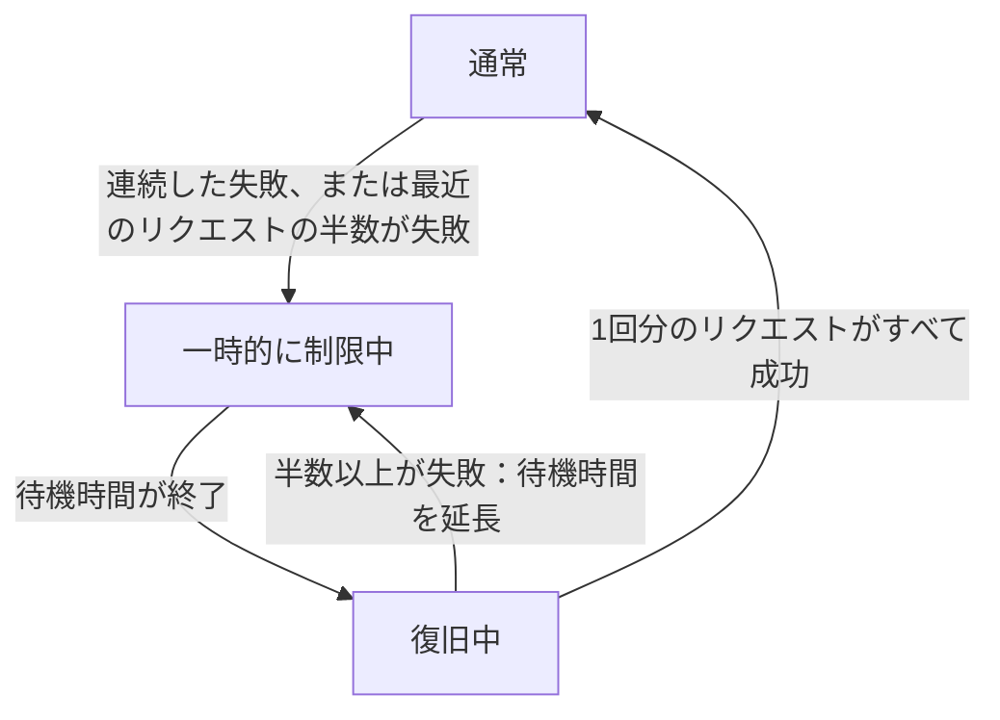

import { ProviderStatusExplorer } from "/snippets/provider-status.jsx";

モデルページでは、各プロバイダー名の後に最大2つのアイコンが表示されます。Phaseo が設定する**ステータスアイコン**と、Gateway が障害中のプロバイダーからトラフィックを迂回させている間だけ表示される**ライブルーティングのアイコン**です。

<ProviderStatusExplorer locale="ja" />

## ステータスアイコン

このステータスは Phaseo が手動で設定し、Phaseo が変更するまで維持されます。モデルページでは、3段階の優先度引き下げはすべて `優先度低` と表示されます。

| アイコン | ステータス | ルーティング |
| --- | --- | --- |
| <Icon icon="circle-check" color="#16a34a" /> | `Active` | 通常どおりルーティングされます。 |
| <Icon icon="triangle-alert" color="#f59e0b" /> | `Deranked L1` | ルーティング可能。他のプロバイダーのすぐ後に試されます。 |
| <Icon icon="triangle-alert" color="#d97706" /> | `Deranked L2` | ルーティング可能。より健全なプロバイダーの後に試されます。 |
| <Icon icon="triangle-alert" color="#ef4444" /> | `Deranked L3` | ルーティング可能。他のプロバイダーよりかなり後に試されます。 |
| <Icon icon="ban" color="#dc2626" /> | `Disabled` | ルーティングされません。 |

## ライブルーティング

Gateway は、現在処理しているリクエストに基づいて、プロバイダー、モデル、エンドポイントごとにこれを自動で設定します。制限中または復旧中のルートも引き続きルーティング可能ですが、他のプロバイダーが先に試されます。

## 提供状況と連携

ステータスのホバーカードには、プロバイダーがモデルを提供しているか、Phaseo が有効にしているかも表示されます。両方が満たされた場合にのみ、ルートは公開されます。たとえば、プロバイダーが新しいモデルを提供していても（`Available`）、Phaseo がまだ対応を開発中（`Implementing`）という場合があります。

### プロバイダーの提供状況

| ステータス | 意味 |
| --- | --- |
| `Available` | プロバイダーは現在この提供内容へのリクエストを受け付けています。 |
| `Preview` | プロバイダーはプレビューとして提供しています。 |
| `Limited Access` | 提供されていますが、アカウント、リージョン、許可リスト、または容量によってアクセスが制限されています。 |
| `Coming Soon` | プロバイダーが発表または掲載していますが、まだ利用できません。 |
| `Deprecated` | 引き続き利用できますが、プロバイダーは移行を推奨しています。 |
| `Removed` | プロバイダーは提供を終了しました。 |
| `Unknown` | Phaseo は上流での提供状況をまだ確認していません。 |

### Phaseo の連携

| ステータス | 意味 | Phaseo のルーティング |
| --- | --- | --- |
| `Unsupported` | Phaseo に互換性のある連携がありません。 | ルーティング不可。 |
| `Planned` | 連携作業は承認されていますが、まだ始まっていません。 | ルーティング不可。 |
| `Implementing` | 連携を実装中です。 | ルーティング不可。 |
| `Testing` | 実装済みで、契約、ステージング、またはカナリアテスト中です。 | 公開ルーティング不可。 |
| `Enabled` | 本番利用がサポートされ、有効になっています。 | ルーティング設定と健全性の条件を満たせば利用可能です。 |
| `Disabled` | Phaseo が意図的に連携を無効にしました。 | ルーティング不可。 |
| `Blocked` | 外部または未解決の依存関係によってロールアウトできません。 | ルーティング不可。 |

公開できるのは `Enabled` のルートだけです。`Internal` のルートは Phaseo 自身のテストトラフィックにのみ使われます。

## 互換性

`availability_status`、`routing_status`、`is_active_gateway`、`routable` は既存の連携のために API に残ります。新しい連携では、プロバイダーと Phaseo の個別のフィールドを読み取ってください。

## 関連ページ

- [ルーティングとフォールバック](./routing-and-fallbacks.mdx)
- [サービス階層](./service-tiers.mdx)
- [Models API リファレンス](../api-reference/endpoint/models.mdx)
