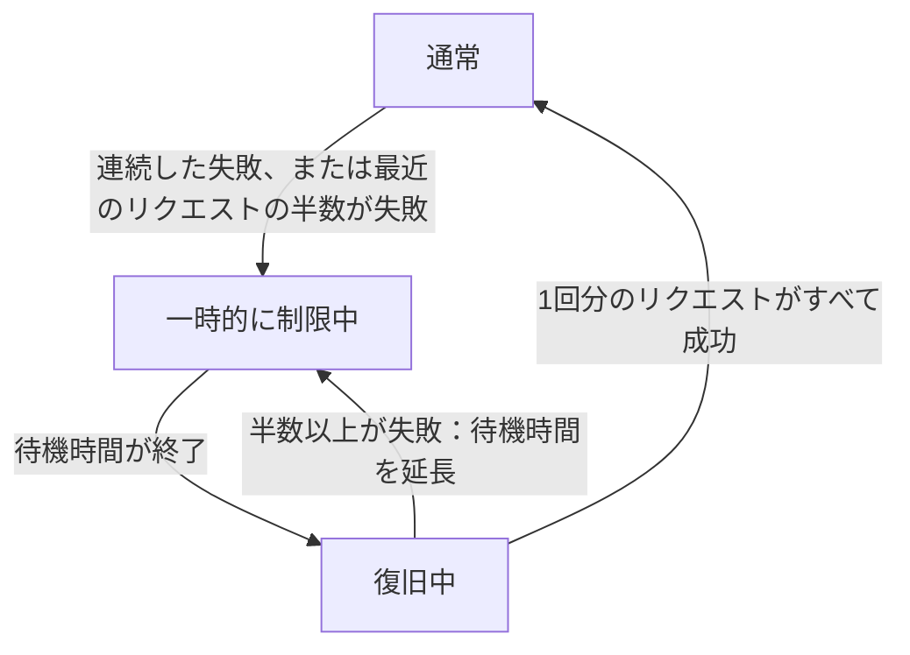

import { ProviderStatusExplorer } from "/snippets/provider-status.jsx";

プロバイダーのモデル提供には、プロバイダー側と Phaseo 側で別々のステータスがあります。プロバイダーがモデルを公開していても、Phaseo が対応するエンドポイントをまだ実装または有効化していない場合に重要です。

これらのフィールドはモデルページ、プロバイダーの料金カード、関連する利用可否の画面に表示されます。

## プロバイダーの提供状況

プロバイダーの提供状況は、上流プロバイダーが提供する内容を示します。

| ステータス | 意味 |
| --- | --- |
| `Available` | プロバイダーは現在この提供内容へのリクエストを受け付けています。 |
| `Preview` | プロバイダーはプレビューとして提供しています。 |
| `Limited Access` | 提供されていますが、アカウント、リージョン、許可リスト、または容量によってアクセスが制限されています。 |
| `Coming Soon` | プロバイダーが発表または掲載していますが、まだ利用できません。 |
| `Deprecated` | 引き続き利用できますが、プロバイダーは移行を推奨しています。 |
| `Removed` | プロバイダーは提供を終了しました。 |
| `Unknown` | Phaseo は上流での提供状況をまだ確認していません。 |

プロバイダーが提供中でも、Phaseo がそのリクエストをルーティングできるとは限りません。

## Phaseo の連携ステータス

Phaseo のステータスは、実装とロールアウトの状況を示します。

| ステータス | 意味 | Phaseo のルーティング |
| --- | --- | --- |
| `Unsupported` | Phaseo に互換性のある連携がありません。 | ルーティング不可。 |
| `Planned` | 連携作業は承認されていますが、まだ始まっていません。 | ルーティング不可。 |
| `Implementing` | 連携を実装中です。 | ルーティング不可。 |
| `Testing` | 実装済みで、契約、ステージング、またはカナリアテスト中です。 | 公開ルーティング不可。 |
| `Enabled` | 本番利用がサポートされ、有効になっています。 | ルーティング設定と健全性の条件を満たせば利用可能です。 |
| `Disabled` | Phaseo が意図的に連携を無効にしました。 | ルーティング不可。 |
| `Blocked` | 外部または未解決の依存関係によってロールアウトできません。 | ルーティング不可。 |

公開ルーティングを有効にできるのは、`Enabled` の連携だけです。

## 内部アクセス

アクセス範囲は Phaseo の連携ステータスとは別です。

| 範囲 | 意味 |
| --- | --- |
| `Public` | すべてのルーティング条件を満たせば、通常の顧客リクエストで利用できます。 |
| `Internal` | 認証済みの Phaseo テストトラフィックだけが利用できます。 |

内部ルートには、高エントロピーの内部トークンと、テストモードを明示したリクエストが必要です。テスト用ヘッダーだけでは顧客が有効にできません。通常のリクエストは内部ルートを探すためにデータベースを照会せず、既存のデフォルトコンテキストキャッシュを使います。内部テストは別のキャッシュ領域を使用し、明示的に内部として指定され、上流の提供内容が利用可能で、Phaseo のステータスが `Testing` または `Enabled` のルートだけを対象にします。

## ルーティングの健全性

ルーティングの健全性は、3つ目の運用シグナルです。有効なルートを今どのように選ぶべきかを示します。

| アイコン | ステータス | 意味 | ルーティング動作 |
| --- | --- | --- | --- |
| <Icon icon="circle-check" color="#16a34a" /> | `Active` | 通常どおり選択できる程度に健全です。 | 現在ルーティング可能。 |
| <Icon icon="triangle-alert" color="#f59e0b" /> | `Deranked L1` | 最近の健全性により、優先度が少し下がっています。 | 現在ルーティング可能。 |
| <Icon icon="triangle-alert" color="#d97706" /> | `Deranked L2` | 最近の健全性により、優先度が明確に下がっています。 | 現在ルーティング可能。より健全なルートが優先されます。 |
| <Icon icon="triangle-alert" color="#ef4444" /> | `Deranked L3` | 最近の健全性により、優先度が大きく下がっています。 | 現在ルーティング可能ですが、優先度は大幅に低くなっています。 |
| <Icon icon="ban" color="#dc2626" /> | `Disabled` | ルーティングスイッチがオフです。 | ルーティングされません。 |

優先度の引き下げによって、プロバイダーの提供状況や Phaseo 連携のライフサイクルは変わりません。リアルタイムの健全性観測も、いずれのライフサイクル項目も書き換えません。

モデルページでは、優先度が下げられたルートに黄色または赤の警告アイコンと
`優先度低` というラベルが表示されます。これらのレベルは Phaseo が手動で設定し、
Phaseo が変更するまで維持されます。

## ライブルーティング

ライブルーティングは、上記のステータスとは別のものです。Gateway は、現在処理している
リクエストに基づいて、プロバイダー、モデル、エンドポイントごとに自動で設定します。

| アイコン | 状態 | 意味 | ルーティング動作 |
| --- | --- | --- | --- |
| <Icon icon="zap-off" color="#ea580c" /> オレンジ色の斜線付き稲妻 | `一時的に制限中` | リクエストが連続して失敗したか、最近のリクエストの半数以上が失敗しました。 | ルーティング可能ですが、他のプロバイダーが先に試されます。 |
| <Icon icon="refresh-cw" color="#0ea5e9" /> 青い更新矢印 | `復旧中` | 待機時間の後、Phaseo はプロバイダーを確認するため少数のリクエストを通します。 | 1回分のリクエストがすべて成功すると、通常のルーティングに戻ります。半数以上が失敗すると、より長い待機時間で再び制限されます。 |

モデルページでは、これらの状態のいずれかに該当する間だけ、ステータスアイコンの後に
ライブルーティングのアイコンが表示されます。ルートが `優先度低` と
`一時的に制限中` の両方に該当する場合は、両方のアイコンが表示されます。詳細は
アイコンにカーソルを合わせて確認してください。

<ProviderStatusExplorer locale="ja" />

ライブルーティングによって、プロバイダーの提供状況、Phaseo 連携のステータス、
手動で設定されたルーティングの健全性が変わることはありません。

## 例

新しく公開されたプロバイダーの提供内容は、次の状態になる場合があります。

- プロバイダーの提供状況: `Available`
- Phaseo のステータス: `Implementing`
- ルーティングの健全性: ルーティングがオフのため対象外

Phaseo が手動で優先度を下げた成熟したルートは、次の状態になる場合があります。

- プロバイダーの提供状況: `Available`
- Phaseo のステータス: `Enabled`
- ルーティングの健全性: `Deranked L2`

プロバイダーで現在エラーが続いているルートは、次の状態になる場合があります。

- プロバイダーの提供状況: `Available`
- Phaseo のステータス: `Enabled`
- ルーティングの健全性: `Active`
- ライブルーティング: `一時的に制限中`

プロバイダーによる発表は、次の状態になる場合があります。

- プロバイダーの提供状況: `Coming Soon`
- Phaseo のステータス: `Planned`
- ルーティングの健全性: 対象外

## 互換性

`availability_status`、`routing_status`、`is_active_gateway`、`routable` などの既存 API フィールドは、追加ロールアウトの間も利用できます。新しい連携では、プロバイダーと Phaseo を明示するフィールドを使ってください。

## 関連ページ

- [ルーティングとフォールバック](./routing-and-fallbacks.mdx)
- [サービス階層](./service-tiers.mdx)
- [Models API リファレンス](../api-reference/endpoint/models.mdx)
