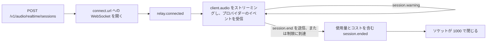

サーバーからセッションを作成し、クライアントを WebSocket で Phaseo のリレーに接続して、マイクの音声をプロバイダーのリアルタイムモデルにストリーミングします。リレーはプロバイダーのイベントを変更せずに転送し、通話中に使用量を計測して、独自のイベントを 3 つ追加します。通話中の `session.warning`、通話を切る `session.end`、最終的な請求額を含む `session.ended` です。

<Note>
リアルタイム音声はベータ版で、ワークスペースごとにアクセスが制限されています。
</Note>



## セッションを開始する

サーバーからセッションを作成します。

```bash
curl https://api.phaseo.app/v1/audio/realtime/sessions \
  -H "Authorization: Bearer $PHASEO_API_KEY" \
  -H "Content-Type: application/json" \
  -d '{"model": "openai/gpt-realtime-2", "voice": "marin"}'
```

レスポンスには `client_secret`、`connect.url`、`max_duration_seconds`、`idle_timeout_seconds`（API セッションでは常に `null`）が含まれます。

`api.phaseo.app` の `connect.url` への WebSocket を開き、`statsync-realtime` と `rtsec.<client_secret>` の 2 つのサブプロトコルを提示します。リレーは `statsync-realtime` を選択します。`rtsec.<client_secret>` だけを提示すると、プロトコルが選択されないため、ブラウザーやほとんどの WebSocket ライブラリでハンドシェイクが失敗します。

プロバイダーの準備ができると、リレーは `relay.connected` を送ります。その後、プロバイダーのサンプルレートで、マイクの音声を `{"type": "client.audio", "audio": "<base64 PCM16>"}` として送ります。

| プロバイダー | 入力音声 |
| --- | --- |
| OpenAI、xAI、ElevenLabs、GPT Live | 24 kHz PCM16 |
| Google、Mistral | 16 kHz PCM16 |

Phaseo はセッション開始時に $5 のクレジットを確保し、通話が続くにつれて確保額を延長します。

[TypeScript と Python の SDK](/ja/v1/sdk-reference/client/audio-realtime) は、これをすべて代わりに行います。`client.realtime.connect()` がセッションを作成してソケットを開き、`session.end()` が `session.ended` を返します。他の SDK にも同じ小さなクライアントがあり、各パッケージの README に例があります。

| SDK | 接続 | WebSocket ライブラリ |
| --- | --- | --- |
| Go | `realtime.Connect(ctx, client, realtime.Options{...})` | `github.com/coder/websocket`（別の `realtime` パッケージ内） |
| Java | `client.realtime.connect(Map.of("model", ...))` | JDK の `java.net.http.WebSocket` |
| C# | `await client.Realtime.ConnectAsync(new RealtimeConnectOptions { ... })` | `System.Net.WebSockets.ClientWebSocket` |
| PHP | `$client->realtime()->connect(["model" => ...])` | `phrity/websocket`（任意、`composer require phrity/websocket`） |
| Ruby | `client.realtime.connect(model: ...)` | `websocket` gem（任意） |
| Rust | `client.realtime().connect(RealtimeOptions::new(...))` | `tungstenite`（`realtime` feature で有効） |

C++ SDK にはリアルタイムクライアントがありません。

### Google Live の接続

無音を含め、通話中はずっとマイクの音声をストリーミングし続けてください。Google は約 150 秒間音声を受信しない接続を閉じ（クローズコード `1008`）、通話は `provider_closed` で終了します。リレーは音声がないまま 2 分経つと、`threshold: "input_idle"` を含む `provider_closing` の警告を送ります。ターンの間の無音はどのターンにも含まれないため、課金されません。

Google は約 10 分ごとに接続も入れ替えます。リレーは Google のセッション再開機能で通話を新しい接続に移し、ソケットを開いたまま、切り替えが終わると `{"type": "relay.provider_reconnected", "reconnects": 1}` を送ります。切り替え中（通常 1 秒未満）に送った音声は保持されてから渡されます。再開した接続はそれまでの会話を再処理し、Google は次のターンでそれを入力トークンとして再び課金するため、長い通話では切り替えのたびにターンあたりのコストが少し増えます。これらはすべて `usage` と請求額に含まれます。リレーが `provider_closing` で警告するのは再開できない場合だけで、その場合は Google が接続を閉じた時点で通話が終了します。

### GPT Live セッション

GPT Live（`openai/gpt-live-1`）は音声を担当し、推論を Responses のバックエンドモデルに渡します。`POST /v1/live/sessions` で作成します。

```bash
curl https://api.phaseo.app/v1/live/sessions \
  -H "Authorization: Bearer $PHASEO_API_KEY" \
  -H "Content-Type: application/json" \
  -d '{
    "model": "openai/gpt-live-1",
    "provider": "openai",
    "voice": "marin",
    "backend_model": "openai/gpt-5.6-luna",
    "backend_settings": {
      "tools": [{ "type": "function", "name": "get_time", "description": "Returns the current UTC time.", "parameters": { "type": "object", "properties": {} } }]
    }
  }'
```

`voice` は `alloy`、`ash`、`ballad`、`beacon`、`bossa`、`cedar`、`cinder`、`coral`、`delta`、`echo`、`gleam`、`marin`、`meridian`、`quartz`、`ripple`、`sage`、`shimmer`、`stone`、`tempo`、`verse`、`vesper`、`willow` のいずれかです。`backend_model` は `openai/gpt-5.6-luna`（既定）または `openai/gpt-5.6-terra` です。他のセッションと同じ方法で接続し、24 kHz の音声をストリーミングします。

関数ツールはクライアントで実行されます。バックエンドの呼び出しは、`event.item.type` が `function_call` の `response.event` として届きます。その名前と `arguments` はモデルが生成したもので、発話者の言葉で誘導されることがあるため、信頼できない入力として扱ってください。

1. 宣言したツールだけを `name` で検索して実行し、それ以外の名前は拒否します。
2. 使う前に `arguments` を JSON として解析し、ツールの `parameters` スキーマで検証します。
3. ログイン中のユーザーにその呼び出しが求める操作が許可されているかを確認し、データの変更、支出、誰かへの連絡を伴う操作の前には本人に確認します。

その後ツールを実行し、結果を送って続きの返答を求めます。呼び出しがこれらのチェックに通らない場合は、実行せずに理由を示す `output` を送ります。

```json
{ "type": "response.item.create", "item": { "type": "function_call_output", "call_id": "call_63hZ...", "output": "{\"utc\":\"2026-10-22T09:42:48Z\"}" } }
{ "type": "response.create" }
```

リレーが `function_call_output` を受け付けるのは、バックエンドが行った呼び出しに対してだけで、呼び出しごとに 1 回、最大 64 KB までです。`response.create` は少なくとも 1 つの出力を送った後にだけ受け付けます。それ以外は `{"type": "relay.client_event_rejected", "reason": "..."}` が返され、通話は続きます。Phaseo が関数ツールを自分で実行することはありません。

GPT Live の通話は、音声の秒数（GPT Live 自身の `usage.seconds` に基づき 1 分あたり $0.05）に加え、ツール結果の後の返答を含むすべての応答でのバックエンドモデルのトークンで課金されます。GPT Live は約 30 秒間音声を受信しないセッションを期限切れにし、通話は `provider_idle_timeout` で終了します。無音を含め、マイクの音声をストリーミングし続けてください。

### ElevenLabs Realtime セッション

ElevenLabs Realtime には 2 つのモデルがあります。高速で安価な既定の `eleven-labs/eleven-realtime-v1-mini` と、回答前に推論し、複雑な指示や複数ステップのツール使用に向いた `eleven-labs/eleven-realtime-v1-max` です。どちらも OpenAI と同じ作成リクエストとリレーを使い、音声は 24 kHz です。Phaseo は自社のキーで ElevenLabs に接続し、クライアントに見えるのはリレーだけです。

ElevenLabs は接続している秒数と、使用した言語モデルのトークンで通話を課金し、通話中は使用量を報告しません。リレーは通話中に接続時間を計測するため、確保額と当座貸越の上限は他のプロバイダーと同じように機能します。通話が終わると、Phaseo は ElevenLabs のその会話の請求額を読み取り、それと自社の定価による合計のうち大きい方を請求します。通常は数秒かかります。それより長くかかる場合、`session.ended` は `billing_status: "pending"` と `final_bill` のリクエストとともに届き、請求は ElevenLabs が報告した時点（通常は数分以内）で確定します。それまで確保額はそのまま残ります。24 時間経っても ElevenLabs が請求額を報告しない場合、セッションは接続時間だけで請求されるのではなく、請求のレビューに回されます。

### ストリーミング文字起こし

Mistral の Voxtral Realtime モデル（`mistral/voxtral-mini-transcribe-realtime-3` と `mistral/voxtral-mini-transcribe-realtime`）は、届いたライブ音声をその場で文字起こしします。音声で返答しないため、`voice` や `instructions` を付けずにセッションを作成します。

```bash
curl https://api.phaseo.app/v1/audio/realtime/sessions \
  -H "Authorization: Bearer $PHASEO_API_KEY" \
  -H "Content-Type: application/json" \
  -d '{"model": "mistral/voxtral-mini-transcribe-realtime-3"}'
```

同じ方法で接続し、16 kHz の PCM16 を `client.audio` としてストリーミングします。Mistral のイベントは変更されずに転送されます。まず `session.created`、次に新しいテキストごとに `transcription.text.delta`、Mistral が送る場合は `transcription.language` と `transcription.segment` です。文字起こしの設定を変えるには、`language`、`target_streaming_delay_ms`（80〜1,200、または 2,400）、`context_bias`、`diarize`、`turn_detection` のいずれかを含む `{"type": "session.update", "session": {...}}` を送ります。音声形式を含むその他のフィールドは `relay.client_event_rejected` で拒否されます。設定は音声が始まると固定されるため、最初の `client.audio` の前に `session.update` を送ってください。それより後の更新も同じように拒否されます。古い `mistral/voxtral-mini-transcribe-realtime` が受け付けるのは `target_streaming_delay_ms` だけです。

`session.end` を送ると、リレーは Mistral の音声ストリームを終了し、完全な文字起こしを含む `transcription.done` を最大 10 秒待ってから、請求を確定して `session.ended` を送ります。すでに送った音声は使われ、破棄されることはありません。

ストリーミング文字起こしは、送信した音声の分数（Voxtral Mini Transcribe Realtime 3 では 1 分あたり $0.008）で課金され、リレーが計測します。`transcription.done` にある Mistral 自身の数が最低請求額になります。手元にある録音には、代わりに[音声の文字起こし](/ja/v1/api-reference/endpoint/audio-transcriptions)を使ってください。

## セッションを終了する

発話者が通話を切ったら `session.end` を送ります。

```json
{ "type": "session.end", "reason": "caller hung up" }
```

| フィールド | 型 | 既定値 | 意味 |
| --- | --- | --- | --- |
| `reason` | string | なし | 自分用のメモ。表示可能な文字で最大 120 文字。`client_reason` として返されます。 |
| `cancel_response` | boolean | `true` | `true` は再生中の返答をキャンセルします。`false` は最大 20 秒まで最後まで再生させます。 |

その後、リレーは次のことを行います。

1. 音声の受け付けを止めます。
2. プロバイダーがまだターンに確定していないマイクの音声を破棄します。
3. 進行中の返答をキャンセルするか最後まで再生させ、その使用量を最大 10 秒待ちます。
4. GPT Live の場合は、プロバイダーに `session.close` を送り、`session.closed` を待ちます。
5. 請求を確定します。
6. `session.ended` を送ります。
7. コード `1000` でソケットを閉じます。

`session.end` を送らずにソケットを閉じても通話は終了し、同じように課金されますが、クライアントは `session.ended` を受け取れません。

## 最終的な請求額を読む：`session.ended`

リレーは、自分が要求した終了、プロバイダーが始めた終了、Gateway が始めた終了のすべてで `session.ended` を送ります。リレーがソケットを閉じる直前、まだソケットが開いている間に送られます。

```json
{
  "type": "session.ended",
  "session_id": "rt_01k8...",
  "reason": "client_requested",
  "initiated_by": "client",
  "client_reason": "caller hung up",
  "duration_seconds": 184.2,
  "usage": { "input_audio_tokens": 1840, "output_audio_tokens": 3120, "input_text_tokens": 412 },
  "cost": {
    "total_usd": 0.231,
    "total_nanos": 231000000,
    "estimated": false,
    "estimate_basis": null,
    "debt_nanos": 0,
    "uncollected_nanos": 0,
    "currency": "USD"
  },
  "billing_status": "settled"
}
```

| フィールド | 意味 |
| --- | --- |
| `reason` | 安定した理由コード。[理由コード](#reason-codes)を参照してください。 |
| `initiated_by` | `client`、`gateway`、`provider` のいずれか。 |
| `duration_seconds` | リレーが接続してからの時間。 |
| `usage` | 通話の課金対象となる使用量です。キャッシュの読み取りと書き込みを含むモダリティ別のトークン数、通話の音声の長さである `audio_seconds`（xAI、ElevenLabs、Mistral、GPT Live の音声はこれで課金されます。トークンで課金される通話では参考値として表示されます）、GPT Live のウェブ検索の `native_web_search_requests` です。`billing_status` が `pending` または `unresolved` の場合はその時点で判明している使用量で、最終的なメーターは `final_bill` で取得できます。 |
| `cost.estimated` | 中断されたターンのプロバイダーの使用量が届かなかったため、使用量の一部を計測した音声から推定した場合は `true`。理由は `estimate_basis` に示されます。 |
| `cost.debt_nanos` | 確保額と無料残高を超えて当座貸越として請求されたコストの部分。 |
| `cost.uncollected_nanos` | 当座貸越の上限を超え、請求されなかったコスト。 |
| `provider_close_code` | プロバイダーが通話を終了した場合の、プロバイダーの WebSocket クローズコード。 |
| `billing_status` | `settled`、`pending`、`unresolved` のいずれか。 |

請求の確定がまだ再試行中の場合、`billing_status` は `pending` で、`cost` には途中の推定額が表示されます。セッションに請求のレビューが必要な場合は `unresolved` です。どちらの場合も、`final_bill` に確定後の最終的なコストを取得するためのリクエストが示されます。

```json
"final_bill": { "method": "GET", "path": "/v1/generations?id=realtime%3Art_01k8..." }
```

<span id="reason-codes"></span>
### 理由コード

| `reason` | `initiated_by` | タイミング |
| --- | --- | --- |
| `client_requested` | client | `session.end` を送りました。 |
| `client_disconnected` | client | `session.end` を送らずにソケットが閉じました。 |
| `provider_closed` | provider | プロバイダーが接続を閉じました。たとえば、音声がないまま約 150 秒経った Google（コード `1008`）や、リレーが再開できなかった `goAway` の後です。 |
| `provider_idle_timeout` | provider | 約 30 秒間音声を受信しなかったため、GPT Live がセッションを期限切れにしました。 |
| `provider_error` | provider | プロバイダーへの接続が失敗したか、エラーを報告しました。 |
| `max_duration_reached` | gateway | プロバイダーのセッションの上限に達しました。 |
| `insufficient_funds` | gateway | 当座貸越の上限に達しました。 |
| `key_revoked` | gateway | 通話中に API キーが取り消されたか削除されました。 |
| `key_expired` | gateway | 通話中に API キーの有効期限が切れました。 |
| `key_blocked` | gateway | 通話中に API キーが一時停止されました。 |
| `workspace_disabled` | gateway | ワークスペースが存在しなくなりました。 |
| `policy_blocked` | gateway | ワークスペースのポリシー変更によってモデルがブロックされたか、プロバイダーが許可リストから外され、`policy_blocked` の警告から 30 秒後もその状態が続いていました。 |
| `input_rejected` | gateway | リレーがクライアントの音声を拒否しました。大きすぎる、リアルタイムより速い、またはプロバイダーの処理が追いつかなかった場合です。 |
| `session_reconciled` | gateway | リレーが状態を失い、セッションが照合処理によって閉じられました。 |
| `gateway_error` | gateway | Phaseo がプロバイダーのイベントを処理できなかったか、使用量を記録できませんでした。 |
| `idle_timeout` | gateway | Playground のみ。音声がないまま 5 分経ちました。 |
| `spend_limit_reached` | gateway | Playground のみ。キーの支出上限またはワークスペースの予算に達しました。 |

新しいコードが追加される可能性があるため、不明な `reason` は `gateway_error` と同じように扱ってください。

## 警告を処理する：`session.warning`

警告は通話を終了させずに、これから起こることを知らせます。各コードはしきい値ごとに最大 1 回送られます。

```json
{ "type": "session.warning", "code": "max_duration_approaching", "message": "...", "seconds_remaining": 120, "expires_at": "2026-10-22T11:00:00.000Z" }
```

| `code` | 追加のフィールド | タイミング |
| --- | --- | --- |
| `max_duration_approaching` | `seconds_remaining`、`expires_at` | プロバイダーのセッションの上限の 2 分前と、30 秒前にもう一度。 |
| `provider_closing` | `seconds_remaining`、アイドルの場合は `threshold: "input_idle"` | Google が接続を閉じようとしています。リレーが再開できなかった `goAway` の後、または（`input_idle`）音声が 2 分間届いていないためです。 |
| `funds_low` | `remaining_usd` | クレジットの確保額を延長できませんでした。通話は無料残高で続きます。 |
| `overdraft_in_use` | `remaining_usd`、`overdraft_used_usd` | 無料残高を使い切り、通話は当座貸越で続いています。上限の残りが $0.25 未満になると再び送られます。 |
| `spend_limit_exceeded` | `limit`（`key` または `workspace_budget`） | キーの支出上限またはワークスペースの予算に達しました。通話は続きますが、新しいリクエストは拒否されます。 |
| `policy_blocked` | `status`。`status` が `ending` の場合は `seconds_remaining` と `ends_at` も | ワークスペースのポリシーが通話をブロックしたか、そのプロバイダーが許可リストから外されました。変更が取り消されない限り、通話は 30 秒後に終了します。取り消された場合は `status: "cleared"` の 2 回目の警告が届きます。 |

`remaining_usd` は、当座貸越を含め、通話が終了するまでにまだ使える金額です。

## 通話が自動で終了する場合

API セッションがアイドルを理由に Phaseo によって終了されることはなく、支出上限は警告するだけです。通話が自動で終了するのは、次のいずれかが起きた場合だけです。

| 制限 | 値 |
| --- | --- |
| OpenAI Realtime | 60 分 |
| xAI | 120 分 |
| Google Live | リレーが再開した接続を通算して 60 分。クライアントが約 150 秒間音声を送らない場合も通話は終了します。 |
| GPT Live | 25 分 |
| ElevenLabs Realtime | 30 分 |
| Mistral のストリーミング文字起こし | 60 分 |
| 当座貸越の上限 | 確保額と無料残高を超えて $1 |
| アクセスの喪失 | キーが取り消された、期限切れになった、一時停止された、またはワークスペースが削除された場合。約 1 分以内に検出され、猶予期間なしで通話が終了します。 |
| ポリシーの変更 | `policy_blocked` の警告から 30 秒後、ポリシーがまだ通話をブロックしている場合 |

セッションの上限は、セッションを作成した時点ではなく、リレーが接続した時点から数えられます。
