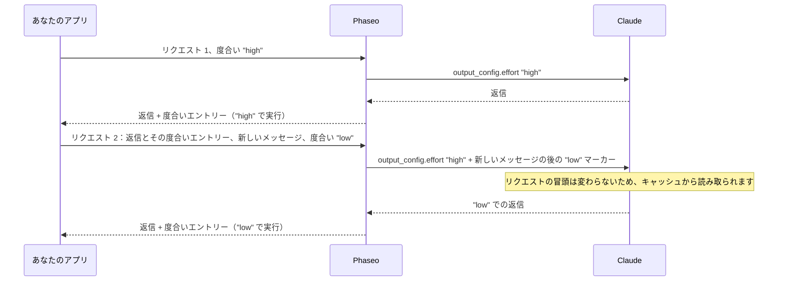

import { EffortCacheExplorer } from "/snippets/effort-cache.jsx";

どのリクエストでも異なる `reasoning_effort`（Chat Completions）または `reasoning.effort`（Responses）を送ると、Phaseo はプロンプトキャッシュをやり直さずに Claude の度合いを変更します。Claude の推論を毎回変更せずに送り返している限り、コードのほかの部分を変える必要はありません。

<EffortCacheExplorer locale="ja" />

Phaseo は会話の最初のリクエストの度合いを Claude に送り続け、各変更を新しいメッセージの後に度合いマーカーとして追加します。マーカーより前の部分はすべて同じままなので、Claude はそれをキャッシュから読み取ります。推論を削除すると、Phaseo は代わりにトップレベルの度合いを変更し、Claude は最初の返信以降のすべてをキャッシュから読み取らずにもう一度処理します。

## Phaseo がキャッシュを保つしくみ

Claude がキャッシュされた会話を読み取るのは、リクエストの冒頭がバイト単位で同じ場合だけで、トップレベルの度合いはその冒頭の一部です。Anthropic の[メッセージ単位の度合い](https://platform.claude.com/docs/en/build-with-claude/effort-per-message)は、代わりに `messages` の中で度合いを変更します。空の `content` と `output_config.effort` を持つ `system` メッセージを使います。Phaseo はこれらのマーカーを自動で書き込みます。



Phaseo はリクエスト間で何も保存しません。Claude の各返信の最後には、実行時の度合いを記録した推論エントリーが 1 つあり、Phaseo は送り返されたエントリーから、以前のすべてのマーカーを同じ場所に再構築します。

| リクエスト | 送る値 | Phaseo が Claude に送る内容 |
| --- | --- | --- |
| 1 | `"high"` | `output_config.effort: "high"` |
| 2 | `"low"` | `"high"` と、新しいメッセージの後の `low` マーカー |
| 3 | `"low"` | `"high"` と、同じ場所にある同じマーカー |
| 4 | `"high"` | `"high"`、以前のマーカー、新しいメッセージの後の `high` マーカー |

送り返したメッセージが変更されることはありません。マーカーは Phaseo が Claude に送るリクエストの中にだけ存在します。

## 推論を変更せずに送り返す

<Warning>
すべての推論エントリーを、受け取ったとおりに毎回のリクエストで送り返してください。Chat の `reasoning_details`、Responses の `reasoning` アイテム、Anthropic の `thinking` ブロックが対象で、暗号化されているかどうかは問いません。削除、編集、並べ替え、要約はしないでください。これらがないと、度合いの変更で Claude のキャッシュがやり直しになり、Claude はツールループのステップ間で推論を失います。
</Warning>

度合いエントリーにはテキストがありません。Chat Completions では、`reasoning_details` の最後の `reasoning.encrypted` エントリーです。

```json
{
  "role": "assistant",
  "content": "1. Export the data. 2. Create the schema. 3. Import and verify.",
  "reasoning_details": [
    { "type": "reasoning.text", "text": "…", "signature": "phx1.…", "format": "anthropic-claude-v1" },
    { "type": "reasoning.encrypted", "data": "phx1.…", "format": "anthropic-claude-v1" }
  ]
}
```

Responses では、`output` の最後の `reasoning` アイテムで、`id` は `rs_effort_` で始まります。

```json
{ "type": "reasoning", "id": "rs_effort_req_123", "summary": [], "content": [], "encrypted_content": "phx1.…" }
```

この値は不透明で、Phaseo は会話がどのプロバイダーに届く前にもこれを取り除きます。

## コードで度合いを変更する

Claude の返信全体を会話に追加してから、次のリクエストで希望する度合いを設定します。トップレベルの `cache_control` は Claude ルートでキャッシュを有効にします。[プロンプトキャッシュ](./prompt-caching.mdx#which-providers-cache-automatically)を参照してください。

### Chat Completions

<CodeGroup>
```ts TypeScript
import OpenAI from "openai";

const client = new OpenAI({
	apiKey: process.env.PHASEO_API_KEY,
	baseURL: "https://api.phaseo.app/v1",
});

const messages: OpenAI.ChatCompletionMessageParam[] = [
	{ role: "user", content: "Plan a migration from SQLite to PostgreSQL." },
];

async function ask(effort: "low" | "medium" | "high") {
	const response = await client.chat.completions.create({
		model: "anthropic/claude-opus-5.5",
		reasoning_effort: effort,
		messages,
		// @ts-expect-error Phaseo field: cache the conversation on Claude routes
		cache_control: { type: "ephemeral" },
	});
	const message = response.choices[0].message;
	messages.push(message); // the whole message, reasoning_details included
	return message.content;
}

await ask("high");
messages.push({ role: "user", content: "Summarise the plan in one sentence." });
await ask("low"); // Claude reads request 1 from cache
```

```python Python
import os
from openai import OpenAI

client = OpenAI(
    api_key=os.environ["PHASEO_API_KEY"],
    base_url="https://api.phaseo.app/v1",
)

messages = [{"role": "user", "content": "Plan a migration from SQLite to PostgreSQL."}]

def ask(effort: str) -> str | None:
    response = client.chat.completions.create(
        model="anthropic/claude-opus-5.5",
        reasoning_effort=effort,
        messages=messages,
        extra_body={"cache_control": {"type": "ephemeral"}},
    )
    message = response.choices[0].message
    # The whole message, reasoning_details included
    messages.append(message.model_dump(exclude_none=True))
    return message.content

ask("high")
messages.append({"role": "user", "content": "Summarise the plan in one sentence."})
ask("low")  # Claude reads request 1 from cache
```
</CodeGroup>

### Responses

Phaseo はレスポンスを保存しないため、すべての `output` アイテムを含む会話全体を `input` で送ってください。

<CodeGroup>
```ts TypeScript
import OpenAI from "openai";

const client = new OpenAI({
	apiKey: process.env.PHASEO_API_KEY,
	baseURL: "https://api.phaseo.app/v1",
});

const input: OpenAI.Responses.ResponseInput = [
	{ role: "user", content: "Plan a migration from SQLite to PostgreSQL." },
];

async function ask(effort: "low" | "medium" | "high") {
	const response = await client.responses.create({
		model: "anthropic/claude-opus-5.5",
		reasoning: { effort },
		input,
		// @ts-expect-error Phaseo field: cache the conversation on Claude routes
		cache_control: { type: "ephemeral" },
	});
	input.push(...response.output); // every item, reasoning items included
	return response.output_text;
}

await ask("high");
input.push({ role: "user", content: "Summarise the plan in one sentence." });
await ask("low"); // Claude reads request 1 from cache
```

```python Python
import os
from openai import OpenAI

client = OpenAI(
    api_key=os.environ["PHASEO_API_KEY"],
    base_url="https://api.phaseo.app/v1",
)

conversation = [{"role": "user", "content": "Plan a migration from SQLite to PostgreSQL."}]

def ask(effort: str) -> str:
    response = client.responses.create(
        model="anthropic/claude-opus-5.5",
        reasoning={"effort": effort},
        input=conversation,
        extra_body={"cache_control": {"type": "ephemeral"}},
    )
    # Every item, reasoning items included
    conversation.extend(item.model_dump(exclude_none=True) for item in response.output)
    return response.output_text

ask("high")
conversation.append({"role": "user", "content": "Summarise the plan in one sentence."})
ask("low")  # Claude reads request 1 from cache
```
</CodeGroup>

### Anthropic Messages

`/v1/messages` では、マーカーを自分で送ります。空の `content` と `output_config.effort` を持つ `system` メッセージです。トップレベルの `output_config.effort` は毎回のリクエストで同じにし、以降のリクエストでも各マーカーを同じ位置に残してください。`mid-conversation-output-config-2026-07-01` ベータヘッダーは Phaseo が追加するため、送る必要はありません。

```bash cURL
curl https://api.phaseo.app/v1/messages \
  -H "x-api-key: $PHASEO_API_KEY" \
  -H "anthropic-version: 2023-06-01" \
  -H "Content-Type: application/json" \
  -d '{
    "model": "anthropic/claude-opus-5.5",
    "max_tokens": 4096,
    "cache_control": { "type": "ephemeral" },
    "output_config": { "effort": "high" },
    "messages": [
      { "role": "user", "content": "Plan a migration from SQLite to PostgreSQL." },
      { "role": "assistant", "content": "1. Export the data. 2. Create the schema. 3. Import and verify." },
      { "role": "system", "content": [], "output_config": { "effort": "low" } },
      { "role": "user", "content": "Summarise the plan in one sentence." }
    ]
  }'
```

マーカーの位置によって、新しい度合いがいつ始まるかが決まります。

- **ユーザーメッセージの直後：** そのメッセージへの Claude の返信が新しい度合いを使います。
- **それ以外の場所**（上の例のように Claude の返信と次のメッセージの間など）：新しい度合いは次のメッセージから始まります。

ツールの結果だけを含むユーザーメッセージは、新しいメッセージとして数えられません。メッセージ単位の度合いに対応していないルートでは、Phaseo はマーカーを取り除き、有効な度合いをトップレベルの度合いとして送ります。

## 変更でキャッシュがやり直しになる場合

次の場合、Phaseo はほかのプロバイダーと同様にトップレベルの度合いを変更します。

- **推論がない。** クライアントが `reasoning_details` または `reasoning` アイテムを削除したため、最新の Claude の返信に度合いエントリーがありません。
- **変更がツールループのステップ間で行われる。** 最新のメッセージにツールの結果しか含まれないため、マーカーは次のメッセージからしか適用されません。Phaseo はこのステップが指定した度合いで実行されるようにトップレベルの度合いを変更し、以降の変更では再びマーカーを使います。
- **リクエストが度合いを設定していない、または推論を無効にしている。** 毎回のリクエストで `reasoning_effort` または `reasoning.effort` を送ってください。`"none"` と `reasoning.enabled: false` は推論を無効にします。
- **ルートが対応していない。** [対応モデル](#supported-models)を参照してください。

トップレベルでの変更では、Claude の最初の返信より前の会話部分はキャッシュに残ります。Claude はその返信以降のすべてをもう一度処理し、新しい入力として課金します。

<span id="supported-models"></span>
## 対応モデル

| ルート | モデル |
| --- | --- |
| Anthropic、Google Vertex AI | Claude Fable 5.2 と 5.1、Mythos 5.2 と 5.1、Opus 5.5 と 5、Sonnet 5.5、Haiku 5.5 |
| Claude on AWS | Mythos を除く同じモデル |
| Amazon Bedrock | Claude Fable 5.1 と Opus 5.5 |

Azure 上の Claude を含むその他のすべてのルートでは、度合いの変更はトップレベルに送られます。

## キャッシュが保たれたことを確認する

変更後のリクエストでキャッシュの数を確認してください。Chat Completions では `usage.prompt_tokens_details.cached_tokens`、Responses では `usage.input_tokens_details.cached_tokens`、Anthropic Messages では `usage.cache_read_input_tokens` です。すべてのフィールドは[使用量と料金のフィールド](./prompt-caching.mdx#usage-and-pricing-fields)に記載されています。

2026 年 11 月 11 日に、`anthropic/claude-haiku-5.5` で同じ 5 リクエストの Chat Completions 会話を、度合いエントリーを送り返した場合と送り返さなかった場合の 2 回計測しました。度合いは `high`、`high`、`low`、`low`、`high` で、2 番目のメッセージで 3,400 トークンのドキュメントが届きました。

| リクエスト 3（度合い `high` から `low`） | 度合いエントリーを削除 | 度合いエントリーを送り返す |
| --- | --- | --- |
| キャッシュから読み取られたトークン | 0 | 3,575 |
| もう一度処理されてキャッシュに書き込まれたトークン | 3,499 | 75 |
