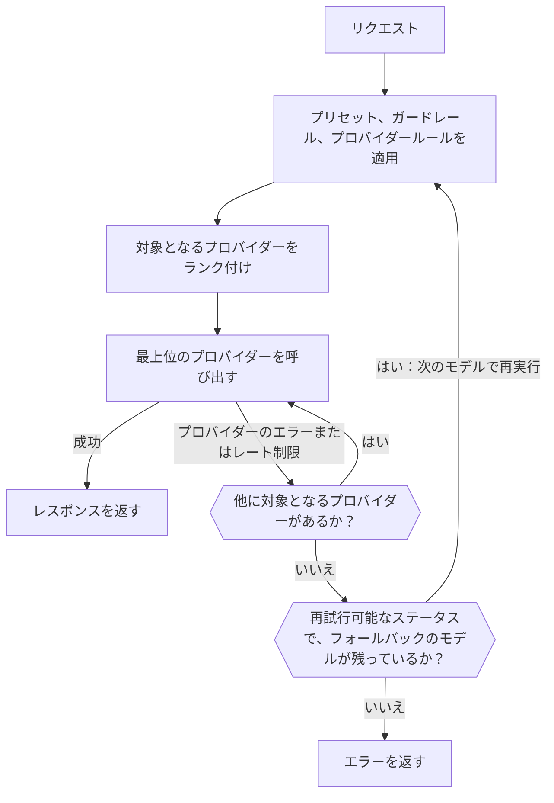

import { RoutingCostExplainer } from "/snippets/routing-cost.jsx";
import { FallbackChainExplorer } from "/snippets/fallback-chain.jsx";

ほとんどのモデルは複数のプロバイダーが提供しています。Gateway はリクエストごとに、ルールで許可されたプロバイダーを残してランク付けし、最も良いプロバイダーを呼び出します。そのプロバイダーが失敗すると次を試し、すべてのプロバイダーが再試行可能なエラーで失敗した場合は、フォールバックのモデルに進むことができます。



それでも、クライアントは `429` と `5xx` のレスポンスを指数バックオフで再試行してください。

<span id="choose-how-providers-are-ranked"></span>
## プロバイダーのランク付け方法を選ぶ

| モード | ランク付けの基準 | 使う場面 |
| --- | --- | --- |
| `balanced`（既定） | 成功した回答あたりのコスト | 価格、速度、信頼性のバランスを最適にしたい場合。 |
| `price` | 価格 | 応答時間よりコストが重要な場合。 |
| `latency` | 最初のトークンまでの時間 | 応答をすぐに開始する必要がある場合。 |
| `throughput` | 出力速度 | 長い出力を早く終わらせる必要がある場合。 |

ワークスペースの既定値は、**ダッシュボード -> 設定 -> ルーティング**、`phaseo settings update --routing-mode <mode>`、または `PATCH /v1/settings` の `routing_mode` で設定します。1 つのリクエストだけなら、`provider.sort` または `routing.mode` を送るか、モデル ID にサフィックスを付けます。

| サフィックス | モード | 例 |
| --- | --- | --- |
| `:nitro` | `throughput` | `openai/gpt-6-astra:nitro` |
| `:cheap` | `price` | `openai/gpt-6-astra:cheap` |
| `:fast` | `latency` | `openai/gpt-6-astra:fast` |

サフィックスは `routing.mode`、`provider.sort`、プリセットとワークスペースのモードより優先されます。許可リスト、リージョン、ガードレール、価格の上限は引き続き適用されます。

ルーティングの設定ページにはベータとアルファのチャンネルの切り替えもあるため、プレビュー版のプロバイダーにトラフィックが送られるのはオプトインした場合だけです。

## balanced モードがプロバイダーをランク付けする方法

テキストリクエスト（Chat Completions、Responses、Messages）では、`balanced` は各プロバイダーの**成功した回答あたりのコスト**を見積もります。

- **トークン:** モデルの計測済みのプロンプトと出力のサイズ、プロバイダーの計測済みのキャッシュヒット率をもとにした、そのプロバイダーでのこのモデルの一般的なリクエストのコストです。
- **待ち時間:** 最初のトークンまでの時間と完全なレスポンスまでの時間を、モデルの一般的な秒あたりの価格でドルに換算したものです。
- **失敗:** 合計をプロバイダーの最近の成功率で割り、プロバイダーのエラーに対するペナルティと、レート制限に対するより小さいペナルティを加えます。

最低コストに近いプロバイダーがトラフィックの大部分を分け合います。復旧に気付けるよう、すべてのプロバイダーに少しの割合が残されます。シナリオを選んで、どうなるかを確認してください（プロバイダーは例です）。

<RoutingCostExplainer locale="ja" />

その他のエンドポイントは、信頼性、レイテンシ、テールレイテンシ、スループット、価格、トークンの適合度でスコア付けされます。プロバイダーの方は、[プロバイダーがトラフィックを獲得する仕組み](./how-providers-earn-traffic)でより大きな割合を得る方法を確認できます。

<span id="request-level-model-fallbacks"></span>
## リクエスト単位のモデルフォールバック

フォールバックのモデルを `models` に列挙します。Phaseo はまず `model` を試し、次に各エントリを順に試します。

```json
{
  "model": "openai/gpt-6-astra",
  "models": ["anthropic/claude-sonnet-5.5", "google/gemini-4-argon"],
  "input": "Summarize this incident report."
}
```

各モデルが返す結果を選んで、Phaseo がいつ次に進むかを確認してください。

<FallbackChainExplorer locale="ja" />

**次のモデルに進む場合。** モデルが試されるのは、前のモデルがプロバイダーの再試行をすべて含めて `429`、`500`、`502`、`503`、`504` で終わった後だけです。Phaseo の予算や無料モデルのクォータによる `429` も、別のモデルなら残りの制限に収まる可能性があるため、次に進みます。[提供終了](#retired-models)したモデルなど、どのプロバイダーも提供しなくなったモデルも同様です。

**次に進まない場合。** `400`、`401`、`402`、`403`、`404`、`408`、`413`、`422` などのクライアントエラーはすぐに返されます。認証や API キーのレート制限など、最初のモデルが実行される前の失敗も同様です。

**リストのルール:**

- `model` は必須です。`models` だけを送ると `400` が返ります。
- `models` には 1〜25 個のエントリを指定します。重複や `model` と同じものは無視されます。
- エントリには、モデル ID、[プロバイダー指定の ID](./provider-qualified-models)、`@support` のようなプリセットを使えます。
- 各試行は、それぞれ独立したリクエストとして検証されます（エンドポイント、パラメーター、ワークスペースのモデル、ガードレール、プリセット、料金、BYOK）。リクエストを処理できないフォールバックはスキップされて記録され、本来返されるはずのエラーを置き換えることはありません。すでに行った試行と同じ試行もスキップされます。

**ログと課金。** 各試行は独自の使用量レコードを持つ別々のリクエストで、フォールバックがない場合と同じように課金されます。レスポンスの `model` フィールドには回答したモデルが示され、そのルーティングのトレースには、元のリクエスト ID、フォールバックの順序、それまでの各試行が一覧表示されます。

**ストリーミング、動画、音楽。** ストリームがフォールバックするのは最初のバイトの前だけで、それ以降のエラーはストリーム内で届きます。動画と音楽がフォールバックするのは、ジョブの送信中だけです。

**他のルーティング設定との組み合わせ。** 割り当てられた動的ルートのフォールバックは `models` より優先され、ルートが選んだ固定のモデルは各試行に引き続き適用されます。プリセットは、それが使われる各試行に独自の制約を適用します。[`phaseo/auto`](./auto-routing) は独自のフォールバックを管理するため、`models` と組み合わせることはできません。

| エンドポイント | `models` |
| --- | --- |
| Chat Completions、Responses、Messages | 対応。最初のバイトの前のストリームを含みます |
| Embeddings、Moderations、Rerank | 対応 |
| 画像の生成と編集 | 対応。マルチパートのアップロードを含みます |
| 音声合成、文字起こし、翻訳 | 対応。マルチパートのアップロードを含みます |
| OCR、Parse、Decisions | 対応 |
| 動画と音楽の生成 | ジョブの送信時に対応 |
| Batches | `400`：各バッチ行は 1 つのモデルを対象にします |
| リアルタイムとライブのセッション | `400`：セッションは 1 つのモデルに固定されます |
| Council の実行 | `400`：モデルは実行の設定から決まります |

マルチパートのエンドポイントは、繰り返しの `models` フィールド、`models[]` フィールド、または 1 つの JSON 配列の文字列を受け付けます。[レート制限](../api-reference/limits.mdx)と[エラー](../api-reference/errors.mdx)も参照してください。

<span id="pin-one-provider"></span>
## 1 つのプロバイダーに固定する

モデル ID の前にプロバイダーを付けると、そのプロバイダーだけを使います。

```json
{
  "model": "baseten:thinking-machines/inkling-small",
  "input": "Hello"
}
```

これにより、そのリクエストではプロバイダー間のフォールバックが無効になります。`baseten:google/gemma-4-26b-a4b:free` のように、サフィックスはモデル ID の一部として残ります。構文とエラーの詳細は[プロバイダー指定のモデル ID](./provider-qualified-models) を参照してください。

## 使うプロバイダーを制限する

| 設定 | 場所 | 動作 |
| --- | --- | --- |
| [プリセット](./presets) | **設定 -> プリセット** | 許可モデルとプロバイダーの許可リストまたは除外リスト。ランク付けの前に適用されるため、フォールバックも制限されます。 |
| [リージョンルーティング](./regional-routing) | リクエストまたはワークスペース | 実行またはデータをリージョン内に留めます。 |
| 動的ルート | **設定 -> ルーティング** | キーごとのルール。下記を参照してください。 |
| BYOK のフォールバック | **設定 -> BYOK** | 失敗した BYOK リクエストを Phaseo のクレジットで再試行できるかどうか。 |

<span id="attach-routing-rules-to-api-keys"></span>
### API キーにルーティングルールを割り当てる

動的ルートは、1 つ以上の推論 API キーに割り当てるルールのフローです。次のことができます。

- リクエスト本文のフィールド、ヘッダー、カスタムの `metadata`、エンドポイント、モデル、セッション ID で分岐する
- A/B テストや段階的な展開のために、トラフィックを割合で分割する
- キーごとに日、週、月のリクエスト数やコストに上限を設ける
- モデル、ルーティングモード、プロバイダーの優先設定、フォールバックのモデル（最大 8 個）を切り替える
- キャッシュとセッションを考慮したプロバイダーアフィニティを有効にする

条件には true と false の出力があり、レートと予算のノードには範囲内と超過の出力があります。割合による分割はセッションまたはプロンプトキャッシュのキーごとに決定的なので、キャッシュされた会話がブランチ間で移動することはありません。

保存すると、変更できない下書きのバージョンが作成されます。デプロイすると、そのバージョンが Gateway にコピーされ、そのキーのポリシーキャッシュがクリアされます。以前のバージョンはロールバック用に残ります。プロバイダーの稼働状況に関する推奨事項は **Insights** に表示されます。スクリプトからは、管理キーを使って `/v1/routing/dynamic-routes` API を利用します。

OpenAI 互換のテキストエンドポイントでは、カスタムのメタデータをリクエスト本文に入れます。

```json
{
  "model": "openai/gpt-6-astra",
  "metadata": { "customer_plan": "pro", "workspace": "acme" }
}
```

## 会話を 1 つのプロバイダーに留める

テキスト生成では、キャッシュを考慮したルーティングが既定で有効です。`prompt_cache_key` または `session_id` を送るリクエストや、`cache_control`（トップレベル、`provider_options.anthropic` 内、またはメッセージブロックやツールの `cache_control` か `prompt_cache_breakpoint` の印）でキャッシュをオプトインしたリクエストは、最初に成功したリクエストを処理したプロバイダーとルートに固定されます。その他のリクエストは、同じ冒頭のコンテキストについてプロバイダーがキャッシュの読み取りまたは書き込みを報告し、そのプロバイダーのキャッシュされた入力が通常の入力より安い場合に、15 分間固定されます。

| | |
| --- | --- |
| 固定の期間 | プロバイダーのキャッシュ保持期間に応じて 15 分〜24 時間。`session_id` の場合は、セッションのアクティビティに応じて最大 24 時間。 |
| 範囲 | ワークスペースごと。`session_id` の場合は、冒頭のコンテキストではなくセッションに紐付きます。 |
| 固定が移る条件 | プロバイダーのサーキットブレーカーが開いた、エラー率が高い、そのプロバイダーでの Phaseo の管理クォータを使い切った、またはルールがそのプロバイダーを許可しなくなった場合。 |

1 つのリクエストで無効にするには `provider.cache_aware_routing: false` を、キャッシュのアフィニティを保ったままセッションを無視するには `routing.session_affinity: false` を使います。

```json
{
  "model": "openai/gpt-6-astra",
  "session_id": "support-session-42",
  "routing": { "session_affinity": false }
}
```

Phaseo が各プロバイダーに送るヒントは、[プロバイダーアフィニティ](./prompt-caching.mdx#provider-affinity)に一覧があります。

<span id="explain-a-routing-decision"></span>
## ルーティングの判断を説明する

**ダッシュボード -> 設定 -> 使用量 -> リクエストログ** を開き、リクエストを選択して、**プロバイダーの応答** の下にある **ルーティングの可観測性** を展開します。次の内容が表示されます。

- ランク付けされたすべてのプロバイダーと最終スコア、選択されたものと試行されたもの
- ランク付けの前に除外されたプロバイダーとその理由
- 展開状況やルーティングのステータスによって順位を下げられたプロバイダー
- 各スコアの入力、重み、寄与、倍率

スコアの要素はスコアを変えます。記録されたコンテキストは、必ずしも判断に影響せずに判断を説明します。トレースに含まれるのは数値とステータスだけで、プロンプトや出力は含まれません。ルーティングの可観測性が有効になる前のリクエストでは、トレースが一部しか表示されないか、まったく表示されないことがあります。

### プロバイダーの稼働率に影響するもの

| 稼働率を下げる | 下げない |
| --- | --- |
| `401` 認証の失敗 | `400` 不正なリクエスト |
| `402` 支払いの失敗 | `403` 地理的な制限 |
| `404` モデルが見つからない | `413` 大きすぎるペイロード |
| `500` 以上 | `429` レート制限 |
| ストリーム開始後のエラー | |
| エラーの理由で終わる `200` | |

地理的な制限とレート制限は、プロバイダーが停止していることを意味しないため、別に追跡されます。本番環境では、失敗をこれらのトレースと照合できるよう、リクエスト ID、ステータスコード、モデル ID を記録してください。

<span id="retired-models"></span>
## 提供終了したモデル

提供終了したモデルは、いずれかのプロバイダーが提供している間は動作し続けます。その後は、ワークスペースが提供終了モデルのルーティングで代替モデルに送る設定をしていない限り、リクエストは `410 model_retired` で失敗します。自分の `models` リストは常に最初に試されます。[モデルの非推奨化と提供終了](./model-retirement.mdx)を参照してください。

<span id="byok-considerations"></span>
## BYOK に関する考慮事項

<Tooltip tip="独自キーの持ち込み: Phaseo はあなたのプロバイダー API キーでリクエストをルーティングし、モデルの利用料はプロバイダーから直接請求されます。">BYOK</Tooltip> では、Phaseo がリクエストをルーティングして記録し、モデルの使用量はプロバイダーが請求します。

| | |
| --- | --- |
| サービス手数料 | UTC の各月で、完了した BYOK リクエストの最初の 250,000 件までは無料。それ以降はプロバイダー相当のコストの 2.5%。 |
| Phaseo のクレジット | 管理キーへのフォールバックと無料枠を超えた後の手数料のため、少なくとも $1 を残しておいてください。 |
| プロバイダーのルール | プロバイダーのクォータ、データポリシー、モデルへのアクセス、アカウントの制限は引き続き適用されます。 |
| 保存 | キーは AES-256-GCM で暗号化され、そのワークスペースとプロバイダーに紐付けられます。 |

各キーは、それを必要とするモデルと API キーに範囲を限定してください。失敗した BYOK リクエストが Phaseo のクレジットで再試行されないようにするには、**ダッシュボード -> 設定 -> BYOK** でフォールバックを無効にするか、`PATCH /v1/settings` で `byok_fallback_enabled` を管理キーで設定します。キーは同じ画面か、管理キーを使った `POST /v1/byok` で追加します。
