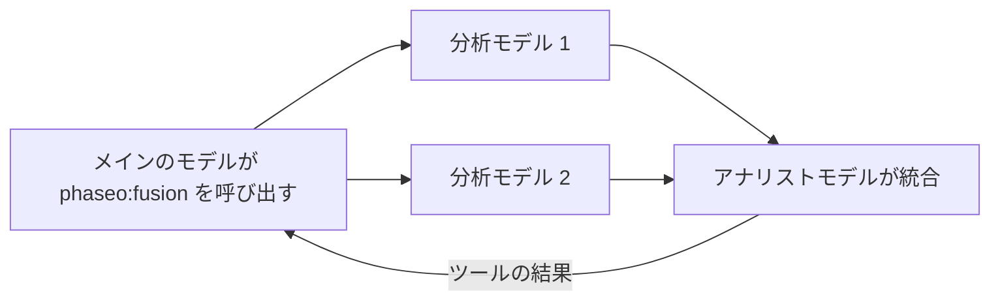

計画の判断、調査の統合、設計のレビューなど、複数の独立した意見があると回答の質が上がる場合は、`phaseo:fusion` を追加します。メインのモデルがこれを呼び出すと、Phaseo は質問をすべての分析モデルに並列で送信し、アナリストモデルにそれらの結果の統合を依頼して、その統合結果を返します。レイテンシが増えるため、1 回のレビューで十分な場合は単一の [Advisor](./advisor) を使ってください。



```json
{
  "tools": [
    {
      "type": "phaseo:fusion",
      "parameters": {
        "analysis_models": ["anthropic/claude-opus-5", "openai/gpt-5"],
        "model": "google/gemini-pro-latest",
        "instructions": "Reconcile disagreements and return concise synthesis guidance.",
        "max_uses": 1,
        "max_completion_tokens": 1400
      }
    }
  ]
}
```

Playground では、サーバーツールのメニューで同じ項目を設定できます: 分析モデル、任意の判定（アナリスト）モデル、呼び出し回数の上限です。

## パラメーター

| パラメーター | 型 | デフォルト | 説明 |
| --- | --- | --- | --- |
| `analysis_models` | string[] | 必須 | 2 つ以上のモデル。これより少ないとリクエストは拒否されます。 |
| `model` | string | リクエストのモデル | 統合結果を書くアナリストモデル。 |
| `instructions` | string | なし | 分析とアナリストの両方の呼び出しへの指示。 |
| `max_uses` | integer | `1` | リクエストあたりの Fusion の呼び出し回数。最大 `4`。 |
| `max_completion_tokens` | integer | `1400` | 各分析と統合の出力トークン数。最大 `32000`。 |

## モデルが送信する内容

`prompt`: 複数の視点が必要な質問です。

## ツールが返す内容

```json
{
  "status": "ok",
  "analyses": 2,
  "analysis": "Both reviewers flag the cutover order..."
}
```

`analyses` は回答した分析モデルの数です。一部が失敗した場合、統合には残りの結果が使われます。エラー結果は、`fusion_invalid_request`（プロンプトがない）、`fusion_max_uses_exceeded`、`fusion_panel_failed`（すべての分析モデルが失敗）、`fusion_request_failed`（アナリストが失敗）です。

## 利用量と料金

呼び出しごとに `usage.server_tool_use.fusion_requests` に 1 が加算され、`server_tool_fusion_requests` で課金されることがあります。すべての分析とアナリストの呼び出しは、それぞれのモデルの料金でリクエストの請求の別項目として課金され、そのトークンは呼び出し元モデルのトークン数には加算されません。有料のモデルを使うには、呼び出し元モデルが無料でもクレジットが必要です。
