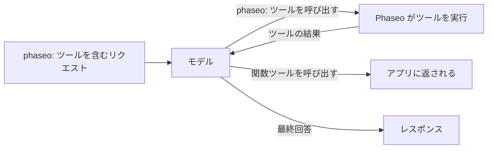

`tools` に `phaseo:` ツールを追加すると、モデルがそのツールを呼び出したときに Phaseo が実行します。モデルが現在時刻、Web 検索、別のモデルの意見を求めると、Phaseo が呼び出しを実行して結果をモデルに返し、モデルが回答を完成させます。ツールの実行処理を自分で書く必要はありません。



<Note>
サーバーツールはベータ版です。プロバイダーの対応状況に応じて、リクエストの形式や結果の内容が変更される場合があります。
</Note>

## 利用可能なツール

| ツール | 種類 | 用途 | エンドポイント |
| --- | --- | --- | --- |
| [日時](./datetime) | `phaseo:datetime` | 最大 5 つのタイムゾーンでの現在の日付と時刻 | 3 つすべて |
| [Web 検索](./web-search) | `phaseo:web_search` | 最新の情報や出典のある情報を Web で検索 | 3 つすべて |
| [Web Fetch](./web-fetch) | `phaseo:web_fetch` | 特定の URL のテキストを読み取り | 3 つすべて |
| [Advisor](./advisor) | `phaseo:advisor` | 別のモデルにレビューや計画を依頼 | 3 つすべて |
| [Subagent](./subagent) | `phaseo:subagent` | 独立したタスクをワーカーモデルに委任 | 3 つすべて |
| [Fusion](./fusion) | `phaseo:fusion` | 複数のモデルの分析を得てから 1 つに統合 | 3 つすべて |
| [モデル検索](./search-models) | `phaseo:search_models` | 最新の Phaseo カタログからモデルを検索 | 3 つすべて |
| [画像生成](./image-generation) | `phaseo:image_generation` | 回答中に画像を作成 | 3 つすべて |
| [パッチの適用](./apply-patch) | `phaseo:apply_patch` | 検証済みのファイルパッチを返す | `/v1/responses` のみ |

「3 つすべて」は `/v1/chat/completions`、`/v1/responses`、`/v1/messages` を指します。

## リクエストを送信する

```bash
curl https://api.phaseo.app/v1/chat/completions \
  -H "Authorization: Bearer $PHASEO_API_KEY" \
  -H "Content-Type: application/json" \
  -d '{
    "model": "openai/gpt-6-astra",
    "messages": [
      { "role": "user", "content": "What are the latest AI policy updates this week?" }
    ],
    "tools": [
      { "type": "phaseo:web_search" },
      { "type": "phaseo:datetime", "parameters": { "timezones": ["Europe/London", "UTC"] } }
    ]
  }'
```

各ツールには任意の `parameters` オブジェクトを指定でき、内容は各ツールのページで説明しています。`stream: true` も使えます。Phaseo がツールのターンを自分で実行し、最終回答をストリーミングで返します。

## サーバーツールと独自の関数を組み合わせる

Phaseo が実行するのは `phaseo:` ツールだけです。同じリクエスト内の通常の `function` ツールは通常どおりアプリに返されるため、[ツール呼び出し](../tool-calling)と同様に、その結果を後続のリクエストで送り返します。

```json
{
  "model": "openai/gpt-6-astra",
  "messages": [
    { "role": "user", "content": "Find recent funding news and save the best item." }
  ],
  "tools": [
    { "type": "phaseo:web_search", "parameters": { "max_results": 3 } },
    {
      "type": "function",
      "function": {
        "name": "save_research_item",
        "description": "Save a selected research item",
        "parameters": {
          "type": "object",
          "properties": {
            "title": { "type": "string" },
            "url": { "type": "string" }
          },
          "required": ["title", "url"]
        }
      }
    }
  ]
}
```

## ツールループの上限

| 上限 | 値 | 上限に達したとき |
| --- | --- | --- |
| リクエストあたりのサーバーツール呼び出し | リクエストの `max_tool_calls`。デフォルトは `30`、最大 `100` | `400 gateway_server_tool_limit` |
| 後続のターン | `8` | `502 gateway_server_tool_error` |
| 1 つのツールの呼び出し | そのツールの `max_uses` | ツールがエラー結果をモデルに返し、モデルはそのツールなしで続行できます |

## 利用量と料金

各サーバーツールは `usage.server_tool_use` にカウンターを追加し、モデルの料金カードで対応するメーターが課金されることがあります。2 つ目のモデル（Advisor、Subagent、Fusion、画像生成）が使ったトークンはリクエストの利用量に加算され、そのモデルの料金で計算されます。

```json
{
  "usage": {
    "input_tokens": 105,
    "output_tokens": 250,
    "server_tool_use": {
      "datetime_requests": 1,
      "web_search_requests": 2,
      "web_search_results": 8
    }
  }
}
```

| ツール | 利用量のカウンター | 料金メーター |
| --- | --- | --- |
| 日時 | `datetime_requests` | なし |
| Web 検索 | `web_search_requests`、`web_search_results`、`web_search_extra_results` | `server_tool_web_search_requests`、`server_tool_web_search_extra_results` |
| Web Fetch | `web_fetch_requests` | `server_tool_web_fetch_requests` |
| Advisor | `advisor_requests` | `server_tool_advisor_requests` |
| Subagent | `subagent_requests` | `server_tool_subagent_requests` |
| Fusion | `fusion_requests` | `server_tool_fusion_requests` |
| モデル検索 | `search_models_requests` | `server_tool_search_models_requests` |
| 画像生成 | `image_generation_requests` | `server_tool_image_generation_requests` |
| パッチの適用 | `apply_patch_requests` | `server_tool_apply_patch_requests` |

Web 検索や Web Fetch がプロバイダー独自のツール（`engine: "native"`）として実行される場合は、代わりに `native_web_search_requests` または `native_web_fetch_requests` で課金されます。
