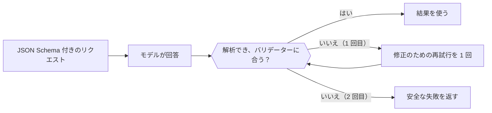

リクエストに JSON Schema を付けて送ると、モデルは自由形式のテキストではなく、その形の JSON を返します。それでも、使う前にはコードで解析と検証を行ってください。



## 形式を選ぶ

| `type` | 得られるもの |
| --- | --- |
| `json_schema` | 送ったスキーマに従う JSON。既定ではこれを使ってください。 |
| `json_object` | 何らかの有効な JSON オブジェクト。形は強制されません。 |
| `text` | プレーンテキスト（既定）。 |

形式を指定する場所はエンドポイントによって異なります。

| エンドポイント | フィールド |
| --- | --- |
| `/v1/chat/completions` | `response_format` |
| `/v1/responses` | `text.format` |
| `/v1/messages` | `output_config.format`（`json_schema` のみ） |

## スキーマを送る

<CodeGroup>
```bash Chat Completions
curl https://api.phaseo.app/v1/chat/completions \
  -H "Authorization: Bearer $PHASEO_API_KEY" \
  -H "Content-Type: application/json" \
  -d '{
    "model": "openai/gpt-6-astra",
    "messages": [
      { "role": "user", "content": "Return the city and weather for London." }
    ],
    "response_format": {
      "type": "json_schema",
      "json_schema": {
        "name": "weather",
        "strict": true,
        "schema": {
          "type": "object",
          "properties": {
            "city": { "type": "string" },
            "weather": { "type": "string" }
          },
          "required": ["city", "weather"],
          "additionalProperties": false
        }
      }
    }
  }'
```

```bash Responses
curl https://api.phaseo.app/v1/responses \
  -H "Authorization: Bearer $PHASEO_API_KEY" \
  -H "Content-Type: application/json" \
  -d '{
    "model": "openai/gpt-6-astra",
    "input": "Return the city and weather for London.",
    "text": {
      "format": {
        "type": "json_schema",
        "name": "weather",
        "strict": true,
        "schema": {
          "type": "object",
          "properties": {
            "city": { "type": "string" },
            "weather": { "type": "string" }
          },
          "required": ["city", "weather"],
          "additionalProperties": false
        }
      }
    }
  }'
```
</CodeGroup>

JSON はメッセージの内容に文字列として返されます。

```json
{
  "choices": [
    {
      "finish_reason": "stop",
      "message": {
        "role": "assistant",
        "content": "{\"city\":\"London\",\"weather\":\"Cloudy\"}"
      }
    }
  ]
}
```

## スキーマを設計する

小さなオブジェクトから始めてください。すべてのフィールドを `required` に並べ、既知のカテゴリには `enum` を使い、余分なキーを拒否する必要がある場合は `additionalProperties: false` を設定します。スキーマはサーバー側のバリデーターと一緒にバージョン管理し、両者がずれないようにしてください。

<span id="validate-the-result"></span>
## 結果を検証する

解析する前に、拒否、内容の欠落、途中で切れた回答（`finish_reason` が `stop` 以外）がないかを確認します。その後、解析したオブジェクトを検証します。次の Zod バリデーターは上のスキーマに対応しています。

```typescript
import { z } from "zod";

const Weather = z.object({
  city: z.string(),
  weather: z.string(),
}).strict();

function parseWeather(content: string) {
  return Weather.parse(JSON.parse(content));
}
```

検証に失敗した場合は、エラーをプロンプトに含めて 1 回だけ再試行し、それでも失敗したら安全な失敗を返します。再試行のたびに課金されます。有効な JSON であっても、値が正しいことや、操作が認可されていることの証明にはなりません。

検証の失敗はモデルとスキーマのバージョンごとに記録し、どちらかが変わったら評価ケースを実行し直してください。不正な形式の JSON を自動で修復するには、[レスポンスの修復](../cookbook/response-healing-for-structured-json.mdx)を参照してください。
