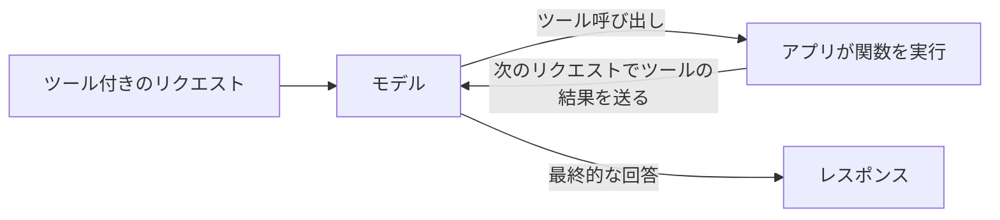

`tools` に関数を記述すると、モデルは推測する代わりに、データベースの検索や天気の確認などの関数を呼び出す形で応答します。アプリが関数を実行して結果を返すと、モデルが最終的な回答を書きます。



ツール呼び出しは 3 つのテキストエンドポイントすべてで使えます。形式はそれぞれ異なります。

| エンドポイント | モデルの呼び出し | アプリが返す結果 |
| --- | --- | --- |
| `/v1/chat/completions` | アシスタントメッセージの `tool_calls` と `finish_reason: "tool_calls"` | `role: "tool"` のメッセージ |
| `/v1/responses` | `function_call` の出力アイテム | `function_call_output` の入力アイテム |
| `/v1/messages` | `tool_use` のコンテンツブロック | `tool_result` のコンテンツブロック |

## ツール付きのリクエストを送る

```bash
curl https://api.phaseo.app/v1/chat/completions \
  -H "Authorization: Bearer $PHASEO_API_KEY" \
  -H "Content-Type: application/json" \
  -d '{
    "model": "openai/gpt-6-astra",
    "messages": [
      { "role": "user", "content": "What is the weather in London?" }
    ],
    "tools": [
      {
        "type": "function",
        "function": {
          "name": "get_weather",
          "description": "Get current weather by city",
          "parameters": {
            "type": "object",
            "properties": {
              "city": { "type": "string" }
            },
            "required": ["city"]
          }
        }
      }
    ],
    "tool_choice": {
      "type": "function",
      "function": { "name": "get_weather" }
    }
  }'
```

この例の `tool_choice` は呼び出しを強制します。モデルに判断させるには、省略するか `"auto"` を設定します。

モデルはテキストの代わりに呼び出しで応答します。

```json
{
  "id": "chatcmpl_...",
  "object": "chat.completion",
  "choices": [
    {
      "index": 0,
      "finish_reason": "tool_calls",
      "message": {
        "role": "assistant",
        "content": null,
        "tool_calls": [
          {
            "id": "call_123",
            "type": "function",
            "function": {
              "name": "get_weather",
              "arguments": "{\"city\":\"London\"}"
            }
          }
        ]
      }
    }
  ]
}
```

何かを実行する前に `arguments` を解析して確認してください。[ツール呼び出しの安全性](./tool-calling-safety)を参照してください。その後、次のリクエストでアシスタントメッセージと結果を返します。Chat Completions と Responses でのこの続きのリクエストは、[ツール呼び出しのパターン](./tool-calling-patterns)で示しています。

## Phaseo にツールを実行させる

type が `phaseo:` で始まるツールは Phaseo 側で実行されます。モデルが呼び出すと Phaseo が実行してループを続けるため、実行部分を書かなくても最終的な回答を受け取れます。1 つのリクエストで自分の関数と組み合わせることもできます。

| ツール | type |
| --- | --- |
| [日時](./server-tools/datetime) | `phaseo:datetime` |
| [Web 検索](./server-tools/web-search) | `phaseo:web_search` |
| [Web Fetch](./server-tools/web-fetch) | `phaseo:web_fetch` |
| [Advisor](./server-tools/advisor) | `phaseo:advisor` |
| [Subagent](./server-tools/subagent) | `phaseo:subagent` |
| [Fusion](./server-tools/fusion) | `phaseo:fusion` |
| [モデル検索](./server-tools/search-models) | `phaseo:search_models` |
| [画像生成](./server-tools/image-generation) | `phaseo:image_generation` |
| [パッチの適用](./server-tools/apply-patch) | `phaseo:apply_patch`（Responses のみ） |

```json
{
  "tools": [
    { "type": "phaseo:datetime", "parameters": { "timezones": ["Europe/London", "UTC"] } }
  ],
  "tool_choice": "auto"
}
```

上限、使用量のカウンター、料金は[サーバーツール](./server-tools)を参照してください。

## ツール呼び出しをストリーミングする

ツール呼び出しのリクエストでは `stream: true` を使えます。関数呼び出しの引数は分割して届くため、すべて集めてから呼び出しを解析してください。サーバーツールが実行される場合、Phaseo はそのツールのターンを終え、ツールを実行し、モデルを続行して、回答の残りをストリーミングします。そのため、クライアントは 1 つのストリームを読むだけです。[ストリーミング](./streaming)を参照してください。

関数を呼び出すのではなく、スキーマに合った回答が必要な場合は、[構造化出力](./structured-outputs)を使ってください。
