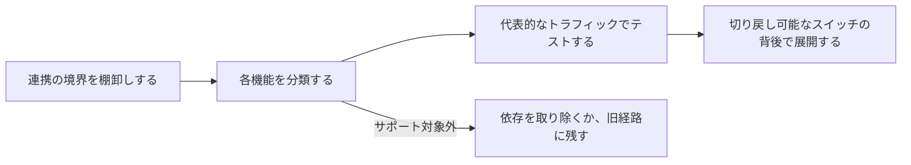

現在の Gateway 連携で使っている機能をそれぞれ探し、トラフィックを移す前に最後の列に書かれた作業を行ってください。最終確認日: 2026 年 11 月 4 日。

移行は次の順序で進めます。この順序なら、両方のプラットフォームが同じ OpenAI 互換リクエストを受け付ける場合でも、変わりうる動作を見つけられます。

## 連携の境界を棚卸しする

移行後に隠れた別の設定経路が残らないよう、現在の Gateway が登場する箇所をすべて記録します。

- ベース URL と API キーの環境変数
- SDK の初期化とカスタムヘッダー
- モデル ID とフォールバックモデル
- プロバイダーの順序、許可リスト、プライバシー要件
- ストリーミング、ツール呼び出し、構造化出力のコード
- バッチジョブ、ファイル、Webhook、非同期ステータスのポーリング
- リクエストの帰属情報と、ユーザーまたはセッションのメタデータ

## リクエスト

| 機能 | Phaseo での扱い | 切り替え前に行うこと |
| --- | --- | --- |
| 認証 | `Authorization: Bearer $PHASEO_API_KEY` | ベース URL とキーを変更し、認証付きリクエストを 1 回実行します。 |
| Chat Completions | `/v1/chat/completions` | 通常、ストリーミング、ツール呼び出し、構造化出力のリクエストをテストします。未知のトップレベルフィールドは `400` を返します。 |
| Responses | `/v1/responses`(保存状態なし) | 入力形式、ストリーミングイベント、ツール、パース処理をテストします。`previous_response_id` と `conversation` は `400` を返すため、履歴全体を送信してください。 |
| Anthropic Messages | ルートホスト `https://api.phaseo.app` の `/v1/messages` | キーを Bearer トークンとして渡し、各 `anthropic-beta` ヘッダーを見直してください。Phaseo はこれらを転送しません。 |
| モデル ID | `<org>/<model>` | 本番で使うすべての ID を `GET /v1/models?format=openai` で確認します。エイリアスが一致するとは限りません。 |
| 埋め込み、画像、音声、モデレーション | モデルとプロバイダーごとにサポート | モデルがその操作に対応していることを確認します。 |

## ルーティングとポリシー

| 機能 | Phaseo での扱い | 切り替え前に行うこと |
| --- | --- | --- |
| モデルのフォールバック | `models` 配列(1〜25 件) | フォールバックは `429`、`500`、`502`、`503`、`504` で実行され、リクエストエラーでは実行されません。 |
| プロバイダーの順序 | `provider.order` | ワークロードに今も必要な順序だけを再現します。 |
| プロバイダーの許可リストと除外リスト | `provider.only`、`provider.ignore` | プロバイダー ID と、少なくとも 1 つのルートが残ることを確認します。 |
| 価格、レイテンシー、スループットでの並べ替え | `provider.sort` | テスト後、リクエストの詳細で選ばれたプロバイダーを確認します。 |
| ゼロデータ保持 | `provider.require_zero_data_retention`(別名 `provider.zdr`) | 適用する前に、モデルに条件を満たすプロバイダーがあることを確認します。 |
| リージョン指定の実行とデータレジデンシー | `provider.required_execution_region`、`provider.required_data_region`、ワークスペースのプライバシー既定値 | 成功するルートと、条件を満たすプロバイダーがない場合のエラーの両方をテストします。 |
| 共有プロンプトと既定値 | [プリセット](../guides/presets) | 共有設定は呼び出し元ごとにコピーせず、プリセットに移します。 |

## 運用

| 機能 | Phaseo での扱い | 切り替え前に行うこと |
| --- | --- | --- |
| アプリの帰属 | `X-App-Id`、`X-App-Name`、`HTTP-Referer`、`X-Title`、`X-App-Categories` | 呼び出し元のアプリケーションを表すヘッダーは残してください。移行中に外すと、コストと使用量の比較が難しくなります。ダッシュボードでアプリのグループ分けを確認します。カテゴリの値は[アプリの帰属](../guides/app-attribution)を参照してください。 |
| コストラベル | `X-Phaseo-Metadata` のラベル | カスタムプロパティやタグをラベルに対応付けます。 |
| リクエストの詳細 | リクエストログと `GET /v1/generations?id=<request_id>` | 代表的なプロンプトで、プロバイダー、レイテンシー、トークン使用量、価格を比較します。 |
| リプレイ | `replay_supported` が `true` のときの `replay_request` | 失敗したリクエストのエンドポイントとペイロードを復元できることを確認します。 |
| バッチと非同期ジョブ | バッチ、ファイル、動画、Webhook、WebSocket の API | ステータスの遷移、終了時の課金、キャンセル、結果の取得を確認します。`/v1/files` が保持するのはバッチ入力のみです。 |
| レート制限 | ユーザーごとの 1 分あたりのリクエスト数。新しいワークスペースでは 10 から | チームのトラフィックを 1 人のキー所有者経由で送るプロキシは、この制限に達することがあります。[制限](../api-reference/limits)を参照してください。 |
| 段階的な展開 | クライアントまたはインフラでのトラフィック分割 | 切り替えが安定するまで、切り戻しはベース URL とキーの変更だけで済むようにしておきます。 |

## 利用できない機能

次の機能には Phaseo の代替がありません。アプリ側か旧プラットフォームに残してください。

- **レスポンスキャッシュ。** Phaseo はレスポンスをキャッシュしません。[プロンプトキャッシュ](../guides/prompt-caching)では引き続き入力コストを削減できます。
- **保存されたレスポンスと会話。** `GET` や `DELETE /v1/responses/{id}` はありません。
- **トークンカウント**(`/v1/messages/count_tokens`)。
- **OpenAI Assistants、Threads、ベクトルストア、ファインチューニング、旧来の `/v1/completions`。**

## 各機能を分類する

上の表と[移行元プラットフォーム](./index#platform-migrations)のガイドを使い、本番の各動作にステータスを 1 つずつ付けます。

| ステータス | 意味 |
| --- | --- |
| 変更なし | 同じリクエストフィールドとレスポンスの動作を検証済みです。 |
| 対応付け | Phaseo が別のフィールドや設定で同じ結果を提供します。 |
| 適応 | 互換レイヤーがリクエストまたはレスポンスを変換します。 |
| サポート対象外 | 依存を取り除くか、そのワークロードを現在の経路に残します。 |
| 未検証 | サポートされている可能性はありますが、本番相当の根拠がまだありません。 |

## 自分のトラフィックで検証する

API の互換性があっても、次の点が同じ動作になるとは限りません。

- 自動のプロバイダー選択とフォールバックの順序
- プロンプトキャッシュのアフィニティとキャッシュ料金
- プロバイダー固有のリクエストフィールドと、レスポンスのみのメタデータ
- レート制限とリトライのタイミング
- データ保持、レジデンシー、学習に関するポリシー
- モデルの正確な提供状況と価格

機密性の高い本番データをコピーせずに、実際のワークロードのパターンから小さなテストセットを作り、次を実行します。

1. 使用中のすべてのエンドポイントで通常のリクエストを 1 回
2. 本番と同じクライアント経路でのストリーミング
3. 現実的なスキーマでのツール呼び出しと構造化出力
4. すべてのプロバイダー制約とプライバシー制約
5. 無効なキー、無効なモデル、レート制限、プロバイダー利用不可の失敗
6. 成功、失敗、キャンセルまでのバッチまたは非同期ジョブ

出力の品質、レイテンシー、トークン使用量、選ばれたプロバイダー、最終コストを比較します。各リクエスト ID を記録しておけば、リクエストログや `GET /v1/generations?id=<request_id>` で確認できます。

## 切り戻し可能なスイッチで展開する

まず開発用と社内のトラフィックから始めます。テストセットに合格してから本番の一部だけを移し、結果が安定するまで切り戻しはベース URL とキーの変更だけに留めます。切り替えをプロンプト、モデル、ルーティングの変更と同時に行わないでください。それらは Gateway の境界を検証した後に行います。
