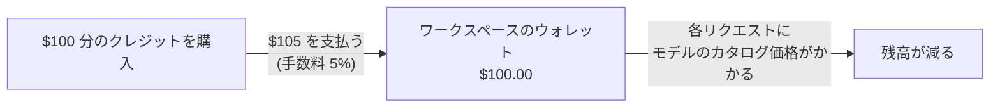

クレジットを一度購入し、各モデルのカタログ価格でリクエストに使います。管理対象のリクエストに対する Phaseo の手数料は、クレジット購入ごとの 5%(最低 $1)のみです。リクエスト自体には上乗せ料金はかかりません。

## チャージにかかる費用

手数料は、購入するクレジットの 5% と $1 のうち大きいほうです。支払額に上乗せされます。

| 購入するクレジット | 手数料 | 支払額 |
| ---: | ---: | ---: |
| $5.00 | $1.00(最低額) | $6.00 |
| $20.00 | $1.00 | $21.00 |
| $100.00 | $5.00 | $105.00 |
| $1,000.00 | $50.00 | $1,050.00 |

逆に言えば、$100.00 の請求では $95.24 分のクレジットが追加され、手数料は $4.76 です。ダッシュボードからのチャージは $5 からです。

クレジットは **設定 -> 請求 -> 請求とクレジット** で購入するか、ターミナルから `phaseo credits add --amount <usd>` で購入します([クイックスタート](../quickstart#add-credits-for-paid-models)を参照)。同じページに残高、現在の手数料、最近の支出が表示されます。**設定 -> 請求 -> 取引** には各購入が一覧表示されます。

## クレジットを使わないもの

| 使用量 | Phaseo の請求 |
| --- | --- |
| 無料モデル(`phaseo/free` と $0 の価格のモデル) | なし。無料モデルのリクエストには 1 日あたりの上限があります。[プラン](../exploring/subscription-plans)を参照してください。 |
| 自分のキーの持ち込み(BYOK) | チャージは不要です。ワークスペースごとに UTC の各月、完了した BYOK リクエストの最初の 250,000 件はサービス手数料がかからず、それ以降はプロバイダー相当のコストの 2.5% がかかります。モデルの使用量はプロバイダーが請求します。[BYOK に関する考慮事項](../guides/routing-and-fallbacks#byok-considerations)を参照してください。 |

## Enterprise

Self Serve Enterprise は、SSO、SCIM、ディレクトリ管理、部門、優先メールサポートのための別の月額サブスクリプションです。ワークスペースのメンバー 100 人までは月額 $29 から始まり、1,000 人では月額 $79 です。クレジットは含まれず、5% の手数料(最低 $1)も変わりません。メンバー料金の詳細とメンバーの数え方は[プラン](../exploring/subscription-plans#enterprise-member-pricing)にあります。

請求書払い、調達、カスタムの契約条件については、[ヘルプセンター](https://phaseo.app/help)にお問い合わせください。通常の Gateway の利用に Enterprise は必要ありません。
