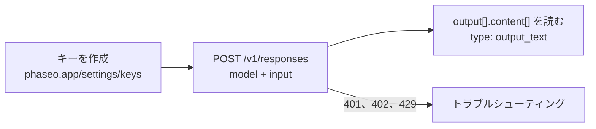

API キーを作成し、`POST /v1/responses` にリクエストを 1 回送信して、`output_text` から返答を読みます。



<Prompt description="**コーディングエージェントを使っていますか？** 始める前にこのプロンプトを貼り付けてください。" icon="bot" actions={["copy", "cursor"]}>
{`You are integrating this project with Phaseo Gateway.

Before editing anything:
- Install the Phaseo skills: npx skills add https://phaseo.app/docs
- Read https://phaseo.app/docs/skill.md and the API reference for the endpoint you will use. If your tools support MCP, search the docs at https://phaseo.app/docs/mcp.
- Inspect the existing provider configuration and identify the smallest safe change.

Rules:
- Call https://api.phaseo.app/v1 with a server-side PHASEO_API_KEY. Never print or commit credentials.
- Keep the current provider and model behaviour unless I ask for a migration. Check model IDs with GET /v1/models instead of guessing them.
- Explain the files you would change and the verification commands first.
- Do not deploy, rotate keys, send external messages, or make unrelated edits without my approval.`}
</Prompt>

<Visibility for="agents">
エージェント向けクイックスタートのチェックリスト：

- ダッシュボードの **設定 -> APIキー** でキーを作成するよう本人に依頼するか、管理キーを使って `POST /v1/keys` で作成します。CLI のサインインではキーを作成できません。キーを生成したり推測したりしないでください。キーはサーバー側のコードからのみ、`Authorization: Bearer phaseo_v1_sk_<kid>_<secret>` として送信します。
- 有料モデルを使う場合は、`phaseo login --scopes billing:write` を一度実行してから、`phaseo credits add --amount <usd> --json` でチャージを開始します。保存済みのカードがある場合は、ワークスペースのオーナーまたは管理者がメールのリンクから確認します。保存済みのカードがない場合は、レスポンスに `next_action: "open_checkout_url"` と支払いリンクが含まれ、オーナーまたは管理者がそれを開いて支払います。カードは以降のチャージ用に保存されます。クレジットや、CLI で行えるその他の作業のためにユーザーをダッシュボードへ案内しないでください。https://phaseo.app/docs/ja/v1/developers/manage-from-an-agent.md を参照してください。
- 最初のリクエストは `POST https://api.phaseo.app/v1/responses` に `model` と `input` を送信します。例では `openai/gpt-6-astra` を使います。これはクレジットが必要な有料モデルです。`phaseo/free` は利用可能な無料モデルを選び、ウォレット残高がなくても動作します。
- 返答は、`output[].content[]` のうち `type` が `output_text` の要素から読みます。
- リクエストが失敗した場合は、https://phaseo.app/docs/ja/v1/api-reference/errors.md の説明に従い、JSON の `error` コードで分岐します。
</Visibility>

## 1. API キーを作成する

[ダッシュボード](https://phaseo.app/settings/keys)の **設定 -> APIキー** でキーを作成し、エクスポートします。

```bash
export PHASEO_API_KEY="phaseo_v1_sk_..."
```

キーは一度だけ表示されます。すべてのリクエストで、キーをベアラートークンとして送信します。

```http
Authorization: Bearer phaseo_v1_sk_<kid>_<secret>
```

<Danger>
API キーはパスワードと同じように扱ってください。サーバー側のコードに保管し、ブラウザーやモバイルアプリには絶対に含めないでください。
</Danger>

<span id="add-credits-for-paid-models"></span>
### 有料モデル用にクレジットを追加する

`phaseo/free` はクレジットなしで動作します。`openai/gpt-6-astra` などの有料モデルにはウォレット残高が必要です。

```bash
phaseo login --scopes billing:write   # once; credit top-ups need this scope
phaseo credits add --amount 20
```

保存済みのカードがある場合は、ワークスペースのオーナーまたは管理者がメールのリンクから請求を確認します。保存済みのカードがない場合は、コマンドが支払いリンクを返し、オーナーまたは管理者がそれを開いて支払います。カードは以降のチャージ用に保存されます。

## 2. テキストリクエストを送信する

新しいテキスト処理には `POST /v1/responses` をおすすめします。例では有料モデルの `openai/gpt-6-astra` を使います。クレジットなしで試すには、利用可能な無料モデルを選ぶ `phaseo/free` に置き換えてください。[無料ルーターでリリースする](./cookbook/free-router-first-deploy)を参照してください。

cURL と `fetch` は何もインストールせずに使えます。SDK を使う場合は、先にインストールしてください。

<CodeGroup>
```bash npm
npm install @phaseo/sdk
```

```bash pnpm
pnpm add @phaseo/sdk
```

```bash pip
pip install phaseo
```
</CodeGroup>

実行環境の要件とその他の SDK については、[TypeScript と Python のインストールページ](./sdk-reference/client/installation)を参照してください。

<CodeGroup>
```bash cURL
curl https://api.phaseo.app/v1/responses \
  -H "Authorization: Bearer $PHASEO_API_KEY" \
  -H "Content-Type: application/json" \
  -d '{
    "model": "openai/gpt-6-astra",
    "input": "Reply with: quickstart works"
  }'
```

```javascript JavaScript
const response = await fetch("https://api.phaseo.app/v1/responses", {
  method: "POST",
  headers: {
    Authorization: `Bearer ${process.env.PHASEO_API_KEY}`,
    "Content-Type": "application/json",
  },
  body: JSON.stringify({
    model: "openai/gpt-6-astra",
    input: "Reply with: quickstart works",
  }),
});

const data = await response.json();
const assistantText = data.output
  ?.find((item) => item.type === "message")
  ?.content?.find((part) => part.type === "output_text")
  ?.text;

console.log(assistantText);
```

```typescript TypeScript SDK
import Phaseo, { outputText } from "@phaseo/sdk";

const client = new Phaseo(); // reads PHASEO_API_KEY

const response = await client.generateResponse({
  model: "openai/gpt-6-astra",
  input: "Reply with: quickstart works",
});

console.log(outputText(response));
```

```python Python SDK
from phaseo import Phaseo

client = Phaseo()  # reads PHASEO_API_KEY

response = client.responses.create(
    {
        "model": "openai/gpt-6-astra",
        "input": "Reply with: quickstart works",
    }
)

print(response.output_text)
```

```go Go SDK
package main

import (
  "context"
  "fmt"

  phaseo "github.com/phaseoteam/Phaseo/packages/sdk/sdk-go/v4"
)

func main() {
  client := phaseo.MustNewFromEnv() // reads PHASEO_API_KEY

  response, err := client.GenerateResponse(context.Background(), phaseo.ResponsesRequest{
    Model: "openai/gpt-6-astra",
    Input: "Reply with: quickstart works",
  })
  if err != nil {
    panic(err)
  }

  fmt.Println(response)
}
```

```csharp C# SDK
using PhaseoSdk;
using System.Collections.Generic;

var client = new Phaseo(); // reads PHASEO_API_KEY

var response = await client.GenerateResponse(new Dictionary<string, object>
{
    ["model"] = "openai/gpt-6-astra",
    ["input"] = "Reply with: quickstart works",
});

Console.WriteLine(response);
```

```php PHP SDK
<?php
require 'vendor/autoload.php';

use Phaseo\Sdk\Phaseo;

$client = new Phaseo(getenv('PHASEO_API_KEY'));

$response = $client->generateResponse([
    'model' => 'openai/gpt-6-astra',
    'input' => 'Reply with: quickstart works',
]);

print_r($response);
```

```ruby Ruby SDK
require 'phaseo_sdk'

client = PhaseoSdk::Phaseo.new # reads PHASEO_API_KEY

response = client.generate_response(
  model: 'openai/gpt-6-astra',
  input: 'Reply with: quickstart works',
)

puts response
```

```java Java SDK
// Build from source: https://phaseo.app/docs/v1/sdk-reference/client/installation
import app.phaseo.sdk.Phaseo;
import java.util.Map;

public class Main {
    public static void main(String[] args) throws Exception {
        var client = new Phaseo(System.getenv("PHASEO_API_KEY"));
        var response = client.createResponse(Map.of(
            "model", "openai/gpt-6-astra",
            "input", "Reply with: quickstart works"
        ));
        for (var item : response.path("output")) {
            for (var part : item.path("content")) {
                if ("output_text".equals(part.path("type").asText())) {
                    System.out.println(part.path("text").asText());
                }
            }
        }
    }
}
```

```rust Rust SDK
use phaseo::Phaseo;
use serde_json::{json, Value};

fn main() -> Result<(), Box<dyn std::error::Error>> {
    let client = Phaseo::from_env()?;
    let response = client.responses(&json!({
        "model": "openai/gpt-6-astra",
        "input": "Reply with: quickstart works"
    }))?;

    let assistant_text = response.body
        .get("output")
        .and_then(Value::as_array)
        .into_iter()
        .flatten()
        .filter(|item| item.get("type").and_then(Value::as_str) == Some("message"))
        .flat_map(|item| {
            item.get("content")
                .and_then(Value::as_array)
                .into_iter()
                .flatten()
        })
        .find_map(|part| {
            (part.get("type").and_then(Value::as_str) == Some("output_text"))
                .then(|| part.get("text").and_then(Value::as_str))
                .flatten()
        })
        .unwrap_or("");

    println!("{assistant_text}");
    Ok(())
}
```

```typescript Vercel AI SDK
import { phaseo } from "@phaseo/ai-sdk-provider";
import { generateText } from "ai";

const result = await generateText({
  model: phaseo("openai/gpt-6-astra"),
  prompt: "Reply with: quickstart works",
});

console.log(result.text);
```
</CodeGroup>

## 3. 返答を読む

```json
{
  "id": "G-...",
  "nativeResponseId": "resp_...",
  "object": "response",
  "created_at": 1730000000,
  "status": "completed",
  "completed_at": 1730000001,
  "model": "openai/gpt-6-astra",
  "output": [
    {
      "type": "message",
      "id": "msg_...",
      "status": "completed",
      "role": "assistant",
      "content": [{ "type": "output_text", "text": "quickstart works", "annotations": [] }]
    }
  ],
  "usage": {
    "input_tokens": 9,
    "output_tokens": 3,
    "total_tokens": 12
  },
  "error": null,
  "incomplete_details": null
}
```

| フィールド | 内容 |
| --- | --- |
| `type: "output_text"` の `output[].content[]` | 返答のテキスト。TypeScript の `outputText()` ヘルパーと Python の `response.output_text` が読み取ってくれます。Vercel AI SDK では `result.text` として返されます。 |
| `id` | Phaseo のリクエスト ID。リクエストは **設定 -> 使用量 -> ログ -> リクエスト** に表示されます。 |
| `nativeResponseId` | 同じレスポンスに対するプロバイダー側の ID。 |
| `usage` | このリクエストで課金された入力、出力、合計のトークン数。 |

### 返答をストリーミングする

ストリーミングすると、生成されるそばから返答を表示できます。各 `response.output_text.delta` イベントの `text` には新しいテキストだけが含まれるため、このループは回答を 1 回だけ表示します。`response.output_text.done` などの終了イベントは、すでにストリーミングされたテキストを繰り返します。イベントの一覧は[ストリーミング](./guides/streaming)を参照してください。

<CodeGroup>
```typescript TypeScript SDK
import Phaseo from "@phaseo/sdk";

const client = new Phaseo(); // reads PHASEO_API_KEY

for await (const chunk of client.streamResponses({
  model: "openai/gpt-6-astra",
  input: "Reply with: quickstart works",
})) {
  if (chunk.type === "response.output_text.delta") process.stdout.write(chunk.text);
}
```

```python Python SDK
from phaseo import Phaseo

client = Phaseo()  # reads PHASEO_API_KEY

for chunk in client.stream_responses(
    {
        "model": "openai/gpt-6-astra",
        "input": "Reply with: quickstart works",
    }
):
    if chunk.get("type") == "response.output_text.delta":
        print(chunk["text"], end="", flush=True)
print()
```
</CodeGroup>

## 4. 最初のリクエストをトラブルシューティングする

| ステータス | 確認すること |
| --- | --- |
| `401` | API キーと `Authorization: Bearer` ヘッダー。 |
| `400` | リクエスト本文とモデル ID。有効な ID は `GET /v1/models` で一覧表示できます。 |
| `402` | クレジット残高。クレジットを追加するか、`phaseo/free` に切り替えてください。 |
| `429` または `5xx` | 指数バックオフで再試行してください。 |

[エラーリファレンス](./api-reference/errors)に、すべてのエラーコードと対処方法が掲載されています。

## テキストの代わりに型付きの回答を得る

コードで文章ではなく値が必要な場合は、`POST /v1/decisions`（ベータ）に質問を送信します。各回答は確率付きの型付きの値として、質問と同じ順序で返されます。質問の種類は `predicate`（はい/いいえ）、`choice`（指定した選択肢のいずれか）、`score`（指定した尺度上のレベル）です。

<CodeGroup>
```bash cURL
curl https://api.phaseo.app/v1/decisions \
  -H "Authorization: Bearer $PHASEO_API_KEY" \
  -H "Content-Type: application/json" \
  -d '{
    "model": "openai/gpt-6-luna",
    "input": "I was charged twice and need a refund. I cannot log in to pay my team.",
    "questions": [
      {
        "type": "choice",
        "name": "department",
        "instructions": "Which team should handle this request?",
        "choices": [
          { "value": "billing", "description": "Payments, invoices, refunds and duplicate charges" },
          { "value": "support", "description": "Product usage and troubleshooting" }
        ]
      },
      {
        "type": "predicate",
        "name": "is_urgent",
        "instructions": "Is the customer blocked from using the product?"
      }
    ]
  }'
```

```typescript TypeScript SDK
import Phaseo from "@phaseo/sdk";

const client = new Phaseo(); // reads PHASEO_API_KEY

const decision = await client.decisions.create({
  model: "openai/gpt-6-luna",
  input: "I was charged twice and need a refund. I cannot log in to pay my team.",
  questions: [
    {
      type: "choice",
      name: "department",
      instructions: "Which team should handle this request?",
      choices: [
        { value: "billing", description: "Payments, invoices, refunds and duplicate charges" },
        { value: "support", description: "Product usage and troubleshooting" },
      ],
    },
    {
      type: "predicate",
      name: "is_urgent",
      instructions: "Is the customer blocked from using the product?",
    },
  ],
});

console.log(decision.answers);
```

```python Python SDK
from phaseo import Phaseo

client = Phaseo()  # reads PHASEO_API_KEY

decision = client.decisions.create(
    {
        "model": "openai/gpt-6-luna",
        "input": "I was charged twice and need a refund. I cannot log in to pay my team.",
        "questions": [
            {
                "type": "choice",
                "name": "department",
                "instructions": "Which team should handle this request?",
                "choices": [
                    {"value": "billing", "description": "Payments, invoices, refunds and duplicate charges"},
                    {"value": "support", "description": "Product usage and troubleshooting"},
                ],
            },
            {
                "type": "predicate",
                "name": "is_urgent",
                "instructions": "Is the customer blocked from using the product?",
            },
        ],
    }
)

print(decision["answers"])
```
</CodeGroup>

レスポンス（値は例示です）：

```json
{
  "model": "openai/gpt-6-luna",
  "answers": [
    {
      "type": "choice",
      "name": "department",
      "choice": "billing",
      "confidence": 0.89,
      "probabilities": [
        { "value": "billing", "probability": 0.91 },
        { "value": "support", "probability": 0.09 }
      ]
    },
    { "type": "predicate", "name": "is_urgent", "probability": 0.84 }
  ],
  "usage": { "input_tokens": 42, "output_tokens": 18, "total_tokens": 60 }
}
```

`answers[0].choice` や `answers[1].probability` を読み、`confidence` や `probabilities` を使って独自のしきい値を設定してください。[Decisions リファレンス](./api-reference/endpoint/decisions)には、すべての判断モデルとその上限・料金、画像入力、そして名前付きの質問マップ（`noul`、`criteria`）を使う以前の `state` 形式が掲載されています。この形式は引き続き動作し、一部のモデルでは必須です。

## 動画を生成する

動画生成は非同期です。ジョブを作成し、ポーリングしてから、ファイルをダウンロードします。

```bash
# 1. Create the job
curl https://api.phaseo.app/v1/videos \
  -H "Authorization: Bearer $PHASEO_API_KEY" \
  -H "Content-Type: application/json" \
  -d '{
    "model": "google/veo-3.1-fast",
    "prompt": "A cinematic sunrise over a mountain lake"
  }'

# 2. Poll until the status is completed
curl https://api.phaseo.app/v1/videos/VIDEO_ID \
  -H "Authorization: Bearer $PHASEO_API_KEY"

# 3. Download the video
curl https://api.phaseo.app/v1/videos/VIDEO_ID/content \
  -H "Authorization: Bearer $PHASEO_API_KEY" \
  -o video.mp4
```

ポーリングの代わりに Webhook を受け取るには、[非同期ジョブと Webhook](./guides/async-video-and-batch)を参照してください。

## 開発を続ける

<Columns cols={2}>
	<Card title="Gateway と統合する" icon="plug" href="./developers/integrating-with-the-gateway">
		エンドポイントを選び、本番環境向けの統合を設定します。
	</Card>
	<Card title="API リファレンス" icon="book" href="./api-reference/introduction">
		すべてのエンドポイントの、すべてのリクエストとレスポンスのフィールド。
	</Card>
	<Card title="サンプル" icon="code" href="./guides/examples">
		一般的なワークフロー向けのスターターアプリケーション。
	</Card>
	<Card title="サポート" icon="message-circle" href="https://phaseo.app/help">
		デバッグ、ルーティング、モデルの動作に関するサポートを受けられます。
	</Card>
</Columns>
