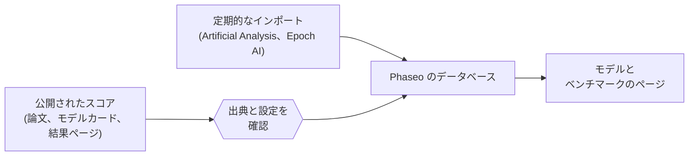

Phaseo は、他者が測定したベンチマークのスコアを、それぞれの出典へのリンクとともに公開します。Phaseo 自身はベンチマークを実行せず、スコアを 1 つに統合することもありません。

## スコアの出典

| 出典 | 取り込み方法 |
| --- | --- |
| モデル開発者の論文、モデルカード、発表 | メンテナーが追加し、**自己申告**として表示 |
| ベンチマーク主催者の結果ページ | メンテナーが追加 |
| Artificial Analysis と Epoch AI の指標 | 定期的なインポート。1 時間ごとに確認 |
| コミュニティからの報告 | GitHub の issue。メンテナーが根拠を確認した後に公開 |

すべてのスコアは、公開前に公開された出典か再現可能な評価ログが必要です。

## 正規化の意味

Phaseo は各ベンチマークを元の尺度のまま保持します。正規化するのはスコアそのものではなく、スコアを取り巻く記録です。

1. 各結果を 1 つのベンチマーク ID に対応付け、異なる名前で呼ばれている同じベンチマークをまとめます。
2. few-shot の数、ハーネス、推論の effort など設定が異なる場合は、既定に統合せずバリアントとして保持します。
3. 各ベンチマークには並べ替えの方向があります。エラー率のように低いほど良いベンチマークでは、最も低いスコアが先頭になります。
4. 出典へのリンクと自己申告のフラグは、スコアとともに保持されます。

自己申告のフラグは開示であり、却下ではありません。十分なコンテキストのないスコアは、出典に関するメモ付きで保存される場合があります。完全に検証されたリーダーボードの行と同等とは見なさないでください。

## 相違を報告する

1. [ベンチマークスコアの提出](./submitting-scores.mdx)に記載された根拠を添えて issue を作成します。
2. issue でレビューの質問に回答します。メンテナーは、検証済みの修正をデータベースエディターで公開します。
3. 大規模な研究の提出については、[Discord](https://discord.gg/aQyywCvgZ5) で調整してください。

カタログの読者向けには、公開ページの[ベンチマークの正規化](https://phaseo.app/how-phaseo-normalises-ai-benchmarks)で同じルールを説明しています。
