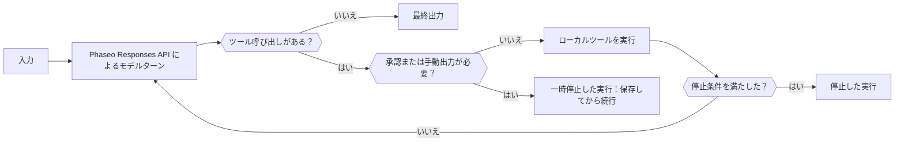

1回のリクエストでは足りない場合は、Phaseo Agent SDK を使います。SDK はアプリケーションのプロセス内で上限付きのループを実行し、各ターンを Responses API に送り、モデルが呼び出したツールを実行し、承認が必要なツールでは人の判断を待って一時停止します。実行状態はアプリケーションが保持します。Phaseo はエージェントのために何もホストしません。

## パッケージを選ぶ

| 言語 | パッケージ | バージョン | インストールされるコアクライアント |
| --- | --- | --- | --- |
| TypeScript | [`@phaseo/agent-sdk`](https://www.npmjs.com/package/@phaseo/agent-sdk) | 0.3.0 | `@phaseo/sdk` |
| Python | [`phaseo-agent-sdk`](https://pypi.org/project/phaseo-agent-sdk/)（モジュール `phaseo_agent`） | 0.3.0 | `phaseo` 3.x |
| Go | [`github.com/phaseoteam/Phaseo/packages/sdk/agent-sdk-go`](https://pkg.go.dev/github.com/phaseoteam/Phaseo/packages/sdk/agent-sdk-go) | v0.3.0 | `sdk-go/v3` |
| C# | [`Phaseo.AgentSdk`](https://www.nuget.org/packages/Phaseo.AgentSdk) | 0.3.0 | `Phaseo.Sdk` |
| PHP | [`phaseo/agent-sdk`](https://packagist.org/packages/phaseo/agent-sdk) | v0.3.0 | `phaseo/sdk` `^3.0.0` |
| Ruby | [`phaseo_agent_sdk`](https://rubygems.org/gems/phaseo_agent_sdk) | 0.3.0 | `phaseo_sdk` `>= 3.0.0, < 4.0.0` |
| Java | `app.phaseo:phaseo-agent-sdk`（Maven Central） | 0.3.0 | `app.phaseo:phaseo-sdk` 3.0.0 |
| Rust | [`phaseo-agent`](https://crates.io/crates/phaseo-agent) | 0.2.0 | `phaseo` 0.2 |

TypeScript がリファレンス設計です。C++ には Agent SDK がありません。インストールコマンドと実行環境の要件は[インストール](./installation)に、最初のエージェントの作り方は[使い方](./usage)にあります。

<Prompt description="コーディングエージェントに、使用中の言語の Phaseo Agent SDK で最初のエージェントを作成させます。" icon="bot" actions={["copy", "cursor"]}>
{`Build a small agent in this project with the Phaseo Agent SDK.

1. Install the Phaseo skills: npx skills add https://phaseo.app/docs
   For TypeScript, follow the phaseo-agent-sdk-typescript skill.
2. Read the Agent SDK pages at https://phaseo.app/docs/v1/sdk-reference/agent/overview, pick this project's language tab, and use only the APIs it documents.
3. Define one agent with at most two local tools that fit [AGENT TASK]. Keep the loop bounded with a step limit, and require approval for any tool that changes data.
4. Use a server-side PHASEO_API_KEY and check the model ID with GET /v1/models before using it.
5. Stream the agent's steps to the console so a run can be inspected.
6. Run the agent once, then report what you verified and what you could not verify.`}
</Prompt>

## 各ランタイムの対応状況を比べる

どの SDK もローカルツールを実行し、承認や手動出力のために正確なツール呼び出し ID で一時停止し、アプリケーションが保存できるシリアライズ可能な実行状態を返します。それ以外は言語によって異なります。

| 機能 | TypeScript | Python | Go | C# | PHP | Ruby | Java | Rust |
| --- | --- | --- | --- | --- | --- | --- | --- | --- |
| デフォルトのステップ上限 | 12 | 12 | 8 | 12 | 12 | 12 | 12 | 8 |
| ステップ上限に達したとき | `Max steps exceeded` をスロー | `RuntimeError` を送出 | エラーを返す | `InvalidOperationException` をスロー | スロー | 例外を送出 | スロー | `stopped` の実行を返す（`max_steps:N`） |
| モデルのストリーミング | 非同期イテラブル | イテレーター（バックグラウンドスレッド） | チャネル | 非同期列挙可能 | イテラブル。反復している間だけ実行（Fiber） | Enumerator（ワーカースレッド） | 実行後にリストで取得。ライブでは `onEvent` 経由 | 未対応 |
| ツールの進捗イベント | 非同期ジェネレーター | `emit_progress` またはジェネレーター | `EmitProgress` | `EmitProgress` | `emitProgress` | `emit_progress` | `emitProgress` | 未対応 |
| ツールの並行実行 | あり | あり（スレッド） | あり | あり | なし | あり（スレッド） | あり（スレッドプール） | なし |
| ツールのタイムアウト | `context.signal` を中止 | 実行を失敗させる。スレッドは動き続ける | 呼び出しを失敗させる。goroutine は動き続ける | `CancellationToken` をキャンセル | ツールが戻った後に確認 | 呼び出しを中断 | スレッドを中断 | なし |
| 実行時のスキーマ検証 | あり | あり | あり | あり | あり | あり | あり | なし。JSON Schema はモデルに送られるだけ |
| デフォルトのツールエラー時の動作 | 実行を失敗させる | 実行を失敗させる | 実行を失敗させる | 実行を失敗させる | 実行を失敗させる | 実行を失敗させる | 実行を失敗させる | モデルに返す |
| 呼び出し ID による承認と拒否 | あり | あり | あり | あり | あり | あり | あり | 承認のみ |
| 対話型（人が介在する）ツール | あり | あり | あり | あり | あり | あり | あり | エージェント単位の `human_review` のみ |
| 停止条件 | 組み合わせ可能 | 組み合わせ可能。ツール呼び出しのないステップでのみ確認 | 組み合わせ可能 | 組み合わせ可能 | 組み合わせ可能 | 組み合わせ可能 | 組み合わせ可能 | ステップ上限 |
| 動的ターン | あり | モデル、指示、サンプリング。ツールは `next_turn_params` 経由 | あり | あり | あり | あり | あり | 実行ごとのモデル、ステップ上限、コンテキスト |
| 型付きタイムラインアイテム | `AgentItem` ユニオン | dict | `Details` マップ | `Details` ディクショナリ | 配列 | ハッシュ | `details()` マップ | なし。`messages` と `steps` を読む |
| 使用量とコスト | あり | あり | あり | あり | あり | あり | あり | トークン数。レスポンスに `meta.cost` または `cost` があればコストも |
| キャンセル | `cancel()` | `cancel()` | Context | `CancellationToken` | `cancel()` | `cancel` | `cancel()` | 未対応 |
| Devtools へのキャプチャ | あり | あり | あり | あり | あり | あり | あり | 未対応 |

Rust（`phaseo-agent` 0.2）は同期型です。ストリーミング、非同期実行、ツールの並行実行、実行時のスキーマ検証、Devtools へのキャプチャはありません。実行でリクエストハンドラーをブロックしたくない場合は、ワーカースレッドで実行してください。PHP はツールを1つずつ実行し、そのストリームはコードが反復している間だけ進みます。

## Agent SDK、クライアント、生の API から選ぶ

| 用途 | 選ぶもの | 担当する範囲 |
| --- | --- | --- |
| 1回の API リクエスト、またはすべてのエンドポイントへの対応 | [クライアント SDK](../client/overview) | 生成された API の型と通信 |
| ツールを使う複数ステップのアプリケーションロジック | Agent SDK | ローカルループ、ツール、チェックポイント、レビュー、イベント、Devtools |
| 独自の通信処理、または未対応の言語 | 生の API | HTTP リクエストとレスポンスの処理 |

各 Agent SDK の Gateway クライアントは、その言語のクライアント SDK を通じてモデルターンを送ります。ほとんどは、Responses API の追加フィールド用に `requestOptions` マップ（またはその言語の同等のもの）を受け付けます。それでも `model`、`input`、`instructions`、関数ツールはエージェントが設定します。Rust 0.2 のアダプターは正規化されたエージェントのフィールドだけを送り、追加オプションを渡す手段はありません。

## レシピから始める

| レシピ | 言語 |
| --- | --- |
| [永続的なエージェントループを作る](../../cookbook/agent-sdk-durable-loop) | TypeScript |
| [構造化出力とウェブ検索でリサーチする](../../cookbook/agent-sdk-research-brief) | TypeScript |
| [プリセットとガードレールを考慮した失敗処理でサポートをトリアージする](../../cookbook/agent-sdk-support-triage) | TypeScript |
| [ランタイムツールでコードレビューエージェントを実行する](../../cookbook/agent-sdk-coding-review) | TypeScript |
| [ローカルのエージェントツールを並行実行する](../../cookbook/agent-sdk-parallel-tools) | TypeScript |
| [構造化 JSON を抽出する](../../cookbook/agent-sdk-python-structured-extraction) | Python |
| [運用ランブックのエージェントを作る](../../cookbook/agent-sdk-go-ops-runbook) | Go |
| [チケットをトリアージする](../../cookbook/agent-sdk-csharp-ticket-triage) | C# |
| [CMS のコンテンツをレビューする](../../cookbook/agent-sdk-php-content-review) | PHP |
| [社内メモを要約する](../../cookbook/agent-sdk-ruby-rag-notes) | Ruby |

TypeScript のレシピは、これらのページの API を使えば他のどの言語にも移植できます。
