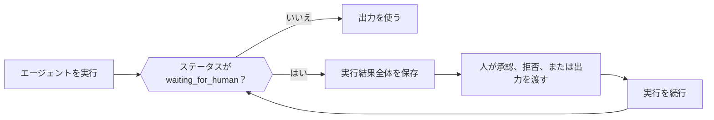

エージェントが人、外部のジョブ、またはアプリケーションが実行するツールを必要とする場合、実行はステータス `waiting_for_human` と続行に必要なすべての情報を持って、（エラーではなく）通常どおり戻ります。結果全体を保存し、アプリケーション内で判断を集めてから、保存した結果と判断をエージェントの続行メソッドに渡します。



<Note>
Phaseo は Agent SDK の実行を保存しません。リクエストやプロセスの再起動後も残す必要がある再開可能な状態は、アプリケーション側で保存してください。
</Note>

| 言語 | 続行 | ストリーミングで続行 | 補足 |
| --- | --- | --- | --- |
| TypeScript | `agent.continueRun()` | `agent.continueStream()` | |
| Python | `agent.continue_run()` | `agent.continue_stream()` | |
| Go | `agent.Continue(ctx, ContinueOptions)` | `agent.ContinueStream` | |
| C# | `agent.ContinueRun(ContinueOptions)` | `agent.ContinueStream` | |
| PHP | `$agent->continueRun()` | `$agent->continueStream()` | `continueRunById()` は先に状態アクセサーから実行を読み込みます |
| Ruby | `agent.continue_run` | `agent.continue_stream` | |
| Java | `agent.continueRun(ContinueOptions)` | `agent.continueStream` | `ContinueOptions` は位置引数のレコードです |
| Rust | `agent.continue_run(&mut client, options)` | なし | `continue_with_events` はイベントコールバックを追加します。実行は同期的です |

## ツール呼び出しを承認または拒否する

承認が必要なツール、手動ツール、人が介在するツールは、実行される前に実行を一時停止します。保留中の各呼び出しには、モデルの `call`（`id` を含む）と `kind`（`approval`、`manual`、`hitl` のいずれか）があります。同じツールへの2つの呼び出しを区別できるよう、すべての呼び出しにはツール名ではなく正確な呼び出し ID で応答してください。

承認された呼び出しはツールを実行します。拒否された呼び出しは、ツールの結果として `{"error": "<reason>"}` をモデルに送ります。デフォルトの理由は `Tool call rejected` です。

<CodeGroup>

```typescript TypeScript
const resumed = await agent.continueRun({
  run: paused,
  client,
  approvals: [{ toolCallId: "call_deploy_42" }],
  rejections: [
    { toolCallId: "call_delete_17", reason: "Not authorized" },
  ],
});
```

```python Python
from phaseo_agent import AgentToolDecision

pending = paused.run.pause.pending_tool_calls

continued = agent.continue_run(
    run=paused,
    client=client,
    approvals=[AgentToolDecision(pending[0].call.id)],
    rejections=[AgentToolDecision(pending[1].call.id, "Not authorized")],
)
```

```go Go
var approvals, rejections []phaseoagent.ToolDecision
for _, pending := range result.Run.Pause.PendingToolCalls {
  if pending.Kind != "approval" {
    continue
  }
  if userApproved(pending.Call) {
    approvals = append(approvals, phaseoagent.ToolDecision{ToolCallID: pending.Call.ID})
  } else {
    rejections = append(rejections, phaseoagent.ToolDecision{ToolCallID: pending.Call.ID, Reason: "Not now"})
  }
}

result, err = agent.Continue(ctx, phaseoagent.ContinueOptions{
  Run: result, Client: client, Approvals: approvals, Rejections: rejections,
})
```

```csharp C#
var pending = result.Run.Pause!.PendingToolCalls!.Where(item => item.Kind == "approval");

result = await agent.ContinueRun(new ContinueOptions
{
    Run = result,
    Client = client,
    Approvals = pending.Where(item => UserApproved(item.Call)).Select(item => new ToolDecision(item.Call.Id)).ToList(),
    Rejections = pending.Where(item => !UserApproved(item.Call)).Select(item => new ToolDecision(item.Call.Id, "Not now")).ToList(),
});
```

```php PHP
use Phaseo\AgentSdk\ToolDecision;

$approvals = $rejections = [];
foreach ($result->run->pause->pendingToolCalls as $pending) {
    if ($pending->kind !== "approval") continue;
    if (userApproved($pending->call)) {
        $approvals[] = new ToolDecision($pending->call->id);
    } else {
        $rejections[] = new ToolDecision($pending->call->id, "Not now");
    }
}

$result = $agent->continueRun(run: $result, client: $client, approvals: $approvals, rejections: $rejections);
```

```ruby Ruby
pending = result.run.pause.pending_tool_calls.select { |item| item.kind == "approval" }
approved, declined = pending.partition { |item| user_approved?(item.call) }

result = agent.continue_run(
  run: result,
  client: client,
  approvals: approved.map { |item| PhaseoAgentSdk::ToolDecision.new(tool_call_id: item.call.id) },
  rejections: declined.map { |item| PhaseoAgentSdk::ToolDecision.new(tool_call_id: item.call.id, reason: "Not now") }
)
```

```java Java
var pending = result.run().pause().pendingToolCalls();
var approvals = pending.stream().filter(item -> item.kind().equals("approval") && userApproved(item.call()))
    .map(item -> new AgentSdk.ToolDecision(item.call().id())).toList();
var rejections = pending.stream().filter(item -> item.kind().equals("approval") && !userApproved(item.call()))
    .map(item -> new AgentSdk.ToolDecision(item.call().id(), "Not now")).toList();

result = agent.continueRun(new AgentSdk.ContinueOptions(
    result, client, null, null, null, null, null, null, null, null, null,
    approvals, rejections, List.of()));
```

```rust Rust
use phaseo_agent::{ContinueOptions, ToolDecision};

let approvals = paused.run.pause.as_ref().unwrap()
    .pending_tool_calls
    .iter()
    .map(|pending| ToolDecision {
        tool_call_id: pending.call.id.clone(),
        reason: Some("Approved by the release operator".to_string()),
    })
    .collect();

let mut options = ContinueOptions::new(paused);
options.approvals = approvals;

let completed = agent.continue_run(&mut client, options)?;
```

</CodeGroup>

保留中の呼び出しの場所と、判断が欠けているときの動作は次のとおりです。

| 言語 | 保留中の呼び出し | 判断が欠けている場合 |
| --- | --- | --- |
| TypeScript | `run.pause.pendingToolCalls` | `Missing approval decision for tool call <id>` をスロー |
| Python | `run.pause.pending_tool_calls` | `ValueError` を送出 |
| Go | `Run.Pause.PendingToolCalls` | `missing approval decision for tool call <id>` を返す |
| C# | `Run.Pause.PendingToolCalls` | `Missing approval decision for tool call <id>` をスロー |
| PHP | `$result->run->pause->pendingToolCalls` | `Missing approval decision for tool call <id>` をスロー |
| Ruby | `result.run.pause.pending_tool_calls` | `Missing approval decision for tool call <id>` を送出 |
| Java | `run().pause().pendingToolCalls()` | `Missing approval decision for tool call <id>` をスロー |
| Rust | `run.pause.pending_tool_calls`（`Option`） | `AgentError` を返す |

一時停止そのものにも `kind` があります。Go と C# は、ツールによる一時停止すべてで `tool_approval` を設定します。PHP、Ruby、Java は、保留中の呼び出しのいずれかが承認を必要とする場合は `tool_approval`、それ以外は最初の呼び出しの種類を設定します。Rust は、承認の呼び出しには `tool_approval`、保留中のすべての呼び出しが外部の結果を必要とする場合は `external_output`、両方が混在する場合は `tool_input` を使います。

<Warning>
Rust `0.2` には拒否の型も `rejections` フィールドもありません。承認されていない呼び出しは一時停止のままにするか、続行する前にアプリケーションの拒否方針を適用してください。
</Warning>

ツールごとではなくすべてのツール呼び出しで承認を必須にするには、エージェント定義に `requireApproval` を設定します（Python と Ruby では `require_approval`、Go と C# では `RequireApproval`）。TypeScript では関数 `requireApproval(call, context)` です。Rust は `Tool::require_approval()` によるツールごとの承認だけに対応しています。各種類のツールの定義方法は[ツール](./tools)にあります。

## 手動ツールと人が介在するツールに結果を渡す

`manual` と `hitl` の呼び出しには、アプリケーションが生成した結果を呼び出し ID ごとに渡します。Rust では、`Tool::external(...)` で作成したツールがこれに当たります。

<CodeGroup>

```typescript TypeScript
await agent.continueRun({
  run: paused,
  client,
  toolOutputs: [{ toolCallId: callId, output: { status: "shipped" } }],
});
```

```python Python
from phaseo_agent import AgentToolOutput

agent.continue_run(
    run=paused,
    client=client,
    tool_outputs=[AgentToolOutput(call_id, {"status": "shipped"})],
)
```

```go Go
ToolOutputs: []phaseoagent.ToolOutput{{ToolCallID: callID, Output: map[string]any{"status": "shipped"}}},
```

```csharp C#
ToolOutputs = new[] { new ToolOutput(callId, new { status = "shipped" }) },
```

```php PHP
use Phaseo\AgentSdk\ToolOutput;

toolOutputs: [new ToolOutput($callId, ["status" => "shipped"])],
```

```ruby Ruby
tool_outputs: [PhaseoAgentSdk::ToolOutput.new(tool_call_id: call_id, output: { status: "shipped" })]
```

```java Java
// ContinueOptions の toolOutputs 引数
List.of(new AgentSdk.ToolOutput(callId, Map.of("status", "shipped")))
```

```rust Rust
use phaseo_agent::{ContinueOptions, ToolOutput};
use serde_json::json;

let mut options = ContinueOptions::new(paused);
options.tool_outputs = vec![ToolOutput {
    tool_call_id: call_id,
    output: json!({ "status": "shipped" }),
}];

let completed = agent.continue_run(&mut client, options)?;
```

</CodeGroup>

出力が欠けていると、続行は `Missing output for tool call <id>` で失敗します（Go では小文字の `missing`、Python では `ValueError`、Rust では `AgentError`）。人の入力メッセージは、ツール出力の代わりにはなりません。

## 人によるレビューのために一時停止する

エージェント定義に人によるレビューのコールバックを設定すると、実行が続く前に各モデルレスポンスを確認できます。一時停止するには `reason`（必要に応じて `payload` も）を持つレビューリクエストを返し、続ける場合は何も返しません。一時停止の `kind` は `human_review` です。コールバックは、実行 ID、ステップ番号、メッセージ、モデルのレスポンス、パース済みの出力を受け取ります（Rust では、実行 ID とエージェント ID、ステップ番号、メッセージ、レスポンス、アプリケーションのコンテキスト）。

<CodeGroup>

```typescript TypeScript
const agent = createAgent({
  id: "support-agent",
  humanReview: ({ response }) =>
    response.message.content.includes("needs approval")
      ? {
          reason: "approval_required",
          payload: { draft: response.message.content },
        }
      : null,
});
```

```python Python
from phaseo_agent import AgentHumanReviewRequest

def review(context):
    if "needs approval" in context.response.message.content:
        return AgentHumanReviewRequest("approval_required", {"draft": context.response.message.content})
    return None

agent = create_agent({"id": "support-agent", "human_review": review})
```

```go Go
HumanReview: func(review phaseoagent.HumanReviewContext) *phaseoagent.HumanReviewRequest {
  if strings.Contains(review.Response.Message.Content, "refund") {
    return &phaseoagent.HumanReviewRequest{Reason: "Refunds need sign-off"}
  }
  return nil
},
```

```csharp C#
HumanReview = review => Task.FromResult<HumanReviewRequest?>(
    review.Response.Message.Content.Contains("refund")
        ? new HumanReviewRequest("Refunds need sign-off")
        : null),
```

```php PHP
use Phaseo\AgentSdk\HumanReviewRequest;

humanReview: fn ($review) => str_contains($review->response->message->content, "refund")
    ? new HumanReviewRequest("Refunds need sign-off")
    : null,
```

```ruby Ruby
human_review: ->(review) {
  if review.response.message.content.include?("refund")
    PhaseoAgentSdk::HumanReviewRequest.new(reason: "Refunds need sign-off")
  end
}
```

```java Java
AgentSdk.HumanReview review = context ->
    context.response().message().content().contains("refund")
        ? new AgentSdk.HumanReviewRequest("Refunds need sign-off", null)
        : null;
```

```rust Rust
use phaseo_agent::{AgentDefinition, HumanReviewRequest};
use serde_json::json;

let definition = AgentDefinition::new("review-agent", "openai/gpt-6-astra")
    .human_review(|context| {
        if context.response.message.content.contains("needs approval") {
            Some(HumanReviewRequest {
                reason: "Review the proposed action".to_string(),
                payload: json!({ "draft": context.response.message.content }),
            })
        } else {
            None
        }
    });
```

</CodeGroup>

人の入力を渡して続行します。この入力はユーザーメッセージとして会話に追加されます。

<CodeGroup>

```typescript TypeScript
const continued = await agent.continueRun({
  run: pausedResult,
  client,
  humanInput: "Approved. Continue and return the final answer.",
});
```

```python Python
continued = agent.continue_run(
    run=paused,
    client=client,
    human_input="Approved. Continue and return the final answer.",
)
```

```go Go
result, err = agent.Continue(ctx, phaseoagent.ContinueOptions{
  Run:        result,
  Client:     client,
  HumanInput: "Approved. Refund up to $50.",
})
```

```csharp C#
result = await agent.ContinueRun(new ContinueOptions
{
    Run = result,
    Client = client,
    HumanInput = "Approved. Refund up to $50.",
});
```

```php PHP
$result = $agent->continueRun(
    run: $result,
    client: $client,
    humanInput: "Approved. Refund up to $50."
);
```

```ruby Ruby
result = agent.continue_run(
  run: result,
  client: client,
  human_input: "Approved. Refund up to $50."
)
```

```java Java
result = agent.continueRun(new AgentSdk.ContinueOptions(
    result, client, null, null, null, null,
    "Approved. Refund up to $50.",          // humanInput
    null, null, null, null));
```

```rust Rust
use phaseo_agent::ContinueOptions;

let mut options = ContinueOptions::new(paused);
options.human_input = Some("Approved. Continue and return the final result.".to_string());

let completed = agent.continue_run(&mut client, options)?;
```

</CodeGroup>

レビューによる一時停止を人の入力なしで続行すると、`Run <id> is waiting for human input` で失敗します（Go では `run <id> is waiting for human input`、Java では `Run is waiting for human input`）。Rust では空でない `human_input` が必要です。TypeScript は構造化された `humanMessages` も受け付けます。

## リクエスト間で実行状態を保存する

実行結果はプレーンなデータです。データベース、オブジェクトストア、ジョブレコードに保存し、アプリケーションの `context` はシリアライズ可能に保ってください。実行を続行できるのは、同じ ID を持つエージェントだけです。保存と再開の完全な流れは、[永続的なエージェントループのクックブック](../../cookbook/agent-sdk-durable-loop)にあります。

SDK に実行の保存と読み込みを任せるには、`load(runId)` と `save(result)` を持つ状態アクセサーを渡します。SDK は各実行と続行の後に保存し、レコードをすべての層に渡す代わりに実行 ID で続行できるようになります。

| 言語 | 状態アクセサー | ID で続行 |
| --- | --- | --- |
| TypeScript | 非同期の `load(runId)` と `save(result)` を持つ `state` | `continueRun({ runId, state, client })` |
| Python | `AgentStateAccessor` を実装した `state` | `continue_run(run_id=..., state=..., client=...)` |
| Go | `RunOptions` と `ContinueOptions` の、`StateAccessor` を実装した `State` | `ContinueOptions{RunID: id, State: store}` |
| C# | `RunOptions` と `ContinueOptions` の、`IStateAccessor` を実装した `State` | `new ContinueOptions { RunId = id, State = store, Client = client }` |
| PHP | `StateAccessor` を実装した `state` | `continueRunById($runId, $state, $client, approvals: ..., rejections: ..., toolOutputs: ...)`。見つからない場合は `Run <id> not found` をスロー |
| Ruby | `state:`。`load(run_id)` と `save(result)` を持つ任意のオブジェクト | `continue_run(run_id: id, state: store, client: client)` |
| Java | `StateAccessor`（`RunOptions` の最後の引数） | 16引数の `ContinueOptions` で、`runId` と `state` を最後に置き、`run` は null にします。実行は読み込まれますが、続行後の結果は保存されないため、自分で保存してください。 |
| Rust | なし | `RunResult` を Serde でシリアライズし、`ContinueOptions::new` に渡す |

<CodeGroup>

```go Go
type StateAccessor interface {
  Load(ctx context.Context, runID string) (*phaseoagent.RunResult, error)
  Save(ctx context.Context, result phaseoagent.RunResult) error
}
```

```csharp C#
public interface IStateAccessor
{
    Task<RunResult?> Load(string runId, CancellationToken cancellationToken = default);
    Task Save(RunResult result, CancellationToken cancellationToken = default);
}
```

```rust Rust
use phaseo_agent::RunResult;

// 一時停止した実行を保存する
std::fs::write("paused-run.json", serde_json::to_string_pretty(&paused)?)?;

// 後で復元する
let paused: RunResult = serde_json::from_str(&std::fs::read_to_string("paused-run.json")?)?;
```

</CodeGroup>

Rust では、続行する前に同じエージェント定義とツールを作り直してください。クロージャと `AgentDefinition` はシリアライズされた実行に含まれません。実際に使われたモデルとステップ上限は `RunRecord` に保存されるため、実行ごとの上書きは続行後も有効です。

何を保存する場合でも、保存した実行の暗号化と保持期間、承認と人の入力に対する認可、再開後に再実行される副作用の冪等性は、アプリケーションが責任を持ちます。
