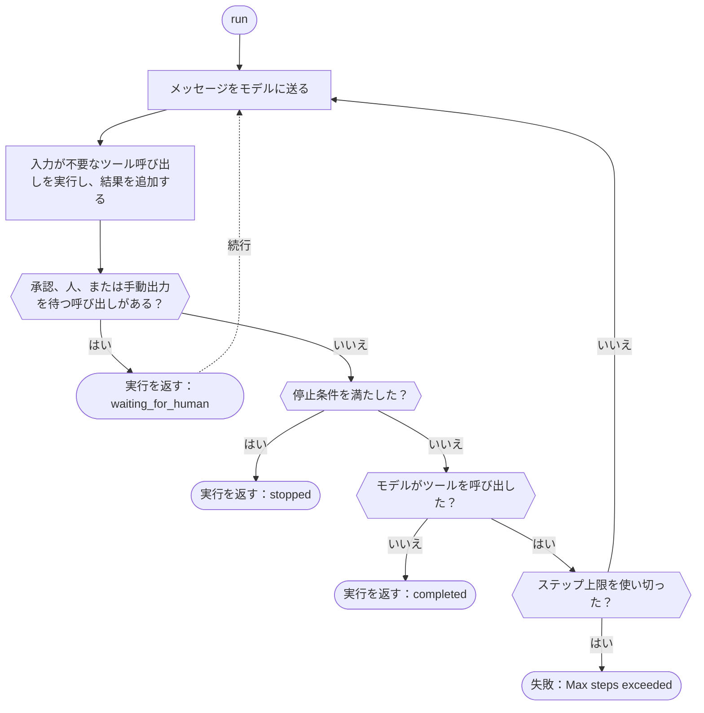

ツールを定義し、エージェントを作成して、Gateway クライアントで実行します。モデルがツールを呼び出すと、SDK がそれを実行して結果を返します。実行は、モデルがツールを呼び出さずに回答したとき、人の判断を待って一時停止したとき、または[停止条件](./stop-conditions)に一致したときに戻ります。先にステップ上限に達した場合、SDK はエラーをスローします。ステータス `stopped` で実行を返すのは Rust だけです。Phaseo はエージェントをホストせず、実行結果も保存しません。保存するのはアプリケーションです。

## 最初のエージェントを作る

<CodeGroup>

```typescript TypeScript
import {
  createAgent,
  createGatewayAgentClient,
  defineTool,
} from "@phaseo/agent-sdk";

const lookupDocs = defineTool({
  id: "lookup-docs",
  description: "Look up an internal docs page by slug.",
  parameters: {
    type: "object",
    properties: {
      slug: { type: "string" },
    },
    required: ["slug"],
    additionalProperties: false,
  },
  async execute(input: { slug: string }) {
    return {
      slug: input.slug,
      url: `https://phaseo.app/docs/v1/${input.slug}`,
    };
  },
});

const agent = createAgent({
  id: "support-docs-agent",
  model: "openai/gpt-6-astra",
  instructions: "Use tools when helpful and finish with a concise answer.",
  tools: [lookupDocs],
});

const result = await agent.run({
  input: "Find the docs page for presets and explain when to use them.",
  client: createGatewayAgentClient({
    clientOptions: {
      apiKey: process.env.PHASEO_API_KEY!,
    },
  }),
});

console.log(result.output);
```

```python Python
import os
from phaseo_agent import AgentTool, create_agent, create_gateway_agent_client, define_tool

lookup_docs = define_tool(AgentTool(
    id="lookup-docs",
    description="Look up an internal docs page by slug.",
    parameters={
        "type": "object",
        "properties": {"slug": {"type": "string"}},
        "required": ["slug"],
        "additionalProperties": False,
    },
    execute=lambda tool_input, runtime: {
        "slug": tool_input["slug"],
        "url": f"https://phaseo.app/docs/v1/{tool_input['slug']}",
    },
))

agent = create_agent({
    "id": "support-docs-agent",
    "model": "openai/gpt-6-astra",
    "instructions": "Use tools when helpful and finish with a concise answer.",
    "tools": [lookup_docs],
})

result = agent.run(
    input="Find the docs page for presets and explain when to use them.",
    client=create_gateway_agent_client(client_options={"api_key": os.environ["PHASEO_API_KEY"]}),
)

print(result.output)
```

```go Go
package main

import (
  "context"
  "fmt"

  phaseoagent "github.com/phaseoteam/Phaseo/packages/sdk/agent-sdk-go"
)

func main() {
  client, err := phaseoagent.CreateGatewayAgentClient(phaseoagent.GatewayAgentClientOptions{})
  if err != nil {
    panic(err) // PHASEO_API_KEY が必要
  }

  lookup := phaseoagent.DefineTool(phaseoagent.Tool{
    ID:          "lookup_docs",
    Description: "Look up a Phaseo documentation topic",
    Parameters: map[string]any{
      "type":       "object",
      "properties": map[string]any{"topic": map[string]any{"type": "string"}},
      "required":   []string{"topic"},
    },
    Execute: func(input any, runtime phaseoagent.RuntimeContext) (any, error) {
      args, _ := input.(map[string]any)
      return map[string]any{"topic": args["topic"], "found": true}, nil
    },
  })

  agent := phaseoagent.CreateAgent(phaseoagent.AgentDefinition{
    ID:           "docs-agent",
    Model:        "openai/gpt-6-astra",
    Instructions: "Use tools when helpful and finish with a concise answer.",
    Tools:        []phaseoagent.Tool{lookup},
    MaxSteps:     6,
  })

  result, err := agent.Run(context.Background(), phaseoagent.RunOptions{
    Input:  "Explain when to use routing presets.",
    Client: client,
  })
  if err != nil {
    panic(err)
  }

  fmt.Println(result.Output)
  fmt.Println(result.Run.Status, result.Usage.TotalTokens)
}
```

```csharp C#
using System.Text.Json;
using PhaseoAgentSdk;

var lookup = AgentSdk.DefineTool(new Tool(
    "lookup_docs",
    async (input, runtime) =>
    {
        var topic = ((JsonElement)input!).GetProperty("topic").GetString();
        return new { topic, found = true };
    },
    "Look up a Phaseo documentation topic",
    new Dictionary<string, object?>
    {
        ["type"] = "object",
        ["properties"] = new Dictionary<string, object?> { ["topic"] = new { type = "string" } },
        ["required"] = new[] { "topic" },
    }));

var agent = AgentSdk.CreateAgent(new AgentDefinition
{
    Id = "docs-agent",
    Model = "openai/gpt-6-astra",
    Instructions = "Use tools when helpful and finish with a concise answer.",
    Tools = new[] { lookup },
    MaxSteps = 6,
});

var result = await agent.Run(new RunOptions
{
    Input = "Explain when to use routing presets.",
    Client = AgentSdk.CreateGatewayAgentClient(), // PHASEO_API_KEY がないとスロー
});

Console.WriteLine(result.Output);
Console.WriteLine($"{result.Run.Status} {result.Usage.TotalTokens}");
```

```php PHP
<?php
require "vendor/autoload.php";

use Phaseo\AgentSdk\AgentDefinition;
use Phaseo\AgentSdk\AgentSdk;
use Phaseo\AgentSdk\Tool;

$lookup = AgentSdk::defineTool(new Tool(
    id: "lookup_docs",
    execute: fn (array $input, $runtime) => ["topic" => $input["topic"], "found" => true],
    description: "Look up a Phaseo documentation topic",
    parameters: [
        "type" => "object",
        "properties" => ["topic" => ["type" => "string"]],
        "required" => ["topic"],
    ],
));

$agent = AgentSdk::createAgent(new AgentDefinition(
    id: "docs-agent",
    model: "openai/gpt-6-astra",
    instructions: "Use tools when helpful and finish with a concise answer.",
    tools: [$lookup],
    maxSteps: 6,
));

$result = $agent->run(
    input: "Explain when to use routing presets.",
    client: AgentSdk::createGatewayAgentClient() // PHASEO_API_KEY がないとスロー
);

echo $result->output . PHP_EOL;
echo $result->run->status . " " . $result->usage["total_tokens"] . PHP_EOL;
```

```ruby Ruby
require "phaseo_agent_sdk"

lookup = PhaseoAgentSdk.define_tool(
  PhaseoAgentSdk::Tool.new(
    id: "lookup_docs",
    description: "Look up a Phaseo documentation topic",
    parameters: {
      type: "object",
      properties: { topic: { type: "string" } },
      required: ["topic"]
    },
    execute: ->(input, runtime) { { topic: input["topic"], found: true } }
  )
)

agent = PhaseoAgentSdk.create_agent(
  id: "docs-agent",
  model: "openai/gpt-6-astra",
  instructions: "Use tools when helpful and finish with a concise answer.",
  tools: [lookup],
  max_steps: 6
)

result = agent.run(
  input: "Explain when to use routing presets.",
  client: PhaseoAgentSdk.create_gateway_agent_client # PHASEO_API_KEY がないと例外を送出
)

puts result.output
puts "#{result.run.status} #{result.usage[:total_tokens]}"
```

```java Java
import app.phaseo.agent.AgentSdk;
import java.time.Duration;
import java.util.List;
import java.util.Map;

var lookup = AgentSdk.defineTool(new AgentSdk.Tool(
    "lookup_docs",
    (input, context) -> Map.of("topic", ((Map<?, ?>) input).get("topic"), "found", true),
    "Look up a Phaseo documentation topic",
    Map.of(
        "type", "object",
        "properties", Map.of("topic", Map.of("type", "string")),
        "required", List.of("topic")),
    Duration.ofSeconds(10)
));

var agent = AgentSdk.createAgent(new AgentSdk.AgentDefinition(
    "docs-agent",                       // id
    "openai/gpt-6-astra",               // model
    null,                               // preset
    "Use tools when helpful and finish with a concise answer.", // instructions
    List.of(lookup),                    // tools
    6,                                  // maxSteps
    null, null, null, null              // parseOutput, humanReview, modelRetry, toolExecution
));

var result = agent.run(new AgentSdk.RunOptions(
    "Explain when to use routing presets.",  // input
    AgentSdk.createGatewayAgentClient(),     // PHASEO_API_KEY がないとスロー
    null, null, null, null, null, null, null, null
));

System.out.println(result.output());
System.out.println(result.run().status() + " " + result.usage().totalTokens());
```

```rust Rust
use phaseo_agent::{
    create_agent, create_gateway_agent_client, define_tool, AgentDefinition,
    RunOptions, Tool,
};
use serde_json::json;

fn main() -> Result<(), Box<dyn std::error::Error>> {
    let lookup = define_tool(Tool::new(
        "lookup_docs",
        "Look up a Phaseo documentation topic",
        json!({
            "type": "object",
            "properties": {
                "topic": { "type": "string" }
            },
            "required": ["topic"]
        }),
        |input, context| {
            Ok(json!({
                "topic": input["topic"],
                "run_id": context.run_id,
                "found": true
            }))
        },
    ));

    let agent = create_agent(
        AgentDefinition::new("docs-agent", "openai/gpt-6-astra")
            .instructions("Use lookup_docs when helpful. Answer concisely.")
            .max_steps(6)
            .tool(lookup),
    );

    let mut client = create_gateway_agent_client("openai/gpt-6-astra")?;
    let result = agent.run(
        &mut client,
        RunOptions::new("Explain when to use routing presets."),
    )?;

    println!("{}", result.output);
    println!("steps: {}", result.run.step_count);
    println!("tokens: {}", result.usage.total_tokens);
    Ok(())
}
```

</CodeGroup>

ツールの ID はモデルから見える関数名で、パラメーターはモデルが値を埋める JSON Schema です。引数は、各言語のネイティブな形でコードに渡されます。

| 言語 | ツールが受け取るもの | 補足 |
| --- | --- | --- |
| TypeScript | 型付きオブジェクト | `execute(input, context)` |
| Python | `dict` | `execute(tool_input, runtime)` |
| Go | `any`（デコード済みの JSON。通常は `map[string]any`） | `Execute(input, runtime) (any, error)` |
| C# | `JsonElement` | `Execute(input, runtime)`。await される |
| PHP | 連想配列 | `execute(array $input, $runtime)` |
| Ruby | 文字列キーのハッシュ | ツールは `PhaseoAgentSdk::Tool.new` で作成します。`define_tool` は渡されたものをそのまま返すため、ただの Hash では動きません |
| Java | `Map` | レコードは位置引数です。設定しない項目には `null` を渡します |
| Rust | `serde_json::Value` | クロージャはローカルで実行されます。`RuntimeContext` には実行 ID、エージェント ID、ステップ番号、アプリケーションのコンテキスト、ツール呼び出しが入っています |

エージェント、実行、クライアントのいずれもモデルまたはプリセットを設定していない場合、Gateway クライアントは `phaseo/free` を送ります。Rust の `create_gateway_agent_client` は、モデルを引数として受け取ります。

## 実行の流れ



各ステップは、返される実行結果にチェックポイントとして記録されます。リクエストや再起動をまたいで再開するには、その結果を独自のストアに保存して続行メソッドに渡すか、エージェントに状態アクセサーを渡します。[状態と承認](./state-and-approval)を参照してください。ステップ上限と、上限に達したときの動作は言語によって異なります。

<Tabs>
<Tab title="TypeScript">

`maxSteps` を設定しない限り、`run()` または `continueRun()` の各呼び出しは最大12ステップまで進み、それを超えると `Max steps exceeded` をスローします。実行をきれいに終わらせるには[停止条件](./stop-conditions)を使います。

</Tab>
<Tab title="Python">

`max_steps` を設定しない限り、実行は最大12ステップまで進み、それを超えると `RuntimeError` を送出します。停止条件はモデルがツールを呼び出さなかったステップでのみ確認されるため、順序は図と異なります。ツールループは、一時停止するか、回答するか、`max_steps` を使い切るまで続きます。

</Tab>
<Tab title="Go">

`MaxSteps`（デフォルトは8）を超えるモデルターンが必要な実行は、`Max steps exceeded (N)` で失敗します。

</Tab>
<Tab title="C#">

`MaxSteps`（デフォルトは12）を超えるモデルターンが必要な実行は、`InvalidOperationException("Max steps exceeded (N)")` をスローします。

</Tab>
<Tab title="PHP">

`maxSteps`（デフォルトは12）を超えるモデルターンが必要な実行は、`Max steps exceeded (N)` をスローします。

</Tab>
<Tab title="Ruby">

`max_steps`（デフォルトは12）を超えるモデルターンが必要な実行は、`Max steps exceeded (N)` を送出します。

</Tab>
<Tab title="Java">

`maxSteps`（デフォルトは12）を超えるモデルターンが必要な実行は、`Max steps exceeded (N)` をスローします。

</Tab>
<Tab title="Rust">

`.max_steps(n)` を呼び出すか `RunOptions.max_steps` を設定しない限り、実行は最大8モデルターンまで進みます。上限に達しても失敗にはならず、実行は `run.status` が `stopped`、`run.stop_reason` が `max_steps:<limit>` の状態で戻ります。実行は同期的で、ローカルツールは1つずつ実行されます。実行でリクエストハンドラーをブロックしたくない場合は、ワーカースレッドやタスク境界を使ってください。

</Tab>
</Tabs>

## 実行結果を読む

どの実行も同じ構成要素を返します。フィールド名は各言語の命名規則に従います（`output`、`Output`、`output()`）。

| 構成要素 | 内容 |
| --- | --- |
| `run` | ステータス、ID、実際に使われたモデル、ステップ上限、コンテキスト、一時停止の状態、停止理由 |
| `steps` | モデルターンごとに1件の記録。リクエスト ID、プロバイダー、モデル、終了理由、警告、ツール呼び出し、使用量 |
| `messages` | ツールの結果を含む会話全体 |
| `output` | 最終出力 |
| `usage` | 入力、出力、キャッシュ、合計のトークン数と、コスト |

Rust の `usage.cost` は、レスポンスの数値の `meta.cost` または `cost` からのみ取得されます。`cost_nanos` や `cost_cents` は対応付けられません。Rust で支出を報告するには、Gateway のレスポンスまたは生成レコードを使ってください。

## 目的に合った機能を探す

| やりたいこと | ページ |
| --- | --- |
| モデルにローカルツール、手動ツール、進捗を報告するツールを渡す | [ツール](./tools) |
| 承認や人の判断を待って一時停止し、再開する | [状態と承認](./state-and-approval) |
| テキストとツールの動きをリアルタイムに表示する | [ストリーミング](./streaming) |
| メッセージ、推論、ツール呼び出しのタイムラインを表示する | [アイテム](./items) |
| ステップ数、トークン数、コスト、時間に上限を設ける | [停止条件](./stop-conditions) |
| ターンの間にモデルやツールを変える | [動的ターン](./dynamic-turns) |
| 型付きの出力を得る、モデル呼び出しを再試行する、プリセットを使う | [出力と再試行](./run-controls) |
| 各ステップをログに残す、監査する | [ライフサイクルフック](./lifecycle-hooks) |
| 実行の使用量、コスト、リクエスト ID を記録する | [オブザーバビリティ](./observability) |
| Gateway、スキーマ、ステップ上限のエラーを処理する | [イベントとエラー](./events-and-errors) |
| 実行をローカルで調べる | [DevTools](./devtools) |

すべてのエクスポートは [API リファレンス](./api-reference)に、完全なエージェントは[例](./examples)にあります。
