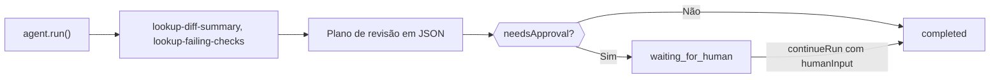

Crie um agente em TypeScript que inspeciona um pull request com ferramentas locais, retorna um plano de revisão em JSON estrito e pausa para uma pessoa quando o plano diz que precisa de aprovação. Ao final, você terá um único script que imprime um `CodeReviewPlan` validado e para em `waiting_for_human` até que alguém o aprove.

As ferramentas retornam dados de exemplo fixos, então o script é ilustrativo; substitua-as por chamadas ao seu host de código e à sua CI. Uma versão empacotada está em `packages/sdk/agent-sdk-ts/examples/coding-review-agent.ts`.



## Crie o agente

<Steps>
<Step title="Instale">

```bash
npm install @phaseo/agent-sdk zod
export PHASEO_API_KEY="phaseo_v1_sk_..."
```

</Step>
<Step title="Escreva o agente">

```ts review-agent.ts
import { z } from "zod";
import { createAgent, createGatewayAgentClient, defineTool } from "@phaseo/agent-sdk";

const CodeReviewPlan = z
  .object({
    risk: z.enum(["low", "medium", "high"]),
    summary: z.string().min(1),
    recommendedActions: z.array(z.string()).min(1),
    needsApproval: z.boolean(),
  })
  .strict();
type CodeReviewPlan = z.infer<typeof CodeReviewPlan>;

const PullRequestInput = z.object({ pullRequestId: z.string().regex(/^pr_\d+$/) }).strict();
const pullRequestParameters = {
  type: "object",
  properties: { pullRequestId: { type: "string", pattern: "^pr_\\d+$" } },
  required: ["pullRequestId"],
  additionalProperties: false,
};

// Ferramentas somente leitura e determinísticas: seguras para executar de novo se um worker retomar a execução.
const lookupDiffSummary = defineTool({
  id: "lookup-diff-summary",
  description: "Return a short summary of the changed files in one pull request.",
  parameters: pullRequestParameters,
  inputSchema: PullRequestInput,
  async execute({ pullRequestId }) {
    return {
      pullRequestId,
      files: ["apps/api/src/pipeline/before/index.ts"],
      summary: "Changes touch request validation.",
    };
  },
});

const lookupFailingChecks = defineTool({
  id: "lookup-failing-checks",
  description: "Return the failing CI checks for one pull request.",
  parameters: pullRequestParameters,
  inputSchema: PullRequestInput,
  async execute({ pullRequestId }) {
    return { pullRequestId, failingChecks: ["web-typecheck"] };
  },
});

const codingReviewAgent = createAgent<string, CodeReviewPlan>({
  id: "coding-review-agent",
  model: "openai/gpt-6-astra",
  instructions:
    "Use the available tools to inspect the coding task, then return a strict JSON review plan.",
  tools: [lookupDiffSummary, lookupFailingChecks],
  maxSteps: 6,
  parseOutput: (text) => JSON.parse(text),
  outputSchema: CodeReviewPlan,
  humanReview: ({ parsedOutput }) =>
    parsedOutput?.needsApproval
      ? { reason: "coding_review_approval_required", payload: parsedOutput }
      : null,
});

// Pede ao Gateway exatamente este formato de JSON e repara JSON quase válido.
const client = createGatewayAgentClient({
  clientOptions: { apiKey: process.env.PHASEO_API_KEY! },
  responseFormat: {
    type: "json_schema",
    name: "code_review_plan",
    schema: {
      type: "object",
      properties: {
        risk: { type: "string", enum: ["low", "medium", "high"] },
        summary: { type: "string" },
        recommendedActions: { type: "array", items: { type: "string" }, minItems: 1 },
        needsApproval: { type: "boolean" },
      },
      required: ["risk", "summary", "recommendedActions", "needsApproval"],
      additionalProperties: false,
    },
  },
  plugins: [{ id: "response-healing", mode: "strict" }],
});

const result = await codingReviewAgent.run({
  input: "Review pull request pr_482 and produce a remediation plan.",
  client,
  onEvent(event) {
    console.log(event.type, event.runId);
  },
});

if (result.run.status === "waiting_for_human") {
  console.log("Needs approval:", result.run.pause?.payload);

  // Em um app real, guarde `result` e continue quando um revisor aprovar.
  if (process.env.APPROVE === "yes") {
    const continued = await codingReviewAgent.continueRun({
      run: result,
      client,
      humanInput: "Approved. Finalize the plan.",
    });
    console.log(continued.output);
  }
} else {
  console.log(result.output);
}
```

`responseFormat` faz o Gateway solicitar este esquema, e `outputSchema` verifica de novo o resultado analisado no seu processo. O modo estrito de [recuperação de respostas](./response-healing-for-structured-json) só desembrulha JSON que já é válido.

</Step>
<Step title="Execute">

```bash
npx tsx review-agent.ts
APPROVE=yes npx tsx review-agent.ts
```

</Step>
</Steps>

## Verifique se funcionou

- O log de eventos mostra `tool.started` e `tool.completed` para as duas ferramentas e, em seguida, `checkpoint.saved` após a etapa de ferramentas.
- Um plano com `needsApproval: true` encerra a primeira execução em `waiting_for_human`, com o plano em `result.run.pause.payload`; com `APPROVE=yes`, ela continua até `completed`.
- Em **Configurações → Uso → Registros**, cada turno do modelo mostra as chamadas de ferramentas, e o registro de plugins da solicitação mostra se a recuperação foi executada.
- Um plano que viola o esquema faz a execução falhar com um `AgentSchemaValidationError` em vez de retornar dados ruins.

## Torne-o seguro para repositórios reais

Mantenha as ferramentas de revisão somente leitura. Se você adicionar uma ferramenta que comenta, faz push ou faz merge, defina `requireApproval: true` nela para que a execução pause antes de ela rodar, e aprove-a com `continueRun({ run, client, approvals: [toolCallId] })`. Trate o conteúdo do diff como entrada não confiável: comentários no código podem conter instruções direcionadas ao modelo. Para sobreviver a reinícios enquanto uma revisão aguarda, salve a execução com um acessor `state`, como no [loop persistente](./agent-sdk-durable-loop). [Estado e aprovação](../sdk-reference/agent/state-and-approval) cobre aprovações e rejeições.
