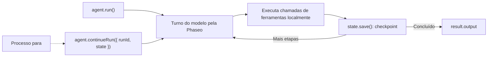

Execute um agente que usa ferramentas com o Agent SDK de TypeScript e salve o estado dele após cada etapa, para que um processo que travou ou reiniciou continue de onde parou. Ao final, você terá um único script que responde a uma pergunta sobre a documentação com uma ferramenta de consulta, grava cada execução em `.agent-runs/<run id>.json` e retoma uma execução quando você passa o ID dela.

O script é ilustrativo: o armazenamento em arquivos serve para uma única máquina. Em produção, mantenha o mesmo par `load`/`save`, mas apoiado no seu banco de dados. A Phaseo não armazena as execuções do Agent SDK para você.



## Crie o agente

<Steps>
<Step title="Instale">

<CodeGroup>
```bash npm
npm install @phaseo/agent-sdk zod
```

```bash pnpm
pnpm add @phaseo/agent-sdk zod
```

```bash yarn
yarn add @phaseo/agent-sdk zod
```

```bash bun
bun add @phaseo/agent-sdk zod
```
</CodeGroup>

`@phaseo/agent-sdk` instala o `@phaseo/sdk` junto. Defina sua chave:

```bash
export PHASEO_API_KEY="phaseo_v1_sk_..."
```

</Step>
<Step title="Escreva o agente">

```ts agent.ts
import { mkdir, readFile, writeFile } from "node:fs/promises";
import { z } from "zod";
import {
  createAgent,
  createGatewayAgentClient,
  defineTool,
  type AgentStateAccessor,
} from "@phaseo/agent-sdk";

const DOC_SLUGS = ["guides/presets", "guides/routing-and-fallbacks", "guides/streaming"] as const;

// O modelo só vê `parameters`; `inputSchema` rejeita qualquer outra coisa antes de execute rodar.
const lookupDocs = defineTool({
  id: "lookup-docs",
  description: "Return the URL of one Phaseo docs page by slug.",
  parameters: {
    type: "object",
    properties: { slug: { type: "string", enum: [...DOC_SLUGS] } },
    required: ["slug"],
    additionalProperties: false,
  },
  inputSchema: z.object({ slug: z.enum(DOC_SLUGS) }).strict(),
  async execute({ slug }) {
    return { slug, url: `https://phaseo.app/docs/v1/${slug}` };
  },
});

const agent = createAgent<string, string>({
  id: "support-docs-agent",
  model: "openai/gpt-6-astra",
  instructions: "Use tools when helpful and finish with a concise answer that includes the docs URL.",
  tools: [lookupDocs],
  maxSteps: 6,
});

// Salva a execução inteira após cada etapa. Troque estas duas funções pelo seu banco de dados.
const RUNS_DIR = ".agent-runs";
const state: AgentStateAccessor<string, unknown, string> = {
  async load(runId) {
    try {
      return JSON.parse(await readFile(`${RUNS_DIR}/${runId}.json`, "utf8"));
    } catch {
      return null;
    }
  },
  async save(result) {
    await mkdir(RUNS_DIR, { recursive: true });
    await writeFile(`${RUNS_DIR}/${result.run.id}.json`, JSON.stringify(result));
  },
};

const client = createGatewayAgentClient({
  clientOptions: { apiKey: process.env.PHASEO_API_KEY! },
});

const onEvent = (event: { type: string; runId: string }) => {
  if (event.type === "checkpoint.saved") console.log("checkpoint", event.runId);
};

const resumeId = process.argv[2];
let result;

if (resumeId) {
  const saved = await state.load(resumeId);
  if (!saved) throw new Error(`No saved run ${resumeId}`);
  result = saved.run.status === "completed"
    ? saved
    : await agent.continueRun({ run: saved, client, state, onEvent });
} else {
  result = await agent.run({
    input: "Find the docs page for presets and explain when to use them.",
    client,
    state,
    onEvent,
  });
}

console.log(result.run.id, result.run.status);
console.log(result.output);
```

</Step>
<Step title="Execute">

```bash
npx tsx agent.ts
```

Para testar a retomada, pare o script com `Ctrl+C` depois da primeira linha `checkpoint` e passe o ID da execução que ele imprimiu (um UUID):

```bash
npx tsx agent.ts 3f6c1d2e-...
```

</Step>
</Steps>

## Verifique se funcionou

- O script imprime `checkpoint` uma vez por etapa e depois o ID da execução, `completed` e uma resposta com uma URL `phaseo.app/docs`.
- `.agent-runs/<run id>.json` guarda o ID da execução, o status, o histórico de mensagens, as chamadas de ferramentas e os resultados de cada etapa e a saída final.
- Depois de uma execução interrompida, o comando de retomada conclui o mesmo ID de execução em vez de iniciar uma nova.
- Cada turno do modelo aparece em **Configurações → Uso → Registros**. Registre o ID da execução ao lado de cada ID de solicitação para poder relacioná-los.

## O que o estado salvo contém

Cada resultado salvo é o `AgentRunResult` completo: `run` (ID, status, mensagens, uso e qualquer pausa), `steps` com os IDs de solicitação do gateway e as chamadas de ferramentas, e `output` quando a execução termina. `continueRun()` aceita esse resultado diretamente, ou um `runId` mais `state`, e nesse caso chama `load()` por conta própria.

Uma chamada de ferramenta que estava em andamento quando o processo parou pode já ter produzido seu efeito, então mantenha as ferramentas idempotentes. O SDK repara o histórico de uma chamada que nunca recebeu resultado antes de continuar. [Estado e aprovação](../sdk-reference/agent/state-and-approval) cobre pausas e aprovações.

## Faça-o crescer com cuidado

Mantenha um agente por fluxo de trabalho, uma lista curta de ferramentas e uma linha de log por execução com o ID da execução e os IDs de solicitação. Quando precisar de pausas para aprovação ou de vários agentes compartilhando ferramentas, mantenha este par de cliente do gateway e estado e construa em torno dele: o [agente de revisão de código](./agent-sdk-coding-review) adiciona uma pausa para aprovação, e [Ferramentas em paralelo](./agent-sdk-parallel-tools) executa ferramentas lado a lado. Para padrões de solicitação compartilhados, chame uma [predefinição](../guides/presets) em vez de um modelo fixo.
