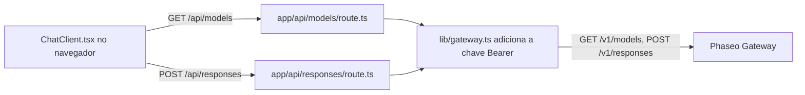

Execute um pequeno aplicativo de chat em Next.js cujo código no navegador conversa apenas com as rotas do seu próprio servidor, para que sua chave de API da Phaseo nunca chegue ao navegador. Ao final, você terá uma página de chat local com um seletor de modelos preenchido por `GET /v1/models` e respostas vindas de `POST /v1/responses`.

O exemplo é ilustrativo: as rotas não têm login nem limite de taxa, então qualquer pessoa que consiga acessá-las gasta a sua chave. Adicione primeiro as verificações de [Antes de implantar](#before-you-deploy-it).

Para que um agente de programação crie o mesmo app do zero, cole este prompt:

<Prompt
  description="Crie um **aplicativo de chat web com Next.js** sobre o Phaseo Gateway."
  icon="message-square"
  actions={["copy", "cursor"]}
>
{`You are building a small production-style chat app with Phaseo Gateway.

Create a Next.js app with:
- a chat UI
- a model picker backed by GET https://api.phaseo.app/v1/models
- a server-side route that calls POST https://api.phaseo.app/v1/responses
- server-side API key handling using PHASEO_API_KEY (Authorization: Bearer)
- loading, success, and error states

Keep the app intentionally small and easy to inspect.

Implementation requirements:
- Use one local API route for model discovery.
- Use one local API route for responses generation.
- Keep secrets server-side only.
- Send the whole conversation in input on every turn. The gateway rejects previous_response_id.
- Only accept model IDs from an allowlist on the server, and cap the input length.
- Show the request/response flow clearly in code.
- Add a short README with setup and run steps.

Verification:
- Run the app if possible.
- Verify two successful chat turns in a row.
- Report the exact files changed, what you verified, and any remaining assumptions.`}
</Prompt>

## Como o exemplo é construído



O exemplo fica em [examples/web-chat-nextjs](https://github.com/phaseoteam/Phaseo/tree/main/examples/web-chat-nextjs):

| Arquivo | O que faz |
| --- | --- |
| `app/components/ChatClient.tsx` | Entrada, estados de carregamento e erro, mensagens renderizadas e seletor de modelos |
| `app/api/models/route.ts` | Retorna os IDs de modelo de `GET /v1/models` |
| `app/api/responses/route.ts` | Verifica se `model` e `input` são strings não vazias (`400 missing_model`, `400 missing_input`) e depois chama `POST /v1/responses` |
| `lib/gateway.ts` | Monta a URL e os cabeçalhos: `Authorization: Bearer $PHASEO_API_KEY`, `x-title` e `http-referer` quando definidos |

## Execute o exemplo

Você precisa do Node.js e de uma chave de API da Phaseo.

<Steps>
<Step title="Instale">

```bash
cd examples/web-chat-nextjs
npm install
```

O exemplo inclui um `package-lock.json`, então o `npm` instala as versões testadas.

</Step>
<Step title="Crie o .env.local">

O exemplo não tem `.env.example`. Crie o `.env.local` você mesmo:

```bash .env.local
PHASEO_API_KEY=phaseo_v1_sk_...
# Opcional. O padrão é https://api.phaseo.app; o /v1 é adicionado para você.
NEXT_PUBLIC_GATEWAY_URL=https://api.phaseo.app
# Cabeçalhos opcionais de atribuição do app.
GATEWAY_APP_TITLE=My chat app
GATEWAY_HTTP_REFERER=https://myapp.example
```

Aqui, `NEXT_PUBLIC_GATEWAY_URL` só é lido no servidor, mas o prefixo `NEXT_PUBLIC_` o exporia ao código do navegador, então nunca coloque uma chave nele. [Atribuição do aplicativo](../guides/app-attribution) explica os dois cabeçalhos opcionais.

</Step>
<Step title="Corrija o segundo turno do chat">

`ChatClient.tsx` envia o `id` da resposta anterior como `previous_response_id`. O Gateway não armazena respostas, então rejeita esse campo com `400 validation_error` (palavra-chave `unsupported_param`) e a segunda mensagem falha. Em `app/api/responses/route.ts`, apague o bloco que copia `previous_response_id` para o payload:

```ts app/api/responses/route.ts
  // Apague estas linhas:
  if (typeof body.previous_response_id === 'string' && body.previous_response_id.trim()) {
    payload.previous_response_id = body.previous_response_id.trim();
  }
```

Depois disso, cada turno é respondido de forma independente. Para manter o contexto, envie os turnos anteriores como um array de mensagens em `input`.

</Step>
<Step title="Inicie o servidor de desenvolvimento">

```bash
npm run dev
```

Abra `http://localhost:3000`.

</Step>
</Steps>

## Verifique se funcionou

- O seletor de modelos é preenchido com IDs de modelo.
- Duas mensagens seguidas recebem uma resposta cada.
- No painel de rede do navegador, as solicitações vão apenas para `/api/models` e `/api/responses`, e nenhuma solicitação carrega `PHASEO_API_KEY`.
- Um ID de modelo inválido mostra a mensagem de erro do Gateway em vez de uma resposta em branco.
- As solicitações aparecem em **Configurações → Uso → Registros** com o título do app que você definiu.

<span id="before-you-deploy-it"></span>
## Antes de implantar

- **Autentique as rotas.** Exija um usuário conectado em `/api/responses` e `/api/models`, ou use a [bancada de trabalho OAuth](./build-an-oauth-nextjs-workbench) para que cada usuário gaste os próprios créditos.
- **Use uma lista de modelos permitidos.** A rota encaminha qualquer string `model` vinda do navegador. Verifique-a contra uma lista fixa no servidor.
- **Limite a entrada e a taxa.** Limite o tamanho da entrada e as solicitações por usuário, e defina um [limite de gasto na chave](../api-reference/limits#key-limits-and-budgets).
- **Use streaming se precisar.** Defina `stream: true` e encaminhe os eventos; [Transmissão](../guides/streaming) mostra qual evento encerra um stream da API Responses.

Para um script de backend em vez de uma UI, comece pelo [aplicativo de smoke test REST com Node](./build-a-node-rest-smoke-app) ou pela [CLI de gateway em Python](./build-a-python-gateway-cli).
