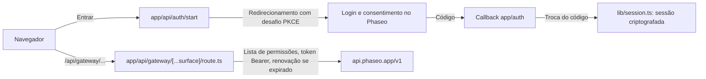

Deixe as pessoas entrarem com o Phaseo e gastarem os próprios créditos no seu aplicativo: o OAuth 2.1 com PKCE dá ao seu servidor um token de acesso, e um único proxy no servidor o anexa a cada chamada ao Gateway. No fim, você tem um aplicativo local com login, tokens guardados na sessão que se renovam, descoberta de modelos, um fluxo de chat sobre `/responses` e um testador para outros endpoints.

O exemplo é ilustrativo. O `lib/oauth.ts` ainda chama um endpoint de login antigo, que o passo 3 de [Execute](#run-it) corrige, e a lista de permissões do proxy é mais ampla do que um produto precisa.

Para que um agente de programação crie o mesmo aplicativo do zero, cole este prompt:

<Prompt
  description="Crie um **workbench Next.js com login** usando OAuth e um proxy unificado do Phaseo."
  icon="shield-user"
  actions={["copy", "cursor"]}
>
{`You are building a signed-in Next.js app on top of Phaseo Gateway.

Create a workbench-style app with:
- OAuth 2.1 + PKCE sign-in against https://api.phaseo.app/oauth/authorize and https://api.phaseo.app/oauth/token (discover them from https://api.phaseo.app/.well-known/oauth-authorization-server), requesting the gateway:access scope
- session-backed token storage in an encrypted, httpOnly cookie
- one unified gateway proxy route on the server that calls https://api.phaseo.app/v1
- model discovery
- one chat flow using the Responses API, sending the whole conversation in input on every turn
- one generic endpoint tester for additional Phaseo endpoints

Requirements:
- Keep gateway credentials and access tokens server-side.
- Use a proxy allowlist of exact paths for safety.
- Support token refresh. Store the new refresh token from every refresh and drop the old one.
- Sign out by sending the refresh token to https://api.phaseo.app/oauth/revoke.
- Keep the workbench understandable rather than over-engineered.
- Add a short README with setup, env vars, and run steps.

Verification:
- run the app if possible
- verify sign-in flow as far as local setup allows
- verify at least one proxied gateway request path
- report exactly what you verified and what remains dependent on external OAuth configuration.`}
</Prompt>

## Como o exemplo é montado



O exemplo fica em [examples/oauth-client-nextjs](https://github.com/phaseoteam/Phaseo/tree/main/examples/oauth-client-nextjs):

| Arquivo | Função |
| --- | --- |
| `app/page.tsx` | Página inicial de login |
| `app/dashboard/page.tsx` | Estrutura protegida |
| `app/dashboard/GatewayWorkbench.tsx` | Carrega as rotas de controle, lista os IDs de modelo, executa o chat sobre `POST /responses` e testa outros endpoints |
| `app/api/gateway/[...surface]/route.ts` | Proxy genérico: verifica a lista de permissões, adiciona o token Bearer, renova o token quando ele expira e repassa o corpo e o status |
| `lib/oauth.ts` | PKCE, troca do código e renovação |
| `lib/session.ts` | Armazenamento criptografado da sessão |

Separar o login das chamadas ao Gateway faz com que um problema de login nunca pareça um problema de modelo, e todos os endpoints compartilham um único lugar que trata os tokens.

<span id="run-it"></span>
## Execute

Você precisa do Node.js, de um aplicativo OAuth com `http://localhost:3000/auth/callback` (ou o seu próprio callback) como URI de redirecionamento e de um segredo de sessão longo e aleatório. Crie o aplicativo OAuth em **Configurações → Aplicativos OAuth** ou com a [API de clientes OAuth](../api-reference/endpoint/oauth-clients-create).

<Steps>
<Step title="Instale">

```bash
cd examples/oauth-client-nextjs
npm install
```

</Step>
<Step title="Crie o .env.local">

O exemplo não tem `.env.example`. Crie o `.env.local` com os nomes que o código lê:

```bash .env.local
NEXT_PUBLIC_OAUTH_CLIENT_ID=your_client_id
OAUTH_CLIENT_SECRET=your_client_secret
# The sample reads this name for the OAuth server's base URL.
NEXT_PUBLIC_AISTATS_URL=https://api.phaseo.app
NEXT_PUBLIC_REDIRECT_URI=http://localhost:3000/auth/callback
SESSION_SECRET=a-long-random-string
NEXT_PUBLIC_GATEWAY_URL=https://api.phaseo.app
```

Nunca coloque `OAUTH_CLIENT_SECRET` ou `SESSION_SECRET` em uma variável `NEXT_PUBLIC_`.

</Step>
<Step title="Aponte o exemplo para os endpoints OAuth atuais">

O `lib/oauth.ts` monta `${NEXT_PUBLIC_AISTATS_URL}/auth/v1/oauth/authorize` e `/auth/v1/token` e pede `openid email profile`. O servidor OAuth do Phaseo publica os seus endpoints em `https://api.phaseo.app/.well-known/oauth-authorization-server`:

| Uso | URL |
| --- | --- |
| Autorização | `https://api.phaseo.app/oauth/authorize` |
| Token | `https://api.phaseo.app/oauth/token` |
| Revogação | `https://api.phaseo.app/oauth/revoke` |

Troque as três URLs em `lib/oauth.ts` por essas e adicione `gateway:access` a `scope` para que o token possa chamar o Gateway.

</Step>
<Step title="Inicie o servidor de desenvolvimento">

```bash
npm run dev
```

Abra `http://localhost:3000`, entre e abra o painel.

</Step>
</Steps>

## Confira se funcionou

- O login volta para a sua URL de callback e cria uma sessão.
- O painel lista os modelos por meio de `/api/gateway/models`.
- Uma rodada de chat por `/api/gateway/responses` recebe uma resposta, e nenhuma solicitação do navegador carrega o token de acesso.
- Um caminho fora da lista de permissões do proxy é rejeitado.

## Duração dos tokens

O endpoint de token retorna dois tokens:

| Token | Duração | Uso |
| --- | --- | --- |
| `access_token` | 7 dias (`expires_in`) | Envie como `Authorization: Bearer` nas solicitações ao Gateway. Ele gasta créditos no espaço de trabalho que a pessoa escolheu. |
| `refresh_token` | 90 dias a partir do último uso | Envie com `grant_type=refresh_token` para obter um novo par. |

- **Troque a cada renovação.** Cada renovação retorna um novo token de acesso e um novo token de renovação. Guarde os dois e descarte os antigos: o token de acesso antigo para de funcionar na hora, e o token de renovação antigo não pode ser usado de novo.
- **Renove depois da expiração.** Você pode renovar depois que o token de acesso expirar, desde que o token de renovação não tenha expirado.
- **Nunca reutilize um token de renovação.** Usá-lo uma segunda vez encerra o login. O Phaseo o trata como um token vazado e revoga o token de acesso e todos os tokens de renovação daquele login, então a pessoa precisa entrar de novo.
- **Os escopos só diminuem.** Uma renovação nunca adiciona escopos. Ela mantém os escopos que a pessoa aprovou, menos os que ela tiver removido desde então.
- **Quando a renovação falha.** A renovação falha quando a pessoa revoga o seu aplicativo, revoga ou desativa a chave dele, remove um escopo de que a chave precisa (como `gateway:access`) ou sai do espaço de trabalho. Remover `gateway:access` também revoga a chave, então o token de acesso dela para de funcionar na hora. Conceder o escopo de novo não traz o token de renovação de volta. Mande a pessoa pelo login de novo.
- **Entrar de novo renova a chave.** O login renova a mesma chave em vez de adicionar outra, enviando ou não `resource=https://api.phaseo.app/v1`. Você recebe um novo token de acesso e um novo token de renovação, os anteriores param de funcionar, e a chave mantém os gastos deste mês. O limite de gastos mensal passa a ser o que a pessoa acabou de aprovar. O token de renovação de um login anterior é simplesmente recusado, e enviá-lo ao endpoint de token ou de revogação não encerra o novo login.
- **Uma chave pausada bloqueia o login.** Se alguma das chaves do seu aplicativo para aquela pessoa e aquele espaço de trabalho estiver pausada, qualquer que seja o recurso, o endpoint de token retorna `invalid_grant` até alguém reativar a chave em **Configurações → Chaves de API**. A renovação só funciona enquanto a chave não estiver revogada: depois de sair da conta ou de qualquer outra revogação, o login emite uma nova chave, e os limites e gastos dela começam do zero.
- **Saia da conta com a revogação.** Envie o token de renovação para `https://api.phaseo.app/oauth/revoke`. Isso revoga a chave e todos os tokens de renovação do login, inclusive um que uma renovação tenha emitido um instante antes.

## Limites de gastos

Na tela de consentimento, a pessoa define um limite de gastos mensal para o seu aplicativo: $20.00 por padrão, outro valor ou nenhum limite. Quando a chave gasta esse valor em um mês do calendário, as solicitações ao Gateway retornam `429` com `key_limit_exceeded` até o mês seguinte ou até a pessoa aumentar o limite em **Configurações → Chaves de API**.

Quaisquer que sejam os escopos que tiver, o seu aplicativo não pode remover esse limite nem contorná-lo pela API. Ele só pode renomear ou excluir chaves de API. Ele não pode criar nem rotacionar chaves, mudar os limites, o status ou a expiração de uma chave, criar chaves de gerenciamento ou cargas de trabalho confiáveis, adicionar membros, mudar orçamentos, guardrails, limites de taxa ou regras de gastos, nem mudar os limites de preço do espaço de trabalho para o roteamento ou o fallback do BYOK para créditos.

## Antes de publicar

- **Reduza a lista de permissões.** O `lib/gateway.ts` permite caminhos exatos e também qualquer caminho em `videos/`, `music/generate/`, `control/` e `internal/`. Mantenha só os caminhos exatos que o seu produto chama.
- **Envie a conversa inteira.** O Gateway não armazena respostas e rejeita `previous_response_id`, então reenvie as rodadas anteriores em `input`.
- **Substitua o testador.** Mantenha o workbench para QA interno e crie fluxos específicos para os usuários finais.

Para um aplicativo com chave de API e sem login, comece pelo [aplicativo de chat web com Next.js](./build-a-nextjs-web-chat-app).
