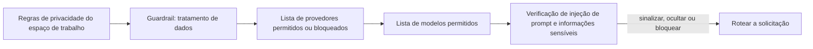

Crie um guardrail em **Configurações → Guardrails**, anexe-o a uma chave de API de baixo risco e amplie o uso só depois que os registros mostrarem que ele se comporta como esperado. No fim, essa chave só alcança os provedores e modelos que você permitir, e os prompts dela são verificados quanto a injeção de prompt e dados sensíveis antes de chegarem a um modelo.

Este é um procedimento no painel; a mesma política pode ser automatizada com a [API de guardrails](../api-reference/endpoint/guardrails-create).

As regras de privacidade do espaço de trabalho são aplicadas primeiro; um guardrail só pode restringi-las. Guardrails não limitam gastos: para isso, defina um limite na chave ou um [orçamento do espaço de trabalho](../api-reference/limits#key-limits-and-budgets).

## Implante

<Steps>
<Step title="Crie o guardrail">

Abra **Configurações → Guardrails → Novo Guardrail**. Dê a ele um nome que descreva o que ele aplica, como `eu-models-pii-redact`, e não o nome de uma equipe, para poder reutilizá-lo em várias chaves.

Defina o acesso às rotas antes das verificações de conteúdo:

| Configuração | Opções |
| --- | --- |
| **Modo de provedores** | Permitir todos os provedores, Permitir somente os provedores selecionados ou Permitir todos, exceto os provedores selecionados |
| **Modo de modelos** | Permitir todos os modelos ou Permitir somente os modelos selecionados (aplicado depois do filtro de provedores) |
| **Tratamento de dados** | Somente ZDR e se os endpoints gratuitos ou pagos que podem treinar com as entradas continuam elegíveis |

Uma primeira política comum bloqueia provedores de baixa confiança e permite apenas os modelos de produção exatos que a chave deve alcançar. Use a prévia para conferir quais provedores e modelos continuam roteáveis e se **Permitir somente** ficou mais restrito do que você pretendia.

</Step>
<Step title="Adicione verificações de conteúdo">

**Injeção de prompt** verifica o conteúdo enviado pelo usuário em busca de padrões comuns de injeção. **Informações sensíveis** detecta dados antes de a solicitação sair do Phaseo:

| Detector | Substituído por | Adiciona latência |
| --- | --- | --- |
| Endereço de e-mail | `[EMAIL]` | Não |
| Número de telefone | `[PHONE]` | Não |
| Número do Seguro Social dos EUA | `[SSN]` | Não |
| Número de cartão de crédito | `[CREDIT_CARD]` | Não |
| Endereço IP (IPv4) | `[IP_ADDRESS]` | Não |
| Nome de pessoa | `[PERSON_NAME]` | Sim |
| Endereço físico | `[ADDRESS]` | Sim |

Cada verificação tem uma ação: **Sinalizar**, **Ocultar** ou **Bloquear**. Comece a injeção de prompt em **Sinalizar** ou **Ocultar** e passe para **Bloquear** só depois de revisar os falsos positivos. Use primeiro os detectores rápidos. Adicione padrões personalizados como regras de regex explícitas.

</Step>
<Step title="Teste na prévia">

Antes de salvar, passe três entradas pela prévia: uma inofensiva, uma que claramente deve ser barrada e um prompt realista de produção. Confira o texto de ocultação, o resultado de bloqueio ou permissão e se nada sem relação é detectado.

</Step>
<Step title="Anexe a uma chave">

Em **Aplicar para chaves**, escolha uma chave de staging ou de baixo risco. Você pode anexar o guardrail enquanto o cria. **Aplicar para membros** o aplica às chaves de API que esses membros criarem. Os membros não podem editar nem remover um guardrail atribuído por um proprietário ou administrador do espaço de trabalho.

</Step>
<Step title="Confira a aplicação">

Envie solicitações reais pela chave e confira:

- **Configurações → Uso → Guardrails**, para as contagens de bloqueios, ocultações e sinalizações.
- A seção **Aplicação de guardrails** de uma solicitação em **Configurações → Uso → Registros**, para ver o guardrail e o detector que foram acionados.
- A coluna **Guardrails** em **Configurações → Chaves de API**, para confirmar a quais chaves ele está anexado.

</Step>
<Step title="Amplie a implantação">

Anexe o mesmo guardrail a mais chaves, endureça as ações de **Sinalizar** para **Ocultar** ou **Bloquear** e adicione os detectores de nome de pessoa e de endereço só onde a latência deles for aceitável.

</Step>
</Steps>

Um guardrail desativado mantém a configuração, mas não é aplicado. Para compartilhar regras de roteamento entre chamadores em vez de aplicá-las a chaves, use uma [predefinição](../guides/presets).
