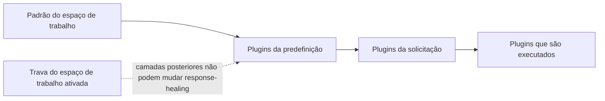

Ative o [reparo de respostas](./response-healing-for-structured-json) uma única vez para todo o espaço de trabalho ou para uma predefinição, em vez de em cada solicitação. No fim, todos os chamadores com saída estruturada recebem a mesma política de reparo, e você pode travá-la para que nenhuma predefinição ou solicitação a desative.

Este é um procedimento no painel; o exemplo de solicitação no final está pronto para produção.

## Como as camadas se combinam

O Phaseo monta a lista de plugins de cada solicitação a partir de três camadas. Uma camada posterior substitui as configurações de uma camada anterior para o mesmo plugin, a menos que a anterior esteja travada:



| Camada | Onde definir | Substitui |
| --- | --- | --- |
| Espaço de trabalho | **Configurações → Roteamento → Reparo de respostas** | Nada |
| Predefinição | **Configurações → Predefinições → (predefinição) → Reparo de respostas** | O espaço de trabalho, a menos que esteja travado |
| Solicitação | `plugins` no corpo | A predefinição e o espaço de trabalho, a menos que o espaço de trabalho esteja travado |

## Configure

<Steps>
<Step title="Ative o padrão do espaço de trabalho">

Em **Configurações → Roteamento → Reparo de respostas**, ative **Ativar por Padrão** e escolha um **Modo de reparo**: `safe` para um reparo de sintaxe limitado, `strict` para apenas desembrulhar JSON que já era válido. Use isso para padrões amplos que todas as chaves de API do espaço de trabalho compartilham.

</Step>
<Step title="Trave se não for negociável">

Ative **Bloquear a política do espaço de trabalho**. Assim, predefinições e solicitações não podem desativar o reparo nem mudar o modo dele. Os registros continuam mostrando se ele foi aplicado ou pulado.

</Step>
<Step title="Defina padrões de predefinição para um fluxo">

No editor de predefinições, ative **Reparo de respostas** e escolha o modo quando uma família de solicitações deve ter tanto um formato de saída estruturada quanto o reparo. Os chamadores dessa predefinição passam a enviar apenas a entrada.

</Step>
</Steps>

## Substitua em uma solicitação

Quando o espaço de trabalho não está travado, uma solicitação pode definir o próprio plugin. `"enabled": false` o desativa nessa solicitação:

```json
{
  "model": "openai/gpt-6-astra",
  "input": "Return the summary as JSON.",
  "text": {
    "format": {
      "type": "json_schema",
      "name": "answer",
      "schema": {
        "type": "object",
        "properties": { "summary": { "type": "string" } },
        "required": ["summary"],
        "additionalProperties": false
      }
    }
  },
  "plugins": [{ "id": "response-healing", "enabled": true, "mode": "strict" }],
  "meta": true
}
```

## Confira a política que foi executada

Abra a solicitação em **Configurações → Uso → Registros** ou leia `meta.plugin_executions` quando tiver enviado `meta: true`. Ali aparecem o status (`applied`, `skipped` ou `failed`), o modo que de fato foi executado e quaisquer `validation_errors` quando um candidato reparado não correspondeu ao schema.

Se dois serviços se comportarem de forma diferente, compare a configuração do espaço de trabalho e a trava dela, os plugins da predefinição e os `plugins` de cada solicitação antes de tratar o caso como um problema de modelo.
