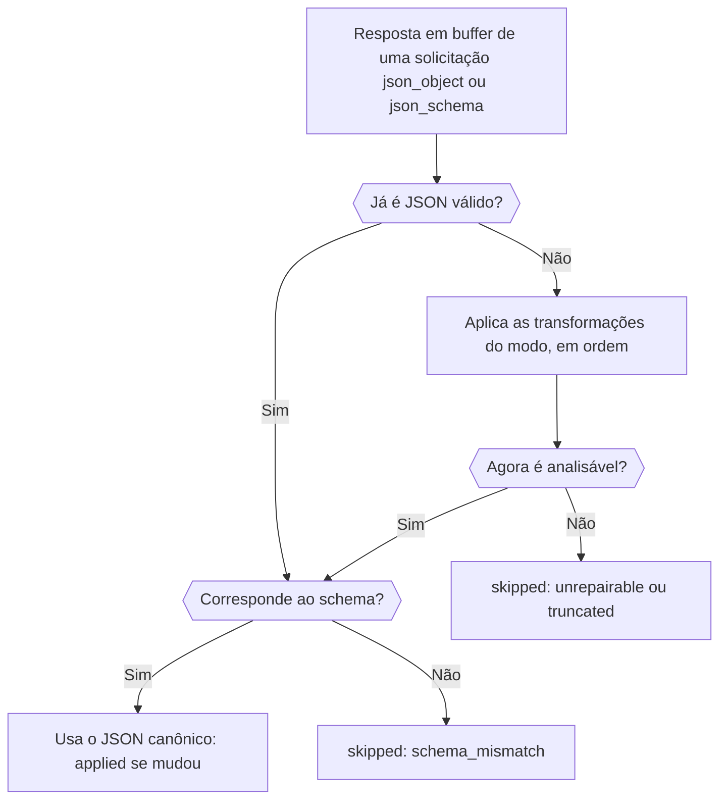

Adicione o plugin `response-healing` a uma solicitação com saída estruturada e o Phaseo repara o JSON quase válido, como JSON dentro de um bloco de código Markdown ou com uma vírgula sobrando no final, antes que ele chegue ao seu parser. No fim, você tem uma solicitação que pede um JSON Schema, repara a resposta quando necessário e informa na resposta se fez isso.

A solicitação está pronta para produção. O reparo só corrige a sintaxe, então o seu código ainda valida o resultado, como em [Valide o resultado](../guides/structured-outputs#validate-the-result).



## Envie uma solicitação com reparo

<CodeGroup>
```bash cURL
curl https://api.phaseo.app/v1/responses \
  -H "Authorization: Bearer $PHASEO_API_KEY" \
  -H "Content-Type: application/json" \
  -d '{
    "model": "openai/gpt-6-astra",
    "input": "Summarize this release in one sentence: dark mode and faster search.",
    "text": {
      "format": {
        "type": "json_schema",
        "name": "answer",
        "strict": true,
        "schema": {
          "type": "object",
          "properties": { "summary": { "type": "string" } },
          "required": ["summary"],
          "additionalProperties": false
        }
      }
    },
    "plugins": [{ "id": "response-healing", "mode": "safe" }],
    "meta": true
  }'
```

```typescript TypeScript
import Phaseo from "@phaseo/sdk";

const client = new Phaseo({ apiKey: process.env.PHASEO_API_KEY! });

const response = await client.generateResponse({
  model: "openai/gpt-6-astra",
  input: "Summarize this release in one sentence: dark mode and faster search.",
  text: {
    format: {
      type: "json_schema",
      name: "answer",
      strict: true,
      schema: {
        type: "object",
        properties: { summary: { type: "string" } },
        required: ["summary"],
        additionalProperties: false,
      },
    },
  },
  plugins: [{ id: "response-healing", mode: "safe" }],
  meta: true,
});

console.log(response.meta?.plugin_executions);
```

```python Python
import os

from phaseo import Phaseo

client = Phaseo(api_key=os.environ["PHASEO_API_KEY"])

response = client.generate_response(
    {
        "model": "openai/gpt-6-astra",
        "input": "Summarize this release in one sentence: dark mode and faster search.",
        "text": {
            "format": {
                "type": "json_schema",
                "name": "answer",
                "strict": True,
                "schema": {
                    "type": "object",
                    "properties": {"summary": {"type": "string"}},
                    "required": ["summary"],
                    "additionalProperties": False,
                },
            }
        },
        "plugins": [{"id": "response-healing", "mode": "safe"}],
        "meta": True,
    }
)

print(response["meta"].get("plugin_executions"))
```
</CodeGroup>

No Chat Completions, envie o mesmo schema em `response_format` em vez de `text.format`. O reparo só é executado quando a solicitação pede `json_object` ou `json_schema`, e nunca em streams: uma solicitação com streaming o pula com `streaming_unsupported`.

## Confira se foi executado

Com `meta: true`, `meta.plugin_executions` lista o plugin quando ele foi executado:

```json
{
  "id": "response-healing",
  "stage": "response.post_provider",
  "status": "applied",
  "changed": true,
  "metadata": {
    "attempted": true,
    "healed": true,
    "mode": "safe",
    "transforms_applied": ["strip_markdown_fence"]
  }
}
```

| `status` | Significado |
| --- | --- |
| `applied` | A resposta foi reescrita como JSON válido. |
| `skipped` | A resposta foi mantida como estava. Com `attempted: false`, a solicitação não era elegível; caso contrário, o JSON já era válido ou não pôde ser corrigido. `metadata.failure_reason` diz o motivo: `streaming_unsupported`, `not_json` (nenhuma saída estruturada foi pedida ou não há texto), `unrepairable`, `truncated` (a resposta parou no limite de tokens) ou `schema_mismatch` com `validation_errors`. |
| `failed` | O próprio plugin deu erro (`reason: plugin_error`); a resposta não foi alterada. |

O mesmo registro aparece na solicitação em **Configurações → Uso → Registros**. Se o plugin nunca aparece, confira se a solicitação, a predefinição dela ou o espaço de trabalho realmente o ativaram; [Defina padrões de plugins](./plugin-defaults-and-response-healing) mostra onde.

## Escolha um modo

| Modo | Transformações, em ordem |
| --- | --- |
| `safe` (padrão) | Remove o bloco de código Markdown, recorta até o `{…}` ou `[…]` mais externo, remove vírgulas finais, coloca aspas em chaves sem aspas e adiciona os colchetes e chaves de fechamento que faltam (não quando a resposta atingiu o limite de tokens) |
| `strict` | Apenas remove o bloco de código Markdown e recorta até o `{…}` ou `[…]` mais externo, então só aceita JSON que já era válido dentro do invólucro |

Com um JSON Schema, o resultado reparado é verificado antes de substituir a resposta: chaves obrigatórias, tipos, `enum` e `const`, limites de arrays e `uniqueItems`, tamanho de strings, `pattern` e os formatos `email`, `uri`, `uuid` e `date-time`, limites numéricos e `multipleOf`, quantidade de propriedades e `additionalProperties: false`.

## Saiba quando ele não ajuda

O reparo nunca inventa campos que faltam, não adivinha valores nem transforma prosa em dados. Distinga estas falhas antes de recorrer a ele:

| Falha | Correção |
| --- | --- |
| JSON estruturalmente próximo do válido | Reparo de respostas |
| JSON válido com campos errados | Restrinja o schema e o prompt |
| Prosa em vez de JSON | Peça `json_schema`, não apenas uma instrução no prompt |
| Cortado no limite de tokens | Aumente `max_output_tokens` |

O reparo funciona melhor com um único objeto com chaves obrigatórias explícitas, temperatura baixa e sem pedido de texto fora do JSON. Ative-o primeiro em uma predefinição, acompanhe `plugin_executions` nos registros e amplie o uso quando os payloads reparados corresponderem ao seu schema.
