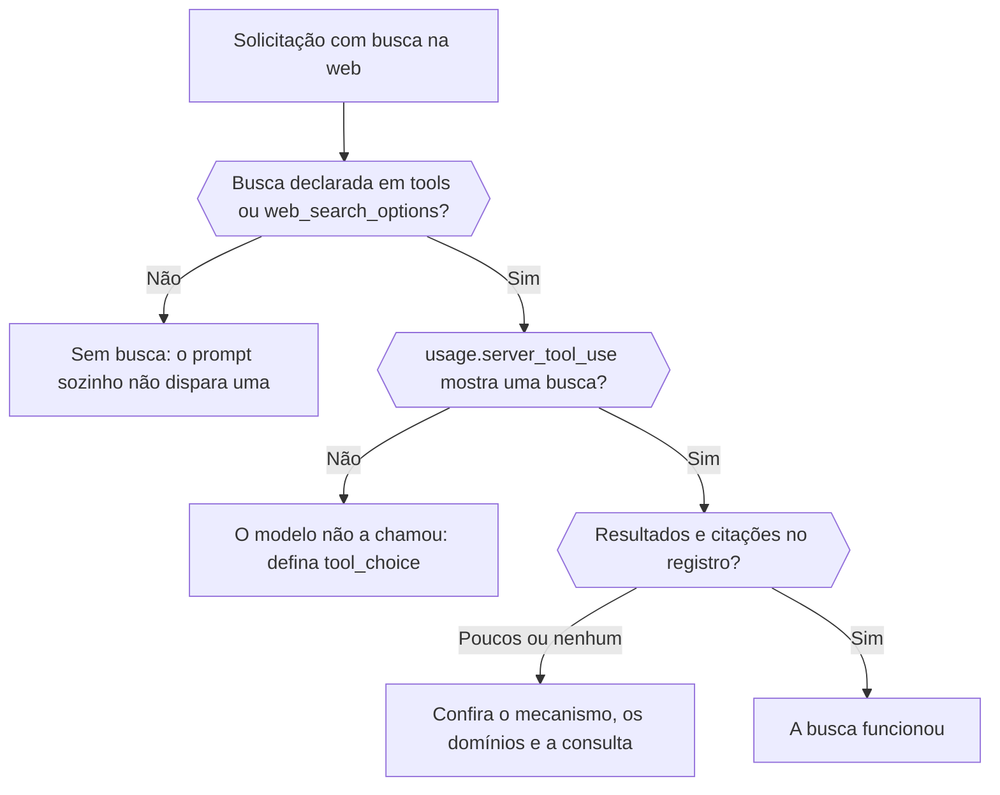

Descubra, pela resposta e pelo registro da solicitação, se uma busca na web realmente foi executada, qual mecanismo a executou e o que ela retornou. No fim, você consegue distinguir uma busca que nunca aconteceu de uma que foi executada e encontrou pouco.



## Declare a busca na solicitação

Pedir "as últimas notícias" no prompt não executa uma busca. Adicione-a explicitamente:

```json
{
  "model": "openai/gpt-6-astra",
  "input": "What changed in the Phaseo changelog this week?",
  "tools": [{ "type": "phaseo:web_search", "parameters": { "max_results": 5 } }],
  "tool_choice": "phaseo:web_search"
}
```

`phaseo:web_search` funciona em Chat Completions, Responses e Messages. `web_search_options` funciona onde o endpoint o suporta. `tool_choice` força a chamada; sem ele, o modelo pode responder de memória. O [guia de busca na web](../guides/server-tools/web-search) lista todos os parâmetros.

## Confira se foi executada

| Onde olhar | Mostra |
| --- | --- |
| `usage.server_tool_use.web_search_requests` na resposta | Quantas buscas gerenciadas foram executadas |
| **Monitoramento da pesquisa na web** na solicitação em **Configurações → Uso → Registros** | Buscas gerenciadas, buscas nativas, a contagem de resultados e a de citações, com os registros extraídos de resultados e citações |
| **Observabilidade do roteamento** na mesma solicitação | Quais provedores foram considerados e quais foram removidos por não suportarem a solicitação |

## Distinga os casos de falha

| O que você vê | Causa | Correção |
| --- | --- | --- |
| Nenhum contador de busca | A busca não foi declarada ou o modelo decidiu não chamá-la | Adicione a ferramenta e defina `tool_choice` |
| A ferramenta retorna `search_not_configured` ao modelo | O mecanismo gerenciado que você escolheu não está ativado | Use o mecanismo padrão ou outro |
| A ferramenta retorna `unsupported_search_engine` | O modelo pediu `engine: "native"` dentro de uma chamada | Defina `native` apenas na definição da ferramenta |
| `400 not_supported`, motivo `regional_hosted_tool_not_supported` | Enviada para `eu.api.phaseo.app` ou `us.api.phaseo.app`, que rejeitam ferramentas de servidor | Use `api.phaseo.app` |
| As buscas foram executadas, mas há poucas citações | A consulta ou as fontes eram fracas | Ajuste `max_results`, `allowed_domains` ou `engine` |

Com `engine: "native"`, a solicitação vai só para provedores que executam a busca na web por conta própria. Se nenhum deles atender o modelo, o Phaseo executa o mecanismo padrão no lugar e cobra como busca gerenciada, então uma solicitação nativa pode mostrar contadores de busca gerenciada.

## Compare solicitações

Quando os resultados variam entre execuções, compare o ID do modelo, o provedor selecionado, os parâmetros de busca e as contagens de resultados e de citações. As contagens são normalizadas entre provedores, então as diferenças de qualidade da busca aparecem sem que você precise ler os payloads brutos. Para um fluxo completo e fundamentado, veja [Busca na web gerenciada em TypeScript](./sdk-typescript-managed-search); para uma URL conhecida, use [web fetch](./tool-grounding-with-web-fetch).
