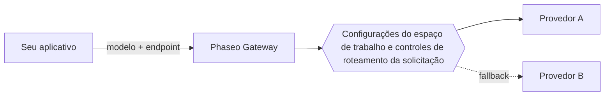

Envie um ID de modelo para um único endpoint do Phaseo, e o Phaseo roteia a solicitação para um provedor que hospeda esse modelo. O seu aplicativo escolhe o modelo e o endpoint; as configurações do seu espaço de trabalho e os controles de roteamento da solicitação decidem quais provedores podem atendê-la.

## Modelos e provedores

Um modelo é o sistema que gera a saída. Um provedor hospeda o modelo e define a disponibilidade, os parâmetros suportados, os preços e o desempenho dele. Um modelo pode ter várias ofertas de provedores.

O catálogo público também lista modelos que ainda não estão disponíveis pelo Gateway. Confira a [disponibilidade do modelo](../exploring/models.mdx) antes de usar um ID em uma solicitação.

## Solicitações e roteamento

Use [Responses, Chat Completions ou Messages](../api-reference/introduction.mdx), o que corresponder ao protocolo do seu aplicativo. Um endpoint compartilhado não significa que todos os modelos suportam todos os parâmetros; os recursos dos provedores continuam variando.

Os [controles de roteamento](../guides/routing-and-fallbacks.mdx) restringem quais provedores podem atender uma solicitação e como eles são classificados. Os fallbacks ficam dentro dessas restrições e dependem da capacidade disponível, então não garantem sucesso.

## Cobrança e acesso

As solicitações gerenciadas usam o saldo do seu espaço de trabalho no Phaseo, e os modelos `:free` funcionam sem créditos depositados. Com as suas próprias credenciais de provedor (BYOK), valem a cobrança e os limites de conta do provedor. Revise [preços e cobrança](../pricing/tiers.mdx) antes da implantação.

Os [trabalhos de vídeo e batch](../guides/async-video-and-batch.mdx) retornam um trabalho antes de o processamento terminar; o acesso de prévia a eles é gerenciado por espaço de trabalho. Consulte o status ou receba um webhook e depois baixe o resultado.

## Próximos passos

Faça a sua primeira solicitação com o [Início rápido](../quickstart.mdx) e depois [integre o Gateway](./integrating-with-the-gateway.mdx) ao seu aplicativo, mantendo a chave no seu backend. Quando algo falhar, [Confiabilidade e status](./reliability-and-status.mdx) mostra como investigar, e os [registros de solicitações](../guides/integrations/observability.mdx) mostram uso, latência, custo e erros de cada solicitação.
