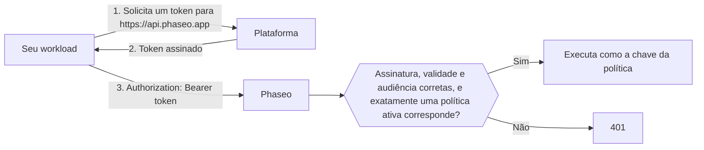

<Note>
Os workloads confiáveis estão em beta e estão sendo liberados gradualmente para os espaços de trabalho. Se **Configurações → Chaves de API → Workloads confiáveis** não aparece no seu painel, seu espaço de trabalho ainda não tem o recurso.
</Note>

Envie o token OIDC de curta duração da sua plataforma como token bearer em vez de uma chave de API do Phaseo, e nada de longa duração precisa ficar nas configurações do projeto ou nos secrets de CI. As plataformas dão a cada deployment, job ou workload um token assinado que diz quem ele é, como "o deployment de produção do projeto `website`" ou "um job no projeto `4815162` do GitLab", e o token expira em poucas horas. Você informa ao Phaseo em quais workloads confiar.

O Phaseo confia em tokens da Vercel, GitHub Actions, GitLab, Google Cloud, Buildkite, CircleCI e AWS, e de um emissor OIDC que você mesmo opera, como um cluster Kubernetes, o Bitbucket Pipelines ou um GitLab autogerenciado. Continue usando chaves de API para todo o resto, como scripts locais e apps móveis.

## Como funciona



Um proprietário ou administrador do espaço de trabalho cria uma **política de confiança** que indica a plataforma, o proprietário em que ela confia (como um proprietário no GitHub, um projeto do GitLab ou uma função da AWS) e condições opcionais, como um projeto, um repositório, uma branch ou um ambiente. Uma solicitação que corresponde é executada como a chave da política, com os mesmos limites de taxa, orçamentos, logs e cobrança de uma solicitação feita com uma chave de API.

Os tokens precisam ser emitidos para a audiência `https://api.phaseo.app`; o Phaseo recusa qualquer outra audiência. A maioria das plataformas usa por padrão uma audiência compartilhada por todos os serviços que seu workload chama, e aceitá-la permitiria que um token enviado a outro serviço fosse reutilizado contra o Phaseo.

## Crie uma política de confiança

<Steps>
<Step title="Abra Workloads confiáveis">
Acesse **Configurações → Chaves de API → Workloads confiáveis** e selecione **Nova política**. Somente proprietários e administradores do espaço de trabalho podem gerenciar políticas.
</Step>
<Step title="Escolha a plataforma e preencha os IDs">
Cada plataforma vincula a política a um ID que não pode ser renomeado nem assumido por outra pessoa. Nomes podem mudar de dono, então o Phaseo nunca confia apenas em um nome.

<Tabs>
<Tab title="Vercel">
- **Slug da equipe**: o slug da equipe, como em `vercel.com/<team-slug>`. Deixe em branco se o seu projeto usa o modo de emissor global da Vercel (emissor `https://oidc.vercel.com` em vez de `https://oidc.vercel.com/<team-slug>`).
- **ID da equipe**: começa com `team_`. Você encontra nas configurações da equipe na Vercel.
- **ID do projeto** (recomendado): começa com `prj_`. Você encontra nas configurações do projeto na Vercel. Sem ele, todos os projetos da equipe são considerados confiáveis.
- **Ambiente**: produção, preview ou desenvolvimento. Deixe todos desmarcados para aceitar qualquer ambiente.
</Tab>
<Tab title="GitHub Actions">
- **ID do proprietário**: o ID numérico do usuário ou da organização dona do repositório.
- **ID do repositório** (recomendado): o ID numérico do repositório. Sem ele, todos os repositórios do proprietário são considerados confiáveis.
- **Branch ou tag** e **Ambiente** (opcionais): por exemplo, `refs/heads/main` ou `production`.

Obtenha os dois IDs com a CLI do GitHub:

```bash
gh api repos/OWNER/REPO --jq '.id, .owner.id'
```
</Tab>
<Tab title="GitLab">
Para projetos no GitLab.com. Para GitLab autogerenciado, use **Emissor OIDC personalizado**.

- **ID do projeto**: o ID numérico na página de visão geral do projeto. Ele não muda quando o projeto é renomeado ou movido para outro grupo, por isso o Phaseo vincula a política a ele, e não ao grupo.
- **Branch ou tag** (opcional): o nome da branch ou tag, como `main`.
- **Ambiente** (opcional): o ambiente do job, como `production`.

Deixe as duas condições em branco para aceitar todos os jobs do projeto.
</Tab>
<Tab title="Google Cloud">
Para tokens do servidor de metadados no Cloud Run, Compute Engine, GKE, Cloud Run functions, App Engine e Cloud Build.

- **ID exclusivo da conta de serviço**: o ID exclusivo numérico na página de detalhes da conta de serviço no console do Google Cloud. Todas as contas do Google compartilham o mesmo emissor, então é esse ID que diferencia seu workload. Não use o e-mail no lugar dele: se a conta de serviço for excluída, alguém pode criar uma nova com o mesmo e-mail.
- **E-mail da conta de serviço** (opcional): uma verificação extra. Os tokens só incluem o e-mail quando o workload os solicita com `format=full`.
</Tab>
<Tab title="Buildkite">
- **ID da organização**: o UUID da organização. Todo token do Buildkite o traz na claim `organization_id`, então você pode lê-lo em um token solicitado por um dos seus pipelines. Ao contrário do slug da organização, ele nunca muda.
- **Slug do pipeline** (opcional): sem ele, todos os pipelines da organização são considerados confiáveis.
</Tab>
<Tab title="CircleCI">
- **ID da organização**: você encontra em **Organization Settings → Overview**. Cada organização do CircleCI tem seu próprio emissor, `https://oidc.circleci.com/org/<organisation ID>`, e o Phaseo o monta a partir desse ID.
- **ID do projeto** (opcional): você encontra em **Project Settings → Overview**. Sem ele, todos os projetos da organização são considerados confiáveis.
</Tab>
<Tab title="AWS">
Para tokens da federação de identidade de saída do IAM (outbound identity federation), que dá a uma função do IAM um token assinado para um serviço externo.

- **URL do emissor**: cada conta da AWS tem seu próprio emissor, que termina em `.tokens.sts.global.api.aws`. Execute `aws iam get-outbound-web-identity-federation-info` e copie `IssuerIdentifier`. Se falhar, ative o recurso primeiro com `aws iam enable-outbound-web-identity-federation`.
- **ARN da função do IAM**: só são aceitos tokens dessa função, como `arn:aws:iam::123456789012:role/evals`. O emissor já identifica sua conta, então o ARN da função identifica o workload.
</Tab>
<Tab title="Emissor OIDC personalizado">
Use esta opção para qualquer outro emissor OIDC que atenda a todos estes requisitos:

- A URL do emissor é uma URL `https://` pública, sem porta, query ou fragmento, e não está em um host que pertença a uma das plataformas acima.
- Ele disponibiliza um documento de descoberta em `<issuer>/.well-known/openid-configuration`.
- Suas chaves de assinatura (`jwks_uri`) ficam no mesmo host do emissor.
- Ele assina tokens com RS256, ES256 ou ES384 e consegue emiti-los para a audiência `https://api.phaseo.app`.

Preencha:

- **URL do emissor**: copie exatamente como aparece na claim `iss` do token, incluindo qualquer barra final.
- **Claim do proprietário** e **Valor do proprietário**: a claim que todo token precisa ter e o valor exato que ela deve ter. Escolha uma claim que ninguém mais possa reutilizar, como um ID numérico, em vez de um nome que possa ser renomeado ou registrado de novo.
- **Claim extra** e **Valor obrigatório** (opcionais): mais uma claim com a qual o token precisa corresponder.

As condições valem apenas para claims de nível superior. Claims aninhadas, como o objeto `kubernetes.io` do Kubernetes, não podem ser usadas.

**Kubernetes (EKS, GKE, AKS)**: cada cluster tem seu próprio emissor. No EKS, execute `aws eks describe-cluster --name <cluster> --query cluster.identity.oidc.issuer`. No AKS, ative o emissor OIDC e execute `az aks show -n <cluster> -g <resource-group> --query oidcIssuerProfile.issuerUrl`. No GKE, o emissor é `https://container.googleapis.com/v1/projects/<project>/locations/<location>/clusters/<cluster>`. Use `sub` como claim do proprietário, com o valor `system:serviceaccount:<namespace>:<service-account>`.

Clusters Kubernetes autogerenciados cujo endpoint de descoberta não é público não funcionam. O Phaseo precisa obter o documento de descoberta e as chaves pela internet sem credenciais, e a maioria dos clusters não permite isso por padrão.

**Bitbucket Pipelines**: o emissor é `https://api.bitbucket.org/2.0/workspaces/<workspace>/pipelines-config/identity/oidc`. Use `workspaceUuid` como claim do proprietário, com o valor incluindo as chaves, como `{a1b2c3d4-...}`. Peça a audiência do Phaseo no step:

```yaml
- step:
    oidc:
      audiences:
        - https://api.phaseo.app
```

**GitLab autogerenciado**: o emissor é a URL do seu GitLab, como `https://gitlab.example.com`. Use `project_id` como claim do proprietário, com o ID numérico do projeto. Sua instância precisa estar acessível pela internet.
</Tab>
</Tabs>
</Step>
<Step title="Defina o token mais longo aceito">
Em **Token mais longo aceito (horas)**, defina a maior duração que você aceita. Tokens emitidos para durar mais são recusados. O máximo, e também o padrão, é de 12 horas, o que cobre os tokens de desenvolvimento da Vercel.
</Step>
</Steps>

As políticas entram em vigor em cerca de um minuto. Ao desativar ou excluir uma política, os tokens dela param de funcionar no mesmo prazo.

## Gerencie políticas com Terraform ou com a API

Gerencie as políticas como código com uma [chave de gerenciamento](./management-api-keys.mdx) que tenha os recursos `keys:read`, `keys:write` e `keys:delete`. Somente espaços de trabalho com workloads confiáveis podem usar essas rotas.

No Terraform, use o recurso `phaseo_trusted_workload`:

```hcl
resource "phaseo_trusted_workload" "deploy" {
  name     = "GitHub deploy (main)"
  platform = "github_actions"
  owner_id = "123456"

  claim_conditions = {
    repository_id = ["987654321"]
    ref           = ["refs/heads/main"]
  }
}
```

`owner_id` é o valor da claim do proprietário da plataforma. Defina `issuer` quando a plataforma precisar:

| `platform` | `issuer` | Claim do proprietário |
| --- | --- | --- |
| `vercel` | Obrigatório: `https://oidc.vercel.com/<team-slug>`, ou `https://oidc.vercel.com` no modo de emissor global | `owner_id` (ID da equipe) |
| `github_actions` | Padrão: `https://token.actions.githubusercontent.com` | `repository_owner_id` |
| `gitlab` | Padrão: `https://gitlab.com` | `project_id` |
| `google_cloud` | Padrão: `https://accounts.google.com` | `sub` (ID exclusivo da conta de serviço) |
| `buildkite` | Padrão: `https://agent.buildkite.com` | `organization_id` |
| `circleci` | Obrigatório: `https://oidc.circleci.com/org/<organisation ID>` | `oidc.circleci.com/org-id` |
| `aws` | Obrigatório: o emissor da sua conta | `sub` (ARN da função do IAM) |
| `custom` | Obrigatório: a URL do seu emissor | A claim que você define em `owner_claim` |

Para um emissor personalizado, defina também `owner_claim`:

```hcl
resource "phaseo_trusted_workload" "cluster" {
  name        = "Production cluster"
  platform    = "custom"
  issuer      = "https://oidc.eks.us-east-1.amazonaws.com/id/EXAMPLED539D4633E53DE1B71EXAMPLE"
  owner_claim = "sub"
  owner_id    = "system:serviceaccount:prod:api"
}
```

Outros campos:

| Campo | Valores |
| --- | --- |
| `claim_conditions` | Nome da claim mapeado para os valores permitidos; cada claim precisa corresponder a um dos seus valores. Até 15 claims além da claim do proprietário, e 20 valores por claim. `iss`, `aud`, `exp`, `iat`, `nbf`, `jti` e a claim do proprietário não podem ser usadas. |
| `max_token_lifetime_seconds` | Maior duração de token aceita, de `60` a `43200` (12 horas). O padrão é `43200`. |
| `enabled` (Terraform) ou `status` (API: `active` ou `disabled`) | Se os tokens correspondentes são aceitos. |

Alterar a plataforma, o emissor, a claim do proprietário ou o proprietário substitui a política. Uma política não tem segredo, então nada sensível fica salvo no estado do Terraform.

Pela API, envie os mesmos campos para `/v1/workload-identity/policies`. Na API, a plataforma se chama `provider`:

```bash
curl https://api.phaseo.app/v1/workload-identity/policies \
  -H "Authorization: Bearer $PHASEO_MANAGEMENT_KEY" \
  -H "Content-Type: application/json" \
  -d '{"name":"GitHub deploy (main)","provider":"github_actions","owner_id":"123456","claim_conditions":{"repository_id":["987654321"],"ref":["refs/heads/main"]}}'
```

Para um emissor personalizado:

```bash
curl https://api.phaseo.app/v1/workload-identity/policies \
  -H "Authorization: Bearer $PHASEO_MANAGEMENT_KEY" \
  -H "Content-Type: application/json" \
  -d '{"name":"Production cluster","provider":"custom","issuer":"https://oidc.eks.us-east-1.amazonaws.com/id/EXAMPLED539D4633E53DE1B71EXAMPLE","owner_claim":"sub","owner_id":"system:serviceaccount:prod:api"}'
```

A [referência da API](../api-reference/endpoint/trusted-workloads-create.mdx) lista todos os campos e respostas.

## Chame o Phaseo com um token

Todo SDK do Phaseo aceita uma função no lugar da chave de API e a chama antes de cada solicitação e de cada nova tentativa, para que cada solicitação use um token atual. Todo SDK, exceto o de C++, inclui um auxiliar para o GitHub Actions e para a Vercel. Ele obtém um token emitido para `https://api.phaseo.app` e o reutiliza até um minuto antes de expirar:

| SDK | GitHub Actions | Vercel |
| --- | --- | --- |
| TypeScript | `githubActionsToken()` | `vercelToken()` |
| Python | `github_actions_token()` | `vercel_token()` |
| Go | `phaseo.GitHubActionsToken()` | `phaseo.VercelToken()` |
| Java | `WorkloadTokens.gitHubActions()` | `WorkloadTokens.vercel()` |
| C# | `WorkloadTokens.GitHubActions()` | `WorkloadTokens.Vercel()` |
| PHP | `WorkloadTokens::githubActions()` | `WorkloadTokens::vercel()` |
| Ruby | `PhaseoSdk::WorkloadTokens.github_actions` | `PhaseoSdk::WorkloadTokens.vercel` |
| Rust | `phaseo::auth::github_actions_token()` | `phaseo::auth::vercel_token()` |
| C++ | Passe sua própria função para `set_api_key_provider` | Passe sua própria função para `set_api_key_provider` |

Os auxiliares exigem a próxima versão de cada SDK. Na Vercel, o auxiliar troca o token do deployment obtido de `VERCEL_OIDC_TOKEN_FILE` ou `VERCEL_OIDC_TOKEN`. Nas Vercel Functions, o token chega em cada solicitação no cabeçalho `x-vercel-oidc-token`; passe-o ao auxiliar como origem do token.

Em outras plataformas, passe sua própria função que retorna o token, como uma que lê a variável do job do GitLab ou chama o servidor de metadados do Google Cloud:

```ts
import Phaseo from "@phaseo/sdk";

const client = new Phaseo({
	apiKey: async () => {
		const response = await fetch(
			"http://metadata.google.internal/computeMetadata/v1/instance/service-accounts/default/identity?audience=https://api.phaseo.app",
			{ headers: { "Metadata-Flavor": "Google" } },
		);
		return response.text();
	},
});
```

<Tabs>
<Tab title="Vercel">
Use `getVercelOidcToken` a partir da entrada de servidor de `@vercel/oidc` 4.x. Ao passar `audience`, o token do deployment é trocado por um emitido para o Phaseo.

Com o [SDK de TypeScript](../sdk-reference/client/overview.mdx), passe-o como a função `apiKey`:

```ts
import Phaseo from "@phaseo/sdk";
import { getVercelOidcToken } from "@vercel/oidc";

const client = new Phaseo({
	apiKey: () => getVercelOidcToken({ audience: "https://api.phaseo.app" }),
});

const response = await client.responses.create({
	model: "openai/gpt-6-astra",
	input: "Hello from a trusted workload",
});
```

Passar uma função como `apiKey` exige uma versão do `@phaseo/sdk` posterior à 3.0.0.

Com qualquer cliente HTTP, solicite um token a cada solicitação e envie-o como token bearer:

```ts
import { getVercelOidcToken } from "@vercel/oidc";

const token = await getVercelOidcToken({ audience: "https://api.phaseo.app" });

const response = await fetch("https://api.phaseo.app/v1/chat/completions", {
	method: "POST",
	headers: {
		Authorization: `Bearer ${token}`,
		"Content-Type": "application/json",
	},
	body: JSON.stringify({
		model: "openai/gpt-6-astra",
		messages: [{ role: "user", content: "Hello from a trusted workload" }],
	}),
});
```

Não guarde o token em uma variável no nível do módulo: a Vercel pode alterá-lo entre solicitações.
</Tab>
<Tab title="GitHub Actions">
O job precisa da permissão `id-token: write` para solicitar um token.

```yaml
permissions:
  id-token: write
  contents: read

jobs:
  evals:
    runs-on: ubuntu-latest
    steps:
      - uses: actions/github-script@v7
        with:
          script: |
            const token = await core.getIDToken("https://api.phaseo.app");
            const response = await fetch("https://api.phaseo.app/v1/chat/completions", {
              method: "POST",
              headers: {
                Authorization: `Bearer ${token}`,
                "Content-Type": "application/json",
              },
              body: JSON.stringify({
                model: "openai/gpt-6-astra",
                messages: [{ role: "user", content: "Hello from GitHub Actions" }],
              }),
            });
            core.info(String(response.status));
```

Em uma etapa de shell, solicite o token com `curl`:

```bash
TOKEN=$(curl -sS -H "Authorization: bearer $ACTIONS_ID_TOKEN_REQUEST_TOKEN" \
  "$ACTIONS_ID_TOKEN_REQUEST_URL&audience=https://api.phaseo.app" | jq -r .value)

curl https://api.phaseo.app/v1/chat/completions \
  -H "Authorization: Bearer $TOKEN" \
  -H "Content-Type: application/json" \
  -d '{"model":"openai/gpt-6-astra","messages":[{"role":"user","content":"Hello"}]}'
```

Os tokens do GitHub Actions são de curta duração, então solicite um novo em jobs longos.
</Tab>
<Tab title="GitLab">
Adicione uma entrada `id_tokens` ao job em `.gitlab-ci.yml`. O GitLab coloca o token na variável que você nomear:

```yaml
evals:
  id_tokens:
    PHASEO_TOKEN:
      aud: https://api.phaseo.app
  script:
    - >
      curl https://api.phaseo.app/v1/chat/completions
      -H "Authorization: Bearer $PHASEO_TOKEN"
      -H "Content-Type: application/json"
      -d '{"model":"openai/gpt-6-astra","messages":[{"role":"user","content":"Hello from GitLab"}]}'
```

O token dura o mesmo que o tempo limite (timeout) do job.
</Tab>
<Tab title="Google Cloud">
Solicite o token ao servidor de metadados. Isso funciona no Cloud Run, Compute Engine, GKE, Cloud Run functions, App Engine e Cloud Build:

```bash
TOKEN=$(curl -sS -H "Metadata-Flavor: Google" \
  "http://metadata.google.internal/computeMetadata/v1/instance/service-accounts/default/identity?audience=https://api.phaseo.app")

curl https://api.phaseo.app/v1/chat/completions \
  -H "Authorization: Bearer $TOKEN" \
  -H "Content-Type: application/json" \
  -d '{"model":"openai/gpt-6-astra","messages":[{"role":"user","content":"Hello from Google Cloud"}]}'
```

Adicione `&format=full` à URL se a sua política verificar o e-mail da conta de serviço. Os tokens duram 1 hora.
</Tab>
<Tab title="Buildkite">
Solicite o token com o agente no comando de um step:

```bash
TOKEN=$(buildkite-agent oidc request-token --audience https://api.phaseo.app)

curl https://api.phaseo.app/v1/chat/completions \
  -H "Authorization: Bearer $TOKEN" \
  -H "Content-Type: application/json" \
  -d '{"model":"openai/gpt-6-astra","messages":[{"role":"user","content":"Hello from Buildkite"}]}'
```

Os tokens duram 5 minutos por padrão. Em steps mais longos, solicite um novo ou passe `--lifetime` em segundos.
</Tab>
<Tab title="CircleCI">
Solicite o token com a CLI do CircleCI em uma etapa do job:

```bash
TOKEN=$(circleci run oidc get --claims '{"aud":"https://api.phaseo.app"}')

curl https://api.phaseo.app/v1/chat/completions \
  -H "Authorization: Bearer $TOKEN" \
  -H "Content-Type: application/json" \
  -d '{"model":"openai/gpt-6-astra","messages":[{"role":"user","content":"Hello from CircleCI"}]}'
```

Os tokens duram 1 hora.
</Tab>
<Tab title="AWS">
Ative a federação de identidade de saída uma vez por conta da AWS e depois solicite um token como a função do IAM. A função precisa de permissão para `sts:GetWebIdentityToken`.

```bash
# Uma vez por conta
aws iam enable-outbound-web-identity-federation

# No workload
TOKEN=$(aws sts get-web-identity-token --audience https://api.phaseo.app \
  --signing-algorithm ES384 --query WebIdentityToken --output text)

curl https://api.phaseo.app/v1/chat/completions \
  -H "Authorization: Bearer $TOKEN" \
  -H "Content-Type: application/json" \
  -d '{"model":"openai/gpt-6-astra","messages":[{"role":"user","content":"Hello from AWS"}]}'
```

O Phaseo aceita `ES384` e `RS256`. Os tokens duram 5 minutos por padrão; passe `--duration-seconds` para até 1 hora.
</Tab>
<Tab title="Emissor OIDC personalizado">
No Kubernetes, monte um token projetado de conta de serviço emitido para a audiência do Phaseo:

```yaml
spec:
  serviceAccountName: api
  containers:
    - name: app
      volumeMounts:
        - name: phaseo-token
          mountPath: /var/run/secrets/phaseo
  volumes:
    - name: phaseo-token
      projected:
        sources:
          - serviceAccountToken:
              audience: https://api.phaseo.app
              expirationSeconds: 3600
              path: token
```

Leia `/var/run/secrets/phaseo/token` antes de cada solicitação e envie o conteúdo como token bearer. O Kubernetes renova o arquivo antes de o token expirar, então não guarde o valor em memória.

No Bitbucket Pipelines, um step com audiências `oidc` definidas recebe o token em `BITBUCKET_STEP_OIDC_TOKEN`.
</Tab>
</Tabs>

## Comportamento e limites

- **Os mesmos controles de uma chave.** As solicitações são executadas como a chave da política, então os limites de taxa da chave, orçamentos, vínculos com departamentos, listas de IPs permitidos, configurações de log e cobrança se aplicam normalmente.
- **Apenas chamadas de modelos.** Os tokens de workloads funcionam onde uma chave de API do Gateway funciona. As APIs de gerenciamento os recusam.
- **Uma única política correspondente.** Um token que corresponde a mais de uma política ativa é recusado. Se as políticas estiverem em espaços de trabalho diferentes, envie o ID do espaço de trabalho no cabeçalho `x-phaseo-workspace` para escolher um. Se estiverem no mesmo espaço de trabalho, restrinja as condições delas para que só uma corresponda.
- **Duração do token.** Tokens emitidos para durar mais do que o **Token mais longo aceito** da política são recusados, e o Phaseo nunca aceita tokens emitidos para mais de 12 horas. Os tokens do Buildkite e da AWS duram 5 minutos por padrão; os do Google Cloud e do CircleCI, 1 hora. Os tokens do GitLab duram o mesmo que o tempo limite do job, então um job com tempo limite acima de 12 horas recebe um token que o Phaseo recusa. O AKS pode emitir tokens de até 24 horas, então defina um `expirationSeconds` menor.
- **A Azure ainda não é compatível.** As identidades gerenciadas da Azure não conseguem solicitar tokens para a audiência do Phaseo. Pods no AKS ainda podem usar um token de conta de serviço do Kubernetes por meio de um emissor personalizado.
- **As chaves de API não mudam.** Os workloads confiáveis adicionam uma segunda forma de autenticação; eles não alteram nem desativam chaves de API.

## Corrija um token recusado

Um token recusado retorna `401` com o código de erro `unauthorised` e um destes valores de `reason`:

| `reason` | O que significa | O que fazer |
| --- | --- | --- |
| `workload_token_wrong_audience` | O token não foi emitido para `https://api.phaseo.app`. | Solicite o token com essa audiência. |
| `workload_token_malformed` | O token não é um token OIDC bem formado: não tem ID de chave, emissor ou claims de tempo válidas. | Envie o token sem alterações, exatamente como a plataforma o emitiu. |
| `workload_issuer_not_trusted` | Nenhuma política ativa usa o emissor deste token. | Verifique se a política está ativada e se o emissor dela corresponde exatamente à claim `iss` do token, incluindo o slug da equipe da Vercel ou o modo de emissor e qualquer barra final em um emissor personalizado. |
| `workload_identity_no_matching_policy` | O token é válido, mas nenhuma política ativa corresponde a ele. | Verifique o ID do proprietário, as condições de projeto, repositório, pipeline, branch, tag ou ambiente, e se o token não dura mais do que o **Token mais longo aceito** da política. |
| `workload_identity_ambiguous` | Mais de uma política ativa corresponde a este token. | Entre espaços de trabalho, envie `x-phaseo-workspace: <workspace id>`. Em um mesmo espaço de trabalho, restrinja as condições das políticas. |
| `workload_identity_not_enabled` | Os workloads confiáveis ainda não estão disponíveis para este espaço de trabalho. | Use uma chave de API por enquanto. |
| `workload_token_expired` | O token expirou. | Solicite um novo token a cada solicitação ou etapa do job. |
| `workload_token_not_yet_valid` | O horário `nbf` do token está mais de um minuto no futuro. | Verifique o relógio da máquina que emite os tokens. |
| `workload_token_lifetime_too_long` | O token foi emitido para durar mais de 12 horas, o máximo que o Phaseo aceita. | Solicite um token de menor duração, como um `expirationSeconds` menor no Kubernetes ou um tempo limite de job menor no GitLab. |
| `workload_token_too_many_claims` | O token de um emissor personalizado tem mais de 100 valores distintos de claims de nível superior. | Configure o emissor para enviar menos claims ou mova os valores extras para um objeto aninhado. |
| `workload_token_unsupported_alg` | O token não está assinado com RS256, ES256 ou ES384. | Configure o emissor para usar um deles. |
| `workload_token_invalid_signature` | A assinatura do token não corresponde às chaves da plataforma. | Envie o token sem alterações, exatamente como a plataforma o emitiu. |
| `workload_token_key_not_found` | As chaves publicadas pelo emissor não incluem a chave que assinou o token. | Tente novamente após uma breve espera. Em um emissor personalizado, verifique se o `jwks_uri` dele disponibiliza a chave de assinatura atual. |
| `key_ip_not_allowed` | A chave da política tem uma lista de IPs permitidos que não inclui quem fez a chamada. | Adicione os endereços IP do workload à lista de IPs permitidos da chave. |
| `workload_jwks_unavailable` | O Phaseo não conseguiu obter as chaves de assinatura da plataforma. | Tente novamente após uma breve espera. Em um emissor personalizado, verifique se `<issuer>/.well-known/openid-configuration` carrega pela internet pública sem credenciais e se o `jwks_uri` dele fica no mesmo host. |
