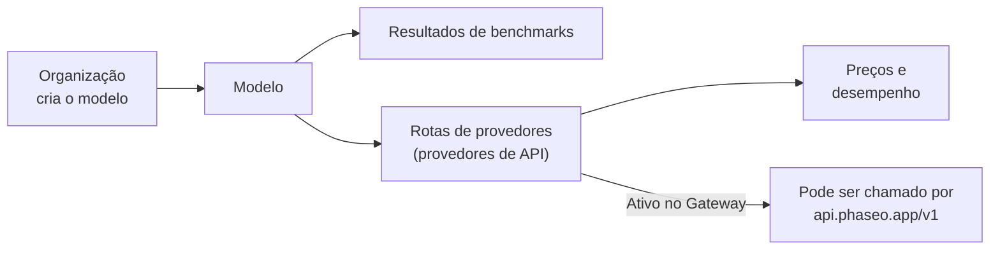

Pesquise qualquer modelo em [phaseo.app](https://phaseo.app/models) para ver quem o criou, quais provedores o disponibilizam, quanto ele custa e como ele pontua, e depois chame-o pelo Gateway quando ele tiver uma rota ativa.

## O que o catálogo contém

| Registro | O que é | Onde procurar |
| --- | --- | --- |
| [Organizações](./organisations.mdx) | Empresas e laboratórios de pesquisa que criam e publicam modelos. | [Organizações](https://phaseo.app/organisations) |
| [Modelos](./models.mdx) | Cada modelo lançado, agrupado em famílias de modelos relacionados. | [Modelos](https://phaseo.app/models) |
| [Benchmarks](./benchmarks.mdx) | Avaliações e as pontuações que os modelos obtêm nelas. | [Benchmarks](https://phaseo.app/benchmarks) |
| [Provedores de API](./api-providers.mdx) | Plataformas que disponibilizam modelos por meio de uma API. | [Provedores de API](https://phaseo.app/api-providers) |
| [Preços e desempenho](./pricing-performance.mdx) | O preço de cada provedor por token, imagem, segundo ou solicitação, e a velocidade medida no Gateway. | Páginas de modelos, [Comparar](https://phaseo.app/compare) |
| [Planos de assinatura](./subscription-plans.mdx) | Planos do Phaseo e assinaturas vendidas por provedores. | [Planos de assinatura](https://phaseo.app/subscription-plans) |

Um registro no catálogo não significa que você pode chamar o modelo. Somente os modelos marcados como **Ativo no Gateway** têm uma rota; `GET /v1/models` retorna apenas esses.

## Como ler os dados

- **Preços** estão em USD, por 1 milhão de tokens para texto, ou na unidade do próprio provedor (por imagem, por segundo, por solicitação) para mídia.
- **Datas** são dias em UTC, exibidas como `01 Jan 2026` em inglês.
- **Pontuações em benchmarks** mantêm a escala e a direção do próprio benchmark. O Phaseo não as converte em uma pontuação comum; consulte [Benchmarks](./benchmarks.mdx).
- **Famílias** agrupam modelos relacionados, como os tamanhos e as versões de uma mesma linha de modelos.

## Como os dados são mantidos atualizados

Jobs de sincronização com os provedores propõem novos preços, que um administrador revisa antes da publicação. Importações de benchmarks e jobs de ciclo de vida dos modelos atualizam o banco de dados de forma programada. Qualquer pessoa pode informar uma correção ou um registro ausente por meio de uma issue no GitHub; os mantenedores analisam as evidências e aplicam as alterações aprovadas. Consulte [Como contribuir](../contributing/overview.mdx).

## Exemplos de perguntas

| Objetivo | Onde encontrar a resposta |
| --- | --- |
| Comparar dois modelos em um benchmark | [Comparar](https://phaseo.app/compare) ou a página do benchmark |
| Encontrar o modelo mais barato para uma tarefa | A lista de [Modelos](https://phaseo.app/models) ordenada por preço e, depois, a [calculadora de preços](https://phaseo.app/tools/pricing-calculator) |
| Ver como um benchmark evoluiu ao longo do tempo | O gráfico **Progresso** do benchmark |
| Encontrar provedores compatíveis com um recurso | A seção **Provedores** da página do modelo, ou `GET /v1/models/{author}/{slug}/endpoints` |
| Encontrar registros para contribuir | Páginas de modelos sem benchmarks ou metadados; consulte [Como contribuir](../contributing/overview.mdx) |
