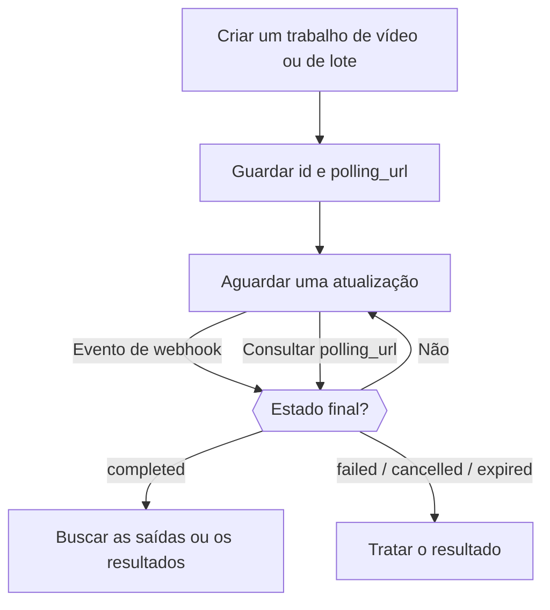

<Note>
A Video API e a Batch API são prévias beta disponíveis somente por convite para espaços de trabalho selecionados. Verifique a disponibilidade em **Configurações → Prévia de recursos**. O acesso é gerenciado por espaço de trabalho; ativar uma preferência pessoal na web não concede acesso à API. As cobranças normais de uso de modelos se aplicam.
</Note>

Criar um vídeo ou um lote retorna um trabalho antes de o processamento terminar. Guarde o `id` e a `polling_url` dele e, depois, aguarde um webhook ou consulte até o trabalho chegar a um estado final: `completed`, `failed`, `cancelled` ou `expired`. Uma resposta de criação bem-sucedida significa apenas que o trabalho foi aceito.



Mantenha o caminho de consulta (polling) mesmo quando usar webhooks. Durante o beta, comece com solicitações pequenas e um limite de gastos na chave de API. Entradas de referência, cancelamento e retenção das saídas dependem do provedor e do modelo. Salve a sua própria cópia das saídas concluídas antes que expirem.

<span id="receive-updates"></span>
## Receba atualizações

Associe um endpoint de webhook do seu espaço de trabalho ao criar qualquer um dos dois tipos de trabalho:

```json
{
  "webhook": {
    "endpoint_id": "YOUR_ENDPOINT_ID",
    "events": ["job.status_changed", "job.completed", "job.failed", "job.cancelled", "job.expired"]
  }
}
```

O Phaseo reconcilia o status do provedor e envia as notificações, então provedores que só oferecem consulta, como os lotes de mensagens da Anthropic, também geram webhooks. Uma falha na entrega do webhook não significa que o trabalho falhou.

Assine os eventos de Batch e de Video separadamente com tipos de evento com namespace, como `batch.completed` ou `video.failed`. Os tipos de evento genéricos `job.*` continuam funcionando e assinam a fase correspondente para os dois tipos de trabalho.

### Verifique e confirme as entregas

Verifique `x-phaseo-signature` com o segredo do endpoint: é o HMAC-SHA256 em hexadecimal de `x-phaseo-timestamp`, um ponto literal e o **corpo da solicitação sem modificações**. Confira se o timestamp é recente, elimine duplicados com base em `x-phaseo-event-id` e confirme as entregas aceitas com uma resposta 2xx. As entregas podem ser repetidas ou chegar fora de ordem, então recupere o trabalho antes de aplicar uma mudança de estado conflitante.

| Tentativa | Quando |
| --- | --- |
| 1 | Assim que o evento acontece |
| 2 | Cerca de 1 minuto após uma tentativa com falha |
| 3 | Cerca de 5 minutos depois |
| 4 | Cerca de 15 minutos depois; se falhar, a entrega é marcada como falha permanente |

Uma resposta 2xx encerra a entrega. Varreduras em segundo plano enviam as novas tentativas, então uma nova tentativa pode chegar depois do previsto. Cada tentativa registra o número, o horário, o status HTTP, o erro e o horário da próxima tentativa. Elimine duplicados mesmo assim: uma confirmação perdida ou um worker interrompido podem deixar uma entrega incerta.

Depois de salvar um endpoint, use **Enviar evento de teste** em Configurações para entregar um payload `webhook.test` assinado. Uma entrega de teste é tentada uma única vez, não é repetida e não entra no histórico de entregas dos trabalhos.

## Veja os logs de trabalhos e solicitações

Em **Configurações → Uso → Registros**, use **Solicitações** para os detalhes das solicitações de inferência, **Vídeo** para o ciclo de vida dos vídeos e **Lote** para os trabalhos em lote e os resultados por linha. As visualizações de detalhes de Vídeo e Lote incluem o status de cobrança, as tentativas no provedor e as tentativas de webhook. Um trabalho pode ser concluído com sucesso enquanto a entrega do webhook dele falha.

O envio de vídeo reserva crédito antes de contatar o provedor. Um timeout sem ID de tarefa mantém a reserva para reconciliação; isso não é evidência de uma geração com falha. Se uma reserva paga de Video ou Batch for inesperadamente precificada em zero depois de um trabalho bem-sucedido, a cobrança permanece aberta com `unexpected_zero_cost` para investigação. Uma resposta de criação com custo zero, por si só, é normal na geração assíncrona.

## Estime quanto custa um vídeo

Os preços de vídeo dependem do provedor e do modelo. Um preço por segundo precisa ser multiplicado pela duração cobrável; um preço por clipe vale apenas para a duração e a resolução especificadas. Várias saídas e entradas de referência cobráveis podem aumentar o total.

A geração de texto/imagem do LTX cobra os segundos de saída, enquanto a de áudio para vídeo cobra os segundos do áudio de entrada. O BytePlus Seedance usa tokens de vídeo, com tarifas diferentes quando há um vídeo de referência. O MiniMax Hailuo V1 usa preços por clipe de duração fixa; o H3 usa segundos e pode cobrar pelas entradas de referência. Verifique as dimensões de preço do provedor selecionado em vez de interpretar um preço de vitrine como o custo de uma solicitação inteira.

As reservas são estimativas retidas antes do envio. A cobrança final usa o uso cobrável do trabalho; o crédito reservado não utilizado é liberado após a reconciliação. Uma resolução ou opção compatível com o provedor não garante que ela esteja disponível no beta.

## Defina duração, frames e referências

Use `seconds` ou `duration` para a duração da saída. Se os dois estiverem presentes, precisam concordar. Use `resolution` com `aspect_ratio`, ou um `size` em pixels, como `1280x720`.

Use `frame_images` para definir explicitamente o primeiro e o último frame:

```json
{
  "frame_images": [
    {
      "type": "image_url",
      "frame_type": "first_frame",
      "image_url": { "url": "https://example.com/start.png" }
    }
  ],
  "input_references": [
    {
      "type": "image_url",
      "role": "reference",
      "image_url": { "url": "https://example.com/character.png" }
    }
  ]
}
```

As URLs de referência precisam usar HTTPS. Especifique `role: "reference"` explicitamente para imagens que sejam apenas referência: solicitações legadas sem `frame_images` interpretam a primeira imagem sem rótulo como primeiro frame. Não combine `frame_images` com papéis de primeiro/último frame em `input_references` nem com `input_reference`.

Referências de vídeo e áudio usam `type: "video_url"` ou `"audio_url"` e `media_url: { "url": "https://..." }`. Modelos e provedores aceitam combinações diferentes. Quando a duração da referência afeta o preço, informe `input_video_duration` e `input_audio_duration` em segundos.

## Envie opções de vídeo específicas do provedor

Mantenha o modelo, a duração, a resolução, a geração de áudio, a mídia de entrada e o número de saídas nos campos canônicos. Envie extensões específicas do provedor sob o ID canônico do provedor:

```json
{
  "provider_options": {
    "atlascloud": { "watermark": false, "output_format": "mp4" },
    "byteplus": { "camera_fixed": true }
  }
}
```

Somente as opções do provedor selecionado são encaminhadas. As opções não selecionam um provedor; use a configuração de roteamento `provider` para isso. Não combine `provider_options` com o legado `provider_params`. Opções aninhadas não podem substituir campos de cobrança ou de callback controlados pelo Gateway.

| Provedor | Exemplos de extensões nativas | Referência |
| --- | --- | --- |
| AtlasCloud Seedance 2.5 | `watermark`, `output_format`, `return_last_frame`, `omni_reference_task_type` | [API do modelo](https://www.atlascloud.ai/models/bytedance/seedance-2.5/reference-to-video) |
| Novita Seedance 1.5 | `watermark`, `camera_fixed`, `fps` (24), `service_tier` (`default`) | [API unificada de vídeo](https://docs.novita.ai/api-reference/reference-unified-video-generation) |
| BytePlus Seedance | `camera_fixed` | Verifique o contrato do provedor do modelo selecionado antes de usar. |
| MiniMax V1 | `fast_pretreatment`; use o canônico `enhance_prompt` para otimização de prompt | [Video API](https://platform.minimax.io/docs/api-reference/video-generation-t2v) |

O AtlasCloud Seedance usa os campos nativos `resolution`, `ratio` e `last_image`. A variante de referência para vídeo recebe referências ordenadas de imagem, vídeo e áudio. A edição com duração automática (`duration: -1`) não é compatível com o contrato de reserva de duração fixa do Gateway. A disponibilidade e os preços do modelo no provedor precisam estar configurados antes que um modelo possa ser roteado; uma opção de provedor não ativa um modelo indisponível.

O MiniMax H3 usa a V2: de 4 a 15 segundos inteiros em `768P` ou `2K`. O H3 Max aceita de 5 a 15 segundos inteiros em `480P` ou `768P`, com texto ou imagens de frame. O H3 aceita imagens, vídeo e áudio de referência; referências não podem ser misturadas com primeiro/último frame. Os dois modelos produzem um vídeo por solicitação e não aceitam as opções de otimização de prompt da V1. Use o canônico `aspect_ratio`; as entradas de frame determinam a própria proporção. As reservas com vídeo de referência cobrem o limite de entrada de 15 segundos do provedor, e o uso real é acertado na conclusão. Consulte o [contrato MiniMax V2](https://platform.minimax.io/docs/api-reference/video-generation-v2-create).

## Verifique o que cada provedor de lotes aceita

As solicitações de lote também aceitam `provider_options`: a OpenAI aceita `output_expires_after` e a Mistral aceita `metadata`. Use IDs canônicos de provedor e não duplique esses campos no nível superior. Por exemplo, `provider_options: { "openai": { "output_expires_after": { "anchor": "created_at", "seconds": 86400 } } }` define a retenção das saídas da OpenAI. Entradas de linhas, modelos, endpoints e destinos de webhook não podem ser substituídos pelas opções.

A Mistral já tem um adaptador nativo de lotes. Os lotes de mensagens da Anthropic são consultados por polling; outros provedores podem combinar polling com notificações nativas de conclusão. A disponibilidade depende dos endpoints compatíveis do provedor e da lista de permissões de lotes da implantação. Verifique a resposta de capacidade de lotes antes de enviar um arquivo ou solicitações inline.

Os lotes do Vertex Gemini aceitam `requests` inline com `/v1/generateContent`, ou `model` e `prompts`. Selecione `provider: "google-vertex"` para usar o Vertex. As linhas bem-sucedidas são cobradas com as tarifas de Batch. Este adaptador exige credenciais gerenciadas; BYOK, Files enviados, embeddings e lotes `google-vertex-eu` não estão disponíveis. A entrada é limitada a 20 MB e 10.000 solicitações. A entrada e a saída armazenadas expiram após 30 dias.

Os resultados do Vertex usam `custom_id` para identificar cada linha enviada, com uma geração bem-sucedida em `response.body` ou um `error` por solicitação. A ordem da saída pode ser diferente da ordem da entrada. Um envio com resultado incerto no provedor fica em revisão manual com a retenção de crédito mantida; evite criar um substituto até que o resultado seja confirmado.

A conclusão de um lote pode incluir linhas com falha. Inspecione cada resultado pelo custom ID em vez de presumir que todas as linhas funcionaram. Guarde a entrada original e o ID do trabalho até que os resultados e a cobrança estejam reconciliados. Um envio incerto precisa ser investigado antes de um novo envio, porque o provedor pode ter aceitado a solicitação original.

### Baixe os resultados do lote

Depois que um lote compatível chega a um estado final, a `results_url` dele aponta para um download autenticado do Phaseo. Use a sua chave de API normal do Phaseo, do espaço de trabalho dono do lote:

```bash
curl --fail "https://api.phaseo.app/v1/batches/$BATCH_ID/results" \
  -H "Authorization: Bearer $PHASEO_API_KEY" \
  --output results.jsonl
```

A resposta transmite JSONL pelo mesmo endpoint para todos os provedores de lotes compatíveis. O Phaseo combina arquivos separados de sucesso e de erro, converte arrays de resultados inline em JSONL e segue a paginação dos resultados. O conteúdo gerado e os erros por solicitação são preservados. Os campos das linhas continuam no formato nativo do provedor: use `custom_id` para linhas compatíveis com OpenAI e da Anthropic, os metadados da solicitação para o Gemini e `batch_request_id` para o xAI. As linhas bem-sucedidas da Anthropic contêm a mensagem gerada em `result.message`.

Os downloads são compatíveis com os adaptadores de OpenAI, Anthropic, Google AI Studio, Mistral, Together, Groq, Alibaba Cloud, Moonshot, Parasail, OVHcloud e xAI. A disponibilidade de provedores ainda depende do acesso à prévia e da lista de permissões de envio; a compatibilidade com download não ativa rotas adicionais. Os endpoints existentes `output_file_id`, `error_file_id` e de conteúdo de arquivos continuam disponíveis. O endpoint de linhas de solicitação do lote contém metadados de rastreamento e cobrança, não os corpos das mensagens geradas.

Baixar os resultados não envia outro lote nem gera uma cobrança de inferência. Você não precisa de credenciais do provedor. Os webhooks sinalizam atualizações do trabalho; baixe os resultados separadamente. Um trabalho em estado final pode ter resultados parciais ou nenhuma saída: o endpoint retorna `409` durante o processamento e `404` quando não há saída disponível. Salve os resultados antes que termine o período de retenção do provedor. Se um download for interrompido, descarte o arquivo parcial e repita o download, não o envio do lote. Resultados JSON inline são transmitidos com um limite de segurança de 8 MiB por linha; arquivos JSONL nativos são transmitidos sem esse limite por linha.

Para saídas grandes, `client.batches.streamResults(batchId, { signal })` no TypeScript retorna um `ReadableStream<Uint8Array>` sem armazenar em buffer. Encaminhe-o ao seu destino e cancele o stream ou aborte o sinal para parar antes; não há um tempo limite fixo para o download total. No Python, `client.batches.stream_results(batch_id)` produz blocos de bytes com o tempo limite HTTP configurado; feche o iterador ao parar antes. As operações geradas `retrieveBatchResults` retornam o texto JSONL completo e são mais adequadas para saídas pequenas.

### Limites de download de lotes

Os downloads de resultados de lotes permitem 10 tentativas por espaço de trabalho por lote em uma janela móvel de 30 minutos, compartilhadas entre as chaves de API e os aliases `/batches` e `/batch`. As tentativas que chegam à admissão do download contam mesmo que o download no upstream falhe ou seja cancelado. Falhas de propriedade e de prontidão não contam. Uma resposta `429` inclui `Retry-After` em segundos. Se o limitador estiver indisponível, os downloads retornam `503` com `Retry-After: 30`.
