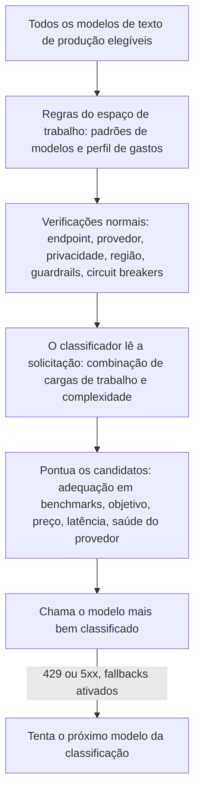

Envie `"model": "phaseo/auto"` e o Phaseo escolhe um modelo para cada solicitação com base na carga de trabalho, no objetivo do seu espaço de trabalho e nos limites de preço dele. O roteamento automático é uma versão Alfa disponível para espaços de trabalho selecionados.

```json
{
  "model": "phaseo/auto",
  "input": "Review this TypeScript function for correctness."
}
```

O campo `model` da resposta mostra qual modelo respondeu.

## Como um modelo é escolhido



1. **Candidatos.** O Phaseo parte de todos os modelos de texto de produção com preço padrão conhecido e mantém apenas os que correspondem aos seus padrões de modelos e ao seu perfil de gastos.
2. **Verificações.** Cada candidato precisa passar pelas mesmas verificações de endpoint, de modelo do espaço de trabalho, de provedor, de privacidade, de guardrails e de circuit breaker que uma solicitação com modelo fixo.
3. **Classificador.** Um modelo fixo de baixo custo lê a solicitação e retorna uma combinação de cargas de trabalho (código, raciocínio, uso de ferramentas e assim por diante), uma pontuação de complexidade e um grau de confiança. Ele nunca escolhe o modelo. As ferramentas e a saída estruturada da solicitação são repassadas a ele como fatos confiáveis.
4. **Pontuação.** A complexidade define o modelo menos capaz com probabilidade de dar uma resposta aceitável, mais uma margem. Depois, o Phaseo combina os benchmarks do catálogo que não são informados pelos próprios desenvolvedores com o seu objetivo e com o preço, a latência, a saúde e a confiabilidade atuais de cada candidato. Dados ausentes contam como neutros; eles nunca ampliam a lista de finalistas.

A solicitação não pode alterar o objetivo, o perfil de gastos nem os padrões do espaço de trabalho. Uma solicitação com modelo fixo ignora completamente o roteamento automático.

## Configure o recurso

<Steps>
<Step title="Abra Roteamento automático">

Acesse **Painel -> Configurações -> Roteamento -> Roteamento automático**.

</Step>
<Step title="Escolha um objetivo">

| Objetivo | O que pesa mais |
| --- | --- |
| `balanced` | Uma combinação prática de qualidade, preço, latência e confiabilidade. |
| `quality` | Resultados de benchmarks relevantes para a carga de trabalho. |
| `cost` | Menor preço dos tokens de entrada e de saída. |
| `latency` | Menor latência recente do provedor. |

</Step>
<Step title="Escolha um perfil de gastos">

Cada perfil é um teto rígido para os preços de texto do nível padrão, em USD por milhão de tokens. Modelos acima dele nunca são considerados.

| Perfil de gastos | Entrada máxima | Saída máxima |
| --- | ---: | ---: |
| Econômico | $0.10 | $0.50 |
| Padrão | $0.30 | $1.50 |
| Premium | $1 | $5 |
| Qualquer preço | Nenhum | Nenhum |

**Personalizado** permite que você defina os dois tetos.

</Step>
<Step title="Restrinja os modelos (opcional)">

Adicione padrões como `anthropic/*`, `openai/gpt-5.*` ou um ID de modelo exato.

</Step>
<Step title="Permita fallbacks e salve">

Com os fallbacks ativados, o Phaseo tenta o próximo modelo da classificação após um `429`, `500`, `502`, `503` ou `504`. Cada fallback passa por todas as verificações novamente. Erros do cliente não trocam de modelo.

</Step>
</Steps>

Pela CLI: `phaseo routing auto update --objective <o> --spend-profile <p> --allowed-patterns <list> --allow-fallbacks`, e `phaseo routing auto get` para ler a configuração. A API é `PATCH /v1/routing/auto`.

<Warning>
  Os perfis de gastos e os padrões decidem quais modelos são elegíveis. Eles não garantem qualidade, então confira a combinação de modelos resultante com as suas próprias cargas de trabalho.
</Warning>

## A solicitação ao classificador

Cada solicitação `phaseo/auto` cria uma solicitação filha separada para o modelo classificador, no mesmo espaço de trabalho e com a mesma identidade de cobrança. Ela aparece separadamente nos logs de solicitações com `purpose=auto_routing_classifier` e o ID da solicitação pai, e é medida separadamente.

Se o classificador falhar, exceder o tempo limite ou retornar dados inválidos, o Phaseo usa um classificador local baseado em regras (código, raciocínio, uso de ferramentas, saída estruturada, tradução, resumo ou geral), para que a solicitação principal continue sendo executada.

## Limites de privacidade e região

Os limites de dados da solicitação também se aplicam ao roteamento automático:

- Com `provider.require_zero_data_retention: true`, ou com um guardrail do espaço de trabalho ou da chave que permite apenas provedores com retenção zero, somente modelos com um provedor desse tipo entram na lista de finalistas.
- As regiões exigidas são verificadas em relação aos provedores de cada candidato.
- A solicitação ao classificador carrega os mesmos limites, mais as listas de provedores `only` e `ignore`. Se o modelo dele não puder atendê-los, o Phaseo usa o classificador local.

Se apenas os requisitos de residência não deixarem nenhum modelo, a solicitação falha com `403 model_region_unavailable` e `unmet_requirements`, como aconteceria com um modelo fixo. Se modelos também tiverem sido descartados por outros motivos, ela falha com `400 unsupported_model_or_endpoint`.

## Inspecione uma decisão

Os detalhes da solicitação mostram a carga de trabalho, o objetivo, o modelo selecionado, a ordem de fallback, as pontuações e as pontuações por fator de cada candidato, os IDs dos benchmarks, as exclusões e a versão do algoritmo. Os rastros não contêm o conteúdo do prompt nem da resposta.

## Combine com outros roteamentos

- **Rotas dinâmicas.** Um modelo fixo escolhido por uma [rota dinâmica](./routing-and-fallbacks#attach-routing-rules-to-api-keys) associada tem prioridade. A substituição é registrada e os fallbacks do roteamento automático ficam desativados para essa solicitação.
- **Fallbacks da solicitação.** `phaseo/auto` gerencia os próprios fallbacks em ordem de classificação, então não pode ser combinado com uma [lista `models`](./routing-and-fallbacks#request-level-model-fallbacks) nem aparecer em uma.
