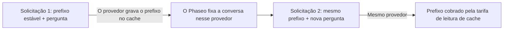

Mantenha o início do prompt igual entre as solicitações, e o provedor o lê do cache em vez de processá-lo de novo: esses tokens são cobrados pela tarifa de leitura de cache e o primeiro token chega mais rápido. A maioria dos provedores armazena prefixos repetidos em cache por conta própria. O Claude só armazena em cache o que você marca com `cache_control`.



O cache de prompts continua executando a inferência em cada solicitação. Ele não devolve uma resposta anterior para uma solicitação idêntica.

## Armazenar um prompt em cache

Marque o último bloco da parte estável. Tudo até esse bloco, inclusive, é armazenado em cache.

<CodeGroup>
```bash Chat Completions
curl https://api.phaseo.app/v1/chat/completions \
  -H "Authorization: Bearer $PHASEO_API_KEY" \
  -H "Content-Type: application/json" \
  -d '{
    "model": "anthropic/claude-sonnet-5.5",
    "messages": [
      {
        "role": "system",
        "content": [
          {
            "type": "text",
            "text": "You are a support assistant. Follow the company policy exactly.",
            "cache_control": { "type": "ephemeral", "ttl": "1h" }
          }
        ]
      },
      { "role": "user", "content": "Summarise the latest ticket." }
    ]
  }'
```

```bash Responses
curl https://api.phaseo.app/v1/responses \
  -H "Authorization: Bearer $PHASEO_API_KEY" \
  -H "Content-Type: application/json" \
  -d '{
    "model": "anthropic/claude-sonnet-5.5",
    "input": [
      {
        "role": "user",
        "content": [
          {
            "type": "input_text",
            "text": "Reference document: Refunds are available for 30 days when...",
            "cache_control": { "type": "ephemeral", "ttl": "5m" }
          },
          {
            "type": "input_text",
            "text": "Answer this customer: Can I return an item after 20 days?"
          }
        ]
      }
    ]
  }'
```

```bash Anthropic Messages
curl https://api.phaseo.app/v1/messages \
  -H "Authorization: Bearer $PHASEO_API_KEY" \
  -H "Content-Type: application/json" \
  -d '{
    "model": "anthropic/claude-sonnet-5.5",
    "max_tokens": 512,
    "system": [
      {
        "type": "text",
        "text": "You are a careful support assistant. Use the policy below.",
        "cache_control": { "type": "ephemeral", "ttl": "1h" }
      }
    ],
    "messages": [
      {
        "role": "user",
        "content": [
          {
            "type": "text",
            "text": "Policy: refunds are available for 30 days when...",
            "cache_control": { "type": "ephemeral", "ttl": "5m" }
          },
          { "type": "text", "text": "Can this customer return an item after 20 days?" }
        ]
      }
    ],
    "tools": [
      {
        "name": "lookup_order",
        "description": "Look up order status.",
        "input_schema": {
          "type": "object",
          "properties": { "order_id": { "type": "string" } },
          "required": ["order_id"]
        },
        "cache_control": { "type": "ephemeral", "ttl": "5m" }
      }
    ]
  }'
```
</CodeGroup>

Depois, confira se funcionou:

1. Envie a solicitação uma vez para gravar o cache.
2. Envie-a de novo com o mesmo conteúdo armazenável em cache.
3. Confira `cached_tokens` e `cache_write_tokens` no uso da resposta (veja [Campos de uso e preços](#usage-and-pricing-fields)) e os medidores de cache nos detalhes da solicitação.
4. Compare latência e custo ao longo de várias chamadas, não só da primeira.

Armazene em cache o conteúdo que se repete entre as solicitações: instruções de sistema longas, documentos reutilizados, exemplos few-shot, definições de ferramentas e resultados grandes de ferramentas que o turno seguinte envia de novo. Não marque conteúdo que muda a cada solicitação, entradas curtas e pontuais, nem dados que sua política não permite que o provedor armazene.

<Note>
O Phaseo envia a cada provedor apenas os controles de cache que ele documenta e remove os demais. Os controles de cache nunca excluem um provedor do roteamento. A página de cada modelo lista seus preços de leitura e gravação de cache.
</Note>

## Quais provedores armazenam em cache automaticamente

| Provedor | Cache | O que o Phaseo envia |
| --- | --- | --- |
| [OpenAI](https://developers.openai.com/api/docs/guides/prompt-caching), [Azure OpenAI](https://learn.microsoft.com/en-us/azure/foundry/openai/how-to/prompt-caching) | Automático para prompts de 1.024 tokens ou mais | `prompt_cache_key`; pontos de interrupção e `prompt_cache_options` no GPT-5.6 e posteriores; `prompt_cache_retention` em modelos anteriores |
| [Anthropic Claude](https://platform.claude.com/docs/en/build-with-claude/prompt-caching) na Anthropic, Claude on AWS, Amazon Bedrock e Google Vertex AI | Por ativação | Pontos de interrupção `cache_control`, no máximo quatro por solicitação |
| [Google Gemini](https://ai.google.dev/gemini-api/docs/caching) no Google AI Studio e no [Vertex AI](https://docs.cloud.google.com/vertex-ai/generative-ai/docs/context-cache/context-cache-overview) | Automático no Gemini 2.5 e posteriores | `cached_content` para um cache explícito que você criou |
| [xAI](https://docs.x.ai/developers/advanced-api-usage/prompt-caching/maximizing-cache-hits) | Automático | `prompt_cache_key` e o cabeçalho `x-grok-conv-id` |
| [DeepSeek](https://api-docs.deepseek.com/guides/kv_cache) | Automático | Nada a mais |
| [Moonshot AI](https://platform.kimi.ai/docs/guide/context-caching) | Automático, com TTL de 5 minutos; um TTL de 1 hora é opcional no Kimi K3 | `prompt_cache_key` e `prompt_cache_options` |
| [Groq](https://console.groq.com/docs/prompt-caching) | Automático nos modelos que a Groq lista | Nada a mais |
| [Fireworks](https://docs.fireworks.ai/guides/prompt-caching) | Automático | `prompt_cache_key`, além do cabeçalho `x-session-affinity` e de `user` |
| [Cerebras](https://inference-docs.cerebras.ai/capabilities/prompt-caching) | Automático | `prompt_cache_key` |
| [Cloudflare Workers AI](https://developers.cloudflare.com/workers-ai/features/prompt-caching) | Automático em modelos selecionados | O cabeçalho `x-session-affinity` |
| [Together AI](https://docs.together.ai/docs/inference/chat/prompt-caching), [Mistral](https://docs.mistral.ai/studio-api/conversations/advanced/prompt-caching) | Automático; `prompt_cache_key` melhora a taxa de acerto | `prompt_cache_key` |
| [Alibaba Model Studio](https://www.alibabacloud.com/help/en/model-studio/context-cache) | Automático (implícito); caches explícitos são opcionais | `cache_control` em bloco |
| [Venice](https://docs.venice.ai/overview/guides/prompt-caching) | Automático; a Venice adiciona os pontos de interrupção do Claude por conta própria | `cache_control` em bloco |
| [DeepInfra](https://docs.deepinfra.com/chat/prompt-cache-retention) | Automático; uma janela de retenção é opcional | `prompt_cache_key`, `prompt_cache_breakpoint` e `prompt_cache_options` |
| [Inference.net](https://inference.net/models/claude-opus-5/) | Automático; cache explícito nos modelos Claude e Gemini 2.5 | `cache_control` em bloco nos modelos Claude e Gemini 2.5, sem `ttl` |
| [Baseten](https://docs.baseten.co/inference/model-apis/pricing-and-limits) | Automático | `prompt_cache_key` e o cabeçalho `x-session-affinity` |
| [Morph](https://docs.morphllm.com/sdk/components/caching) | Automático | `prompt_cache_key` e o cabeçalho `x-session-id` |

Outros provedores compatíveis com OpenAI recebem `prompt_cache_key` quando a API deles o aceita, e nenhum outro controle de cache. O Phaseo sempre envia um hash do seu espaço de trabalho e da chave, nunca a própria chave; veja [Afinidade com o provedor](#provider-affinity).

<span id="cache-controls"></span>
## Controles de cache

### Deixar o Phaseo posicionar os pontos de interrupção do Claude

Um `cache_control` de nível superior em Chat Completions, Responses ou Anthropic Messages ativa o cache nas rotas do Claude, e o Phaseo posiciona os pontos de interrupção para você. Os outros provedores o ignoram.

```json
{
  "cache_control": { "type": "ephemeral", "ttl": "5m" }
}
```

Use `ttl: "5m"` (o padrão) para contexto compartilhado de curta duração e `ttl: "1h"` quando o modelo aceitar entradas de cache mais duradouras. Um `cache_control` de nível superior também mantém a conversa em um único provedor; veja [Afinidade com o provedor](#provider-affinity).

`provider_options.anthropic.cache_control` é a mesma configuração e também aceita um `scope`. Quando uma solicitação envia os dois, o valor de `provider_options` prevalece:

```json
{
  "provider_options": {
    "anthropic": {
      "cache_control": { "type": "ephemeral", "ttl": "5m", "scope": "agent" }
    }
  }
}
```

| `scope` | Onde o Phaseo posiciona os pontos de interrupção |
| --- | --- |
| `all_text` (padrão) | No texto de sistema e nas três mensagens de usuário mais recentes que contêm texto ou imagens. |
| `last_user_message` | Apenas na mensagem de usuário mais recente. |
| `agent` | Para loops de ferramentas: na última definição de ferramenta, no texto de sistema, na mensagem final (incluindo resultados de ferramentas) e na mensagem da etapa anterior. `conversation` é um alias. |
| `none` | Em lugar nenhum. |

Use `agent` em loops de ferramentas com várias etapas. `all_text` e `last_user_message` não marcam mensagens que contêm apenas resultados de ferramentas, então o prefixo em cache para de crescer. Valores de `scope` não reconhecidos são tratados como `agent`.

Os pontos de interrupção que você define nos blocos prevalecem sobre a política padrão e contam para o limite de quatro por solicitação da Anthropic: a política padrão para de adicionar marcas ao chegar a quatro. Se os seus próprios blocos tiverem mais de quatro marcas, o Phaseo mantém a primeira e as três mais recentes e remove as outras, para que a solicitação não seja rejeitada.

### Pontos de interrupção de cache em blocos

Uma marca de cache em um bloco de conteúdo armazena em cache tudo até esse bloco, inclusive. O Phaseo aceita duas grafias:

- `cache_control`: `{"type": "ephemeral"}`, com um `ttl` opcional de `5m` ou `1h`.
- `prompt_cache_breakpoint`: o `{"mode": "explicit"}` da OpenAI, com um `ttl` opcional de `30m` ou `12h` (veja [Cache de 12 horas na OpenAI](#12-hour-cache-on-openai)). Quando um bloco tem os dois, `prompt_cache_breakpoint` prevalece.

Em Chat Completions e Responses, as marcas são aceitas em partes de texto e imagem, em definições de ferramentas de função e em resultados de ferramentas cujo conteúdo é uma matriz de partes de texto. O Anthropic Messages aceita `cache_control` onde a Anthropic aceita: blocos de texto de `system`, blocos de texto e imagem das mensagens, blocos de resultado de ferramenta e definições de ferramentas. Quando uma solicitação tem vários TTLs, a Anthropic exige que os pontos de interrupção de `1h` venham antes dos de `5m`.

Cada provedor recebe a marca no próprio formato:

| Provedor | `cache_control` em bloco | `prompt_cache_breakpoint` |
| --- | --- | --- |
| Claude na Anthropic, Claude on AWS, Amazon Bedrock e Google Vertex AI | Enviado como `{"type": "ephemeral"}` com o seu `ttl` | Enviado como `cache_control: {"type": "ephemeral"}` |
| OpenAI, GPT-5.6 e posteriores | Enviado como `prompt_cache_breakpoint: {"mode": "explicit"}`; o `ttl` é descartado | Enviado, com o `ttl` |
| Azure OpenAI, GPT-5.6 e posteriores | Enviado como `prompt_cache_breakpoint: {"mode": "explicit"}`; o `ttl` é descartado | Enviado sem `ttl` |
| OpenAI e Azure OpenAI, modelos anteriores | Removido | Removido |
| DeepInfra | Removido | Enviado sem `ttl` |
| Alibaba Model Studio e Venice | Enviado | Removido |
| Inference.net, modelos Claude e Gemini 2.5 | Enviado sem `ttl` | Removido |
| Outros provedores | Removido | Removido |

Marcas em definições de ferramentas só chegam às rotas do Claude, ao Alibaba Model Studio, à Venice e aos modelos Claude e Gemini 2.5 da Inference.net; a OpenAI não aceita pontos de interrupção em ferramentas. Remover uma marca não altera o resto do prompt, então o prefixo em cache corresponde a uma solicitação sem marcas.

O Amazon Bedrock e o Google Vertex AI armazenam o Claude 3.7 Sonnet, o 3.5 Sonnet e o 3 Opus em cache por apenas 5 minutos, e o Bedrock pode rejeitar um `ttl` nesses modelos. Nessas rotas, o Phaseo envia seus pontos de interrupção sem `ttl`, para que fiquem em cache por 5 minutos, e informa um `1h` removido como `cache_control.ttl` no cabeçalho `X-Phaseo-Dropped-Params` e em `meta.routing.dropped_params`. A Inference.net documenta pontos de interrupção sem `ttl`, então o Phaseo remove e informa um `ttl` ali da mesma forma, e as gravações são cobradas como gravações de 5 minutos.

<span id="openai-retention-and-options"></span>
### Retenção e opções da OpenAI

Os controles de cache da OpenAI dependem da geração do modelo. O Phaseo envia cada um apenas onde é aceito:

| Campo | Valores | Enviado para |
| --- | --- | --- |
| `prompt_cache_options` | `mode`: `implicit` ou `explicit`; `ttl`: `30m` (padrão) ou `12h` | OpenAI GPT-5.6 e posteriores |
| `prompt_cache_options` | `mode`: `implicit` ou `explicit`; `ttl`: `30m` | Azure OpenAI GPT-5.6 e posteriores |
| `prompt_cache_options` | `mode`: `explicit`; `ttl`: `5m` ou `1h` | DeepInfra |
| `prompt_cache_options` | `mode`: `implicit`; `ttl`: `5m` (padrão), ou `1h` no Kimi K3 | Moonshot AI |
| `prompt_cache_retention` | `in_memory` ou `24h` | Modelos da OpenAI e da Azure OpenAI anteriores ao GPT-5.6 |

O modo `explicit` armazena em cache apenas os pontos de interrupção que você posiciona. A DeepInfra também exige `prompt_cache_key` em todas as solicitações da sessão. O Phaseo só envia um `1h` da Moonshot AI para rotas do Kimi K3 que têm preço de gravação de 1 hora, então essas gravações são cobradas por esse preço; nos demais casos, ele remove o `ttl` e o informa como `prompt_cache_options.ttl` no cabeçalho `X-Phaseo-Dropped-Params`. Os outros provedores não recebem nenhum dos dois campos.

Envie qualquer um dos campos no nível superior ou em `provider_options.openai`. Quando os dois estão presentes, o valor de nível superior prevalece:

```json
{
  "prompt_cache_retention": "24h",
  "provider_options": {
    "openai": { "prompt_cache_retention": "in_memory" }
  }
}
```

Aqui a solicitação usa `24h`.

<span id="12-hour-cache-on-openai"></span>
### Cache de 12 horas na OpenAI

No GPT-5.6 e posteriores, a OpenAI mantém uma entrada de cache por pelo menos 12 horas quando você define `ttl: "12h"`, seja para a solicitação inteira em `prompt_cache_options`, seja para um ponto de interrupção em `prompt_cache_breakpoint`. Um ponto de interrupção sem `ttl` próprio usa o da solicitação. A OpenAI cobra uma gravação de 12 horas a 2.5× a tarifa de entrada e uma gravação de 30 minutos a 1.25×; as leituras de cache custam o mesmo nos dois casos.

```json
{
  "model": "openai/gpt-5.6-sol",
  "prompt_cache_options": { "ttl": "30m" },
  "input": [
    {
      "role": "developer",
      "content": [
        {
          "type": "input_text",
          "text": "Shared tool manual...",
          "prompt_cache_breakpoint": { "mode": "explicit", "ttl": "12h" }
        }
      ]
    },
    { "role": "user", "content": "Find the failing test." }
  ]
}
```

- A OpenAI documenta a duração de 12 horas apenas na Responses API dela. Uma solicitação de Chat Completions que a peça é executada na Responses API da OpenAI, e a resposta mantém o formato de Chat Completions.
- As rotas que aceitam um cache de 12 horas são tentadas primeiro: a API da própria OpenAI (`openai` e `openai-eu`), em um modelo GPT-5.6 ou posterior cuja tabela de preços tenha um preço de gravação de 12 horas. Qualquer outra rota, como a Azure OpenAI, outro provedor ou um modelo anterior ao GPT-5.6, recebe a solicitação sem ele, então vale o padrão de 30 minutos. A solicitação continua sendo executada, e o campo removido é informado como `prompt_cache_options.ttl` ou `prompt_cache_breakpoint.ttl` no cabeçalho `X-Phaseo-Dropped-Params` e em `meta.routing.dropped_params`.

### Usar um cache explícito do Gemini

O Gemini 2.5 e posteriores armazenam em cache implicitamente, sem nada a enviar. Para usar um cache explícito que você criou com a API de cache do Google, passe o nome dele em `provider_options.google.cached_content`:

```json
{
  "provider_options": {
    "google": { "cached_content": "cachedContents/abc123" }
  }
}
```

- No Google AI Studio, `cached_content` só funciona com a sua própria chave de API do Google (BYOK). Com a chave do Phaseo, a solicitação retorna `400`, porque o cache pertence à conta que o criou.
- No Vertex AI, `cached_content` só funciona com a sua própria credencial do Vertex AI; com a credencial do Phaseo, a solicitação retorna `400`. Envie o nome completo do cache, `projects/{project}/locations/{location}/cachedContents/{id}`, e o Phaseo envia a solicitação para esse projeto e local. Um nome curto como `cachedContents/abc123` usa o `project_id` e a `region` do JSON da sua conta de serviço e retorna `400` se algum deles estiver faltando.
- O Google não oferece caches explícitos no Gemini 4 Argon e posteriores.

`provider_options.google.cache_control` e `provider_options.google.cache_ttl` são aceitos, mas não são enviados ao Google.

### Responses: enviar a conversa inteira

O Phaseo não armazena respostas. Solicitações que definem `previous_response_id` ou `conversation` retornam `400` `unsupported_param`, então envie a conversa inteira em `input` a cada etapa. A abertura estável dela é o prefixo que fica em cache. Em loops de ferramentas, envie de volta também os itens de saída `reasoning`; veja [Raciocínio em loops de ferramentas](../api-reference/endpoint/responses.mdx#reasoning-in-tool-loops).

<span id="change-reasoning-effort-mid-conversation"></span>
### Mudar o esforço de raciocínio no meio da conversa

Envie o esforço que você quer em cada solicitação (`reasoning_effort` no Chat Completions, `reasoning.effort` no Responses), e o Phaseo muda o esforço do Claude sem reiniciar o cache de prompts dele. Um novo esforço de nível superior invalidaria a conversa em cache, então o Phaseo continua enviando ao Claude o primeiro nível da conversa e adiciona a mudança como um marcador de [esforço por mensagem](https://platform.claude.com/docs/en/build-with-claude/effort-per-message) depois da sua nova mensagem:

| Solicitação | Você envia | O Phaseo envia ao Claude |
| --- | --- | --- |
| 1 | `"high"` | `output_config.effort: "high"` |
| 2 | `"low"` | `"high"`, mais um marcador `low` depois da sua nova mensagem. O prefixo em cache continua correspondendo. |
| 3 | `"low"` | `"high"`, mais o mesmo marcador no mesmo lugar |
| 4 | `"high"` | `"high"`, o marcador anterior e um marcador `high` depois da sua nova mensagem |

O Phaseo não armazena nada entre as solicitações. Ele lê os níveis anteriores da conversa que você envia, então isso só funciona quando:

- **Você envia o raciocínio de volta sem alterações.** Cada resposta do Claude termina com uma entrada de raciocínio que registra o nível em que ela foi executada: a última entrada `reasoning.encrypted` em `reasoning_details` do Chat, ou o último item `reasoning` na saída do Responses. Ela não tem texto. Se você a descartar, ou descartar qualquer outro raciocínio, a próxima mudança vai para o nível superior.
- **A mudança vem com uma nova mensagem do usuário.** Uma mudança entre passos de um loop de ferramentas, quando a sua mensagem mais recente contém apenas resultados de ferramentas, vai para o nível superior e reinicia o cache.
- **O raciocínio continua ativado.** Solicitações com o raciocínio desativado mantêm o comportamento atual.
- **A rota oferece suporte.** Anthropic e Google Vertex AI: Claude Fable 5.2 e 5.1, Mythos 5.2 e 5.1, Opus 5.5 e 5, Sonnet 5.5 e Haiku 5.5. Claude on AWS: os mesmos modelos, exceto Mythos. Amazon Bedrock: Fable 5.1 e Opus 5.5. Nos demais casos, incluindo o Claude no Azure, a mudança vai para o nível superior.

No Anthropic Messages, envie você mesmo o marcador: uma mensagem `system` com `content` vazio e `output_config.effort`. Ela pode ficar em qualquer lugar de `messages`, e o Phaseo adiciona o cabeçalho beta `mid-conversation-output-config-2026-07-01`. Mantenha-a no lugar nas solicitações seguintes. Em rotas sem esforço por mensagem, o Phaseo a remove e envia o nível em vigor como esforço de nível superior.

```json
{
  "model": "anthropic/claude-opus-5.5",
  "max_tokens": 4096,
  "output_config": { "effort": "high" },
  "messages": [
    { "role": "user", "content": "Plan a migration from SQLite to PostgreSQL." },
    { "role": "assistant", "content": "1. Export the data. 2. Create the schema. 3. Import and verify." },
    { "role": "system", "content": [], "output_config": { "effort": "low" } },
    { "role": "user", "content": "Summarise the plan in one sentence." }
  ]
}
```

<span id="usage-and-pricing-fields"></span>
## Campos de uso e preços

Todos os endpoints de texto informam leituras e gravações de cache. Chat Completions e Responses seguem a semântica da OpenAI: a contagem de entrada inclui as leituras e gravações de cache. O Anthropic Messages segue a da Anthropic: `input_tokens` as exclui.

| Endpoint | Entrada total | Leituras de cache | Gravações de cache |
| --- | --- | --- | --- |
| Chat Completions | `prompt_tokens`, incluindo leituras e gravações | `prompt_tokens_details.cached_tokens` | `prompt_tokens_details.cache_write_tokens` |
| Responses | `input_tokens`, incluindo leituras e gravações | `input_tokens_details.cached_tokens` | `input_tokens_details.cache_write_tokens`, dividido por duração no OpenAI GPT-5.6 e posteriores em `input_tokens_details.cache_write_tokens_details.ttl_30m_tokens` e `ttl_12h_tokens` |
| Anthropic Messages | `input_tokens` + `cache_read_input_tokens` + `cache_creation_input_tokens` | `cache_read_input_tokens` | `cache_creation_input_tokens`, dividido por TTL em `cache_creation.ephemeral_5m_input_tokens` e `cache_creation.ephemeral_1h_input_tokens` |

Em Chat Completions e Responses, a entrada sem cache é a entrada total menos as leituras de cache menos as gravações de cache. Respostas do Anthropic Messages em streaming trazem os campos de cache em `message_delta`. O uso de Chat Completions não tem divisão por duração, porque a OpenAI não documenta nenhuma ali; os detalhes da solicitação ainda a registram.

<Note>
Respostas anteriores informavam as gravações de cache como `output_tokens_details.cached_tokens` (`completion_tokens_details.cached_tokens` em Chat Completions), e as rotas do Claude deixavam as leituras e gravações de cache fora de `input_tokens` em Chat Completions e Responses. Nada disso vale mais: leia as gravações em `cache_write_tokens`. Respostas do Anthropic Messages sem streaming retornavam `cache_creation_input_tokens: null`; agora retornam as contagens reais.
</Note>

Os detalhes da solicitação e os detalhamentos de preço usam estes medidores:

| Medidor | Conta |
| --- | --- |
| `cached_read_text_tokens` | Leituras de cache. |
| `cached_write_text_tokens` | Gravações de cache, quando o provedor tem um único preço de gravação de cache. |
| `cached_write_text_tokens_5m`, `cached_write_text_tokens_1h` | Gravações de cache do Claude com TTL de 5 minutos ou 1 hora, quando o provedor as informa separadamente. |
| `cached_write_text_tokens_30m`, `cached_write_text_tokens_12h` | Gravações de cache da OpenAI com duração de 30 minutos ou 12 horas. |

### Como os tokens em cache são cobrados

O Phaseo cobra cada token de entrada uma vez, por uma única tarifa: a entrada sem cache pela tarifa de entrada, as leituras de cache pela tarifa de leitura de cache e as gravações de cache pela tarifa de gravação de cache, ou pelas tarifas de 5 minutos e 1 hora (Claude) ou de 30 minutos e 12 horas (OpenAI) quando o provedor as precifica separadamente. Alguns provedores contam as gravações de cache dentro do total de entrada e outros as informam à parte; de qualquer forma, um token gravado nunca é cobrado também como entrada comum.

Por exemplo, com tarifas ilustrativas de $5.00 por 1M de tokens de entrada, $0.50 para leituras de cache, $6.25 para gravações de cache de 30 minutos e $30.00 para saída, uma solicitação com 53.100 tokens de entrada, dos quais 48.000 são leituras de cache e 3.000 são gravações de cache, mais 850 tokens de saída, custa:

| Tokens | Tarifa por 1M | Custo |
| --- | ---: | ---: |
| 2.100 de entrada sem cache | $5.00 | $0.01050 |
| 48.000 leituras de cache | $0.50 | $0.02400 |
| 3.000 gravações de cache | $6.25 | $0.01875 |
| 850 de saída | $30.00 | $0.02550 |
| Total | | $0.07875 |

Se 2.000 dessas gravações tivessem duração de 12 horas, elas custariam $12.50 por 1M em vez de $6.25, e a solicitação custaria $0.09125.

Alguns provedores não dão desconto para tokens em cache em alguns modelos. As páginas desses modelos mostram o mesmo preço para entrada e leituras de cache.

### Quando uma rota ainda não tem preço de cache

Se um provedor informar tokens em cache em uma rota que ainda não tem preço de cache no catálogo, a solicitação não falha:

- As leituras de cache são cobradas pela tarifa de entrada da rota.
- As gravações de cache são cobradas pela tarifa de entrada vezes o multiplicador de gravação documentado pelo provedor.
- A linha de preço é marcada com `pricing_fallback: "input_rate"`.

| Gravações | Multiplicador da tarifa de entrada |
| --- | --- |
| Claude, qualquer plataforma | 1.25× para gravações de 5 minutos, 2× para gravações de 1 hora |
| Gravações de 30 minutos da OpenAI, qualquer rota | 1.25× |
| Gravações de 12 horas da OpenAI, qualquer rota | 2.5× |
| OpenAI, Azure OpenAI e Alibaba, outras gravações | 1.25× |
| Moonshot AI e Kimi K3 | 1× para gravações de 5 minutos, 2× para gravações de 1 hora |
| Outros provedores | 1× |

Em uma rota do Claude cujo catálogo tem um único preço de gravação de cache, esse preço é a tarifa de 5 minutos. As gravações que o provedor informa como gravações de 1 hora são cobradas a 2× a tarifa de entrada, em uma linha `cached_write_text_tokens_1h` marcada com `pricing_fallback: "input_rate"`.

O `message_delta` final de uma resposta do Claude em streaming informa o total de gravações de cache sem a divisão por TTL. As gravações além da divisão são cobradas como gravações de 5 minutos, porque gravações de ferramentas do servidor podem usar 5 minutos mesmo quando a solicitação pede 1 hora.

<span id="provider-affinity"></span>
## Afinidade com o provedor

Um cache de prompt fica em um provedor e, muitas vezes, em uma região ou implantação desse provedor. O Phaseo mantém as solicitações relacionadas no provedor e na rota que as atenderam, para que um loop de agente não pague para reconstruir o cache em outro lugar.

Envie `prompt_cache_key` ou `session_id`, ou ative o cache com `cache_control` (no nível superior, em `provider_options.anthropic.cache_control` ou como marca `cache_control` ou `prompt_cache_breakpoint` em um bloco de mensagem ou ferramenta), para fixar uma conversa. O Phaseo a fixa no provedor e na rota que atenderam a primeira solicitação bem-sucedida, e as solicitações seguintes com a mesma chave também vão para lá. As fixações são mantidas por espaço de trabalho, endpoint e modelo.

Quanto tempo uma fixação dura depende da retenção de cache do provedor:

| Solicitação | A fixação dura |
| --- | --- |
| `session_id` | 24 horas, renovadas enquanto a sessão estiver ativa |
| `cache_control` da Anthropic com `ttl: "1h"` | 90 minutos |
| OpenAI ou Azure OpenAI com `prompt_cache_retention: "24h"` | 24 horas |
| OpenAI ou Azure OpenAI com retenção em memória (o padrão) | 90 minutos |
| OpenAI com `ttl: "12h"` em `prompt_cache_options` ou em um ponto de interrupção, ou uma gravação de 12 horas informada | 18 horas |
| OpenAI ou Azure OpenAI com `prompt_cache_options.ttl: "30m"` | 45 minutos |
| Qualquer outro caso | 15 minutos |

Uma fixação só muda quando o provedor falha (um disjuntor aberto ou uma taxa alta de erros recentes), quando a cota gerenciada do Phaseo nesse provedor se esgota, ou quando a rota, predefinição, guardrail ou política de solicitação ativa não o permite mais. A solicitação então passa para uma alternativa, e a fixação vai para o provedor que a atendeu. Os detalhes da solicitação registram isso como `sticky_routing.demotionReason` nos diagnósticos de roteamento. Solicitações fixadas não são usadas para sondar provedores em recuperação.

Sem chave, `session_id` ou marca de cache, o Phaseo ainda fixa o contexto de abertura por 15 minutos em um provedor que informou uma leitura ou gravação de cache para ele, desde que a entrada em cache desse provedor seja mais barata que a entrada padrão.

O Phaseo envia aos provedores um hash do seu espaço de trabalho e de `prompt_cache_key`, nunca a chave bruta, então a mesma chave em dois espaços de trabalho nunca compartilha um cache de provedor. Com apenas um `session_id`, o Phaseo deriva esse hash da sessão para OpenAI, xAI, Fireworks e Cerebras. Fireworks, Cloudflare Workers AI e Baseten também o recebem no cabeçalho `x-session-affinity`, a Morph no cabeçalho `x-session-id` e a xAI como `x-grok-conv-id`, a menos que você defina `provider_options.xai.conversation_id`. As respostas continuam ecoando o seu próprio `prompt_cache_key`.

Defina `provider.cache_aware_routing` como `false` para desativar isso em uma solicitação. Defina `routing.session_affinity` como `false` quando a solicitação tiver um `session_id`, mas deve usar apenas o roteamento normal baseado em contexto; nesse caso, o Phaseo também deixa de derivar uma chave de cache de provedor a partir da sessão. Para saber como a afinidade se combina com a ordem de provedores e as alternativas, veja [Roteamento e alternativas](./routing-and-fallbacks.mdx). Todos os campos de cache também estão listados na [referência de parâmetros](../api-reference/parameters.mdx).
