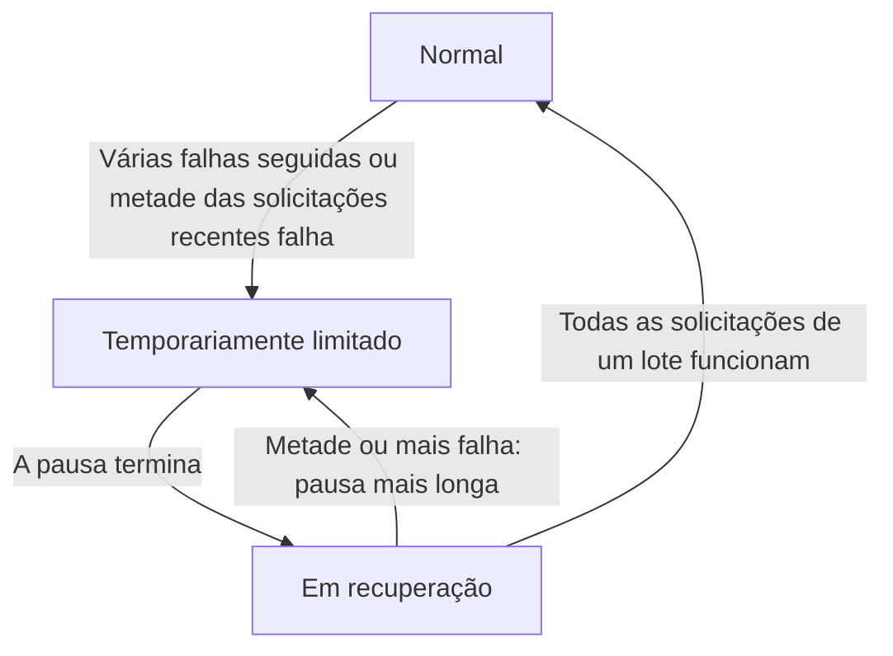

import { ProviderStatusExplorer } from "/snippets/provider-status.jsx";

Na página de um modelo, aparecem até dois ícones depois do nome de cada provedor: um **ícone de status**, definido pelo Phaseo, e um **ícone de roteamento em tempo real**, que só aparece enquanto o Gateway desvia o tráfego de um provedor com falhas.

<ProviderStatusExplorer locale="pt-BR" />

## Ícone de status

O Phaseo define este status manualmente, e ele permanece até o Phaseo alterá-lo. As páginas de modelos mostram os três níveis de rebaixamento como `Prioridade menor`.

| Ícone | Status | Roteamento |
| --- | --- | --- |
| <Icon icon="circle-check" color="#16a34a" /> | `Active` | Roteado normalmente. |
| <Icon icon="triangle-alert" color="#f59e0b" /> | `Deranked L1` | Roteável, logo atrás de outros provedores. |
| <Icon icon="triangle-alert" color="#d97706" /> | `Deranked L2` | Roteável, atrás de provedores mais saudáveis. |
| <Icon icon="triangle-alert" color="#ef4444" /> | `Deranked L3` | Roteável, bem atrás de outros provedores. |
| <Icon icon="ban" color="#dc2626" /> | `Disabled` | Não é roteado. |

## Roteamento em tempo real

O Gateway define isso automaticamente para cada provedor, modelo e endpoint, com base nas solicitações que está atendendo agora. Uma rota limitada ou em recuperação continua roteável, mas outros provedores são tentados primeiro.

## Disponibilidade e integração

O card de status também mostra se o provedor oferece o modelo e se o Phaseo o ativou. Uma rota só é pública quando as duas coisas permitem. Por exemplo, um provedor pode oferecer um modelo novo (`Available`) enquanto o Phaseo ainda desenvolve o suporte (`Implementing`).

### Disponibilidade do provedor

| Status | Significado |
| --- | --- |
| `Available` | O provedor aceita solicitações para a oferta no momento. |
| `Preview` | O provedor disponibiliza a oferta em prévia. |
| `Limited Access` | A oferta existe, mas o acesso depende da conta, região, lista de permissões ou capacidade. |
| `Coming Soon` | O provedor anunciou ou listou a oferta, mas ela ainda não pode ser usada. |
| `Deprecated` | A oferta continua disponível, mas o provedor recomenda a migração. |
| `Removed` | O provedor deixou de disponibilizar a oferta. |
| `Unknown` | O Phaseo ainda não verificou a disponibilidade na origem. |

### Integração do Phaseo

| Status | Significado | Roteamento do Phaseo |
| --- | --- | --- |
| `Unsupported` | O Phaseo não tem uma integração compatível com a oferta. | Não roteável. |
| `Planned` | O trabalho de integração foi aprovado, mas ainda não começou. | Não roteável. |
| `Implementing` | O trabalho de integração está em andamento. | Não roteável. |
| `Testing` | Implementada e em testes de contrato, staging ou canário. | Não roteável publicamente. |
| `Enabled` | Compatível e habilitada para uso em produção. | Pode ser roteada se as chaves de roteamento e a saúde permitirem. |
| `Disabled` | O Phaseo desativou a integração intencionalmente. | Não roteável. |
| `Blocked` | Uma dependência externa ou ainda não resolvida impede o rollout. | Não roteável. |

Só rotas `Enabled` podem ser públicas. Rotas `Internal` atendem apenas o tráfego de teste do próprio Phaseo.

## Compatibilidade

`availability_status`, `routing_status`, `is_active_gateway` e `routable` continuam na API para integrações existentes. Integrações novas devem ler os campos separados do provedor e do Phaseo.

## Páginas relacionadas

- [Roteamento e fallbacks](./routing-and-fallbacks.mdx)
- [Níveis de serviço](./service-tiers.mdx)
- [Referência da API de modelos](../api-reference/endpoint/models.mdx)
