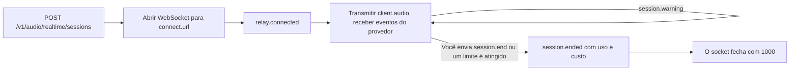

Crie uma sessão no seu servidor, conecte o cliente ao relay do Phaseo por WebSocket e transmita o áudio do microfone para o modelo em tempo real de um provedor. O relay repassa os eventos do próprio provedor sem alterações, mede a chamada enquanto ela acontece e adiciona três eventos próprios: `session.warning` durante a chamada, `session.end` para desligar e `session.ended` com a cobrança final.

<Note>
A voz em tempo real está em beta, e o acesso é liberado por espaço de trabalho.
</Note>



## Iniciar uma sessão

Crie a sessão no seu servidor:

```bash
curl https://api.phaseo.app/v1/audio/realtime/sessions \
  -H "Authorization: Bearer $PHASEO_API_KEY" \
  -H "Content-Type: application/json" \
  -d '{"model": "openai/gpt-realtime-2", "voice": "marin"}'
```

A resposta inclui `client_secret`, `connect.url`, `max_duration_seconds` e `idle_timeout_seconds` (sempre `null` em sessões de API).

Abra um WebSocket para `connect.url` em `api.phaseo.app` e ofereça dois subprotocolos: `statsync-realtime` e `rtsec.<client_secret>`. O relay seleciona `statsync-realtime`. Se você oferecer apenas `rtsec.<client_secret>`, os navegadores e a maioria das bibliotecas de WebSocket falham no handshake, porque nenhum protocolo é selecionado.

O relay envia `relay.connected` quando o provedor está pronto. Depois, envie o áudio do microfone como `{"type": "client.audio", "audio": "<base64 PCM16>"}` na taxa de amostragem do provedor:

| Provedor | Áudio de entrada |
| --- | --- |
| OpenAI, xAI, ElevenLabs, GPT Live | PCM16 de 24 kHz |
| Google, Mistral | PCM16 de 16 kHz |

O Phaseo reserva $5 de crédito quando a sessão começa e amplia a reserva conforme a chamada continua.

Os [SDKs de TypeScript e Python](/pt-BR/v1/sdk-reference/client/audio-realtime) fazem tudo isso por você: `client.realtime.connect()` cria a sessão e abre o socket, e `session.end()` retorna `session.ended`. Os outros SDKs têm o mesmo cliente pequeno; o README de cada pacote tem um exemplo.

| SDK | Conectar | Biblioteca de WebSocket |
| --- | --- | --- |
| Go | `realtime.Connect(ctx, client, realtime.Options{...})` | `github.com/coder/websocket`, no pacote separado `realtime` |
| Java | `client.realtime.connect(Map.of("model", ...))` | `java.net.http.WebSocket` do JDK |
| C# | `await client.Realtime.ConnectAsync(new RealtimeConnectOptions { ... })` | `System.Net.WebSockets.ClientWebSocket` |
| PHP | `$client->realtime()->connect(["model" => ...])` | `phrity/websocket` (opcional, `composer require phrity/websocket`) |
| Ruby | `client.realtime.connect(model: ...)` | gem `websocket` (opcional) |
| Rust | `client.realtime().connect(RealtimeOptions::new(...))` | `tungstenite`, atrás da feature `realtime` |

O SDK de C++ não tem cliente de tempo real.

### Conexões do Google Live

Continue transmitindo o áudio do microfone durante toda a chamada, inclusive o silêncio. O Google fecha uma conexão que fica cerca de 150 segundos sem receber áudio (código de fechamento `1008`), e a chamada termina com `provider_closed`. O relay envia um aviso `provider_closing` com `threshold: "input_idle"` depois de 2 minutos sem áudio. O silêncio entre os turnos não faz parte de nenhum turno, então não é cobrado.

O Google também substitui cada conexão depois de cerca de 10 minutos. O relay passa a chamada para uma nova conexão com a retomada de sessão do Google, mantém o seu socket aberto e envia `{"type": "relay.provider_reconnected", "reconnects": 1}` quando a troca termina. O áudio que você envia durante a troca (normalmente menos de um segundo) é retido e repassado. A conexão retomada reprocessa a conversa até ali, e o Google cobra isso de novo como tokens de entrada no turno seguinte, então uma chamada longa custa um pouco mais por turno depois de cada troca. Tudo isso entra em `usage` e na cobrança. O relay só avisa com `provider_closing` se não conseguir retomar, e a chamada termina quando o Google fecha a conexão.

### Sessões do GPT Live

O GPT Live (`openai/gpt-live-1`) cuida da voz e passa o raciocínio para um modelo de backend do Responses. Crie a sessão com `POST /v1/live/sessions`:

```bash
curl https://api.phaseo.app/v1/live/sessions \
  -H "Authorization: Bearer $PHASEO_API_KEY" \
  -H "Content-Type: application/json" \
  -d '{
    "model": "openai/gpt-live-1",
    "provider": "openai",
    "voice": "marin",
    "backend_model": "openai/gpt-5.6-luna",
    "backend_settings": {
      "tools": [{ "type": "function", "name": "get_time", "description": "Returns the current UTC time.", "parameters": { "type": "object", "properties": {} } }]
    }
  }'
```

`voice` é um destes: `alloy`, `ash`, `ballad`, `beacon`, `bossa`, `cedar`, `cinder`, `coral`, `delta`, `echo`, `gleam`, `marin`, `meridian`, `quartz`, `ripple`, `sage`, `shimmer`, `stone`, `tempo`, `verse`, `vesper` ou `willow`. `backend_model` é `openai/gpt-5.6-luna` (padrão) ou `openai/gpt-5.6-terra`. Conecte e transmita áudio de 24 kHz da mesma forma que nas outras sessões.

As ferramentas de função são executadas no seu cliente. A chamada do backend chega como um `response.event` cujo `event.item.type` é `function_call`. O nome e os `arguments` vêm do modelo, e o que a pessoa na chamada diz pode influenciá-los, então trate-os como entrada não confiável:

1. Execute apenas as ferramentas que você declarou, buscadas pelo `name`, e recuse qualquer outro nome.
2. Interprete `arguments` como JSON e valide-o contra o esquema `parameters` da ferramenta antes de usá-lo.
3. Verifique se o usuário conectado tem permissão para fazer o que a chamada pede e confirme com ele antes de qualquer ação que altere dados, gaste dinheiro ou entre em contato com alguém.

Depois, execute a ferramenta, envie o resultado e peça a resposta seguinte. Se uma chamada não passar nessas verificações, envie um `output` explicando o motivo em vez de executá-la:

```json
{ "type": "response.item.create", "item": { "type": "function_call_output", "call_id": "call_63hZ...", "output": "{\"utc\":\"2026-10-22T09:42:48Z\"}" } }
{ "type": "response.create" }
```

O relay só aceita um `function_call_output` para uma chamada feita pelo backend, uma vez por chamada e com até 64 KB, e só aceita `response.create` depois de pelo menos uma saída. Qualquer outra coisa recebe `{"type": "relay.client_event_rejected", "reason": "..."}`, e a chamada continua. O Phaseo nunca executa ferramentas de função por conta própria.

Uma chamada do GPT Live é cobrada por segundo de voz ($0.05 por minuto, a partir do `usage.seconds` do próprio GPT Live) mais os tokens do modelo de backend em cada resposta, incluindo as respostas depois dos resultados de ferramentas. O GPT Live expira uma sessão que fica cerca de 30 segundos sem receber áudio, o que encerra a chamada com `provider_idle_timeout`. Continue transmitindo o áudio do microfone, inclusive o silêncio.

### Sessões do ElevenLabs Realtime

O ElevenLabs Realtime vem em dois modelos: `eleven-labs/eleven-realtime-v1-mini`, o padrão mais rápido e mais barato, e `eleven-labs/eleven-realtime-v1-max`, que raciocina antes de responder e é indicado para instruções complexas e uso de ferramentas em várias etapas. Os dois usam a mesma solicitação de criação e o mesmo relay da OpenAI, com áudio de 24 kHz. O Phaseo se conecta à ElevenLabs com a própria chave; o seu cliente só vê o relay.

A ElevenLabs cobra cada segundo em que a chamada fica conectada, mais os tokens de modelo de linguagem que ela usa, e não informa o uso durante a chamada. O relay mede o tempo conectado enquanto a chamada acontece, então as reservas e o limite de saldo negativo funcionam como nos outros provedores. Quando a chamada termina, o Phaseo lê a cobrança da ElevenLabs para a conversa e cobra o maior valor entre ela e o total pelo preço de tabela do próprio Phaseo. Isso normalmente leva alguns segundos. Se demorar mais, `session.ended` chega com `billing_status: "pending"` e uma solicitação `final_bill`, e a cobrança é liquidada assim que a ElevenLabs a informar, normalmente em poucos minutos. Suas reservas continuam até lá. Se a ElevenLabs não informar a cobrança em 24 horas, a sessão vai para revisão de cobrança em vez de ser cobrada só pelo tempo conectado.

### Transcrição em streaming

Os modelos Voxtral Realtime da Mistral transcrevem o áudio ao vivo conforme ele chega: `mistral/voxtral-mini-transcribe-realtime-3` e `mistral/voxtral-mini-transcribe-realtime`. Eles não respondem com voz, então crie a sessão sem `voice` nem `instructions`:

```bash
curl https://api.phaseo.app/v1/audio/realtime/sessions \
  -H "Authorization: Bearer $PHASEO_API_KEY" \
  -H "Content-Type: application/json" \
  -d '{"model": "mistral/voxtral-mini-transcribe-realtime-3"}'
```

Conecte da mesma forma e transmita PCM16 de 16 kHz como `client.audio`. Os eventos da Mistral são repassados sem alterações: `session.created`, depois `transcription.text.delta` com cada novo trecho de texto, e `transcription.language` e `transcription.segment` quando a Mistral os envia. Para mudar as configurações de transcrição, envie `{"type": "session.update", "session": {...}}` com qualquer um de `language`, `target_streaming_delay_ms` (de 80 a 1.200, ou 2.400), `context_bias`, `diarize` e `turn_detection`. Outros campos, incluindo o formato de áudio, são rejeitados com `relay.client_event_rejected`. As configurações ficam fixas quando o áudio começa, então envie `session.update` antes do primeiro `client.audio`; atualizações posteriores são rejeitadas da mesma forma. O modelo mais antigo `mistral/voxtral-mini-transcribe-realtime` aceita apenas `target_streaming_delay_ms`.

Quando você envia `session.end`, o relay encerra o stream de áudio da Mistral e espera até 10 segundos por `transcription.done`, que traz a transcrição completa, antes de liquidar e enviar `session.ended`. O áudio que você já enviou é aproveitado; nada é descartado.

A transcrição em streaming é cobrada por minuto de áudio que você envia ($0.008 por minuto no Voxtral Mini Transcribe Realtime 3), medido pelo relay. A contagem da própria Mistral em `transcription.done` é o mínimo cobrado. Para uma gravação que você já tem, use [transcrições de áudio](/pt-BR/v1/api-reference/endpoint/audio-transcriptions).

## Encerrar uma sessão

Envie `session.end` quando a pessoa desligar:

```json
{ "type": "session.end", "reason": "caller hung up" }
```

| Campo | Tipo | Padrão | Significado |
| --- | --- | --- | --- |
| `reason` | string | nenhum | Uma nota sua, com até 120 caracteres imprimíveis, devolvida como `client_reason`. |
| `cancel_response` | boolean | `true` | `true` cancela uma resposta que ainda está tocando. `false` deixa que ela termine, por até 20 segundos. |

Em seguida, o relay:

1. para de aceitar áudio;
2. descarta o áudio do microfone que o provedor não confirmou em um turno;
3. cancela a resposta em andamento, ou deixa que ela termine, e espera até 10 segundos pelo uso dela;
4. no GPT Live, envia `session.close` ao provedor e espera por `session.closed`;
5. liquida a cobrança;
6. envia `session.ended`;
7. fecha o socket com o código `1000`.

Fechar o socket sem `session.end` também encerra a chamada e a cobra da mesma forma, mas o seu cliente não recebe `session.ended`.

## Ler a cobrança final: `session.ended`

O relay envia `session.ended` em todo encerramento: o que você pediu, o que o provedor iniciou e o que o gateway iniciou. Ele é enviado enquanto o seu socket ainda está aberto, logo antes de o relay fechá-lo.

```json
{
  "type": "session.ended",
  "session_id": "rt_01k8...",
  "reason": "client_requested",
  "initiated_by": "client",
  "client_reason": "caller hung up",
  "duration_seconds": 184.2,
  "usage": { "input_audio_tokens": 1840, "output_audio_tokens": 3120, "input_text_tokens": 412 },
  "cost": {
    "total_usd": 0.231,
    "total_nanos": 231000000,
    "estimated": false,
    "estimate_basis": null,
    "debt_nanos": 0,
    "uncollected_nanos": 0,
    "currency": "USD"
  },
  "billing_status": "settled"
}
```

| Campo | Significado |
| --- | --- |
| `reason` | Um código de motivo estável. Veja os [códigos de motivo](#reason-codes). |
| `initiated_by` | `client`, `gateway` ou `provider`. |
| `duration_seconds` | Tempo desde que o relay se conectou. |
| `usage` | O uso pelo qual a chamada é cobrada: contagens de tokens por modalidade, incluindo leituras e gravações de cache; `audio_seconds`, a duração do áudio da chamada, que é o que se cobra no xAI, ElevenLabs, Mistral e na voz do GPT Live (nas chamadas cobradas por tokens, aparece só como informação); e `native_web_search_requests` para as pesquisas na web do GPT Live. Quando `billing_status` é `pending` ou `unresolved`, mostra o uso conhecido até o momento, e `final_bill` retorna os medidores finais. |
| `cost.estimated` | `true` quando parte do uso foi estimada a partir do áudio medido, porque o uso do provedor para um turno interrompido nunca chegou. `estimate_basis` diz o motivo. |
| `cost.debt_nanos` | A parte do custo cobrada como saldo negativo além das suas reservas e do saldo livre. |
| `cost.uncollected_nanos` | O custo além do limite de saldo negativo que não foi cobrado. |
| `provider_close_code` | O código de fechamento do WebSocket do provedor, quando foi o provedor que encerrou a chamada. |
| `billing_status` | `settled`, `pending` ou `unresolved`. |

Se a liquidação ainda estiver sendo tentada de novo, `billing_status` é `pending` e `cost` mostra a estimativa parcial. Se a sessão precisar de revisão de cobrança, o valor é `unresolved`. Nos dois casos, `final_bill` traz a solicitação para buscar o custo final depois da liquidação:

```json
"final_bill": { "method": "GET", "path": "/v1/generations?id=realtime%3Art_01k8..." }
```

<span id="reason-codes"></span>
### Códigos de motivo

| `reason` | `initiated_by` | Quando |
| --- | --- | --- |
| `client_requested` | client | Você enviou `session.end`. |
| `client_disconnected` | client | O seu socket fechou sem `session.end`. |
| `provider_closed` | provider | O provedor fechou a conexão, por exemplo o Google depois de cerca de 150 segundos sem áudio (código `1008`), ou depois de um `goAway` do qual o relay não conseguiu retomar. |
| `provider_idle_timeout` | provider | O GPT Live expirou a sessão porque ficou cerca de 30 segundos sem receber áudio. |
| `provider_error` | provider | A conexão com o provedor falhou ou informou um erro. |
| `max_duration_reached` | gateway | O limite de sessão do provedor foi atingido. |
| `insufficient_funds` | gateway | O limite de saldo negativo foi atingido. |
| `key_revoked` | gateway | A chave de API foi revogada ou excluída durante a chamada. |
| `key_expired` | gateway | A chave de API expirou durante a chamada. |
| `key_blocked` | gateway | A chave de API foi pausada durante a chamada. |
| `workspace_disabled` | gateway | O espaço de trabalho não existe mais. |
| `policy_blocked` | gateway | Uma mudança de política do espaço de trabalho bloqueou o modelo, ou removeu o provedor da lista de permitidos, e continuava valendo 30 segundos depois do aviso `policy_blocked`. |
| `input_rejected` | gateway | O relay rejeitou o áudio do cliente: grande demais, mais rápido que o tempo real, ou o provedor ficou para trás. |
| `session_reconciled` | gateway | O relay perdeu o estado, e a sessão foi fechada pela reconciliação. |
| `gateway_error` | gateway | O Phaseo não conseguiu processar os eventos do provedor nem registrar o uso. |
| `idle_timeout` | gateway | Apenas no Playground: cinco minutos sem áudio. |
| `spend_limit_reached` | gateway | Apenas no Playground: um limite de gastos da chave ou o orçamento do espaço de trabalho foi atingido. |

Novos códigos podem ser adicionados, então trate um `reason` desconhecido como `gateway_error`.

## Lidar com avisos: `session.warning`

Os avisos informam o que está por vir sem encerrar a chamada. Cada código é enviado no máximo uma vez por limite.

```json
{ "type": "session.warning", "code": "max_duration_approaching", "message": "...", "seconds_remaining": 120, "expires_at": "2026-10-22T11:00:00.000Z" }
```

| `code` | Campos extras | Quando |
| --- | --- | --- |
| `max_duration_approaching` | `seconds_remaining`, `expires_at` | 2 minutos antes do limite de sessão do provedor e de novo 30 segundos antes. |
| `provider_closing` | `seconds_remaining` e, no caso de inatividade, `threshold: "input_idle"` | O Google vai fechar a conexão: depois de um `goAway` do qual o relay não conseguiu retomar, ou (`input_idle`) porque nenhum áudio chegou em 2 minutos. |
| `funds_low` | `remaining_usd` | Não foi possível ampliar a reserva de crédito. A chamada continua com o seu saldo livre. |
| `overdraft_in_use` | `remaining_usd`, `overdraft_used_usd` | O seu saldo livre acabou e a chamada está usando saldo negativo. Enviado de novo quando restam menos de $0.25 do limite. |
| `spend_limit_exceeded` | `limit` (`key` ou `workspace_budget`) | Um limite de gastos da chave ou o orçamento do espaço de trabalho foi atingido. A chamada continua; novas solicitações são recusadas. |
| `policy_blocked` | `status`, mais `seconds_remaining` e `ends_at` quando `status` é `ending` | Uma política do espaço de trabalho agora bloqueia a chamada, ou o provedor dela foi removido da lista de permitidos. A chamada termina depois de 30 segundos, a menos que a mudança seja desfeita; nesse caso, chega um segundo aviso com `status: "cleared"`. |

`remaining_usd` é o que a chamada ainda pode gastar antes de terminar, incluindo o saldo negativo.

## Quando uma chamada termina sozinha

O Phaseo nunca encerra sessões de API por inatividade, e os limites de gastos só geram avisos. Uma chamada só termina sozinha quando acontece uma destas situações:

| Limite | Valor |
| --- | --- |
| OpenAI Realtime | 60 minutos |
| xAI | 120 minutos |
| Google Live | 60 minutos, somando as conexões que o relay retoma. A chamada também termina se o seu cliente parar de enviar áudio por cerca de 150 segundos. |
| GPT Live | 25 minutos |
| ElevenLabs Realtime | 30 minutos |
| Transcrição em streaming da Mistral | 60 minutos |
| Limite de saldo negativo | $1 além das suas reservas e do saldo livre |
| Perda de acesso | A chave é revogada, expira ou é pausada, ou o espaço de trabalho é removido. Detectado em cerca de um minuto; depois, a chamada termina sem período de carência. |
| Mudança de política | 30 segundos depois de um aviso `policy_blocked`, se a política ainda bloquear a chamada |

Os limites de sessão contam a partir de quando o relay se conecta, não de quando a sessão foi criada.
