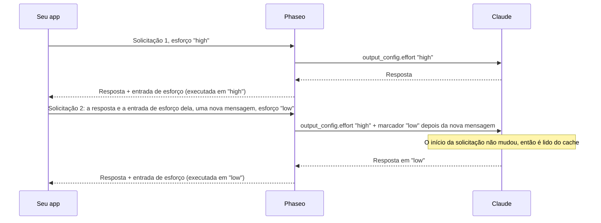

import { EffortCacheExplorer } from "/snippets/effort-cache.jsx";

Envie um `reasoning_effort` (Chat Completions) ou `reasoning.effort` (Responses) diferente em qualquer solicitação, e o Phaseo muda o esforço do Claude sem reiniciar o cache de prompts dele. Você não precisa mudar mais nada no seu código, desde que envie o raciocínio do Claude de volta sem alterações em toda solicitação.

<EffortCacheExplorer locale="pt-BR" />

O Phaseo continua enviando ao Claude o esforço da primeira solicitação da sua conversa e adiciona cada mudança como um marcador de esforço depois da sua nova mensagem. Tudo o que vem antes do marcador continua igual, então o Claude lê isso do cache. Se você descartar o raciocínio, o Phaseo muda o esforço de nível superior no lugar, e o Claude processa de novo tudo a partir da primeira resposta dele em vez de ler do cache.

## Como o Phaseo mantém o cache

O Claude só lê uma conversa em cache quando o início da solicitação é idêntico byte a byte, e o esforço de nível superior faz parte desse início. O [esforço por mensagem](https://platform.claude.com/docs/en/build-with-claude/effort-per-message) da Anthropic muda o nível dentro de `messages`, com uma mensagem `system` que tem `content` vazio e um `output_config.effort`. O Phaseo escreve esses marcadores para você:



O Phaseo não armazena nada entre as solicitações. Cada resposta do Claude termina com uma entrada de raciocínio que registra o nível em que ela foi executada, e o Phaseo reconstrói cada marcador anterior, no mesmo lugar, a partir das entradas que você envia de volta:

| Solicitação | Você envia | O Phaseo envia ao Claude |
| --- | --- | --- |
| 1 | `"high"` | `output_config.effort: "high"` |
| 2 | `"low"` | `"high"`, mais um marcador `low` depois da sua nova mensagem |
| 3 | `"low"` | `"high"`, mais o mesmo marcador no mesmo lugar |
| 4 | `"high"` | `"high"`, o marcador anterior e um marcador `high` depois da sua nova mensagem |

As mensagens que você envia de volta nunca são alteradas. Os marcadores existem apenas na solicitação que o Phaseo envia ao Claude.

## Enviar o raciocínio de volta sem alterações

<Warning>
Envie de volta cada entrada de raciocínio exatamente como você a recebeu, em toda solicitação: `reasoning_details` do Chat, itens `reasoning` do Responses e blocos `thinking` da Anthropic, criptografados ou não. Não os descarte, edite, reordene nem resuma. Sem eles, uma mudança de esforço reinicia o cache do Claude, e o Claude perde o raciocínio entre os passos do loop de ferramentas.
</Warning>

A entrada de esforço não tem texto. No Chat Completions, é a última entrada `reasoning.encrypted` em `reasoning_details`:

```json
{
  "role": "assistant",
  "content": "1. Export the data. 2. Create the schema. 3. Import and verify.",
  "reasoning_details": [
    { "type": "reasoning.text", "text": "…", "signature": "phx1.…", "format": "anthropic-claude-v1" },
    { "type": "reasoning.encrypted", "data": "phx1.…", "format": "anthropic-claude-v1" }
  ]
}
```

No Responses, é o último item `reasoning` em `output`, com um `id` que começa com `rs_effort_`:

```json
{ "type": "reasoning", "id": "rs_effort_req_123", "summary": [], "content": [], "encrypted_content": "phx1.…" }
```

O valor é opaco, e o Phaseo o remove antes que a conversa chegue a qualquer provedor.

## Mudar o esforço no seu código

Adicione a resposta inteira do Claude à sua conversa e depois defina o esforço que você quer na próxima solicitação. O `cache_control` de nível superior ativa o cache nas rotas do Claude; veja [Cache de prompts](./prompt-caching.mdx#which-providers-cache-automatically).

### Chat Completions

<CodeGroup>
```ts TypeScript
import OpenAI from "openai";

const client = new OpenAI({
	apiKey: process.env.PHASEO_API_KEY,
	baseURL: "https://api.phaseo.app/v1",
});

const messages: OpenAI.ChatCompletionMessageParam[] = [
	{ role: "user", content: "Plan a migration from SQLite to PostgreSQL." },
];

async function ask(effort: "low" | "medium" | "high") {
	const response = await client.chat.completions.create({
		model: "anthropic/claude-opus-5.5",
		reasoning_effort: effort,
		messages,
		// @ts-expect-error Campo do Phaseo: armazena a conversa em cache nas rotas do Claude
		cache_control: { type: "ephemeral" },
	});
	const message = response.choices[0].message;
	messages.push(message); // a mensagem inteira, incluindo reasoning_details
	return message.content;
}

await ask("high");
messages.push({ role: "user", content: "Summarise the plan in one sentence." });
await ask("low"); // o Claude lê a solicitação 1 do cache
```

```python Python
import os
from openai import OpenAI

client = OpenAI(
    api_key=os.environ["PHASEO_API_KEY"],
    base_url="https://api.phaseo.app/v1",
)

messages = [{"role": "user", "content": "Plan a migration from SQLite to PostgreSQL."}]

def ask(effort: str) -> str | None:
    response = client.chat.completions.create(
        model="anthropic/claude-opus-5.5",
        reasoning_effort=effort,
        messages=messages,
        extra_body={"cache_control": {"type": "ephemeral"}},
    )
    message = response.choices[0].message
    # A mensagem inteira, incluindo reasoning_details
    messages.append(message.model_dump(exclude_none=True))
    return message.content

ask("high")
messages.append({"role": "user", "content": "Summarise the plan in one sentence."})
ask("low")  # o Claude lê a solicitação 1 do cache
```
</CodeGroup>

### Responses

O Phaseo não armazena respostas, então envie a conversa inteira em `input`, incluindo todos os itens de `output`.

<CodeGroup>
```ts TypeScript
import OpenAI from "openai";

const client = new OpenAI({
	apiKey: process.env.PHASEO_API_KEY,
	baseURL: "https://api.phaseo.app/v1",
});

const input: OpenAI.Responses.ResponseInput = [
	{ role: "user", content: "Plan a migration from SQLite to PostgreSQL." },
];

async function ask(effort: "low" | "medium" | "high") {
	const response = await client.responses.create({
		model: "anthropic/claude-opus-5.5",
		reasoning: { effort },
		input,
		// @ts-expect-error Campo do Phaseo: armazena a conversa em cache nas rotas do Claude
		cache_control: { type: "ephemeral" },
	});
	input.push(...response.output); // todos os itens, incluindo os de raciocínio
	return response.output_text;
}

await ask("high");
input.push({ role: "user", content: "Summarise the plan in one sentence." });
await ask("low"); // o Claude lê a solicitação 1 do cache
```

```python Python
import os
from openai import OpenAI

client = OpenAI(
    api_key=os.environ["PHASEO_API_KEY"],
    base_url="https://api.phaseo.app/v1",
)

conversation = [{"role": "user", "content": "Plan a migration from SQLite to PostgreSQL."}]

def ask(effort: str) -> str:
    response = client.responses.create(
        model="anthropic/claude-opus-5.5",
        reasoning={"effort": effort},
        input=conversation,
        extra_body={"cache_control": {"type": "ephemeral"}},
    )
    # Todos os itens, incluindo os de raciocínio
    conversation.extend(item.model_dump(exclude_none=True) for item in response.output)
    return response.output_text

ask("high")
conversation.append({"role": "user", "content": "Summarise the plan in one sentence."})
ask("low")  # o Claude lê a solicitação 1 do cache
```
</CodeGroup>

### Anthropic Messages

Em `/v1/messages`, envie você mesmo o marcador: uma mensagem `system` com `content` vazio e `output_config.effort`. Mantenha o mesmo `output_config.effort` de nível superior em toda solicitação, e mantenha cada marcador no lugar nas solicitações seguintes. O Phaseo adiciona o cabeçalho beta `mid-conversation-output-config-2026-07-01`, então você não precisa enviá-lo.

```bash cURL
curl https://api.phaseo.app/v1/messages \
  -H "x-api-key: $PHASEO_API_KEY" \
  -H "anthropic-version: 2023-06-01" \
  -H "Content-Type: application/json" \
  -d '{
    "model": "anthropic/claude-opus-5.5",
    "max_tokens": 4096,
    "cache_control": { "type": "ephemeral" },
    "output_config": { "effort": "high" },
    "messages": [
      { "role": "user", "content": "Plan a migration from SQLite to PostgreSQL." },
      { "role": "assistant", "content": "1. Export the data. 2. Create the schema. 3. Import and verify." },
      { "role": "system", "content": [], "output_config": { "effort": "low" } },
      { "role": "user", "content": "Summarise the plan in one sentence." }
    ]
  }'
```

A posição do marcador decide quando o novo nível começa:

- **Logo depois de uma mensagem do usuário:** a resposta do Claude a essa mensagem usa o novo nível.
- **Em qualquer outro lugar**, como entre a resposta do Claude e a sua próxima mensagem, no exemplo acima: o novo nível começa na sua próxima mensagem.

Uma mensagem do usuário que contém apenas resultados de ferramentas não conta como nova mensagem. Em rotas sem esforço por mensagem, o Phaseo remove os marcadores e envia o nível em vigor como esforço de nível superior.

## Quando a mudança reinicia o cache

O Phaseo muda o esforço de nível superior, como faz com outros provedores, quando:

- **O raciocínio está faltando.** A sua resposta mais recente do Claude não tem entrada de esforço, porque o seu cliente descartou `reasoning_details` ou os itens `reasoning`.
- **A mudança vem entre passos do loop de ferramentas.** A sua mensagem mais recente contém apenas resultados de ferramentas, então um marcador só valeria a partir da sua próxima mensagem. O Phaseo muda o esforço de nível superior para que este passo seja executado no nível que você pediu, e as mudanças seguintes voltam a usar marcadores.
- **A solicitação não define esforço ou desativa o raciocínio.** Envie `reasoning_effort` ou `reasoning.effort` em toda solicitação. `"none"` e `reasoning.enabled: false` desativam o raciocínio.
- **A rota não oferece suporte.** Veja [Modelos compatíveis](#supported-models).

Uma mudança de nível superior mantém no cache a parte da conversa anterior à primeira resposta do Claude. O Claude processa de novo tudo a partir dessa resposta e cobra isso como nova entrada.

<span id="supported-models"></span>
## Modelos compatíveis

| Rota | Modelos |
| --- | --- |
| Anthropic, Google Vertex AI | Claude Fable 5.2 e 5.1, Mythos 5.2 e 5.1, Opus 5.5 e 5, Sonnet 5.5, Haiku 5.5 |
| Claude on AWS | Os mesmos modelos, exceto Mythos |
| Amazon Bedrock | Claude Fable 5.1 e Opus 5.5 |

Em todas as outras rotas, incluindo o Claude no Azure, uma mudança de esforço vai para o nível superior.

## Verificar se o cache se manteve

Leia as contagens de cache na solicitação seguinte a uma mudança: `usage.prompt_tokens_details.cached_tokens` no Chat Completions, `usage.input_tokens_details.cached_tokens` no Responses e `usage.cache_read_input_tokens` no Anthropic Messages. [Campos de uso e preços](./prompt-caching.mdx#usage-and-pricing-fields) lista todos os campos.

Medimos a mesma conversa de Chat Completions com cinco solicitações em `anthropic/claude-haiku-5.5` em 11 de novembro de 2026, uma vez enviando as entradas de esforço de volta e outra sem elas. O esforço foi `high`, `high`, `low`, `low`, `high`, e um documento de 3.400 tokens chegou na segunda mensagem:

| Solicitação 3 (esforço de `high` para `low`) | Entradas de esforço descartadas | Entradas de esforço enviadas de volta |
| --- | --- | --- |
| Tokens lidos do cache | 0 | 3.575 |
| Tokens processados de novo e gravados no cache | 3.499 | 75 |
