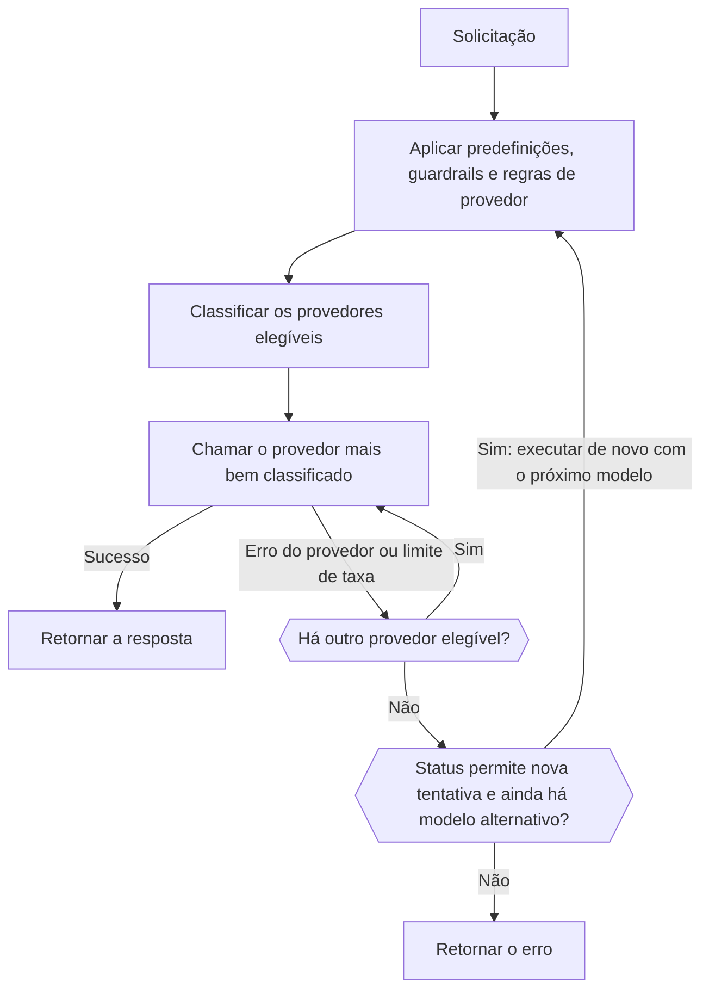

import { RoutingCostExplainer } from "/snippets/routing-cost.jsx";
import { FallbackChainExplorer } from "/snippets/fallback-chain.jsx";

A maioria dos modelos é servida por vários provedores. Em cada solicitação, o Gateway mantém os provedores que as suas regras permitem, classifica-os e chama o melhor. Se esse provedor falhar, ele tenta o próximo; se todos os provedores falharem com um erro que permite nova tentativa, ele pode passar para um modelo alternativo.



O seu cliente ainda deve tentar de novo as respostas `429` e `5xx` com backoff exponencial.

<span id="choose-how-providers-are-ranked"></span>
## Escolher como os provedores são classificados

| Modo | Classifica por | Use quando |
| --- | --- | --- |
| `balanced` (padrão) | Custo por resposta bem-sucedida | Você quer a melhor combinação de preço, velocidade e confiabilidade. |
| `price` | Preço | O custo importa mais que o tempo de resposta. |
| `latency` | Tempo até o primeiro token | As respostas precisam começar rápido. |
| `throughput` | Velocidade de saída | Saídas longas precisam terminar rápido. |

Defina o padrão do espaço de trabalho em **Painel -> Configurações -> Roteamento**, com `phaseo settings update --routing-mode <mode>` ou com `routing_mode` em `PATCH /v1/settings`. Para uma única solicitação, envie `provider.sort` ou `routing.mode`, ou adicione um sufixo ao ID do modelo:

| Sufixo | Modo | Exemplo |
| --- | --- | --- |
| `:nitro` | `throughput` | `openai/gpt-6-astra:nitro` |
| `:cheap` | `price` | `openai/gpt-6-astra:cheap` |
| `:fast` | `latency` | `openai/gpt-6-astra:fast` |

Um sufixo substitui `routing.mode`, `provider.sort` e os modos da predefinição e do espaço de trabalho. As listas de permitidos, as regiões, os guardrails e os tetos de preço continuam valendo.

A página de configurações de Roteamento também tem opções para os canais beta e alpha, para que os provedores em prévia só recebam tráfego quando você optar por isso.

## Como o modo balanced classifica os provedores

Em solicitações de texto (Chat Completions, Responses e Messages), o `balanced` estima o **custo por resposta bem-sucedida** de cada provedor:

- **Tokens:** quanto custa uma solicitação típica desse modelo no provedor, usando os tamanhos medidos de prompt e de saída do modelo e a taxa medida de acerto de cache do provedor.
- **Espera:** o tempo até o primeiro token e até a resposta completa, convertido em dólares pelo preço típico por segundo do modelo.
- **Falhas:** o total dividido pela taxa de sucesso recente do provedor, mais uma penalidade por erros do provedor e uma menor por limites de taxa.

Os provedores próximos do menor custo dividem a maior parte do tráfego. Todo provedor mantém uma pequena parcela, para que uma recuperação seja percebida. Escolha um cenário para ver como isso funciona (os provedores são exemplos):

<RoutingCostExplainer locale="pt-BR" />

Os outros endpoints são pontuados por confiabilidade, latência, latência de cauda, vazão, preço e adequação de tokens. Se você é um provedor, [Como os provedores ganham tráfego](./how-providers-earn-traffic) mostra como conquistar uma parcela maior.

<span id="request-level-model-fallbacks"></span>
## Modelos alternativos no nível da solicitação

Liste os modelos alternativos em `models`. O Phaseo tenta `model` primeiro e depois cada entrada, na ordem:

```json
{
  "model": "openai/gpt-6-astra",
  "models": ["anthropic/claude-sonnet-5.5", "google/gemini-4-argon"],
  "input": "Summarize this incident report."
}
```

Escolha o que cada modelo retorna para ver quando o Phaseo passa para o próximo:

<FallbackChainExplorer locale="pt-BR" />

**O que passa para o próximo modelo.** Um modelo só é tentado depois que o anterior, com todas as novas tentativas de provedor, termina em `429`, `500`, `502`, `503` ou `504`. Um `429` de um orçamento do Phaseo ou de uma cota de modelo gratuito também passa adiante, já que outro modelo pode caber no limite restante. O mesmo vale para um modelo que nenhum provedor serve mais, por exemplo um modelo [aposentado](#retired-models).

**O que não passa.** Erros do cliente, como `400`, `401`, `402`, `403`, `404`, `408`, `413` e `422`, retornam imediatamente. O mesmo acontece com falhas antes de o primeiro modelo ser executado, como autenticação ou limites de taxa da chave de API.

**Regras da lista:**

- `model` é obrigatório; enviar apenas `models` retorna `400`.
- `models` aceita de 1 a 25 entradas. Duplicatas e cópias de `model` são ignoradas.
- As entradas podem ser IDs de modelo, [IDs qualificados por provedor](./provider-qualified-models) ou predefinições como `@support`.
- Cada tentativa é validada como uma solicitação própria (endpoint, parâmetros, modelos do espaço de trabalho, guardrails, predefinições, preços, BYOK). Uma alternativa que não consegue atender à solicitação é pulada e registrada; ela nunca substitui o erro que você receberia de outra forma. Uma tentativa idêntica a uma já feita também é pulada.

**Registros e cobrança.** Cada tentativa é uma solicitação separada com o próprio registro de uso, cobrada como se as alternativas não existissem. O campo `model` da resposta indica o modelo que respondeu, e o rastro de roteamento dela lista o ID da solicitação principal, a ordem das alternativas e cada tentativa anterior.

**Streaming, vídeo e música.** Um stream só passa para uma alternativa antes do primeiro byte; depois disso, os erros chegam no stream. Vídeo e música só passam para uma alternativa enquanto a tarefa está sendo enviada.

**Com outros controles de roteamento.** As alternativas de uma rota dinâmica vinculada têm precedência sobre `models`, e um modelo fixo escolhido pela rota continua valendo em cada tentativa. Uma predefinição aplica as próprias restrições a cada tentativa em que é usada. O [`phaseo/auto`](./auto-routing) gerencia as próprias alternativas e não pode ser combinado com `models`.

| Endpoint | `models` |
| --- | --- |
| Chat Completions, Responses, Messages | Aceito, inclusive em streams antes do primeiro byte |
| Embeddings, Moderations, Rerank | Aceito |
| Geração e edição de imagens | Aceito, inclusive em uploads multipart |
| Fala, transcrição e tradução | Aceito, inclusive em uploads multipart |
| OCR, Parse, Decisions | Aceito |
| Geração de vídeo e música | Aceito no envio da tarefa |
| Batches | `400`: cada linha do lote aponta para um modelo |
| Sessões em tempo real e ao vivo | `400`: uma sessão fica vinculada a um modelo |
| Execuções do Council | `400`: os modelos vêm da configuração da execução |

Os endpoints multipart aceitam campos `models` repetidos, campos `models[]` ou uma string com um array JSON. Veja também [Limites de taxa](../api-reference/limits.mdx) e [Erros](../api-reference/errors.mdx).

<span id="pin-one-provider"></span>
## Fixar um provedor

Coloque o provedor antes do ID do modelo para usar exatamente esse provedor:

```json
{
  "model": "baseten:thinking-machines/inkling-small",
  "input": "Hello"
}
```

Isso desativa a alternativa entre provedores para a solicitação. Os sufixos continuam fazendo parte do ID do modelo, como em `baseten:google/gemma-4-26b-a4b:free`. [IDs de modelo qualificados por provedor](./provider-qualified-models) traz a sintaxe completa e os erros.

## Limitar quais provedores são usados

| Controle | Onde | O que faz |
| --- | --- | --- |
| [Predefinições](./presets) | **Configurações -> Predefinições** | Modelos permitidos e listas de provedores permitidos ou ignorados, aplicados antes da classificação, então também limitam as alternativas. |
| [Roteamento regional](./regional-routing) | Solicitação ou espaço de trabalho | Mantém a execução ou os dados em uma região. |
| Rotas dinâmicas | **Configurações -> Roteamento** | Regras por chave: veja abaixo. |
| Alternativa de BYOK | **Configurações -> BYOK** | Se uma solicitação BYOK que falhou pode tentar de novo com créditos do Phaseo. |

<span id="attach-routing-rules-to-api-keys"></span>
### Vincular regras de roteamento a chaves de API

Uma rota dinâmica é um fluxo de regras vinculado a uma ou mais chaves de API de inferência. Ela pode:

- ramificar por campos do corpo da solicitação, cabeçalhos, `metadata` personalizado, endpoint, modelo ou ID de sessão
- dividir o tráfego por porcentagem para testes A/B e lançamentos graduais
- limitar solicitações ou custo diários, semanais ou mensais por chave
- trocar o modelo, o modo de roteamento, a preferência de provedor e os modelos alternativos (até oito)
- ativar a afinidade de provedor baseada em cache e em sessão

As condições têm saídas verdadeira e falsa; os nós de taxa e de orçamento têm saídas dentro e excedido. As divisões por porcentagem são determinísticas por sessão ou chave de cache de prompt, então uma conversa em cache não muda de ramo.

Salvar cria uma versão de rascunho imutável. Implantar copia essa versão para o Gateway e limpa os caches de política das chaves dela; as versões anteriores continuam disponíveis para reversão. As recomendações sobre a saúde dos provedores aparecem em **Insights**. Pela CLI: `phaseo routing dynamic-routes create`, `set-keys` e `deploy`, ou a API `/v1/routing/dynamic-routes`.

O metadata personalizado vai no corpo da solicitação nos endpoints de texto compatíveis com OpenAI:

```json
{
  "model": "openai/gpt-6-astra",
  "metadata": { "customer_plan": "pro", "workspace": "acme" }
}
```

## Manter uma conversa em um provedor

O roteamento baseado em cache vem ativado por padrão na geração de texto. Uma solicitação que envia `prompt_cache_key` ou `session_id`, ou ativa o cache com `cache_control` (no nível superior, em `provider_options.anthropic` ou como marca `cache_control` ou `prompt_cache_breakpoint` em um bloco de mensagem ou ferramenta), fica fixada no provedor e na rota que atenderam a primeira solicitação bem-sucedida. As outras solicitações ficam fixadas por 15 minutos assim que um provedor informa uma leitura ou gravação de cache para o mesmo contexto de abertura, se a entrada em cache desse provedor for mais barata que a entrada padrão.

| | |
| --- | --- |
| Duração da fixação | De 15 minutos a 24 horas, conforme a retenção de cache do provedor. Com `session_id`, até 24 horas de atividade da sessão. |
| Escopo | Por espaço de trabalho. Com `session_id`, vinculada à sessão em vez do contexto de abertura. |
| A fixação muda quando | O disjuntor do provedor abre, a taxa de erros dele está alta, a cota gerenciada do Phaseo nele se esgota ou as suas regras não o permitem mais. |

Desative isso em uma solicitação com `provider.cache_aware_routing: false`, ou mantenha a afinidade de cache e ignore a sessão com `routing.session_affinity: false`:

```json
{
  "model": "openai/gpt-6-astra",
  "session_id": "support-session-42",
  "routing": { "session_affinity": false }
}
```

[Afinidade com o provedor](./prompt-caching.mdx#provider-affinity) lista as dicas que o Phaseo envia a cada provedor.

<span id="explain-a-routing-decision"></span>
## Explicar uma decisão de roteamento

Abra **Painel -> Configurações -> Uso -> Registros de solicitações**, selecione uma solicitação e expanda **Observabilidade do roteamento** em **Respostas do provedor**. Ela mostra:

- cada provedor classificado com a pontuação final, e quais foram selecionados e tentados
- os provedores excluídos antes da classificação, com o motivo
- os provedores rebaixados pelo status de lançamento ou de roteamento
- as entradas, os pesos, as contribuições e os multiplicadores de cada pontuação

Os fatores de pontuação alteram a pontuação; o contexto registrado explica a decisão sem necessariamente afetá-la. Os rastros guardam apenas números e status, nunca prompts ou saídas. Solicitações feitas antes de a observabilidade do roteamento ser ativada podem mostrar um rastro parcial ou nenhum.

### O que conta contra a disponibilidade de um provedor

| Reduz a disponibilidade | Não reduz |
| --- | --- |
| Falhas de autenticação `401` | Solicitações inválidas `400` |
| Falhas de pagamento `402` | Restrições geográficas `403` |
| `404` modelo não encontrado | `413` payloads grandes demais |
| `500` e acima | `429` limites de taxa |
| Erros depois que um stream começa | |
| Um `200` que termina com um motivo de erro | |

Restrições geográficas e limites de taxa são acompanhados separadamente, porque não significam que o provedor está fora do ar. Em produção, registre os IDs de solicitação, os códigos de status e os IDs de modelo para poder associar as falhas a esses rastros.

<span id="retired-models"></span>
## Modelos aposentados

Um modelo aposentado continua funcionando enquanto algum provedor ainda o servir. Depois disso, as solicitações falham com `410 model_retired`, a menos que o espaço de trabalho as envie para um substituto com o roteamento de modelos aposentados. A sua própria lista `models` é sempre tentada primeiro. Veja [Descontinuação e aposentadoria de modelos](./model-retirement.mdx).

<span id="byok-considerations"></span>
## Considerações sobre BYOK

Com <Tooltip tip="Traga sua própria chave: o Phaseo roteia a solicitação com a sua própria chave de API do provedor, e o seu provedor cobra o uso do modelo diretamente.">BYOK</Tooltip>, o Phaseo roteia e registra a solicitação, enquanto o seu provedor cobra o uso do modelo.

| | |
| --- | --- |
| Taxa de serviço | Nenhuma nas primeiras 250.000 solicitações BYOK concluídas em cada mês UTC; depois, 2.5% do custo equivalente no provedor. |
| Crédito do Phaseo | Mantenha pelo menos $1 disponível, para alternativas gerenciadas e taxas depois da franquia. |
| Regras do provedor | As cotas, a política de dados, o acesso aos modelos e os limites de conta do seu provedor continuam valendo. |
| Armazenamento | As chaves são criptografadas com AES-256-GCM e vinculadas ao espaço de trabalho e ao provedor. |

Restrinja cada chave aos modelos e às chaves de API que precisam dela. Para impedir que uma solicitação BYOK que falhou tente de novo com créditos do Phaseo, desative a alternativa em **Painel -> Configurações -> BYOK** ou defina `byok_fallback_enabled` em `PATCH /v1/settings` (`phaseo settings update --body-json '{"byok_fallback_enabled":false}'`). Adicione chaves com `phaseo byok create --provider <id> --name <name> --key-stdin`.
