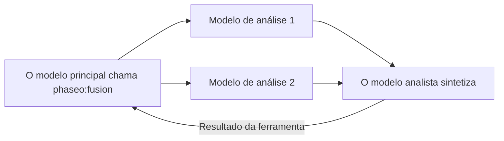

Adicione `phaseo:fusion` quando uma resposta se beneficiar de várias opiniões independentes, como uma decisão de planejamento, uma síntese de pesquisa ou uma revisão de design. Quando o modelo principal a chama, o Phaseo envia a pergunta a todos os modelos de análise em paralelo, pede a um modelo analista que junte as conclusões e devolve essa síntese. Ela aumenta a latência, então use um único [Advisor](./advisor) quando uma rodada de revisão bastar.



```json
{
  "tools": [
    {
      "type": "phaseo:fusion",
      "parameters": {
        "analysis_models": ["anthropic/claude-opus-5", "openai/gpt-5"],
        "model": "google/gemini-pro-latest",
        "instructions": "Reconcile disagreements and return concise synthesis guidance.",
        "max_uses": 1,
        "max_completion_tokens": 1400
      }
    }
  ]
}
```

No Playground, o menu de ferramentas de servidor define as mesmas coisas: os modelos de análise, um modelo juiz (analista) opcional e um limite de chamadas.

## Parâmetros

| Parâmetro | Tipo | Padrão | Descrição |
| --- | --- | --- | --- |
| `analysis_models` | string[] | Obrigatório | Pelo menos 2 modelos. Com menos, a solicitação é rejeitada. |
| `model` | string | O modelo da solicitação | O modelo analista que escreve a síntese. |
| `instructions` | string | Nenhum | Instruções para as chamadas de análise e para a do analista. |
| `max_uses` | integer | `1` | Chamadas à Fusion por solicitação, até `4`. |
| `max_completion_tokens` | integer | `1400` | Tokens de saída de cada análise e da síntese, até `32000`. |

## O que o modelo envia

Um `prompt`: a pergunta que precisa de várias perspectivas.

## O que a ferramenta retorna

```json
{
  "status": "ok",
  "analyses": 2,
  "analysis": "Both reviewers flag the cutover order..."
}
```

`analyses` conta os modelos de análise que responderam. Se alguns falharem, a síntese usa os demais. Os resultados de erro são `fusion_invalid_request` (sem prompt), `fusion_max_uses_exceeded`, `fusion_panel_failed` (todos os modelos de análise falharam) e `fusion_request_failed` (o analista falhou).

## Uso e preços

Cada chamada soma 1 a `usage.server_tool_use.fusion_requests` e pode ser cobrada com `server_tool_fusion_requests`. Cada chamada de análise e de analista é cobrada pelos preços do seu modelo, como uma linha separada na cobrança da solicitação; seus tokens não são somados aos do modelo que a chama. Modelos pagos exigem créditos mesmo quando o modelo que os chama é gratuito.
