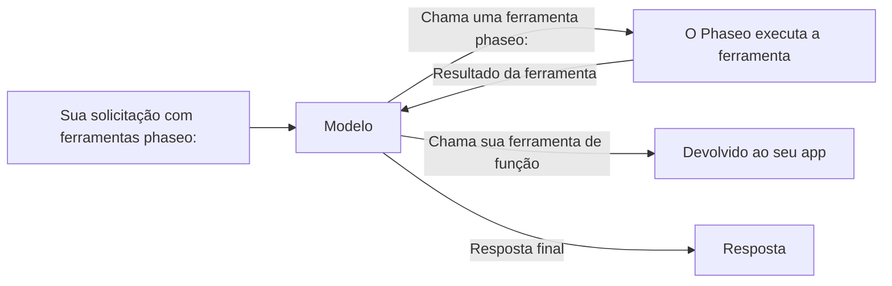

Adicione uma ferramenta `phaseo:` a `tools` e o Phaseo a executa para você quando o modelo a chama: o modelo pede a hora atual, uma pesquisa na web ou a opinião de um segundo modelo, o Phaseo executa a chamada, devolve o resultado e o modelo termina a resposta. Você não precisa escrever um executor de ferramentas.



<Note>
As ferramentas de servidor estão em beta. Os formatos das solicitações e os dados dos resultados podem mudar conforme o suporte dos provedores muda.
</Note>

## Ferramentas disponíveis

| Ferramenta | Tipo | Use para | Endpoints |
| --- | --- | --- | --- |
| [Datetime](./datetime) | `phaseo:datetime` | Data e hora atuais em até 5 fusos horários | Os três |
| [Web Search](./web-search) | `phaseo:web_search` | Pesquisar na web informações atuais ou com fontes | Os três |
| [Web Fetch](./web-fetch) | `phaseo:web_fetch` | Ler o texto de uma URL específica | Os três |
| [Advisor](./advisor) | `phaseo:advisor` | Pedir a outro modelo uma revisão ou um plano | Os três |
| [Subagent](./subagent) | `phaseo:subagent` | Repassar uma tarefa autocontida a um modelo trabalhador | Os três |
| [Fusion](./fusion) | `phaseo:fusion` | Obter a análise de vários modelos e depois uma síntese | Os três |
| [Search Models](./search-models) | `phaseo:search_models` | Encontrar um modelo no catálogo atual do Phaseo | Os três |
| [Geração de imagens](./image-generation) | `phaseo:image_generation` | Criar uma imagem durante a resposta | Os três |
| [Aplicar patch](./apply-patch) | `phaseo:apply_patch` | Retornar patches de arquivos validados | Só `/v1/responses` |

"Os três" significa `/v1/chat/completions`, `/v1/responses` e `/v1/messages`.

## Envie uma solicitação

```bash
curl https://api.phaseo.app/v1/chat/completions \
  -H "Authorization: Bearer $PHASEO_API_KEY" \
  -H "Content-Type: application/json" \
  -d '{
    "model": "openai/gpt-6-astra",
    "messages": [
      { "role": "user", "content": "What are the latest AI policy updates this week?" }
    ],
    "tools": [
      { "type": "phaseo:web_search" },
      { "type": "phaseo:datetime", "parameters": { "timezones": ["Europe/London", "UTC"] } }
    ]
  }'
```

Cada ferramenta recebe um objeto `parameters` opcional, descrito na página dela. `stream: true` também funciona: o Phaseo executa os turnos das ferramentas e transmite a resposta final para você por streaming.

## Combine ferramentas de servidor com suas próprias funções

O Phaseo só executa as ferramentas `phaseo:`. Uma ferramenta `function` comum na mesma solicitação é devolvida ao seu app normalmente, e você envia o resultado dela em uma solicitação seguinte, como em [Chamadas de ferramentas](../tool-calling).

```json
{
  "model": "openai/gpt-6-astra",
  "messages": [
    { "role": "user", "content": "Find recent funding news and save the best item." }
  ],
  "tools": [
    { "type": "phaseo:web_search", "parameters": { "max_results": 3 } },
    {
      "type": "function",
      "function": {
        "name": "save_research_item",
        "description": "Save a selected research item",
        "parameters": {
          "type": "object",
          "properties": {
            "title": { "type": "string" },
            "url": { "type": "string" }
          },
          "required": ["title", "url"]
        }
      }
    }
  ]
}
```

## Limites do loop de ferramentas

| Limite | Valor | Quando é atingido |
| --- | --- | --- |
| Chamadas a ferramentas de servidor por solicitação | `max_tool_calls` na solicitação, padrão `30`, máximo `100` | `400 gateway_server_tool_limit` |
| Turnos de continuação | `8` | `502 gateway_server_tool_error` |
| Chamadas a uma ferramenta | O `max_uses` dessa ferramenta | A ferramenta devolve um resultado de erro ao modelo, que pode continuar sem ela |

## Uso e preços

Cada ferramenta de servidor soma um contador a `usage.server_tool_use`, e a tabela de preços de um modelo pode cobrar o medidor correspondente. Os tokens usados por um segundo modelo (Advisor, Subagent, Fusion, Geração de imagens) são somados ao uso da solicitação e cobrados com os preços desse modelo.

```json
{
  "usage": {
    "input_tokens": 105,
    "output_tokens": 250,
    "server_tool_use": {
      "datetime_requests": 1,
      "web_search_requests": 2,
      "web_search_results": 8
    }
  }
}
```

| Ferramenta | Contador de uso | Medidor de preço |
| --- | --- | --- |
| Datetime | `datetime_requests` | Nenhum |
| Web Search | `web_search_requests`, `web_search_results`, `web_search_extra_results` | `server_tool_web_search_requests`, `server_tool_web_search_extra_results` |
| Web Fetch | `web_fetch_requests` | `server_tool_web_fetch_requests` |
| Advisor | `advisor_requests` | `server_tool_advisor_requests` |
| Subagent | `subagent_requests` | `server_tool_subagent_requests` |
| Fusion | `fusion_requests` | `server_tool_fusion_requests` |
| Search Models | `search_models_requests` | `server_tool_search_models_requests` |
| Geração de imagens | `image_generation_requests` | `server_tool_image_generation_requests` |
| Aplicar patch | `apply_patch_requests` | `server_tool_apply_patch_requests` |

Quando a Web Search ou a Web Fetch é executada como ferramenta própria do provedor (`engine: "native"`), a cobrança usa `native_web_search_requests` ou `native_web_fetch_requests`.
