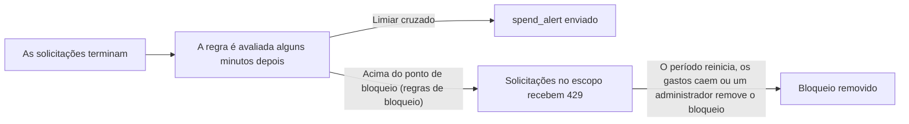

Crie uma regra de gastos para receber um alerta quando os gastos do seu espaço de trabalho cruzarem um limiar e, se quiser, para bloquear solicitações quando os gastos passarem de uma margem de tolerância. Abra **Configurações → Notificações → Alertas de gastos** e selecione **Adicionar alerta**. Um espaço de trabalho pode ter até 50 regras em qualquer plano; a 51ª falha com `409 spend_rule_limit_reached`.

<Note>Os alertas de gastos, o bloqueio e os relatórios de gastos estão sendo liberados aos poucos. Até serem ativados, as regras e as configurações são salvas, mas nada é avaliado, bloqueado ou enviado, e as regras novas não podem usar `action: "block"`.</Note>



Uma regra combina:

| Parte | Campo | Valores |
| --- | --- | --- |
| Métrica | `metric` | `spend`, `budget_percent`, `forecast`, `spike`, `balance`. Veja os [tipos de alerta](#alert-types-and-bases). |
| Escopo | `scope_type`, `scope_id` | De quem são os gastos que contam: o espaço de trabalho, uma chave de API, um membro, um departamento, um modelo ou um provedor |
| Período | `period` | Um `day`, `week` ou `month` do calendário, ou `rolling` ao longo de `window_hours` |
| Limiares | `threshold_amount` ou `threshold_percents` | O valor em dólares ou as porcentagens que enviam um alerta |
| Ação | `action` | `notify`, ou `block` para também recusar solicitações acima de um limite |

O Phaseo avalia as regras a partir do uso registrado, alguns minutos depois que as solicitações terminam. Espaços de trabalho com regras também são verificados a cada hora, e as regras de saldo, a cada 15 minutos. Os gastos incluem trabalhos de vídeo, lote, música e tempo real.

O editor mostra o valor atual de uma regra salva e pode enviar um alerta de teste. A página da chave de API e a página de orçamentos têm atalhos que abrem o editor com o limite da chave ou o orçamento como base. Membros podem ver as regras; proprietários e administradores as criam, alteram, testam e excluem.

<span id="alert-types-and-bases"></span>
## Tipos de alerta e bases

| Métrica | Envia um alerta quando | Períodos |
| --- | --- | --- |
| `spend` | os gastos do período atingem `threshold_amount` | qualquer um |
| `budget_percent` | os gastos atingem uma porcentagem de uma base, com até cinco limiares, como 50, 80 e 100 | qualquer um |
| `forecast` | os gastos projetados até o fim do período atingem um valor ou uma porcentagem de uma base | dia, semana, mês |
| `spike` | os gastos das últimas horas são várias vezes os gastos habituais | contínuo |
| `balance` | o saldo disponível cai até um valor, ou duraria menos que um número de dias | contínuo, só no escopo do espaço de trabalho |

As porcentagens são medidas em relação a uma base (`base_kind`):

- `amount`: um valor em dólares definido na regra, usado só para alertas.
- `workspace_budget`: o orçamento do espaço de trabalho com o intervalo correspondente (`base_ref`: `daily` para um período de dia, `weekly` para uma semana, `monthly` para um mês). Um orçamento vitalício não pode ser uma base.
- `key_limit`: o limite de gastos da chave de API da regra para a janela correspondente. Exige o escopo de chave.
- `previous_period`: os gastos no mesmo ponto do período anterior, como "ontem até este horário". Para regras contínuas, é a janela anterior; para previsões, é o período anterior inteiro.

Uma regra cuja base não existe, como um orçamento excluído ou uma chave sem limite de gastos, não envia nada até a base voltar a existir. Guardrails não têm limites de gastos e não podem ser uma base.

## Escolher de quem são os gastos que contam

| Escopo | `scope_id` | Conta |
| --- | --- | --- |
| `workspace` | nenhum | todos os gastos do espaço de trabalho |
| `key` | ID da chave de API | solicitações feitas com a chave |
| `member` | o ID de usuário do membro | solicitações feitas com chaves que o membro criou, mais as solicitações OAuth do próprio membro |
| `department` | ID do departamento | tudo o que as pessoas do departamento fazem (veja abaixo) |
| `model` | ID do modelo, como `openai/gpt-6-astra` | solicitações atendidas pelo modelo |
| `provider` | ID do provedor | solicitações atendidas pelo provedor |

Os gastos de um departamento são atribuídos por solicitação:

1. Uma chave atribuída a um departamento conta só para esse departamento.
2. Caso contrário, quem decide é o criador da chave: os departamentos dele, ou, em solicitações OAuth, os departamentos do usuário conectado.
3. Alguém que está em vários departamentos conta para **todos** eles por padrão. Escolha **Somente o departamento principal** em vez de **Todos os departamentos dela** em **Configurações de gastos do espaço de trabalho** (API: `spend.department_attribution: "primary"`) para contar só o departamento principal da pessoa. Sem um departamento marcado como principal, vem primeiro um departamento ao qual a pessoa foi adicionada manualmente e, depois, o mais antigo.

A participação nos departamentos é lida sempre que a regra é avaliada, então mover alguém para outro departamento leva junto os gastos dessa pessoa no período atual. Como uma pessoa pode contar para vários departamentos, os totais dos departamentos podem somar mais que o total do espaço de trabalho. O uso anterior a setembro de 2026 não é atribuído a membros nem a departamentos.

## Períodos e fusos horários

Dia, semana e mês são períodos do calendário. As semanas vão de segunda a domingo. Cada regra pode definir o próprio `time_zone` IANA, como `Europe/London` ou `America/New_York`; caso contrário, usa o fuso horário de faturamento do espaço de trabalho, que por padrão é UTC. Altere o fuso horário de faturamento em **Configurações de gastos do espaço de trabalho** ou com `spend.billing_time_zone` na [API de configurações de notificações](../api-reference/endpoint/notifications-settings-update.mdx). As mudanças de horário de verão são tratadas, e os nomes de fuso diferenciam maiúsculas de minúsculas.

Um período `rolling` cobre as últimas `window_hours` (de 1 a 720) e avança continuamente. As regras de pico o usam como janela do pico, e as regras de saldo, como o intervalo em que calculam a média dos gastos.

<Note>Os [limites de chave](../api-reference/limits.mdx#key-limits-and-budgets) e os [orçamentos do espaço de trabalho](../api-reference/endpoint/budgets-list.mdx) sempre reiniciam nas fronteiras de UTC. Uma regra com base `workspace_budget` ou `key_limit` em outro fuso horário compara o próprio dia, semana ou mês local com esse limite, então os gastos dela podem ser diferentes do que o limite conta.</Note>

## Limiares e alertas repetidos

Uma regra tem de um a cinco limiares percentuais (de 1 a 1000) ou um limiar em dólares, conforme a métrica.

- Em períodos do calendário, cada limiar envia no máximo um alerta por período. Quando os gastos cruzam vários limiares de uma vez, um único alerta indica o mais alto e lista os outros.
- As regras contínuas, de pico e de saldo usam `cooldown_minutes` (de 5 a 43.200, padrão 360). Durante o intervalo de espera, só um limiar mais alto envia alerta; depois dele, a regra alerta de novo se os gastos continuarem acima.
- Os limiares já enviados neste período não são enviados de novo quando você edita a regra.

**Enviar teste** entrega o alerta que a regra enviaria agora, marcado com `[TEST]`, aos destinos da regra. Nada é registrado, e um espaço de trabalho pode enviar cinco testes por minuto. O **Histórico** de cada regra lista os alertas e os bloqueios que ela enviou.

<span id="block-requests"></span>
## Bloquear solicitações

Uma regra `spend` ou `budget_percent` com `action: "block"` avisa nos limiares e bloqueia quando os gastos atingem o ponto de bloqueio: `block_at_percent` da base (de 100 a 1000, padrão 110, e pelo menos o limiar mais alto), ou `block_at_amount` em uma regra `spend` (pelo menos `threshold_amount`). Regras com base `previous_period` não podem bloquear. O espaço entre o último alerta e o ponto de bloqueio é a margem de tolerância: a sua equipe é avisada antes que as solicitações parem.

<Warning>O bloqueio é feito com o melhor esforço. Ele usa o uso registrado, então um bloqueio começa alguns minutos depois que os gastos passam do ponto de bloqueio, e os gastos podem ultrapassá-lo nesse tempo. Para um teto rígido verificado em cada solicitação, use limites de chave ou orçamentos do espaço de trabalho.</Warning>

| | Bloqueio por regra de gastos | Limite de chave | Orçamento do espaço de trabalho |
| --- | --- | --- | --- |
| Verificação | a cada poucos minutos, a partir do uso registrado | em cada solicitação | em cada solicitação |
| Escopo | espaço de trabalho, chave, membro, departamento, modelo ou provedor | uma chave | o espaço de trabalho |
| Períodos | dia, semana, mês ou contínuo, em qualquer fuso horário | dia, semana ou mês em UTC | dia, semana ou mês em UTC, ou vitalício |
| Modelos gratuitos | não são bloqueados, a menos que `block_free_models` seja true | contam | contam |
| Aviso antes | sim, nos limiares da regra | não | não |
| Remoção | por um proprietário ou administrador, pelo resto do período | aumente o limite | aumente o orçamento |

Enquanto um bloqueio está ativo, as solicitações no escopo dele recebem `429` com o código de erro `spend_rule_blocked`. O corpo inclui `reason: "spend_rule_block"`, `rule_id`, `rule_name`, `block_id`, `limit_scope`, `limit_value` (USD) e `reset_at`. `Retry-After` indica os segundos até o período reiniciar. Uma regra contínua não tem horário de reinício: o bloqueio dura até os gastos na janela caírem abaixo do ponto de bloqueio, e a resposta não tem `Retry-After`. Um bloqueio de provedor remove as rotas desse provedor, e a solicitação só é recusada quando não sobra nenhuma outra rota. Sessões em tempo real ainda não são bloqueadas.

Enquanto os gastos estão acima do último limiar da regra, mas abaixo do ponto de bloqueio, as respostas às solicitações no escopo trazem um cabeçalho `x-phaseo-spend-warning` que lista até três regras, por exemplo `rule_id=…; scope=workspace; resets_at=2026-11-01T00:00:00.000Z`. Os clientes podem registrá-lo ou desacelerar antes de o bloqueio começar.

Um bloqueio é removido sozinho quando o período reinicia, quando os gastos de uma regra contínua caem abaixo do ponto de bloqueio, ou quando a regra é desativada, excluída ou alterada. Proprietários e administradores podem removê-lo em **Alertas de gastos → Bloqueios ativos** ou com [`POST /v1/spend-blocks/{id}/lift`](../api-reference/endpoint/spend-blocks-lift.mdx). Um bloqueio removido não recomeça no mesmo período (em regras contínuas, durante uma janela). As notificações de bloqueio por gastos são enviadas quando um bloqueio começa e quando é removido.

## Acompanhar o saldo e a autonomia

Uma regra `balance` acompanha o saldo disponível do espaço de trabalho: o saldo de créditos menos os valores reservados para solicitações em andamento. Ela usa o escopo do espaço de trabalho e um período contínuo, e alerta quando qualquer uma das condições é atendida:

- `threshold_amount`: o saldo disponível está igual ou abaixo desse valor;
- `runway_days` (de 1 a 365): no gasto diário médio das últimas `window_hours`, o saldo duraria menos que esse número de dias. Sem gastos recentes, não há alerta de autonomia.

Uma regra de saldo alerta uma vez por queda. Ela só alerta de novo depois que o saldo se recupera e cai outra vez, e não com mais frequência que o intervalo de espera dela. Nenhum alerta é enviado enquanto a recarga automática está ativada e funcionando.

O e-mail de saldo baixo em **Configurações → Créditos** continua como o padrão simples. Ele é enviado uma vez a cada vez que o saldo cai abaixo do limiar dele, no máximo a cada seis horas, e não enquanto a recarga automática está funcionando. Use uma regra de saldo para alertas de autonomia, outros destinos ou outro limiar.

## Prever os gastos até o fim do período

Uma regra `forecast` projeta os gastos até o fim do dia, da semana ou do mês atual em linha reta: os gastos até agora, divididos pela parte do período que já passou. Ela espera até que tenham passado 3 horas de um dia, 24 horas de uma semana ou 72 horas de um mês, e até que pelo menos $0.01 tenha sido gasto, para que um início tranquilo não dispare um alerta. O alerta diz quando o limite será atingido no ritmo atual.

Defina um `threshold_amount` em dólares, ou uma base com porcentagens. Com uma base `previous_period`, a projeção é comparada com o período anterior inteiro. Cada limiar alerta uma vez por período.

## Detectar picos repentinos

Uma regra `spike` compara os gastos das últimas `window_hours` (de 1 a 56) com os gastos habituais para esse horário:

- Para janelas com menos de 24 horas, os gastos habituais são a mediana das mesmas horas em cada um dos sete dias anteriores. Para janelas mais longas, são a mediana das janelas anteriores de mesmo tamanho nos sete dias anteriores.
- Ela alerta quando os gastos são pelo menos `spike_multiplier` vezes os habituais (mais de 1 e até 100, padrão 3) e pelo menos `spike_floor` (padrão $5).
- Ela precisa de gastos do espaço de trabalho em pelo menos três dessas janelas anteriores. Até lá, o editor mostra que ela ainda está aprendendo. Quando os gastos habituais são zero, só o piso vale.
- Ela usa um intervalo de espera (padrão de 6 horas) e nunca bloqueia.

A comparação usa passos exatos de 24 horas, então, depois de uma mudança de horário de verão, ela compara com uma hora antes ou depois no relógio local. As regras de pico são verificadas quando chega uso novo.

## Relatórios de gastos

Os proprietários recebem um relatório semanal de gastos por padrão, e os administradores podem optar por recebê-lo. Também há relatórios diários e mensais. O [guia de notificações do espaço de trabalho](./workspace-notifications.mdx#spend-reports) mostra as configurações e o conteúdo. Além disso:

- Um relatório é enviado entre 09:00 e 21:00 no fuso horário de faturamento, no primeiro dia depois do período dele. Se não puder ser enviado nesse dia, ele é pulado em vez de ser enviado atrasado.
- A previsão de um relatório é para o mês de faturamento atual.
- Os totais por membro e por departamento incluem trabalhos assíncronos e seguem a regra de departamento acima, então podem diferir um pouco do total.
- Cada pessoa cancela a inscrição na própria cópia do relatório de um espaço de trabalho. Membros que não são proprietários nem administradores nunca o recebem.

## Escolher para onde vão os alertas

As regras de gastos enviam três tipos de notificação. Escolha para onde cada uma vai em **Configurações → Notificações**:

| Rota | Tipo | Enviada quando |
| --- | --- | --- |
| Alertas de gastos | `spend_alert` | o limiar de uma regra é cruzado |
| Bloqueios por gastos | `spend_blocked` | um bloqueio começa ou é removido (`payload.state` é `started` ou `lifted`) |
| Relatórios de gastos | `spend_report` | um relatório de gastos está previsto |

Uma regra pode ter os próprios destinos. Eles substituem as rotas Alertas de gastos e Bloqueios por gastos para essa regra; se todos estiverem pausados, os alertas da regra não são enviados para as rotas no lugar deles. Os alertas e os bloqueios também chegam ao app móvel para proprietários e administradores, e para o criador da chave ou o membro a que a regra se refere.

Webhooks personalizados recebem o alerta como JSON, com `title`, `message`, `rule_id`, `rule_name`, `metric`, `scope`, `period`, `value_nanos` e, conforme a métrica, `base_nanos`, `forecast`, `spike` ou os campos de saldo. Verifique cada entrega pela assinatura; veja [Verificar assinaturas de webhook](./workspace-notifications.mdx#verify-webhook-signatures).

## Gerenciar regras com a API

A [API de regras de gastos](../api-reference/endpoint/spend-rules-list.mdx) usa uma chave de gerenciamento com `spend_rules:read`, `spend_rules:write` ou `spend_rules:delete`. Os valores podem ser enviados em dólares (`threshold_amount_usd`) ou com exatidão em nanodólares (`threshold_amount_nanos`), e as respostas incluem os dois.

```bash
curl https://api.phaseo.app/v1/spend-rules \
  -H "Authorization: Bearer $PHASEO_MANAGEMENT_KEY" \
  -H "Content-Type: application/json" \
  -d '{
    "name": "Monthly budget",
    "metric": "budget_percent",
    "period": "month",
    "base_kind": "workspace_budget",
    "base_ref": "monthly",
    "threshold_percents": [50, 80, 100],
    "action": "block",
    "block_at_percent": 110
  }'
```

Use [`GET /v1/spend-rules/{id}/preview`](../api-reference/endpoint/spend-rules-preview.mdx) para ver o valor atual e o próximo limiar, e [`POST /v1/spend-rules/{id}/test`](../api-reference/endpoint/spend-rules-test.mdx) para enviar um teste. [`GET /v1/spend-blocks`](../api-reference/endpoint/spend-blocks-list.mdx) lista os bloqueios ativos. O fuso horário de faturamento, a atribuição por departamento e as configurações de relatório ficam no objeto `spend` das [configurações de notificações](../api-reference/endpoint/notifications-settings-update.mdx).

## Gerenciar regras com o Terraform

O [provedor Terraform do Phaseo](https://github.com/phaseoteam/terraform-provider-phaseo) (`phaseoteam/phaseo`) tem os recursos `phaseo_spend_rule` e `phaseo_workspace_budget` e as fontes de dados `phaseo_spend_rules`, `phaseo_spend_blocks` e `phaseo_workspace_budgets`.

```hcl
resource "phaseo_workspace_budget" "monthly" {
  interval = "monthly"
  limit    = 500
}

resource "phaseo_spend_rule" "monthly_budget" {
  name               = "Monthly budget"
  metric             = "budget_percent"
  period             = "month"
  base_kind          = "workspace_budget"
  base_ref           = "monthly"
  threshold_percents = [50, 80, 100]
  action             = "block"
  block_at_percent   = 110

  depends_on = [phaseo_workspace_budget.monthly]
}

resource "phaseo_spend_rule" "spike" {
  name             = "Spend spike"
  metric           = "spike"
  period           = "rolling"
  window_hours     = 3
  spike_multiplier = 4
}
```

Importe uma regra ou um orçamento existente pelo ID:

```bash
terraform import phaseo_spend_rule.monthly_budget 11111111-1111-4111-8111-111111111111
```

<Visibility for="agents">
Regras sobre regras de gastos para agentes, resumindo esta página:

- Os bloqueios por regras de gastos são feitos com o melhor esforço e começam minutos depois do limite; para tetos exatos, use limites de chave ou orçamentos do espaço de trabalho.
- Uma solicitação bloqueada retorna `429` com `spend_rule_blocked`, `rule_id`, `block_id` e `reset_at`. Aguarde o `Retry-After`; sem ele, o bloqueio dura até os gastos na janela contínua caírem, ou até um proprietário ou administrador removê-lo com `POST /v1/spend-blocks/{id}/lift`. Não tente de novo em loop.
- `x-phaseo-spend-warning` em uma resposta significa que uma regra de bloqueio passou do último limiar de alerta; um bloqueio pode vir em seguida.
- Os modelos gratuitos não são bloqueados, a menos que a regra defina `block_free_models`.
- Os períodos do calendário usam o fuso horário da regra (padrão: o fuso horário de faturamento do espaço de trabalho, que por padrão é UTC); os limites de chave e os orçamentos do espaço de trabalho usam UTC.
</Visibility>
