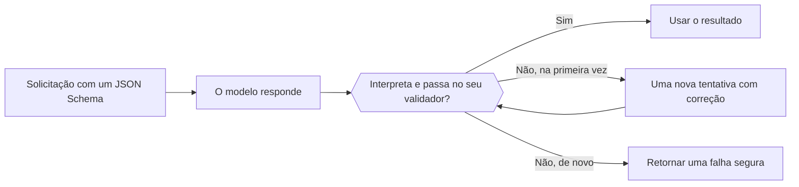

Envie um JSON Schema com a solicitação e o modelo retorna JSON nesse formato em vez de texto livre. O seu código ainda precisa interpretar e validar o resultado antes de usá-lo.



## Escolher um formato

| `type` | O que você recebe |
| --- | --- |
| `json_schema` | JSON que segue o schema que você envia. Use este por padrão. |
| `json_object` | Algum objeto JSON válido, sem formato imposto. |
| `text` | Texto simples (o padrão). |

Onde o formato vai depende do endpoint:

| Endpoint | Campo |
| --- | --- |
| `/v1/chat/completions` | `response_format` |
| `/v1/responses` | `text.format` |
| `/v1/messages` | Não é compatível. Peça JSON no prompt e valide-o da mesma forma. |

## Enviar um schema

<CodeGroup>
```bash Chat Completions
curl https://api.phaseo.app/v1/chat/completions \
  -H "Authorization: Bearer $PHASEO_API_KEY" \
  -H "Content-Type: application/json" \
  -d '{
    "model": "openai/gpt-6-astra",
    "messages": [
      { "role": "user", "content": "Return the city and weather for London." }
    ],
    "response_format": {
      "type": "json_schema",
      "json_schema": {
        "name": "weather",
        "strict": true,
        "schema": {
          "type": "object",
          "properties": {
            "city": { "type": "string" },
            "weather": { "type": "string" }
          },
          "required": ["city", "weather"],
          "additionalProperties": false
        }
      }
    }
  }'
```

```bash Responses
curl https://api.phaseo.app/v1/responses \
  -H "Authorization: Bearer $PHASEO_API_KEY" \
  -H "Content-Type: application/json" \
  -d '{
    "model": "openai/gpt-6-astra",
    "input": "Return the city and weather for London.",
    "text": {
      "format": {
        "type": "json_schema",
        "name": "weather",
        "strict": true,
        "schema": {
          "type": "object",
          "properties": {
            "city": { "type": "string" },
            "weather": { "type": "string" }
          },
          "required": ["city", "weather"],
          "additionalProperties": false
        }
      }
    }
  }'
```
</CodeGroup>

O JSON volta como string no conteúdo da mensagem:

```json
{
  "choices": [
    {
      "finish_reason": "stop",
      "message": {
        "role": "assistant",
        "content": "{\"city\":\"London\",\"weather\":\"Cloudy\"}"
      }
    }
  ]
}
```

## Projetar o schema

Comece com um objeto pequeno. Liste todos os campos em `required`, use `enum` para categorias conhecidas e defina `additionalProperties: false` quando chaves extras precisarem ser rejeitadas. Versione o schema junto com o seu validador no servidor para que os dois nunca se afastem.

<span id="validate-the-result"></span>
## Validar o resultado

Antes de interpretar, verifique se houve recusa, conteúdo ausente ou resposta truncada (`finish_reason` diferente de `stop`). Depois, valide o objeto interpretado. Este validador Zod corresponde ao schema acima:

```typescript
import { z } from "zod";

const Weather = z.object({
  city: z.string(),
  weather: z.string(),
}).strict();

function parseWeather(content: string) {
  return Weather.parse(JSON.parse(content));
}
```

Se a validação falhar, tente de novo uma vez com o erro no prompt e depois retorne uma falha segura. Cada nova tentativa é cobrada. Um JSON válido ainda não prova que os valores estão corretos nem que uma ação está autorizada.

Acompanhe as falhas de validação por modelo e por versão do schema, e execute de novo os seus casos de avaliação quando qualquer um dos dois mudar. Para corrigir automaticamente JSON malformado, veja [reparo de respostas](../cookbook/response-healing-for-structured-json.mdx).
