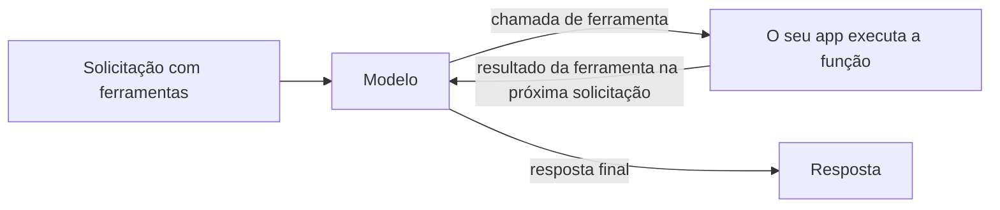

Descreva as suas funções em `tools`, e o modelo responde com uma chamada a uma delas, como uma consulta ao banco de dados ou ao clima, em vez de adivinhar. O seu app executa a função e envia o resultado de volta; o modelo então escreve a resposta final.



As chamadas de ferramentas funcionam nos três endpoints de texto, cada um no próprio formato:

| Endpoint | Chamada do modelo | O seu resultado |
| --- | --- | --- |
| `/v1/chat/completions` | `tool_calls` na mensagem do assistente, `finish_reason: "tool_calls"` | Uma mensagem `role: "tool"` |
| `/v1/responses` | Um item de saída `function_call` | Um item de entrada `function_call_output` |
| `/v1/messages` | Um bloco de conteúdo `tool_use` | Um bloco de conteúdo `tool_result` |

## Enviar uma solicitação com ferramentas

```bash
curl https://api.phaseo.app/v1/chat/completions \
  -H "Authorization: Bearer $PHASEO_API_KEY" \
  -H "Content-Type: application/json" \
  -d '{
    "model": "openai/gpt-6-astra",
    "messages": [
      { "role": "user", "content": "What is the weather in London?" }
    ],
    "tools": [
      {
        "type": "function",
        "function": {
          "name": "get_weather",
          "description": "Get current weather by city",
          "parameters": {
            "type": "object",
            "properties": {
              "city": { "type": "string" }
            },
            "required": ["city"]
          }
        }
      }
    ],
    "tool_choice": {
      "type": "function",
      "function": { "name": "get_weather" }
    }
  }'
```

Aqui, `tool_choice` força a chamada. Omita-o, ou defina `"auto"`, para deixar o modelo decidir.

O modelo responde com uma chamada em vez de texto:

```json
{
  "id": "chatcmpl_...",
  "object": "chat.completion",
  "choices": [
    {
      "index": 0,
      "finish_reason": "tool_calls",
      "message": {
        "role": "assistant",
        "content": null,
        "tool_calls": [
          {
            "id": "call_123",
            "type": "function",
            "function": {
              "name": "get_weather",
              "arguments": "{\"city\":\"London\"}"
            }
          }
        ]
      }
    }
  ]
}
```

Interprete e verifique `arguments` antes de executar qualquer coisa; veja [Segurança e validação de chamadas de ferramentas](./tool-calling-safety). Depois, envie a mensagem do assistente e o seu resultado de volta na próxima solicitação. [Padrões de chamadas de ferramentas](./tool-calling-patterns) mostra essa solicitação de acompanhamento para Chat Completions e Responses.

## Deixar o Phaseo executar a ferramenta

Ferramentas cujo tipo começa com `phaseo:` são executadas pelo Phaseo: o modelo as chama, o Phaseo as executa e continua o ciclo, e você recebe a resposta final sem escrever um executor. Você pode misturá-las com as suas próprias funções em uma mesma solicitação.

| Ferramenta | Tipo |
| --- | --- |
| [Data e hora](./server-tools/datetime) | `phaseo:datetime` |
| [Busca na web](./server-tools/web-search) | `phaseo:web_search` |
| [Web Fetch](./server-tools/web-fetch) | `phaseo:web_fetch` |
| [Advisor](./server-tools/advisor) | `phaseo:advisor` |
| [Subagent](./server-tools/subagent) | `phaseo:subagent` |
| [Fusion](./server-tools/fusion) | `phaseo:fusion` |
| [Buscar modelos](./server-tools/search-models) | `phaseo:search_models` |
| [Geração de imagens](./server-tools/image-generation) | `phaseo:image_generation` |
| [Aplicar patch](./server-tools/apply-patch) | `phaseo:apply_patch` (só Responses) |

```json
{
  "tools": [
    { "type": "phaseo:datetime", "parameters": { "timezones": ["Europe/London", "UTC"] } }
  ],
  "tool_choice": "auto"
}
```

Veja [Ferramentas do servidor](./server-tools) para limites, contadores de uso e preços.

## Transmitir chamadas de ferramentas

As solicitações com chamadas de ferramentas aceitam `stream: true`. Os argumentos das chamadas de função chegam em partes; junte todos antes de interpretar a chamada. Quando uma ferramenta do servidor é executada, o Phaseo conclui esse turno da ferramenta, executa a ferramenta, continua o modelo e transmite o resto da resposta para você, então o seu cliente continua lendo um único stream. Veja [Transmissão](./streaming).

Para respostas que precisam seguir um schema em vez de chamar uma função, use [Saídas estruturadas](./structured-outputs).
